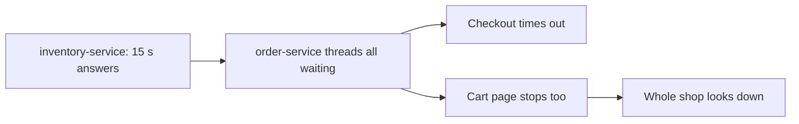

# Resilience Patterns: The Big Picture

**Resilience · Step 1.1 · Overview** · Last updated 2026-10-21
**Prerequisites:** none

Read this first. It is the map of the resilience area: the problem these patterns solve, what each one is for, how they relate, and the order to learn them in.

## 1. The concept in simple English

**What is it?** Resilience patterns are a small family of **independent** techniques that stop one slow or broken dependency from taking your whole system down.

**Why do we need it?** In a system of many services, something is always failing somewhere. Without protection, one failing part drags down everything that depends on it.

**When would I meet it?** Every time a service calls another service, a database or an external API, which is almost always.

> [!TIP]
> **Memory hook:** a ship. Don't wait forever at the dock (timeout), try the radio again (retry), stop sailing to a port that's on fire (circuit breaker), seal the compartments (bulkhead), and keep a lifeboat ready (fallback).

## 2. Mental model: a ship

| In the analogy | In the real system |
|---|---|
| Leaving the dock after a fixed wait | **Timeout** |
| Trying the radio again, a bit later each time | **Retry** with backoff and jitter |
| Not sailing to a port that's on fire | **Circuit breaker** |
| Sealed compartments in the hull | **Bulkhead** |
| A limit on passengers per hour at the gangway | **Rate limiter** |
| Turning passengers away when the ship is full | **Load shedding** |
| The lifeboat | **Fallback** |
| The fire drill | **Resilience testing** |

**Where the analogy breaks:** a ship has one captain making every decision. In software, each pattern acts on its own, on each call, often in different services, so they must be configured to work together (for example, retries must stop when the breaker opens).

## 3. Industry terms

| Term | Simple meaning | Why it matters | Example | Related terms |
|---|---|---|---|---|
| **Resilience / fault tolerance** | Keep working, or degrade gracefully, despite failures | The goal of the whole area | Shop stays open while reviews are down | Availability |
| **Cascading failure** | One failure spreading to others through shared resources | The main thing these patterns prevent | Slow inventory freezes the cart page | Blast radius |
| **Blast radius** | How much is affected when one thing fails | What you design to keep small | One feature, not the whole shop | Bulkhead |
| **Fail fast** | Refuse at once instead of waiting | Frees resources quickly | Breaker rejects in about 1 ms | Timeout |
| **Graceful degradation** | Offer less, but keep the core working | Users keep the important features | Page without recommendations | Fallback |
| **Retry storm** | Retries multiplying load on a service that is already struggling | Turns a small problem into an outage | Every layer retrying three times | Backoff |
| **Stability patterns** | Michael Nygard's name for this family (*Release It!*) | The vocabulary interviewers use | Timeouts, circuit breaker, bulkheads | Reliability patterns |

## 4. In a real system (ShopFlow)

**The business problem.** During a sale, ShopFlow must keep taking orders even when one of its services or providers misbehaves.

The Inventory Service's database slows down. It doesn't crash; it just takes 15 seconds to answer. Every checkout that asks for stock waits, holding a request thread in the Order Service. Within a minute all of its threads are waiting, and even the cart page, which never touches inventory, stops responding.

**Slow was worse than down.** A dead service fails fast and frees the thread; a slow one traps it. That is how failures cascade.

**How the patterns help.** A timeout bounds each wait; a bulkhead limits how many threads inventory calls may hold; a circuit breaker stops calling inventory once it is clearly unhealthy; and a fallback ("stock will be confirmed") keeps checkout open.

**What it costs.** More configuration per dependency, thresholds that need tuning, and fallback behaviour that must be agreed with the business.

**Elsewhere:** in online banking, a slow statement service shouldn't block logins; in food delivery, one partner restaurant's broken menu API shouldn't hang the whole app; in video streaming, failed recommendations shouldn't stop playback.

## 5. How it works: one question per pattern

There is no single fix. Each pattern answers **one question**, and **none is part of another**: the bulkhead is not part of the circuit breaker; they are siblings.

| Step | Pattern | The question it answers |
|---|---|---|
| 1.2 | **Timeout** | How long will I wait for one call? |
| 1.3 | **Retry** (with backoff and jitter) | Is this failure temporary, so trying again may work? |
| 1.4 | **Idempotency** | Is it safe to repeat this request? |
| 1.5 | **Circuit breaker** | Has this dependency failed enough that I should stop calling it? |
| 1.6 | **Bulkhead** | How many calls may use this dependency at the same time? |
| 1.7 | **Rate limiter** | How many calls per second will I accept or send? |
| 1.8 | **Load shedding and backpressure** | When overloaded, what do I drop or slow down? |
| 1.9 | **Fallback / graceful degradation** | What do I answer when the real answer is missing? |
| 1.10 | **Testing resilience** | Does any of this work when something really breaks? |

How they stack on one outgoing call:

A call passes each layer before reaching the remote service. Any layer can refuse it, and the **fallback** decides what the caller gets back. This is Resilience4j's default order when you use its annotations; other libraries can differ. Resilience4j's time limiter only applies to asynchronous calls; for normal blocking HTTP calls, the timeout is set on the HTTP client itself.

**How they depend on each other:**

1. **Timeouts come first.** Every other pattern assumes a call eventually ends.
2. **Retries need idempotency**, or repeating a request can repeat its side effects.
3. **Retries need limits**, and usually a circuit breaker, or they become retry storms against a dead service.
4. **The bulkhead and the breaker are siblings.** The bulkhead protects your threads from the first second; the breaker reacts once failures pile up.
5. **Rate limiting and load shedding protect *you*** from your callers. The others protect you from your dependencies.
6. **Every refusal needs a fallback**, and all of it needs **testing**.

## 6. Architectural decisions: the baseline

| On every outside call | Add when | Add at the edge facing callers |
|---|---|---|
| Timeout, limited retries (idempotent calls only), circuit breaker, fallback | A bulkhead when several dependencies share threads | Rate limiting, load shedding |

Then test it ([1.10](10-testing-resilience.md)): patterns you have never seen fail on purpose are assumptions.

**Library or platform?** Libraries such as Resilience4j allow business-specific fallbacks; a service mesh (Envoy, Istio) gives a uniform baseline of timeouts, retries and outlier detection without code. Many teams use both, taking care that retries don't happen in both places.

## 7. Notes in this area, in learning order

| Step | Topic | Prerequisites | Status |
|---|---|---|---|
| 1.1 | This overview | none | Done |
| 1.2 | [Timeouts](02-timeouts.md) | 1.1 | Done |
| 1.3 | [Retries, backoff and jitter](03-retries-backoff-jitter.md) | 1.2 | Done |
| 1.4 | [Idempotency](04-idempotency.md) | 1.3 | Done |
| 1.5 | [Circuit breaker](05-circuit-breaker.md) | 1.2, 1.3 | Done |
| 1.6 | [Bulkhead](06-bulkhead.md) | 1.2, 1.5 | Done |
| 1.7 | [Rate limiting and throttling](07-rate-limiting.md) | 1.1 | Done |
| 1.8 | [Load shedding and backpressure](08-load-shedding-backpressure.md) | 1.6, 1.7 | Done |
| 1.9 | [Fallbacks and graceful degradation](09-fallbacks-graceful-degradation.md) | 1.5, 1.6 | Done |
| 1.10 | [Testing resilience (chaos engineering)](10-testing-resilience.md) | 1.2 to 1.9 | Done |
| | [Resilience cheat sheet](99-resilience-cheat-sheet.md) | | Revision |

## 8. Check your understanding

1. Why can a slow dependency do more damage than one that is completely down?
2. A colleague says "the bulkhead is part of the circuit breaker". How would you correct them?
3. Which pattern must be in place before retries are safe, and why?
4. Which two patterns protect your service from its callers rather than from its dependencies?

Answers are at the end of this note.

## 9. Revision

**Remember**
- **Slow is worse than down.** Slow calls trap threads; that is how failures cascade.
- **Each pattern answers one question.** They are independent siblings, combined in layers.
- **Timeouts first**, then retries with idempotency, then the breaker.
- **Every refusal needs an honest fallback.**
- **Test failure and recovery on purpose.**

**Explain in 15 seconds:** "Resilience patterns stop one bad dependency from spreading failure: timeouts, safe retries, circuit breakers, bulkheads, rate limiting, load shedding and fallbacks, each answering a different question."

**Explain in 60 seconds:**
> "The dangerous failure in distributed systems is usually a slow dependency, because slow calls hold threads and the failure cascades. I limit the blast radius in layers. Every outside call gets a timeout; I retry only idempotent calls, a few times, with backoff and jitter; a circuit breaker stops calling a dependency that keeps failing; a bulkhead limits how many threads one dependency can use; and every refusal returns an honest fallback. At the edges I rate-limit and shed load. The patterns need tuning and can interact badly, retries at several layers for example, so I test them with fault injection."

**Likely follow-up questions:**
- **Which pattern comes first?** Timeouts: the others depend on calls ending.
- **Why can retries make things worse?** They multiply load on a struggling service; limits and a breaker stop them.
- **What do rate limiting and load shedding protect?** Your own service, from too much incoming traffic.

**Architect's takeaway:** make timeouts, safe retries, a breaker and an honest fallback the default for every outside call, and add bulkheads and shedding where the blast radius justifies them.

**Next topic:** [Timeouts](02-timeouts.md) (1.2)

## 10. Verification and sources

> [!NOTE]
> Checked 2026-10-20 and 2026-10-21 by web search. Re-verify when you revisit this note.

- **Confirmed:** the AWS Well-Architected Reliability pillar recommends client timeouts, retries with exponential backoff and jitter, limited retries and retrying only idempotent operations, and lists circuit breakers and throttling as related patterns. Michael Nygard's *Release It!* is the source of the "stability patterns" vocabulary (timeouts, circuit breaker, bulkheads, fail fast).
- **Assumptions and illustrations:** ShopFlow and the examples from other industries are illustrative, not descriptions of specific companies.
- **To verify:** Microsoft's Azure Architecture Center grouping of bulkhead, circuit breaker and retry as reliability patterns (only seen on third-party mirrors); the exact Resilience4j decorator order for your version.
- **Decision rule:** timeouts, safe retries and a circuit breaker on every outside call; bulkheads where one dependency could starve the rest; rate limiting and shedding on edges facing callers.

**Sources:** Michael Nygard, *Release It!*; AWS Well-Architected Framework, Reliability pillar; Microsoft Azure Architecture Center, cloud design patterns; Resilience4j documentation.

## Answers

1. A dead dependency fails at once and frees the calling thread. A slow one holds the thread for the whole wait, so callers run out of threads and unrelated features stop too.
2. They are independent siblings answering different questions: the bulkhead limits how many calls run at the same time, from the first second; the breaker stops calling after it has observed enough failures. They work well together, but either can be used alone.
3. Idempotency (and a timeout, so the call ends at all). After a timeout the first attempt may have succeeded, so a retry must not repeat the side effect, such as a second charge.
4. Rate limiting and load shedding.

Back to [the index](../README.md) · [Roadmap](../roadmap.md).
