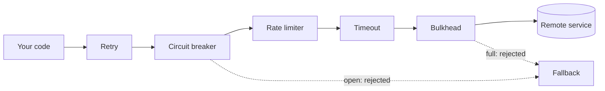

# Resilience Patterns: The Big Picture

**Category:** Resilience · **Level:** Fundamentals · **Last updated:** 2026-10-20

> [!NOTE]
> Read this first. It is the map for the whole resilience track. Each pattern has its own note; this page shows how they relate and in what order to learn them.

## In one minute

**Resilience** means your system keeps working, or fails in a controlled way, when something it depends on is slow or broken. There is no single pattern for this. There is a small family of **independent patterns**, each answering a different question. They are usually combined, and none of them is part of another.

So, to answer the question directly: **the bulkhead is not part of the circuit breaker.** They are siblings. Libraries like Resilience4j ship them as separate modules that you can use alone or together.

## Why it matters for your role

- **As an engineer:** you apply these patterns on every call that leaves your service, and you tune and test them.
- **As an architect:** you decide which patterns are required as a standard, agree the fallback behaviour with the business, and ask in design reviews: "what happens when this dependency is slow, down, or overloaded?"

## 1. The problem they all solve

Distributed systems fail in partial, messy ways. The dangerous failure is rarely "service is down". It is "service is slow", because slow calls hold your threads and the problem spreads. This is a **cascading failure**. The patterns below are all ways to limit the **blast radius**, which means how far one failure can spread.

## 2. The family, one question each

| # | Pattern | The question it answers | Protects against |
|---|---|---|---|
| 1 | **Timeout** | How long am I willing to wait for one call? | Calls that never finish |
| 2 | **Retry** (with backoff and jitter) | Is this failure temporary, so trying again may work? | Short glitches |
| 3 | **Idempotency** | Is it safe to repeat this request? | Duplicate side effects from retries |
| 4 | **Circuit breaker** | Has this dependency failed enough that I should stop calling it? | Wasting calls on a broken or slow service |
| 5 | **Bulkhead** | How many calls may use this dependency at the same time? | One dependency using all my threads |
| 6 | **Rate limiter / throttling** | How many calls per second will I allow? | Overload, from callers or toward dependencies |
| 7 | **Load shedding and backpressure** | When overloaded, what do I drop or slow down on purpose? | Collapse under too much traffic |
| 8 | **Fallback / graceful degradation** | What do I answer when the real answer isn't available? | Total failure when only a part is broken |

Every pattern is useful alone, but each has a gap that another one fills.

## 3. How they stack on one call

Read it left to right: a call passes through each layer before it reaches the remote service. Any layer can refuse the call, and the **fallback** decides what the caller gets back.

> [!NOTE]
> The order above is Resilience4j's default when you use its annotations (retry outermost, bulkhead innermost). Other libraries, and your own wrapping code, can use a different order. Check this for your version.

## 4. How they depend on each other

- **Timeouts come first.** Every other pattern assumes a call eventually ends. Without a timeout, a retry or a breaker can't even see a hung call.
- **Retries need idempotency.** Repeating a "charge the card" request is dangerous unless the operation is safe to repeat.
- **Retries need a breaker.** Retries alone can overload a struggling service (a **retry storm**). The breaker stops them.
- **The breaker and bulkhead are siblings.** The bulkhead protects your threads in the first seconds. The breaker reacts once a pattern of failures is clear.
- **Rate limiting and load shedding protect *you*.** The others protect you from your dependencies. These protect you from your callers.
- **The fallback is shared.** All the patterns that refuse a call need an answer to give back.

## 5. Notes in this track, in learning order

Step numbers match the [roadmap](../roadmap.md). Finished notes are linked; the rest are planned.

| Step | Topic | Why in this position | Status |
|---|---|---|---|
| 1.1 | This overview | Gives the map | Done |
| 1.2 | Timeouts | The foundation for all the others | Planned |
| 1.3 | Retries, backoff and jitter | The simplest reaction to failure | Planned |
| 1.4 | Idempotency | Makes retries safe | Planned |
| 1.5 | [Circuit breaker](05-circuit-breaker.md) | Stops retries and calls when a dependency is down | Done |
| 1.6 | [Bulkhead](06-bulkhead.md) | Limits damage from slow dependencies | Done |
| 1.7 | Rate limiting and throttling | Protects your own service | Planned |
| 1.8 | Load shedding and backpressure | Handles real overload | Planned |
| 1.9 | Fallbacks and graceful degradation | Ties the earlier patterns together | Planned |
| 1.10 | Testing resilience (chaos engineering) | Proves it works | Planned |

For quick revision, use the [resilience cheat sheet](99-resilience-cheat-sheet.md).

> [!IMPORTANT]
> In this course, the circuit breaker and bulkhead were learned **before** steps 1.2 to 1.4. That is fine, but it leaves gaps. Steps 1.2 to 1.4 are the next lessons, and they will connect back to the two notes already written.

## 6. Industry terms, so the vocabulary is right

| Term | Meaning |
|---|---|
| **Resilience / fault tolerance** | The system keeps working, or degrades gracefully, despite failures |
| **Stability patterns** | Michael Nygard's name for this family in *Release It!* (includes timeouts, circuit breaker, bulkheads, fail fast) |
| **Reliability patterns** | Microsoft's grouping in the Azure Architecture Center (includes bulkhead, circuit breaker, retry) |
| **Cascading failure** | One failure spreading to other parts through shared resources |
| **Blast radius** | How much is affected when one thing fails |
| **Fail fast** | Refuse or fail immediately instead of waiting |
| **Graceful degradation** | Offer less, but keep the core working |
| **Load shedding** | Dropping some requests on purpose to protect the rest |
| **Backpressure** | Telling callers to slow down |
| **Idempotent** | Safe to do more than once with the same result |
| **Retry storm** | Retries multiplying load on a service that is already struggling |

## 7. Industry check

> [!NOTE]
> Last checked: 2026-10-20 by web search. The Microsoft results came from third-party mirrors, not the official pages, and the AWS results covered retries and timeouts but not bulkheads or graceful degradation. Re-verify this section against the official guides when you revisit the note.

- **Microsoft Azure Architecture Center:** lists bulkhead, circuit breaker and retry among its reliability patterns, together with health endpoint monitoring, saga and compensating transactions.
- **AWS Well-Architected, Reliability pillar:** recommends retries with exponential backoff and jitter, limiting the number of retries, setting client timeouts, and retrying only idempotent operations. It also treats circuit breakers, throttling and fail-fast behaviour as related patterns.
- **Nygard, *Release It!*:** the original source of the "stability patterns" vocabulary (timeouts, circuit breaker, bulkheads, fail fast).
- **Decision rule:** timeouts, retries and a circuit breaker are the baseline for every outside call. Add bulkheads where one dependency could starve the rest. Add rate limiting and load shedding on the edges that face callers.

## 8. Quick Q&A (for review)

**Is a bulkhead part of a circuit breaker?** No. They are separate patterns that answer different questions and are often used together.

**Which pattern should come first when learning?** Timeouts, because every other pattern depends on a call eventually ending.

**Why do retries need a circuit breaker?** Retries alone can multiply load on a struggling service. The breaker stops them.

**Why do retries need idempotency?** Repeating a request must not repeat its side effects, such as charging a card twice.

**What do rate limiting and load shedding protect?** Your own service from too much incoming traffic.

## 9. Going further

- Michael Nygard, *Release It!*
- Microsoft Azure Architecture Center, cloud design patterns (reliability section)
- AWS Well-Architected Framework, Reliability pillar
- Resilience4j documentation

Back to [the index](../README.md) · [Roadmap](../roadmap.md).
