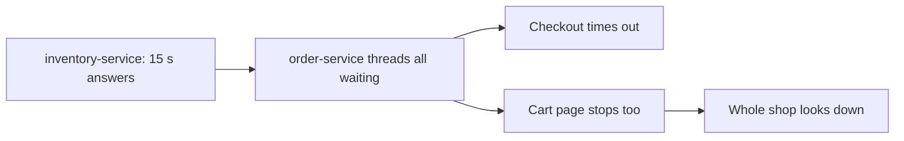
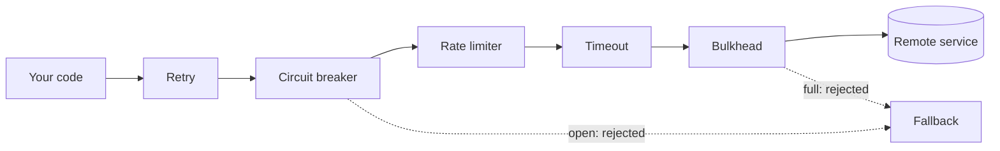

# Resilience Patterns: The Big Picture

**Resilience · Step 1.1 · Fundamentals** · Last updated 2026-10-21

> [!TIP]
> **In one sentence:** resilience patterns are a small family of independent techniques that stop one slow or broken dependency from taking your whole system down.
>
> **Memory hook:** think of a **ship**. Timeouts are the rule "don't wait forever at the dock", retries are "try the radio again", the circuit breaker is "stop calling a port that's on fire", bulkheads are the sealed compartments, and the fallback is the lifeboat.

Read this first. It is the map for the whole track: what each pattern is for, how they relate, and the order to learn them in.

## Where it fits

Step 1.1, the start of the resilience track. Every later note in this folder is one pattern from the family shown here.

## 1. The story

ShopFlow's `inventory-service` has a slow database during a sale. It doesn't crash; it just takes 15 seconds to answer. Every checkout request that asks for stock waits, holding a request thread. Within a minute, all threads in `order-service` are waiting. Now even the cart page, which never touches inventory, stops responding. One slow dependency has taken down the shop.

This is a **cascading failure**: a failure that spreads through shared resources. Notice that *slow* was worse than *down*. A dead service fails fast and frees the thread; a slow one traps it.

## 2. The idea

There is no single fix. There is a family of **independent patterns**, each answering one question. They are usually combined, and **none is part of another**: the bulkhead is not part of the circuit breaker, they are siblings.

| # | Pattern | The question it answers |
|---|---|---|
| 1.2 | **Timeout** | How long will I wait for one call? |
| 1.3 | **Retry** (with backoff and jitter) | Is this failure temporary, so trying again may work? |
| 1.4 | **Idempotency** | Is it safe to repeat this request? |
| 1.5 | **Circuit breaker** | Has this dependency failed enough that I should stop calling it? |
| 1.6 | **Bulkhead** | How many calls may use this dependency at the same time? |
| 1.7 | **Rate limiter** | How many calls per second will I accept or send? |
| 1.8 | **Load shedding and backpressure** | When overloaded, what do I drop or slow down? |
| 1.9 | **Fallback / graceful degradation** | What do I answer when the real answer is missing? |
| 1.10 | **Testing resilience** | Does any of this work when something really breaks? |

How they stack on one outgoing call:

A call passes each layer before reaching the remote service. Any layer can refuse it, and the **fallback** decides what the caller gets back. (This order is Resilience4j's default with annotations; other libraries can differ.)

## 3. Key terms

| Term | Plain meaning |
|---|---|
| **Resilience / fault tolerance** | Keep working, or degrade gracefully, despite failures |
| **Cascading failure** | One failure spreading to others through shared resources |
| **Blast radius** | How much is affected when one thing fails |
| **Fail fast** | Refuse or fail at once instead of waiting |
| **Graceful degradation** | Offer less, but keep the core working |
| **Retry storm** | Retries multiplying load on a service that is already struggling |
| **Idempotent** | Safe to do twice with the same result |
| **Load shedding** | Dropping some requests on purpose to protect the rest |
| **Backpressure** | Telling senders to slow down |

## 4. How they depend on each other

1. **Timeouts come first.** Every other pattern assumes a call eventually ends.
2. **Retries need idempotency**, or repeating a request can repeat its side effects.
3. **Retries need a circuit breaker**, or they create retry storms against a dead service.
4. **The bulkhead and the breaker are siblings.** The bulkhead protects your threads in the first seconds; the breaker reacts once failures pile up.
5. **Rate limiting and load shedding protect *you***, from your callers. The others protect you from your dependencies.
6. **Every refusal needs a fallback**, and all of it needs **testing**.

## 5. Real-world examples

- **Online banking:** the statement service is slow; with timeouts and a bulkhead, logins and transfers keep working while statements show "temporarily unavailable".
- **Food delivery:** the restaurant-menu service of one partner fails; a circuit breaker stops calls to it, and the app shows that restaurant as "closed for now" instead of the whole app hanging.
- **Video streaming:** the recommendations service is overloaded; the home page falls back to a cached "popular now" row, and playback is unaffected.

## 6. Design choices: the baseline

| Every outside call | Add when | Add at the edge |
|---|---|---|
| Timeout, retry (idempotent calls only), circuit breaker, fallback | Several dependencies share threads: bulkhead | Rate limiting, load shedding |

Then test it (1.10). Patterns you never saw fail on purpose are assumptions.

## 7. Notes in this area, in learning order

| Step | Topic | Status |
|---|---|---|
| 1.1 | This overview | Done |
| 1.2 | [Timeouts](02-timeouts.md) | Done |
| 1.3 | [Retries, backoff and jitter](03-retries-backoff-jitter.md) | Done |
| 1.4 | [Idempotency](04-idempotency.md) | Done |
| 1.5 | [Circuit breaker](05-circuit-breaker.md) | Done |
| 1.6 | [Bulkhead](06-bulkhead.md) | Done |
| 1.7 | [Rate limiting and throttling](07-rate-limiting.md) | Done |
| 1.8 | [Load shedding and backpressure](08-load-shedding-backpressure.md) | Done |
| 1.9 | [Fallbacks and graceful degradation](09-fallbacks-graceful-degradation.md) | Done |
| 1.10 | [Testing resilience (chaos engineering)](10-testing-resilience.md) | Done |

For quick revision, use the [resilience cheat sheet](99-resilience-cheat-sheet.md).

## 8. Remember

- **Slow is worse than down.** Slow calls trap threads; that is how failures cascade.
- **Each pattern answers one question.** They are independent siblings, combined in layers.
- **Timeouts first**, then retries with idempotency, then the breaker.
- **Every refusal needs an honest fallback.**
- **Test failure and recovery on purpose.**

## 9. Interview corner

**15-second answer:** "Resilience patterns stop one bad dependency from spreading failure: timeouts, retries with idempotency, circuit breakers, bulkheads, rate limiting, load shedding and fallbacks, each answering a different question."

**60-second answer:**
> "The dangerous failure in distributed systems is usually a slow dependency, because slow calls hold threads and the failure cascades. I limit the blast radius in layers. Every outside call gets a timeout; I retry only idempotent calls with backoff and jitter; a circuit breaker stops calling a dependency that keeps failing; a bulkhead limits how many threads one dependency can use; and every refusal returns an honest fallback. At the edges I rate-limit and shed load. Then I test it with fault injection, because untested resilience is an assumption."

**Likely follow-up questions:**
- **Is a bulkhead part of a circuit breaker?** No. Separate patterns: one limits concurrent calls, the other stops calls after failures.
- **Which pattern comes first?** Timeouts: the others depend on calls ending.
- **Why can retries make things worse?** They multiply load on a struggling service; the breaker stops them.
- **What do rate limiting and load shedding protect?** Your own service, from too much incoming traffic.

**Architect angle:** "I make timeouts, safe retries, a breaker and an honest fallback the default for every outside call, and add bulkheads and shedding where the blast radius justifies them."

## 10. Industry check

> [!NOTE]
> Checked 2026-10-20 by web search. Re-verify when you revisit the note.

- **Confirmed:** the AWS Well-Architected Reliability pillar recommends client timeouts, retries with exponential backoff and jitter, limited retries, and retrying only idempotent operations, and lists circuit breakers and throttling as related patterns. Michael Nygard's *Release It!* is the source of the "stability patterns" vocabulary (timeouts, circuit breaker, bulkheads, fail fast).
- **To verify:** Microsoft's Azure Architecture Center grouping of bulkhead, circuit breaker and retry as "reliability patterns" (my results came from third-party mirrors, not the official pages); the exact Resilience4j decorator order for your version.
- **Decision rule:** timeouts, safe retries and a circuit breaker on every outside call; bulkheads where one dependency could starve the rest; rate limiting and shedding on edges facing callers.

## 11. Going further

- Michael Nygard, *Release It!*
- AWS Well-Architected Framework, Reliability pillar
- Microsoft Azure Architecture Center, cloud design patterns
- Resilience4j documentation

Back to [the index](../README.md) · [Roadmap](../roadmap.md).
