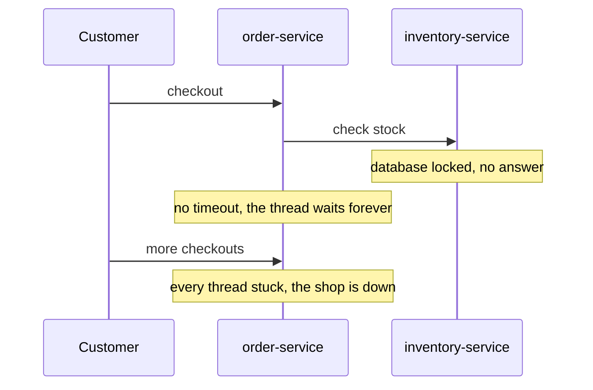
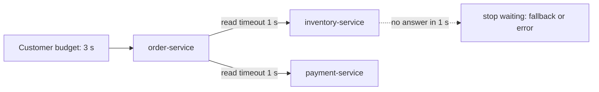

# Timeouts

**Resilience · Step 1.2 · Fundamentals** · Last updated 2026-10-21
**Prerequisites:** [Resilience patterns: the big picture](01-resilience-overview.md) (1.1)

## 1. What it is and why it matters

**What is it?** A timeout is a limit on how long you wait for a call. When it runs out, you stop waiting and treat the call as failed, so a hung dependency can't hold your threads forever.

**Why do we need it?** A request thread that waits for an answer that never comes is lost to every other user. Enough of them, and the whole service stops.

**When would I meet it?** On every HTTP call, database query and connection-pool request, and whenever you design how long a user waits.

> [!TIP]
> **Memory hook:** "I'll wait 10 minutes, then leave." Without that rule you could stand on the corner all day while your other plans fall apart.

## 2. Mental model: meeting a friend

| In the analogy | In the real system |
|---|---|
| How long you wait at the corner | The **read timeout** |
| How long you try to get through on the phone | The **connect timeout** |
| Your whole evening's plan | The **deadline** or time budget |
| Telling the next friend "I can only stay 20 minutes" | **Deadline propagation** |

**Where the analogy breaks:** when you leave the corner, your friend stops coming too. When your code stops waiting, the remote service **keeps working** and may still finish, so the outcome is **unknown**, not "failed".

## 3. Industry terms

| Term | Simple meaning | Why it matters | Example | Related terms |
|---|---|---|---|---|
| **Connect timeout** | Limit on opening the connection | Stops waiting for a host that doesn't answer | 500 ms | Read timeout |
| **Read (response) timeout** | Limit on waiting for the answer after sending | Catches the server that accepts and then hangs | 2 s | Connect timeout |
| **Pool (acquire) timeout** | Limit on waiting for a free connection from your own pool | Stops queuing behind your own exhausted pool | HikariCP `connectionTimeout` | Bulkhead |
| **Deadline / time budget** | Total time allowed for the whole operation, including retries | Every inner call must fit inside it | 3 s for checkout | Retry |
| **Deadline propagation** | Passing the remaining time to the services you call | Nobody works after the caller has given up | gRPC deadlines | Budget |
| **Tail latency (p99, p99.9)** | How slow the slowest 1% or 0.1% of calls are | Where timeout values come from | p99.9 = 800 ms | Percentile |

## 4. In a real system (ShopFlow)

**The business problem.** Checkout must answer within a few seconds, even when the Inventory Service misbehaves.

The Order Service called the Inventory Service with an HTTP client nobody had configured. One night the inventory database locked up: connections opened, but no answers came back. The client had no read timeout, so every checkout waited... and waited. After a few minutes all request threads were stuck and the shop stopped answering anything.



**How timeouts help.** With a 1-second read timeout, each stuck call is abandoned after a second, the thread is freed, and checkout can use a fallback or a clear error.

**What it costs.** Some calls that would have succeeded slowly now fail (false timeouts), and a timed-out change may still have happened on the other side.

**Elsewhere:** a card authorisation to a payment provider gets a few seconds at most; a mobile app on a poor network uses a short connect timeout to show "retry" instead of a frozen screen; a reporting query gets a query timeout so it can't hold connections checkout needs.

## 5. How it works



There are several different waits, and each needs its own limit:

1. **Waiting for a connection from your own pool** (pool timeout).
2. **Opening the connection** (connect timeout).
3. **Waiting for the response** after sending the request (read timeout).
4. **The whole operation**, including any retries (the deadline).

**Choosing the value:**

1. Measure the dependency's real latency, especially the tail (p99, p99.9).
2. Decide how many false timeouts you accept, for example 0.1% of calls.
3. Set the timeout near the matching percentile (p99.9 for 0.1%), plus a little for the network.
4. Check it fits inside your caller's budget; if not, the budget or the design must change.
5. Watch the timeout rate after release and adjust.

**Inner versus outer:** inner timeouts must add up to less than the outer one. If your caller gives you 3 seconds and you make two calls in a row with 2 seconds each, the second can still be running after the caller has given up.

**Who guarantees what**

| Layer | Responsible for |
|---|---|
| HTTP client or driver | Enforcing connect and read timeouts, if you set them (many defaults are very long or infinite) |
| Framework (Spring) | Passing your timeout settings to the client; transaction and pool timeouts |
| Application | Choosing values, fitting them in the budget, handling the unknown outcome |
| Remote service | It may keep working after you stop waiting; your timeout doesn't cancel its work |

> [!NOTE]
> Untested sketch to show the shape. Spring Boot 3.4 renamed these builder methods (from `setConnectTimeout` and `setReadTimeout`); check your version.

```java
@Bean
RestTemplate restTemplate(RestTemplateBuilder builder) {
    return builder
        .connectTimeout(Duration.ofMillis(500))   // open the connection
        .readTimeout(Duration.ofSeconds(2))       // wait for the answer
        .build();
}
```

| Where | What to set |
|---|---|
| HTTP clients | Connect timeout and read timeout |
| Database | Pool wait (HikariCP `connectionTimeout`) and query or transaction timeout (`@Transactional(timeout = 3)`) |
| Asynchronous code | Resilience4j `TimeLimiter` around a `CompletableFuture` |
| Your own server | Limits on idle connections and request time |

## 6. Failure scenarios

### No read timeout

- **What happened?** The story above: a dependency accepted connections and then never answered.
- **Why?** Only defaults were used, and the client's default read timeout was infinite or very long. A connect timeout alone doesn't help when the connection opens fine.
- **What users see:** checkout hangs, then the whole shop stops responding.
- **Solutions:** set connect **and** read timeouts on every client; treat a missing timeout as a defect in code review.
- **Trade-offs:** values must be chosen and maintained per dependency.

### Inner timeout longer than the outer one

- **What happened?** The API gateway gave up after 5 seconds, but the Order Service waited 8 seconds for payment.
- **Why?** Timeouts were chosen per service, not from a top-down budget.
- **What users see:** a gateway error, while the order may still be completing in the background.
- **Solutions:** design budgets from the user's expectation downwards; propagate the remaining deadline.
- **Trade-offs:** inner services get less time and must be faster.

### Timeout treated as "failed"

- **What happened?** A payment call timed out; the code assumed it failed and charged again.
- **Why?** The provider had charged the card; only the answer was late.
- **What users see:** a double charge.
- **Solutions:** treat timeouts as "unknown": check the status first, or retry only with an [idempotency key](04-idempotency.md).
- **Trade-offs:** an extra status call or idempotency support on the server.

## 7. Architectural decisions

| Too short | Too long |
|---|---|
| Normal slow calls fail (false timeouts) | Threads stay blocked, failures spread |
| Triggers retries, adding load | Users wait for nothing |
| Wastes work the remote may still finish | Breakers and bulkheads react late |

- **One value per dependency**, from its own measured latency, never one value for everything.
- **Count timeouts per dependency** and alert when the rate rises; they are an early sign of trouble.
- **Common mistakes:** no timeout at all; only a connect timeout; inner timeouts longer than outer ones; one value for every dependency; treating a timeout as failure; not counting timeouts.

## 8. Check your understanding

1. A server accepts the connection and then never sends a response. Which timeout catches it?
2. A call times out. Did the operation fail? What should you do before retrying a payment?
3. The gateway allows 3 seconds. The Order Service calls inventory and then payment, one after the other. Is a 2-second timeout on each sensible?
4. How would you choose a timeout value for a new dependency?

Answers are at the end of this note.

## 9. Revision

**Remember**
- **Every outside call gets a timeout.** No exceptions.
- **Connect + read + overall deadline**, each set separately.
- **Choose values from measured tail latency**, not guesses.
- **Inner timeouts fit inside the outer budget.**
- **A timeout means unknown outcome**, so changes must be idempotent before retrying.

**Explain in 15 seconds:** "Every outside call gets a timeout, so a hung dependency can't hold my threads; I set connect and read timeouts plus an overall deadline from measured latency."

**Explain in 60 seconds:**
> "A slow dependency is more dangerous than a dead one, because waiting calls hold threads and the failure spreads. So every outside call gets a timeout: a connect timeout, a read timeout and an overall deadline. I choose the values from the dependency's measured tail latency, for example p99.9 plus network time, and make sure inner timeouts fit inside the caller's budget. A timeout doesn't cancel the remote work, so the outcome is unknown, and operations that change data must be idempotent before I retry them. I count timeouts per dependency and alert when the rate rises."

**Likely follow-up questions:**
- **Connect versus read timeout?** Connect limits opening the connection; read limits waiting for the answer.
- **What is deadline propagation?** Passing the remaining time budget to downstream calls, so nobody works after the caller has given up.
- **Does a timeout cancel the remote work?** No; the other side may finish, which is why the outcome is unknown.

**Architect's takeaway:** treat a missing timeout as a defect, and design time budgets top-down from the user's expectation.

**Next topic:** [Retries, backoff and jitter](03-retries-backoff-jitter.md) (1.3)

## 10. Verification and sources

> [!NOTE]
> Checked 2026-10-21 by web search; summaries and parts of the Amazon article, not its full text. Re-verify when you revisit this note.

- **Confirmed:** Amazon's Builders' Library article "Timeouts, retries and backoff with jitter" names timeouts, retries and backoff as the essential tools and derives timeouts from downstream latency percentiles and an acceptable false-timeout rate. The AWS Well-Architected Reliability pillar has best practices for client timeouts and limiting retries. Spring Boot 3.4 deprecated `RestTemplateBuilder.setConnectTimeout` and `setReadTimeout` in favour of `connectTimeout` and `readTimeout` (Spring Boot API deprecation list).
- **Assumptions and illustrations:** the ShopFlow stories; the code (not run); the values are examples.
- **To verify:** the default timeouts of the clients you use; the `RestClient` equivalents in your Spring version.
- **Decision rule:** connect, read and overall timeouts on every outside call, from measured latency, inside the outer budget.

**Sources:** Amazon Builders' Library, "Timeouts, retries and backoff with jitter"; AWS Well-Architected Framework, Reliability pillar; Michael Nygard, *Release It!* ("Timeouts"); Spring Boot API documentation.

## Answers

1. The **read** (response) timeout. The connect timeout only covers opening the connection, which succeeded.
2. Unknown: the remote side may have done the work and only the answer was lost. Check the payment's status, or retry with the same idempotency key so the provider won't charge twice.
3. No. Two sequential 2-second waits can take 4 seconds, longer than the 3-second budget; the second call could still be running after the gateway gave up. Give each about 1 second (from measured latency), or make the calls in parallel.
4. Measure its latency distribution, pick the percentile that matches the false-timeout rate you accept (for example p99.9), add network allowance, check it fits the caller's budget, then watch the timeout rate in production.

Back to [the resilience overview](01-resilience-overview.md) · [Index](../README.md) · [Roadmap](../roadmap.md).
