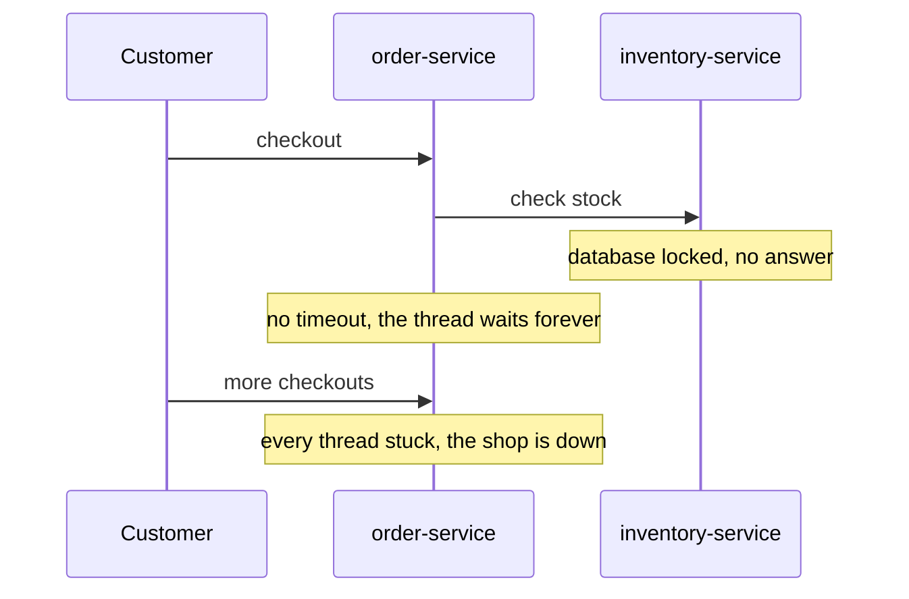
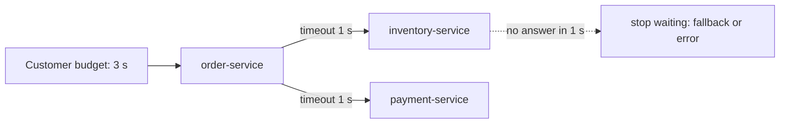

# Timeouts

**Resilience · Step 1.2 · Fundamentals** · Last updated 2026-10-21

> [!TIP]
> **In one sentence:** a timeout is a limit on how long you wait for a call; when it runs out, you stop waiting and treat the call as failed, so a hung dependency can't hold your threads forever.
>
> **Memory hook:** a timeout is the **"I'll wait 10 minutes, then leave" rule** for meeting a friend. Without it you could stand on the corner all day while your other plans fall apart.

## Where it fits

Step 1.2, the foundation of the [resilience track](01-resilience-overview.md). Every later pattern assumes calls eventually end: [retries](03-retries-backoff-jitter.md) need a failed call to retry, the [circuit breaker](05-circuit-breaker.md) needs a call to end before it can count it, and a [bulkhead](06-bulkhead.md) slot is only freed when the call returns. Next: retries (1.3).

## 1. The story

ShopFlow's `order-service` calls `inventory-service` with an HTTP client nobody configured. One night, inventory's database locks up: connections open, but no answers come back. The client has no read timeout, so every checkout request waits... and waits. After a few minutes all 200 request threads are stuck, and the shop stops answering anything. The fix was one line of configuration that was never written.



## 2. The idea

Give every wait a **deadline**. When the time is up, stop waiting, free the thread, and handle the failure (retry, fallback or error).

There are several different waits, and each needs its own limit: opening the connection, waiting for the response, waiting for a free connection from your own pool, and the total time for the whole operation. The total time is a **budget**: if the customer gives you 3 seconds, every call inside must fit in those 3 seconds.



A timeout does **not** cancel the work on the other side. The remote service may still finish. So a timed-out call has an **unknown outcome**, which is why changes must be [idempotent](04-idempotency.md) before you retry them.

## 3. Key terms

| Term | Plain meaning |
|---|---|
| **Connect timeout** | Limit on opening the connection |
| **Read (response) timeout** | Limit on waiting for the answer after sending the request |
| **Pool (acquire) timeout** | Limit on waiting for a free connection from your own pool |
| **Deadline / time budget** | Total time allowed for the whole operation, including retries |
| **Deadline propagation** | Passing the remaining time down to the services you call |
| **Tail latency (p99, p99.9)** | How slow the slowest 1% or 0.1% of calls are |

## 4. How to choose the value, step by step

1. Measure the dependency's real latency, especially the tail (p99, p99.9).
2. Decide how many false timeouts you accept, for example 0.1% of calls.
3. Set the timeout near the matching percentile (p99.9 for 0.1%), plus a little for the network.
4. Check it fits inside your caller's budget; if not, the budget or the design must change.
5. Watch the timeout rate after release and adjust.

This percentile approach is how Amazon's Builders' Library describes it. It works less well when the tail is very close to the median, so check against your own numbers.

## 5. Real-world examples

- **Payments:** a card authorisation call to an external provider gets a few seconds at most. If it times out, the shop must check the payment status before retrying, because the charge may have gone through.
- **Mobile apps on poor networks:** a short connect timeout and a sensible read timeout let the app show "retry" quickly instead of a frozen screen.
- **Databases:** a reporting query that runs for minutes gets a query timeout, so one heavy report can't hold the connections that checkout needs.

## 6. Design choices and trade-offs

| Too short | Too long |
|---|---|
| Normal slow calls fail (false timeouts) | Threads stay blocked, failures spread |
| Triggers retries, adding load | Users wait for nothing |
| Wastes work the remote may still finish | Breakers and bulkheads react late |

**Inner versus outer:** inner timeouts must add up to less than the outer one. If your caller gives you 3 seconds and you make two calls in a row with 2 seconds each, the second can still be running after the caller gave up.

## 7. Common mistakes

1. **No timeout at all**, or trusting a client default nobody checked. Many HTTP clients have none or a very long one.
2. **Only a connect timeout.** A server that accepts the connection and then hangs is the classic case.
3. **Inner timeouts longer than the outer one**, so work continues after the caller left.
4. **One timeout for every dependency**, whatever their real speed.
5. **Treating a timeout as "failed".** It means "unknown": the call may have succeeded.
6. **Not counting timeouts**, so slowness stays invisible.

## 8. In code

> [!NOTE]
> Untested sketch to show the shape. Method names have changed between Spring Boot versions; check yours.

```java
@Bean
RestTemplate restTemplate(RestTemplateBuilder builder) {
    return builder
        .setConnectTimeout(Duration.ofMillis(500))   // open the connection
        .setReadTimeout(Duration.ofSeconds(2))       // wait for the answer
        .build();
}
```

| Where | What to set |
|---|---|
| HTTP clients | Connect timeout and read timeout |
| Database | Pool wait (HikariCP `connectionTimeout`) and query or transaction timeout (`@Transactional(timeout = 3)`) |
| Async code | Resilience4j `TimeLimiter` around a `CompletableFuture` |
| Your own server | Limits on idle connections and request time |

## 9. Remember

- **Every outside call gets a timeout.** No exceptions.
- **Connect + read + overall deadline**, each set separately.
- **Choose values from measured tail latency**, not guesses.
- **Inner timeouts fit inside the outer budget.**
- **A timeout means unknown outcome**, so changes must be idempotent before retrying.

## 10. Interview corner

**15-second answer:** "Every outside call gets a timeout, so a hung dependency can't hold my threads; I set connect and read timeouts plus an overall deadline from measured latency."

**60-second answer:**
> "A slow dependency is more dangerous than a dead one, because waiting calls hold threads and the failure spreads. So every outside call gets a timeout: a connect timeout, a read timeout and an overall deadline. I choose the values from the dependency's measured tail latency, for example p99.9 plus network time, and make sure inner timeouts fit inside the caller's budget. A timeout means the outcome is unknown, since the remote may have finished, so operations that change data must be idempotent before I retry them. And I count timeouts per dependency and alert when the rate rises."

**Likely follow-up questions:**
- **How do you pick the value?** From measured latency at a chosen percentile, plus network allowance, inside the caller's budget.
- **Connect versus read timeout?** Connect limits opening the connection; read limits waiting for the answer.
- **The call timed out; did it fail?** Unknown. The other side may have done the work, so check or use idempotency before retrying.
- **What is deadline propagation?** Passing the remaining time budget to downstream calls so nobody works after the caller has given up.

**Architect angle:** "I treat a missing timeout as a defect in review, and I design time budgets top-down from the user's expectation."

## 11. Industry check

> [!NOTE]
> Checked 2026-10-21 by web search; I read summaries and parts of the Amazon article, not the full text. Re-verify when you revisit the note.

- **Confirmed:** Amazon's Builders' Library article "Timeouts, retries and backoff with jitter" names timeouts, retries and backoff as the essential tools, and derives timeouts from downstream latency percentiles and an acceptable false-timeout rate. The AWS Well-Architected Reliability pillar has best practices for setting client timeouts and limiting retries.
- **To verify:** the default timeouts of the clients you use, and the current Spring Boot method names for client timeouts.
- **Decision rule:** connect, read and overall timeouts on every outside call, from measured latency, inside the outer budget.

## 12. Going further

- Amazon Builders' Library, "Timeouts, retries and backoff with jitter"
- AWS Well-Architected Framework, Reliability pillar
- Michael Nygard, *Release It!* ("Timeouts")

**Next:** [Retries, backoff and jitter](03-retries-backoff-jitter.md) (1.3).

Back to [the index](../README.md) · [Roadmap](../roadmap.md).
