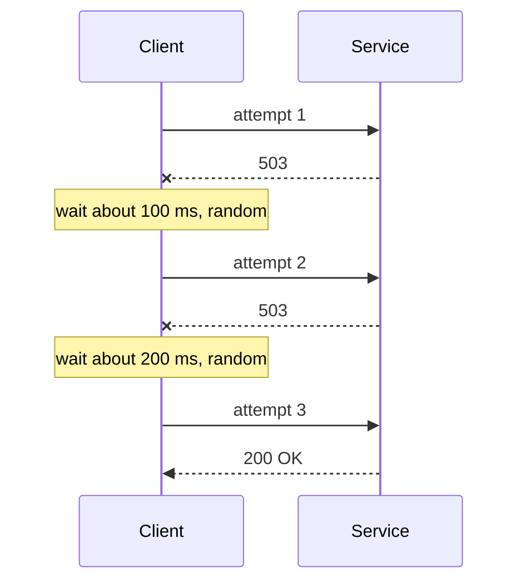

# Retries, Backoff and Jitter

**Resilience · Step 1.3 · Fundamentals** · Last updated 2026-10-21
**Prerequisites:** [Timeouts](02-timeouts.md) (1.2); read next: [Idempotency](04-idempotency.md) (1.4)

## 1. The concept in simple English

**What is it?** A retry tries a failed call again. Done safely, it waits longer each time (**backoff**), adds randomness (**jitter**), and only repeats calls that are safe to repeat.

**Why do we need it?** Many failures are brief: a dropped connection, a restarting pod, a moment of overload. Trying again a little later often succeeds, and the user never notices.

**When would I meet it?** Whenever you configure an HTTP client, a cloud SDK, a message consumer or a resilience library, and in every incident where "retries made it worse".

> [!TIP]
> **Memory hook:** a busy phone line. You don't redial every second (a retry storm); you wait a bit longer each time (backoff); and if a whole city is calling the same number, everyone waits a slightly different time (jitter) so they don't all ring at once.

## 2. Mental model: redialling a busy number

| In the analogy | In the real system |
|---|---|
| Redialling | A **retry** |
| Waiting longer before each redial | **Exponential backoff** |
| Everyone waiting a slightly different time | **Jitter** |
| "Please call back in 5 minutes" | The **`Retry-After`** header |
| Giving up after three tries | A maximum number of **attempts** |

**Where the analogy breaks:** redialling a busy line costs only you. A retry adds load to a service that may already be struggling, and if your first attempt actually succeeded, the retry can **repeat its effect**, which is why retried operations must be [idempotent](04-idempotency.md) (safe to do twice).

## 3. Industry terms

| Term | Simple meaning | Why it matters | Example | Related terms |
|---|---|---|---|---|
| **Transient failure** | A short-lived problem that may succeed on retry | The only kind worth retrying | Timeout, 503 | Permanent failure |
| **Exponential backoff** | The wait doubles after each failure, up to a cap | Gives the dependency room to recover | 100, 200, 400 ms | Jitter |
| **Jitter** | Random variation added to each wait | Stops clients retrying in step | Wait 0 to 400 ms | Thundering herd |
| **Retry storm** | Retries multiplying load on a struggling service | Turns a blip into an outage | Every layer retrying | Retry budget |
| **Retry amplification** | Retries at several layers multiplying each other | 3 attempts at 5 layers = 243× | Gateway, service, client | One retry layer |
| **Retry budget** | A cap on how much extra traffic retries may add | Bounds the damage | At most 10% extra | Circuit breaker |
| **`Retry-After`** | A response header saying how long to wait | The server's own advice | `Retry-After: 30` | 429, 503 |

## 4. In a real system (ShopFlow)

**The business problem.** Checkout must ride out brief payment glitches without overwhelming the Payment Service when it is really in trouble.

At the start of the sale, the Payment Service became slow and returned some errors. Every caller retried three times, immediately. The web app retried too, and so did the API gateway. The struggling service received many times its normal traffic exactly when it could least cope, and only recovered when the team turned retries off by hand.


**How safe retries help.** Retry only transient errors on idempotent calls, at one layer, a few times, with backoff and jitter, and stop when the circuit breaker opens. Brief glitches disappear; long outages no longer get worse.

**What it costs.** Higher latency when calls fail, some extra load, and the need for idempotency on every retried change.

**Elsewhere:** cloud SDKs already retry with backoff and jitter, so adding your own loop on top multiplies attempts; millions of phones syncing on a fixed schedule all hit a recovering server at once unless they add jitter; payment providers accept retries only with an idempotency key.

## 5. How it works



1. **What starts it:** a call fails.
2. **Is it worth retrying?** Only if the error is transient **and** the operation is idempotent. Otherwise stop.
3. **Is the circuit breaker open?** If yes, don't retry; use the fallback.
4. **Is there time and an attempt left** within the deadline? If not, give up.
5. **Wait** for the backoff with jitter, or for `Retry-After` if the server sent it.
6. **Try again**, and go back to step 2 on failure.

**Jitter styles** (AWS Architecture Blog): *full jitter* waits a random time between 0 and the current ceiling; *equal jitter* waits half the ceiling plus a random part of the other half; *decorrelated jitter* bases each wait on the previous one. Full jitter is a good default.

| Retry | Don't retry |
|---|---|
| Timeouts, connection errors | 400, 401, 403, 404, validation errors |
| 502, 503, 504 | Business errors such as "card declined" |
| 429, after `Retry-After` | Anything not safe to repeat |

> [!NOTE]
> Untested sketch to show the shape. Property names are those of Resilience4j 2.2.0's Spring Boot configuration; check your version.

```yaml
resilience4j:
  retry:
    instances:
      payment:
        maxAttempts: 3                      # total attempts, including the first
        waitDuration: 200ms
        enableExponentialBackoff: true
        exponentialBackoffMultiplier: 2
        enableRandomizedWait: true          # jitter
        retryExceptions: [java.io.IOException, java.util.concurrent.TimeoutException]
        ignoreExceptions: [io.github.resilience4j.circuitbreaker.CallNotPermittedException]
```

```java
@Retry(name = "payment")
public PaymentResult charge(ChargeRequest request) { ... }
```

`CallNotPermittedException` is what an open circuit breaker throws; ignoring it means "never retry a call the breaker refused".

## 6. Failure scenarios

### Retry storm across layers

- **What happened?** The story above.
- **Why?** Each of several layers retried; attempts multiply (3 × 3 × 3 = 27 calls for one click with three layers).
- **What users see:** the slowdown becomes an outage, and recovery takes far longer.
- **Solutions:** retry at **one** layer (usually the one that knows the operation is safe, closest to the user); a retry budget; a circuit breaker.
- **Trade-offs:** some failures that another layer could have hidden reach the user.

### Retrying a non-idempotent change

- **What happened?** A charge timed out and was retried; both attempts charged the card.
- **Why?** The first attempt had succeeded; only the response was lost.
- **What users see:** a double charge.
- **Solutions:** retry changes only with an idempotency key, or check the status before retrying.
- **Trade-offs:** idempotency support on the server.

### Clients retrying in step

- **What happened?** After a short outage, every client retried at exactly 1, 2 and 4 seconds, creating new spikes.
- **Why?** Backoff without jitter keeps clients that failed together in sync.
- **Solutions:** add jitter (full jitter by default).
- **Trade-offs:** none worth avoiding.

## 7. Architectural decisions

- **Which layer owns retries?** Decide per call path; usually one layer, the one that knows the operation is safe.
- **Benefit versus cost:** retries hide short glitches cheaply but lengthen latency on failure and add load on a struggling service; for long outages the breaker and fallback do better.
- **Library or mesh?** Retries in a service mesh need no code but don't know whether an operation is idempotent; keep them conservative, and never retry in both places.
- **Common mistakes:** retrying immediately; backoff without jitter; retrying at every layer; retrying non-idempotent operations; retrying errors that can never succeed; unlimited retries or retries that outlive the deadline; ignoring `Retry-After`.

## 8. Check your understanding

1. Why add jitter if you already back off exponentially?
2. Five layers each make 3 attempts. How many calls can reach the bottom service for one user request?
3. Should you retry a `CallNotPermittedException` from an open breaker? Why?
4. A payment call times out. Under what condition is a retry safe?

Answers are at the end of this note.

## 9. Revision

**Remember**
- **Retry only transient errors on idempotent operations.**
- **Backoff + jitter + a cap**, inside the deadline.
- **One layer only**: 3 attempts at 5 layers is 243 times the load.
- **Never retry "breaker open".**
- **Honour `Retry-After`.**

**Explain in 15 seconds:** "I retry only transient failures on idempotent calls, a few times, with exponential backoff and jitter, at one layer, behind a circuit breaker."

**Explain in 60 seconds:**
> "Retries hide short glitches, but careless retries cause retry storms. I retry only transient errors like timeouts and 503s, and only on idempotent operations, because a timed-out call may have succeeded. I use capped exponential backoff with jitter so clients don't retry in step, honour Retry-After, and keep all attempts inside the caller's deadline. I retry at one layer, because retries multiply: three attempts at five layers is 243 times the load. A circuit breaker stops retries when the dependency is clearly down, so retries help with short problems without making long ones worse."

**Likely follow-up questions:**
- **What do you never retry?** Validation, authorisation and business errors, and anything not safe to repeat.
- **How do retries and the circuit breaker work together?** The breaker counts each attempt; when it opens, retries stop because "breaker open" is excluded.
- **What is a retry budget?** A cap on the extra load retries may add, such as 10% of normal traffic.

**Architect's takeaway:** decide which layer owns retries for each call path, so the system never multiplies them.

**Next topic:** [Idempotency](04-idempotency.md) (1.4)

## 10. Verification and sources

> [!NOTE]
> Checked 2026-10-21 by web search; summaries, not full originals. Re-verify when you revisit this note.

- **Confirmed:** Amazon's Builders' Library and the AWS Architecture Blog recommend capped exponential backoff with jitter and limited attempts, and warn about retry amplification across layers; most AWS SDKs include backoff and jitter. AWS Well-Architected says to control and limit retries and to retry only idempotent operations. Resilience4j's retry properties include `enableExponentialBackoff`, `enableRandomizedWait` and `randomizedWaitFactor` (tutorials and guides).
- **Assumptions and illustrations:** the ShopFlow story; the configuration (not run); the multiplication figures are arithmetic.
- **Confirmed (Resilience4j 2.2.0 source, `CommonRetryConfigurationProperties`):** enabling both `enableExponentialBackoff` and `enableRandomizedWait` is valid and selects `IntervalFunction.ofExponentialRandomBackoff`; `randomizedWaitFactor` must be in [0, 1); `exponentialMaxWaitDuration` is only applied when `randomizedWaitFactor` is also set in the combined mode. Resilience4j's retry documentation lists defaults of 3 attempts (including the first call) and a constant 500 ms wait.
- **To verify:** behaviour of other Resilience4j versions; Spring Retry's `@Backoff` options.
- **Decision rule:** transient errors, idempotent operations, one layer, few attempts, backoff with jitter, inside the deadline, behind a breaker.

**Sources:** Amazon Builders' Library, "Timeouts, retries and backoff with jitter"; AWS Architecture Blog, "Exponential Backoff and Jitter"; AWS Well-Architected Framework, Reliability pillar; Resilience4j documentation.

## Answers

1. Backoff spaces out one client's attempts, but clients that failed at the same moment still retry at the same moments. Jitter spreads them out so the spikes disappear.
2. 3 × 3 × 3 × 3 × 3 = **243** calls in the worst case.
3. No. The breaker refused the call because the dependency is unhealthy; retrying only adds load and delay. Go to the fallback instead.
4. Only if repeating can't charge twice: the provider supports an idempotency key and you resend the same key, or you first check the payment's status.

Back to [the resilience overview](01-resilience-overview.md) · [Index](../README.md) · [Roadmap](../roadmap.md).
