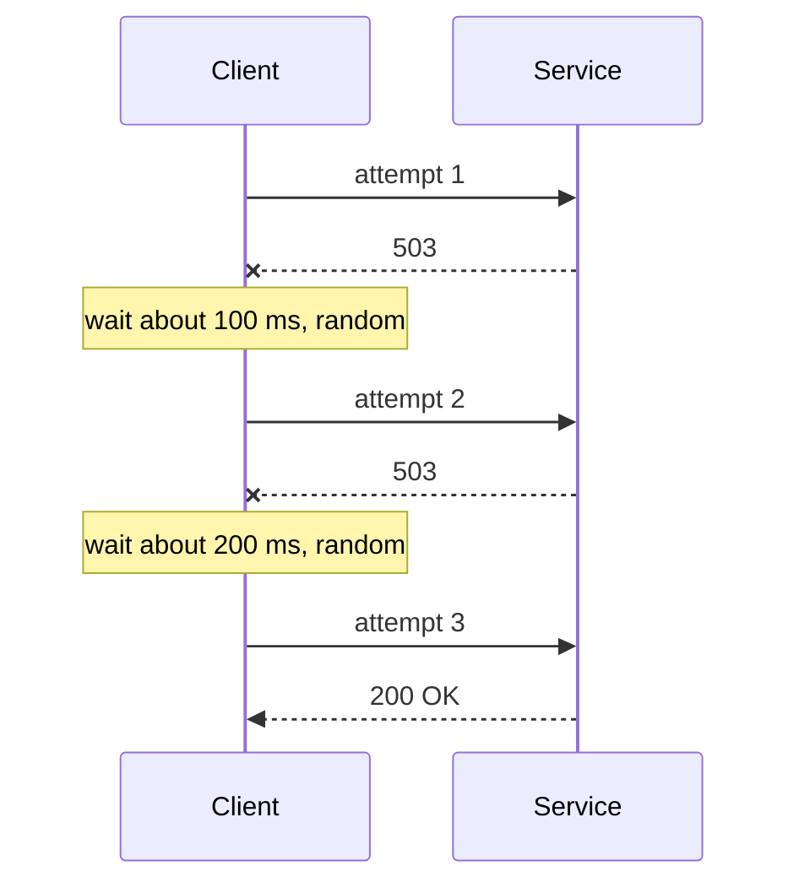

# Retries, Backoff and Jitter

**Resilience · Step 1.3 · Fundamentals** · Last updated 2026-10-21

> [!TIP]
> **In one sentence:** a retry tries a failed call again; done safely, it waits longer each time (backoff), adds randomness (jitter), and only repeats calls that are safe to repeat.
>
> **Memory hook:** a **busy phone line**. You don't redial every second (that's a retry storm), you wait a bit longer each time (backoff), and if a whole city is calling the same number, everyone waits a slightly different time (jitter) so they don't all ring at once.

## Where it fits

Step 1.3 of the [resilience track](01-resilience-overview.md). It needs [timeouts](02-timeouts.md) (a call must end before it can be retried) and [idempotency](04-idempotency.md) (repeating must be safe). The [circuit breaker](05-circuit-breaker.md) is what stops retries when a dependency stays down. Next: idempotency (1.4).

## 1. The story

At the start of ShopFlow's sale, `payment-service` gets slow and returns some errors. Every caller retries three times, immediately. The web app retries too, and so does the API gateway. A struggling payment service now receives many times its normal traffic, exactly when it can least cope, and never recovers until the team turns retries off by hand.


This is a **retry storm**. Retries help with *short* problems and hurt with *long* ones.

## 2. The idea

Retry safely, with four rules:

1. **Only failures that can be temporary**: timeouts, connection errors, 503. Not validation errors, not "card declined".
2. **Only operations that are safe to repeat** (idempotent).
3. **Wait longer each time** (exponential **backoff**): 100 ms, 200 ms, 400 ms, up to a cap.
4. **Add randomness** (**jitter**) so many clients don't retry at the same moment.

And limit the damage: a few attempts at most, all inside the overall deadline, at **one layer only**, and stop when the circuit breaker opens.



## 3. Key terms

| Term | Plain meaning |
|---|---|
| **Transient failure** | A short-lived problem that may succeed on retry |
| **Exponential backoff** | The wait doubles after each failure, up to a cap |
| **Jitter** | Random variation added to each wait |
| **Retry storm** | Retries multiplying load on a struggling service |
| **Retry amplification** | Retries at several layers multiplying each other |
| **Retry budget** | A cap on how much extra traffic retries may add (for example 10%) |
| **`Retry-After`** | A response header saying how long to wait before retrying |

## 4. How it works, step by step

1. The call fails. Is the error transient, and is the operation idempotent? If not, don't retry.
2. Is the circuit breaker open? If yes, don't retry; use the fallback.
3. Is there time left in the deadline, and attempts left? If not, give up.
4. Wait: the backoff for this attempt, with jitter (or the `Retry-After` value if the server sent one).
5. Try again, and go back to step 1 on failure.

**Jitter styles** (from the AWS Architecture Blog post on backoff and jitter): *full jitter* waits a random time between 0 and the current ceiling; *equal jitter* waits half the ceiling plus a random amount up to the other half; *decorrelated jitter* bases each random wait on the previous one. Full jitter is a good default.

## 5. Real-world examples

- **Cloud SDKs:** most cloud provider SDKs retry throttled or failed calls with backoff and jitter by default; your code should not add a second retry loop on top.
- **Mobile apps syncing data:** when the server is down, millions of phones retrying on a fixed schedule hit it all at once when it comes back. Jitter spreads them out.
- **Payment providers:** a timed-out charge is retried only with an idempotency key, so the retry can't charge twice.

## 6. Design choices and trade-offs

| Retry | Don't retry |
|---|---|
| Timeouts, connection errors | 400, 401, 403, 404, validation errors |
| 502, 503, 504 | Business errors such as "card declined" |
| 429, after `Retry-After` | Anything not safe to repeat |

**Why one layer?** If each of 5 layers makes 3 attempts, the bottom service can see 3 × 3 × 3 × 3 × 3 = **243 times** the load. Retry at the layer that knows the operation is safe, usually the one closest to the user.

**Benefit versus cost:** retries hide short glitches cheaply, but lengthen latency on failure and add load on a struggling service.

## 7. Common mistakes

1. **Retrying immediately**, with no backoff.
2. **Backoff without jitter**, so clients stay in step.
3. **Retrying at every layer**, multiplying the load.
4. **Retrying non-idempotent operations** without an idempotency key.
5. **Retrying errors that can never succeed.**
6. **Unlimited retries**, or retries that outlive the caller's deadline.
7. **Ignoring `Retry-After`.**

## 8. In code

> [!NOTE]
> Untested sketch to show the shape. Check the property names (especially the jitter ones) for your Resilience4j version.

```yaml
resilience4j:
  retry:
    instances:
      payment:
        maxAttempts: 3
        waitDuration: 200ms
        enableExponentialBackoff: true
        exponentialBackoffMultiplier: 2
        enableRandomizedWait: true
        retryExceptions: [java.io.IOException, java.util.concurrent.TimeoutException]
        ignoreExceptions: [io.github.resilience4j.circuitbreaker.CallNotPermittedException]
```

```java
@Retry(name = "payment")
public PaymentResult charge(ChargeRequest request) { ... }
```

| Setting | What it controls |
|---|---|
| Max attempts | How many tries in total |
| Wait and multiplier | The backoff curve |
| Randomised wait | Jitter |
| Retry and ignore lists | Which errors are retried |

## 9. Remember

- **Retry only transient errors on idempotent operations.**
- **Backoff + jitter + a cap**, inside the deadline.
- **One layer only**: 3 attempts at 5 layers is 243 times the load.
- **Never retry "breaker open".**
- **Honour `Retry-After`.**

## 10. Interview corner

**15-second answer:** "I retry only transient failures on idempotent calls, a few times, with exponential backoff and jitter, at one layer, behind a circuit breaker."

**60-second answer:**
> "Retries hide short glitches, but careless retries cause retry storms. I retry only transient errors like timeouts and 503s, and only on idempotent operations. I use capped exponential backoff with jitter so clients don't retry in step, honour Retry-After, and keep all attempts inside the caller's deadline. I retry at one layer, because retries multiply across layers: three attempts at five layers is 243 times the load. And a circuit breaker stops retries when the dependency is clearly down."

**Likely follow-up questions:**
- **Why jitter, if you already back off?** Without randomness, clients that failed together retry together, and the spike returns.
- **What do you never retry?** Validation, auth and business errors, and anything not safe to repeat.
- **How do retries and the circuit breaker work together?** The breaker counts each attempt; when it opens, retries stop because "breaker open" is excluded.
- **What is a retry budget?** A cap on the extra load retries may add, such as 10% of normal traffic.

**Architect angle:** "I decide which layer owns retries for each call path, so the system never multiplies them."

## 11. Industry check

> [!NOTE]
> Checked 2026-10-21 by web search; summaries, not full originals. Re-verify when you revisit the note.

- **Confirmed:** Amazon's Builders' Library and the AWS Architecture Blog recommend capped exponential backoff with jitter, limited attempts, and warn about retry amplification across layers; most AWS SDKs include backoff and jitter. AWS Well-Architected says to control and limit retries and to retry only idempotent operations.
- **To verify:** the Resilience4j property names for jitter (`enableRandomizedWait`, `randomizedWaitFactor`) and whether your version uses `maxAttempts` or another name; Spring Retry's `@Backoff` options.
- **Decision rule:** transient errors, idempotent operations, one layer, few attempts, backoff with jitter, inside the deadline, behind a breaker.

## 12. Going further

- Amazon Builders' Library, "Timeouts, retries and backoff with jitter"
- AWS Architecture Blog, "Exponential Backoff and Jitter"
- AWS Well-Architected Framework, Reliability pillar

**Next:** [Idempotency](04-idempotency.md) (1.4).

Back to [the index](../README.md) · [Roadmap](../roadmap.md).
