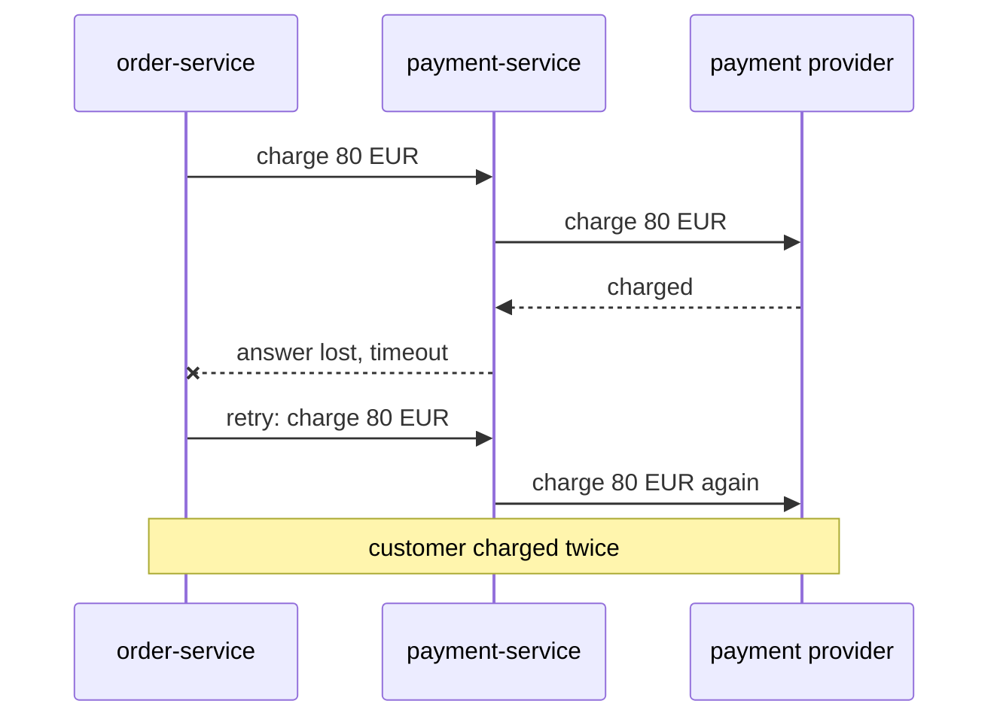
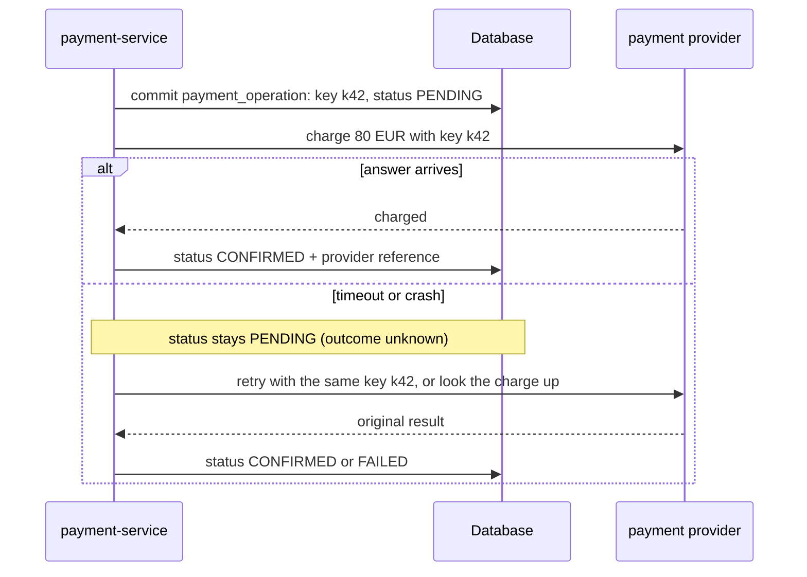

# Idempotency

**Resilience · Step 1.4 · Fundamentals** · Last updated 2026-10-21
**Prerequisites:** [Timeouts](02-timeouts.md) (1.2), [Retries, backoff and jitter](03-retries-backoff-jitter.md) (1.3)

## 1. The concept in simple English

**What is it?** An operation is **idempotent** if doing it twice has the same effect as doing it once. **Deduplication** is how a system makes an operation behave that way: it recognises a repeat and doesn't act on it again.

**Why do we need it?** Retries, timeouts and redelivered messages all mean the same request can arrive more than once. After a timeout you don't know whether the first attempt happened. Without idempotency, "try again" can mean "charge twice".

**When would I meet it?** On every write that gets retried: payment calls, order creation, message consumers, and any API a client may call again after a timeout.

> [!TIP]
> **Memory hook:** a lift button. Pressing it five times still brings one lift. A "charge the card" button that charges five times is the bug idempotency prevents.

## 2. Mental model: pressing the lift button

| In the analogy | In the real system |
|---|---|
| Pressing the button again | A **retry** or a redelivered message |
| The lift already called | The first attempt already had its effect |
| The lift controller remembering the call | The server storing the **idempotency key** and its result |

**Where the analogy breaks:** the lift controller is one system. A card charge happens in **another** company's system, so your own memory (your database) and the real effect can disagree, and that gap is where most real bugs live (section 6).

## 3. Industry terms

| Term | Simple meaning | Why it matters | Example | Related terms |
|---|---|---|---|---|
| **Idempotent operation** | Repeating it has the same effect as once | Makes retries safe | "Set address to X" | Natural idempotency |
| **Idempotency key** | A unique ID the client creates once per logical operation and resends on every retry | Lets the receiver recognise a repeat | `payment-order-42` | Client request identifier |
| **Deduplication** | Detecting and ignoring repeats | The mechanism behind idempotency | Unique constraint on the key | Idempotent consumer |
| **Unknown outcome** | After a timeout, you can't tell if the operation happened | The case idempotency exists for | Charge request timed out | Timeout ([1.2](02-timeouts.md)) |
| **Reconciliation** | Comparing your records with the other system's and fixing differences | How you resolve unknown outcomes | Look up the charge by reference | Durable operation record |
| **At-least-once delivery** | Delivery can occur zero, one or many times depending on the system and the failure; at-least-once means it keeps retrying until the message is acknowledged, under its stated assumptions (retention, acknowledgement, retries and recovery policies), so duplicates are possible | Why consumers must deduplicate; not a promise of no loss in every circumstance | Redelivered `OrderPlaced` | At-most-once |
| **Transactional outbox / inbox** | Store an outgoing event (outbox) or a processed message ID (inbox) in the same **database** transaction as the state change | Reliable messaging around a database | `outbox` table | Dual write |

## 4. In a real system (ShopFlow)

**The business problem.** A customer pays €80. The Order Service calls the Payment Service, which charges the card at an external payment provider. The charge must happen once, even when networks fail and calls are retried.

The charge succeeds, but the answer is lost and the call times out. The Order Service retries, and the card is charged again. The customer sees two €80 charges and calls support.



**How idempotency helps.** The same logical payment always carries the same key. Whoever receives a repeat recognises it and returns the first result instead of charging again.

**What it costs.** Extra storage and lookups, key lifetime and cleanup, and the need to cooperate with the provider; none of this is free or automatic.

## 5. How it works

**Four levels of protection.** They protect different things; know which one you have.

| Level | What it protects | What it does **not** protect |
|---|---|---|
| **Natural idempotency** ("set balance to 90", not "subtract 10") | Updates expressed as a final state | Anything that adds or creates |
| **Database-only deduplication** (key + unique constraint in your database) | State **in that database**, changed in the same transaction | Calls to other systems made during the work |
| **Provider-supported idempotency** (you send the key, the provider deduplicates) | The provider's own side effect, within its contract | Whatever the provider's contract excludes (key lifetime, scope) |
| **Durable operation record + reconciliation** | Your ability to recover from unknown outcomes | Nothing by itself; it works together with the other levels |

**Why the obvious code is wrong.** This looks safe and isn't:

> [!WARNING]
> **Deliberately defective example. Do not copy it.** It calls the external payment gateway inside a database transaction. That is unsafe because the charge cannot be rolled back with the transaction: a crash after the charge loses the local record but not the money. The safer design is the durable-operation workflow in "A safer workflow" below. Untested sketch.

```java
// DEFECTIVE ON PURPOSE: the external charge is not atomic with this transaction's commit
@Transactional
public PaymentResult charge(String key, ChargeRequest request) {
    if (records.exists(key)) return records.result(key);
    records.insertInProgress(key, request);        // row exists only inside this transaction
    PaymentResult result = gateway.charge(request); // external call: NOT part of the transaction
    records.saveResult(key, result);
    return result;                                  // commit happens here
}
```

A database transaction cannot make a call to an external provider atomic with its own commit. If the provider charges the card and the process crashes (or the commit fails) before the transaction commits, the `insertInProgress` row **rolls back**. The retry finds no record, calls the provider again, and, unless the provider deduplicates, charges again. The local idempotency record protected nothing, because the real effect happened outside the transaction it lived in.

**A safer workflow.** Make the decision to pay durable *before* calling the provider, and keep the external call outside the database transaction:



1. **Persist a durable operation record first**, in its own committed transaction: a stable operation ID and idempotency key (derived from the business operation, for example order ID + attempt purpose), the amount, and status `PENDING`.
2. **Call the provider outside any open database transaction**, sending **the same key on every attempt**.
3. **Record the result** (provider reference, status) in a new transaction.
4. **Treat a timeout or crash as "unknown", never as "failed".** Leave the record `PENDING`. Retry with the same key, or ask the provider for the operation's status.
5. **Reconcile.** A background job re-checks operations stuck in `PENDING` for too long, using the key or your reference, and settles them. This also covers keys that have expired at the provider.

> [!NOTE]
> Untested sketch of the shape; the real design depends on the provider's contract and your requirements.

```java
var op = operations.createPending(orderId, amount);        // committed: key = op.key(), status PENDING
try {
    var result = gateway.charge(op.key(), amount);          // same key on every retry; no open DB transaction
    operations.markConfirmed(op.id(), result.reference());
} catch (TimeoutException e) {
    operations.markUnknown(op.id());                        // not "failed": reconcile later
}
```

**If the provider does not support idempotency keys.** You cannot make a blind retry safe. Options, in order of preference: (a) look the operation up by your own reference or metadata before any retry; (b) do not auto-retry: keep the operation `PENDING`/`UNKNOWN`, and let reconciliation or a person resolve it; (c) use a two-step flow (authorise, then capture) so a duplicate authorisation can be released; (d) accept a small duplicate risk and compensate with a refund process. Which is acceptable is a business decision.

**Outbox and inbox, and their actual guarantees.** The **outbox** writes an event to a table in the same *database* transaction as the state change, and a relay publishes it later: the event is published if (and only if) the transaction committed, but the relay can publish twice after a crash, so delivery is at-least-once. The **inbox** (idempotent receiver) stores processed message IDs in the same database transaction as the effect, so redelivered messages are skipped. Both give strong guarantees for the **database** state; neither makes an external call exactly-once. See [2.2.15](../02-messaging/02-kafka/15-kafka-connect-cdc.md) and [2.2.5](../02-messaging/02-kafka/05-offset-commits-delivery-guarantees.md).

**What "at-least-once" does and doesn't promise.** It means the system keeps trying until the message is acknowledged, so duplicates are possible. It holds under assumptions: the message is still retained, the producer's write was acknowledged, the consumer acknowledges only after processing, and retry and recovery policies keep running. It is not a promise that a message can never be lost in any circumstance, and it does not give exactly-once business effects.

**Who guarantees what**

| Layer | Responsible for |
|---|---|
| Your database | Atomicity of your own state; unique constraints |
| Provider | Deduplicating requests that carry its key, within its documented contract |
| Your application | A stable key, a durable operation record before the call, reconciliation of unknown outcomes |
| Messaging platform | Redelivery until acknowledged (at-least-once); not business-level deduplication |

## 6. Failure scenarios

### Provider charged, local record rolled back

- **What happened?** The defective example above: charge succeeded, crash before commit.
- **Why?** The external effect and the local commit aren't atomic.
- **What the business sees:** a double charge on retry, if the provider doesn't deduplicate.
- **Solutions:** durable `PENDING` record committed *before* the call; the same key on every attempt; reconciliation.
- **Trade-offs:** an extra table, a background job, and more states to handle.

### Timeout treated as failure

- **What happened?** The charge timed out; the code marked it failed and created a new charge.
- **Why?** A timeout means unknown, not failed ([1.2](02-timeouts.md)).
- **What the business sees:** duplicate charges or a lost sale.
- **Solutions:** leave the operation `PENDING`; retry with the same key or look it up; reconcile.

### New key on each retry, or key reused for a different request

- **What happened?** The client generated a fresh key per attempt, or reused one for a different amount.
- **Why?** The key must identify the *logical operation*, created once. A reused key with different parameters is a client bug, and providers may reject it.
- **Solutions:** derive the key from the business operation and store it in the operation record.

### Key expired at the provider

- **What happened?** A retry came after the provider had removed the key.
- **Why?** Providers keep keys for a limited time (Stripe API v1 may remove keys at least 24 hours old, and treats a reused key after that as a new request).
- **Solutions:** reconcile unresolved operations well inside the key lifetime.

### Two identical requests at the same moment

- **What happened?** Both passed the "is there a record?" check.
- **Solutions:** a unique constraint on the key, with a `PENDING` state; the loser waits or reads the winner's result.

## 7. Architectural decisions

| Technique | Use it for | Cost |
|---|---|---|
| Natural idempotency | Updates you can express as a final state | None, when possible |
| Unique key in your database | State in that database | Table, lookup, cleanup |
| Provider idempotency key | Retrying calls to a provider that supports it | Read its contract: scope, lifetime, behaviour on mismatch |
| Durable operation record + reconciliation | Anything with an external side effect | States, a reconciler, operational monitoring |
| Outbox / inbox | Reliable events and message handling around a database | A relay; duplicates still possible, so consumers deduplicate |

The right mix depends on the provider's contract and what a duplicate costs: a duplicate email is a nuisance, a duplicate charge is a refund and a complaint. **Common mistakes:** retrying a POST without a key; checking then acting without a unique constraint; assuming the database record covers an external call; not comparing the payload for a reused key.

## 8. Check your understanding

1. Why can't a `@Transactional` method that calls a payment provider make the charge idempotent by saving a record inside the transaction?
2. A payment call times out. What status do you record, and why not "failed"?
3. The provider doesn't support idempotency keys. Give two ways to reduce the risk of a double charge.
4. A message consumer writes to your database and sends an email. Which of these does an inbox table protect?

Answers are at the end of this note.

## 9. Revision

**Remember**
- **Idempotent = repeating has the same effect as once.**
- **A timeout is an unknown outcome, not a failure.**
- **The client creates the key once per operation and reuses it on every retry.**
- **Make the operation durable *before* the external call; keep the call outside the database transaction.**
- **A database record protects database state, not external calls. Reconcile the rest.**

**Explain in 15 seconds:** "Idempotent means repeating has the same effect as once; I send one key per operation on every retry, record the operation durably before calling the provider, and reconcile unknown outcomes."

**Explain in 60 seconds:**
> "Retries and at-least-once delivery mean the same request can arrive twice, and a timeout leaves the outcome unknown. Setting a value is naturally idempotent. For a payment, I create a durable operation record with a stable key and commit it first, then call the provider outside any database transaction, sending the same key on every attempt, and record the result. A timeout leaves the operation pending, never failed, and a reconciler settles it by retrying with the same key or looking it up. Idempotency prevents duplicate business effects only inside a boundary I can define: a database unique key protects state in that database, and an outbox or inbox gives strong guarantees for database state, but none of it automatically gives exactly-once effects across Kafka, my database and an external provider. For the provider, the guarantee is whatever its idempotency contract says. If it has no idempotency keys, I look the operation up before retrying, or hold it for reconciliation."

**Likely follow-up questions:**
- **Which HTTP methods are idempotent?** GET, PUT and DELETE by definition (and HEAD, OPTIONS); POST and PATCH are not by default.
- **How long do you keep keys?** Longer than any realistic retry or reconciliation window, and inside the provider's key lifetime; then clean up.
- **Does idempotency give you exactly-once?** Not automatically, and not end to end. At-least-once delivery plus idempotent handling prevents duplicate business effects *within a defined processing boundary* (for example one database transaction, or a provider that honours your key). Across Kafka, a database and an external provider there is no single boundary, so each hop needs its own guarantee, and unknown outcomes still need reconciliation.

**Architect's takeaway:** treat every call with an external side effect as "may be repeated and may have an unknown outcome", and design the operation record, the key and the reconciliation around that.

**Next topic:** [Circuit breaker](05-circuit-breaker.md) (1.5)

## 10. Verification and sources

> [!NOTE]
> Checked 2026-10-21 against the pages named below. Re-verify provider behaviour for your provider and API version.

- **Confirmed (Stripe API reference, "Idempotent requests"):** for API v1, Stripe saves the status code and body of the first request made with a key after endpoint execution begins and returns it for retries, including 500 errors; keys may be removed automatically once at least 24 hours old, and a reused key after pruning generates a new request; incoming parameters are compared with the original and a mismatch errors; all POST requests accept idempotency keys, GET and DELETE don't need them; API v2 behaves differently (retries don't repeat successful operations).
- **Confirmed (Amazon Builders' Library, "Making retries safe with idempotent APIs"):** a retry with the same client request identifier should return a semantically equivalent response; recording the identifier and performing the state change must be atomic (ACID), or a failure can leave the token recorded without the effect; after a timeout the outcome can be unclear and, without an identifier, requires reconciling state; a reused identifier with different parameters should be rejected.
- **Assumptions and illustrations:** the ShopFlow story, the state names and the code (not run); the five-step workflow is a design pattern, not any provider's documented procedure.
- **To verify:** the current status of the IETF draft "The Idempotency-Key HTTP Header Field" (a draft, not a standard, when last checked); your provider's own key lifetime and scope.
- **Decision rule:** natural idempotency where possible; otherwise a key per logical operation, a durable record before the external call, and reconciliation.

**Sources:** Stripe API reference, "Idempotent requests"; Amazon Builders' Library, "Making retries safe with idempotent APIs"; Gregor Hohpe and Bobby Woolf, *Enterprise Integration Patterns* ("Idempotent Receiver"); microservices.io, "Transactional outbox".

## Answers

1. The provider's charge happens outside the database transaction. If the charge succeeds and the process crashes or the commit fails, the transaction (including the saved record) rolls back, but the charge stays. The retry sees no record and charges again unless the provider deduplicates.
2. Record it as pending or unknown. The provider may have charged the card and only the answer was lost. Retry with the same key, or look the charge up, and reconcile.
3. Look the operation up by your own reference before any retry; don't auto-retry and hold the operation for reconciliation; use authorise-then-capture so a duplicate authorisation can be released; or accept a small risk and compensate with refunds.
4. The inbox table protects the **database** change from being applied twice when the message is redelivered. It does not stop the email being sent again; that needs the email provider's idempotency support, or an accepted duplicate risk.

Back to [the resilience overview](01-resilience-overview.md) · [Index](../README.md) · [Roadmap](../roadmap.md).
