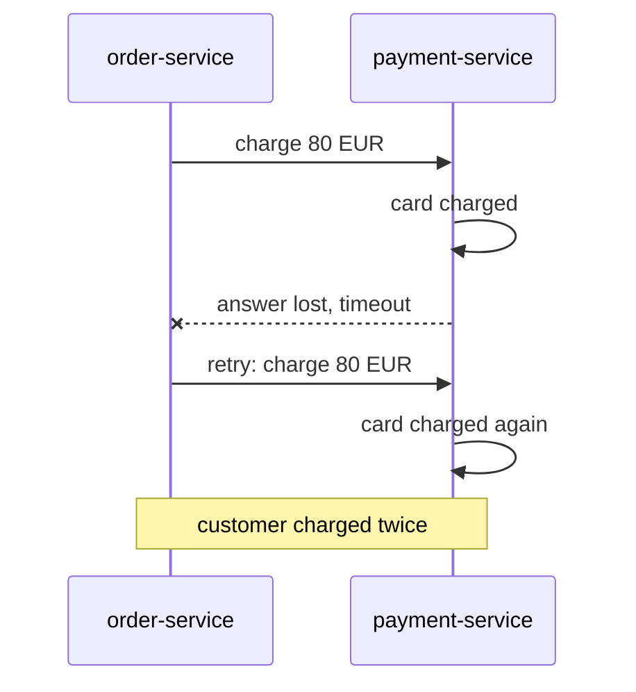
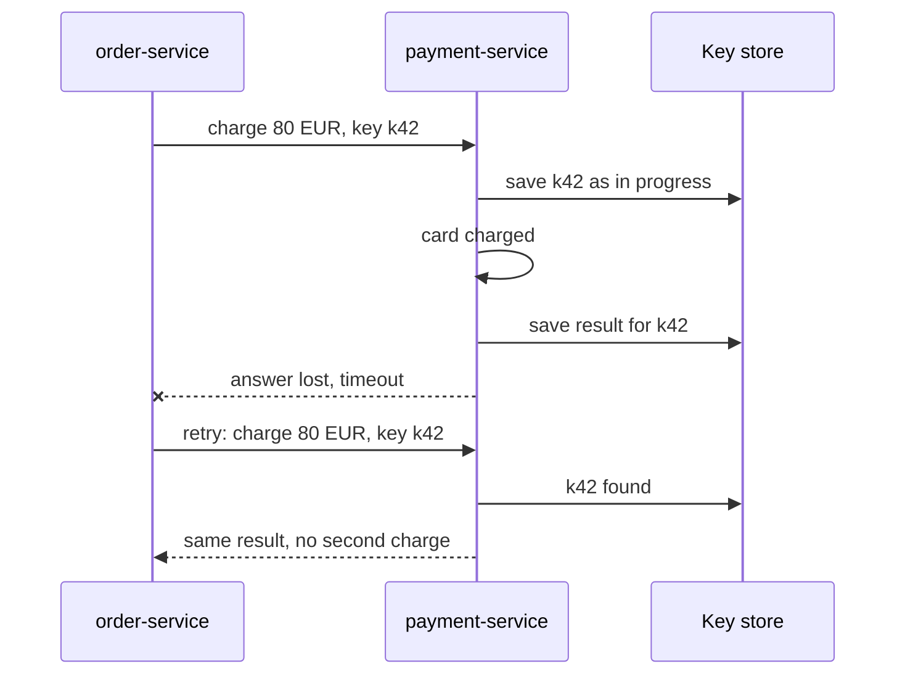

# Idempotency

**Resilience · Step 1.4 · Fundamentals** · Last updated 2026-10-21

> [!TIP]
> **In one sentence:** an operation is idempotent if doing it twice has the same effect as doing it once, which is what makes retries and duplicate messages safe.
>
> **Memory hook:** a **lift button**. Pressing it five times still brings one lift. A "charge the card" button that charges five times is the opposite, and that's the bug idempotency prevents.

## Where it fits

Step 1.4 of the [resilience track](01-resilience-overview.md). It makes [retries](03-retries-backoff-jitter.md) safe and answers the "unknown outcome" of a [timeout](02-timeouts.md). It returns in messaging as the *idempotent consumer* and in Kafka as the *idempotent producer*. Next: the circuit breaker (1.5).

## 1. The story

A ShopFlow customer pays €80. `order-service` calls `payment-service`, which charges the card, but the answer is lost on the network and the call times out. `order-service` retries. The card is charged again. The customer sees two €80 charges and calls support, angry.



## 2. The idea

Make the second request recognisable. The client creates a unique **idempotency key** for the logical operation ("order 42, payment") and sends it with every attempt. The server remembers keys it has processed and the result it gave. When the same key comes again, it returns the stored result instead of doing the work again.



Some operations are idempotent by nature and need nothing extra: "set the address to X", "delete order 42", any read. The ones that need help are "add", "create" and "charge".

## 3. Key terms

| Term | Plain meaning |
|---|---|
| **Idempotent** | Repeating has the same effect as doing it once |
| **Idempotency key** | A unique ID the client sends per logical operation |
| **Natural idempotency** | The operation is safe to repeat by design (set, not add) |
| **Idempotent consumer** | A message handler that skips messages it has already processed |
| **Unique constraint** | A database rule that rejects a second identical insert |
| **At-least-once delivery** | Messages may arrive more than once, never zero times |

In HTTP, GET, PUT and DELETE are defined as idempotent; POST and PATCH are not by default.

## 4. How it works, step by step

1. The client creates the key **once** per operation (a UUID) and reuses it on every retry.
2. The server tries to insert the key as "in progress". A unique constraint means only one request can win.
3. If the key already exists with a result, return that result.
4. If the key exists with a **different** request body, reject it (409 or 422): it's a client bug.
5. Otherwise do the work, store the result with the key, and return it.
6. Keep keys for a limited time (for example 24 hours), scoped per client.

## 5. Real-world examples

- **Payment APIs:** many payment providers accept an `Idempotency-Key` header, so merchants can safely retry a charge after a timeout.
- **Message consumers:** a bank's statement service records every processed event ID in the same database transaction as its update, so a redelivered event is skipped.
- **Booking systems:** a hotel booking uses the client's booking reference as a unique key, so double-clicking "Book" creates one reservation, not two.

## 6. Design choices and trade-offs

| Technique | Use it for |
|---|---|
| **Natural idempotency** ("set balance to 90", not "subtract 10") | Updates you can express as a final state |
| **Idempotency key** | Payments, order creation, any retried POST |
| **Unique constraint on a natural key** | Creating records with a business reference |
| **Conditional update (version check)** | Concurrent updates |
| **Processed-message table** | Message handlers |

**Cost:** extra storage and a lookup on every write, plus key lifetime and cleanup to manage. Worth it wherever a duplicate costs money or trust.

## 7. Common mistakes

1. **Retrying POST with no key** and hoping.
2. **A new key on each retry**, which defeats the purpose.
3. **Check-then-act without a unique constraint**, so two parallel requests both pass.
4. **Not comparing the payload** for a reused key.
5. **Doing the side effect first and saving the key later**: a crash in between causes a duplicate.
6. **Forgetting downstream effects** such as emails and published events.

## 8. In code

> [!NOTE]
> Untested sketch to show the shape.

```java
@Transactional
public PaymentResult charge(String key, ChargeRequest request) {
    var existing = records.findByKey(key);
    if (existing.isPresent()) {
        if (!existing.get().matches(request)) throw new IdempotencyKeyReuseException();
        return existing.get().storedResult();          // replay: no second charge
    }
    records.insertInProgress(key, request);            // unique index on key
    PaymentResult result = gateway.charge(request);
    records.saveResult(key, result);
    return result;
}
```

| Setting | What it controls |
|---|---|
| Unique index on the key | Only one request per key can proceed |
| Key lifetime | How long replays are recognised |
| Key scope | Per client or account, so keys can't collide |

## 9. Remember

- **Idempotent = twice has the same effect as once.**
- **A timeout is an unknown outcome**: retry only if repeating is safe.
- **Client makes the key once and reuses it** on every retry.
- **Store the key first, with a unique constraint.**
- **Same key, different payload = reject.**

## 10. Interview corner

**15-second answer:** "Idempotent means repeating has the same effect as doing once; I use idempotency keys or unique constraints so retries and duplicate messages are safe."

**60-second answer:**
> "Retries and at-least-once delivery mean the same request can arrive twice, and a timeout leaves the outcome unknown. For naturally idempotent operations, like setting a value, nothing extra is needed. For things like charging a card, the client sends a unique idempotency key per operation and reuses it on retries. The server stores the key with a unique constraint before doing the work, saves the result, and returns the stored result for any repeat; the same key with a different payload is rejected. Message handlers do the same with processed message IDs."

**Likely follow-up questions:**
- **Which HTTP methods are idempotent?** GET, PUT, DELETE (and HEAD, OPTIONS); POST and PATCH are not by default.
- **How do you handle two simultaneous requests with the same key?** A unique constraint on insert, with an "in progress" state, so only one proceeds.
- **How long do you keep keys?** Long enough to cover realistic retries, such as 24 hours, then clean up.
- **How is this different from exactly-once?** Exactly-once in practice is at-least-once delivery plus idempotent handling.

**Architect angle:** "I make idempotency part of every write API and event contract, because retries and redelivery are certain to happen."

## 11. Industry check

> [!NOTE]
> Checked 2026-10-21 by web search. Re-verify when you revisit the note.

- **Confirmed:** an IETF Internet-Draft, "The Idempotency-Key HTTP Header Field" (latest revision found: 07, October 2025), proposes a standard header to make POST and PATCH fault-tolerant; it says keys should be unique, not reused for a different payload, and suggests a UUID. It is still a draft, not a finished standard. AWS guidance says to retry only idempotent operations.
- **To verify:** the draft's current status; which payment providers use the header in exactly this form (Stripe is often cited, but my search did not confirm it).
- **Decision rule:** natural idempotency where possible, an idempotency key or unique constraint everywhere else.

## 12. Going further

- IETF draft, "The Idempotency-Key HTTP Header Field" (work in progress)
- AWS Well-Architected Framework, Reliability pillar
- Gregor Hohpe and Bobby Woolf, *Enterprise Integration Patterns* ("Idempotent Receiver")

**Next:** [Circuit breaker](05-circuit-breaker.md) (1.5).

Back to [the index](../README.md) · [Roadmap](../roadmap.md).
