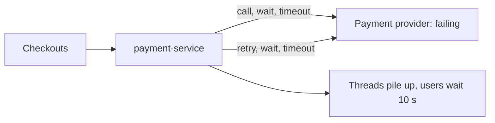

# Circuit Breaker

**Resilience · Step 1.5 · Fundamentals** · Last updated 2026-10-21
**Prerequisites:** [Timeouts](02-timeouts.md) (1.2), [Retries, backoff and jitter](03-retries-backoff-jitter.md) (1.3)

## 1. The concept in simple English

**What is it?** A circuit breaker watches recent calls to a dependency. When too many fail or run slow, it **opens**: calls are refused at once, without touching the dependency, and a fallback answers instead. After a while it lets a few test calls through and closes again if they succeed.

**Why do we need it?** Calling a dependency that is clearly broken wastes your threads and the caller's time, and adds load to something that is already struggling. Timeouts bound each wait; a breaker stops making the waits at all.

**When would I meet it?** Around calls to an external provider or another service that can fail for minutes at a time, in every library and mesh that offers "resilience" features.

> [!TIP]
> **Memory hook:** the fuse box in your house. A fault trips it so the wiring doesn't burn. You don't keep flipping it back on while the toaster is still shorted; you wait, then test it once.

## 2. Mental model: a fuse box

| In the analogy | In the real system |
|---|---|
| The fuse | The **circuit breaker** around one dependency |
| A short circuit | A run of failures or slow calls |
| The fuse tripping | **Open** state: calls rejected immediately |
| Flipping it back to test | **Half-open** state: a few trial calls |
| Power restored | **Closed** state: normal calls |

**Where the analogy breaks:** a fuse trips on one fault and is reset by a person. A software breaker judges a *rate* over recent calls, resets itself, and can open for the wrong reason (for example, counting business errors as failures) if misconfigured.

## 3. Industry terms

| Term | Simple meaning | Why it matters | Example | Related terms |
|---|---|---|---|---|
| **Closed / open / half-open** | Normal / refusing calls / testing with a few calls | The three states | Open for 10 s | State machine |
| **Sliding window** | The recent calls the breaker judges | Defines "recent" | Last 10 calls | Minimum number of calls |
| **Failure-rate threshold** | Share of failures that opens the breaker | The main trip condition | 50% | Slow-call threshold |
| **Slow-call threshold** | Calls slower than this count as "slow" | Catches the dangerous case where nothing fails but everything is slow | Over 1 s | Timeout ([1.2](02-timeouts.md)) |
| **Minimum number of calls** | Don't judge until this many are recorded | One failure out of one call isn't "100% failing" | 5 | Window |
| **Fallback** | The answer given when a call is rejected or fails | What users see while open | "Payment pending" | Graceful degradation ([1.9](09-fallbacks-graceful-degradation.md)) |
| **Stability patterns** | Michael Nygard's family name (*Release It!*) | Interview vocabulary | Circuit breaker, bulkhead | Reliability patterns |

## 4. In a real system (ShopFlow)

**The business problem.** Checkout must stay usable when the external payment provider has a bad hour, without hammering the provider or leaving customers staring at a spinner.

The provider starts failing. The Payment Service keeps calling it: every checkout waits for a timeout, then retries, then waits again. Customers see a spinner for 10 seconds before an error, threads pile up, and the already struggling provider receives even more traffic from the retries.



**How the breaker helps.** After enough failures it opens. Rejections take about a millisecond, threads stay free, the provider gets room to recover, and the customer sees "payment pending, we'll confirm shortly" instead of waiting.

**What it costs.** Thresholds to tune, a fallback to design with the business, and an alert for "breaker open" (a polite fallback can hide an outage for hours).

**Elsewhere:** a travel site keeps one breaker per airline API, so one airline's outage doesn't spoil searches for the others.

## 5. How it works


1. **Closed:** each call's result goes into the sliding window.
2. Once the minimum number of calls is reached, the breaker checks the failure rate and the slow-call rate.
3. If either crosses its threshold, it goes **open**.
4. While open, every call is rejected at once and the fallback answers.
5. After the wait time it goes **half-open** and lets a small number of trial calls through.
6. Trial calls succeed: **closed**. They fail: **open** again.

**What counts as a failure:** timeouts, 5xx errors, connection errors. Not business answers: a declined card (HTTP 402) is a correct response and must be ignored, or a run of declines would block every customer. A breaker needs a **timeout** underneath it; calls that never finish can't be counted.

**Who guarantees what**

| Layer | Responsible for |
|---|---|
| Library (Resilience4j) or mesh | Counting, state changes, rejecting calls while open |
| Application | Which exceptions count, the fallback's content, alerting on open breakers |
| The dependency | Recovering; the breaker only gives it room |
| Neither | Making the fallback honest: that is a business decision |

> [!NOTE]
> The configuration below was run and checked with automated tests on Spring Boot 3.2.4 and Resilience4j 2.2.0 (the lab's tests and demo scripts also ran on Java 21.0.8 on 2026-10-21). The results come from those runs.

```java
@CircuitBreaker(name = "payment", fallbackMethod = "pendingPayment")
public PaymentResult charge(String orderId) { ... }

PaymentResult pendingPayment(String orderId, Throwable t) {
    if (t instanceof PaymentDeclinedException d) throw d;   // business answer: not a degradation
    return PaymentResult.pending(orderId);
}
```

```yaml
resilience4j.circuitbreaker.instances.payment:
  slidingWindowSize: 10
  minimumNumberOfCalls: 5
  failureRateThreshold: 50
  slowCallDurationThreshold: 1s
  slowCallRateThreshold: 80
  waitDurationInOpenState: 10s
  permittedNumberOfCallsInHalfOpenState: 3
  ignoreExceptions: [com.example.PaymentDeclinedException]
```

**What the example runs showed:**

| Situation | Result |
|---|---|
| 3 healthy then 3 failing calls | Opened at 3 failures out of 6 (50%): earlier successes count in the window |
| Calls while open | About 1 ms each; the dependency received none |
| After 10 s | Half-open on its own; 3 healthy trial calls closed it |
| Declined cards (402) | Stayed closed; declines weren't recorded as failures |
| 2-second calls, no errors | Opened on the slow-call rate (100%) after 5 calls |

The fallback method receives every exception, including ignored ones, which is why it rethrows the declined-card error. Spring Boot Actuator shows state at `/actuator/circuitbreakers` and transitions at `/actuator/circuitbreakerevents`.

## 6. Failure scenarios

### Business errors trip the breaker

- **What happened?** A run of declined cards opened the breaker and blocked every customer.
- **Why?** A decline is a valid answer, but was counted as a failure.
- **Solutions:** ignore business exceptions in the breaker; rethrow them in the fallback.

### The fallback hides an outage

- **What happened?** The breaker stayed open for hours; users saw "payment pending" and nobody noticed.
- **Solutions:** alert when a breaker stays open; track and reconcile deferred payments ([1.4](04-idempotency.md)).

### The breaker never sees slow calls

- **What happened?** The provider answered in 8 seconds for 20 minutes, but the breaker watched only errors.
- **Solutions:** set the slow-call threshold and a timeout.

### Self-invocation skips the breaker

- **What happened?** An annotated method was called from the same class and the breaker did nothing.
- **Why?** The annotation works through a proxy; a self-call bypasses it.
- **Solutions:** call it through another bean, or use the programmatic API.

## 7. Architectural decisions

| Choice | Guidance |
|---|---|
| **Scope** | One breaker **per dependency**, not one for the whole application |
| **Thresholds** | Tune from real traffic; too sensitive flaps, too lax reacts late |
| **Fallback** | A business decision: give less, never something false |
| **Library or mesh** | Library when the fallback needs business logic; a mesh (Envoy, Istio) for a uniform baseline with no code; many teams use both, taking care retries and breakers aren't duplicated |
| **Several instances** | Each instance has its own breaker; they won't all open together, which is usually fine |

**Breaker versus bulkhead:** the breaker reacts to *recent results*; the bulkhead ([1.6](06-bulkhead.md)) limits *concurrent calls* from the first second. They are siblings; use both where threads could be exhausted. **Common mistakes:** no timeout underneath; one shared breaker; never tuning thresholds; too many half-open trial calls knocking over a service that just recovered.

## 8. Check your understanding

1. A breaker that only counts errors: does it protect you from a dependency that answers every call in 9 seconds?
2. Why must a declined card be ignored by the breaker?
3. The breaker is open and the fallback says "payment pending". What must you still do about those payments?
4. What does the minimum number of calls prevent?

Answers are at the end of this note.

## 9. Revision

**Remember**
- **Closed → open → half-open → closed.**
- **Slow calls count too**, so you need the slow-call threshold and a timeout.
- **Ignore business errors.**
- **A fallback may give less, never something false.**
- **Alert when a breaker stays open.**

**Explain in 15 seconds:** "A circuit breaker stops calling a dependency after too many failures or slow calls, answers with a fallback, and sends a few trial calls later before trusting it again."

**Explain in 60 seconds:**
> "A circuit breaker watches recent calls to a dependency. When the failure or slow-call rate crosses a threshold, it opens and rejects calls immediately, which protects my threads and gives the dependency room to recover. After a wait it goes half-open, lets a few trial calls through, and closes if they succeed. I use one breaker per dependency, under a timeout and limited retries, ignore business errors like declined cards, return an honest fallback, and alert when a breaker stays open. It doesn't make the dependency healthy; it limits the damage while it isn't."

**Likely follow-up questions:**
- **What happens when the dependency recovers?** Nothing until the wait ends; then the half-open trial calls decide.
- **Why a minimum number of calls?** So one failure out of one call doesn't look like "100% failing".
- **Library or service mesh?** Library when the fallback needs business logic; a mesh for a no-code baseline; often both.

**Architect's takeaway:** the fallback is a product decision agreed with the business, and an open breaker is an alert, not a silent success.

**Next topic:** [Bulkhead](06-bulkhead.md) (1.6)

## 10. Verification and sources

> [!NOTE]
> Checked 2026-10-20 and 2026-10-21. Re-verify when you revisit this note.

- **Confirmed:** Netflix's Hystrix README states Hystrix is no longer in active development and in maintenance mode, and recommends resilience4j for new projects; the latest Resilience4j release on GitHub was v2.4.0 (published 2026-03-14) when checked, while the example above ran on 2.2.0. The table of results above comes from the lab's tests and demo scripts (the demos were re-run on 2026-10-21 and reproduced the open, half-open, closed, declined-card and slow-call behaviours).
- **Assumptions and illustrations:** the ShopFlow story and the "Elsewhere" example.
- **To verify:** service-mesh outlier-detection features for your mesh version; default values if you upgrade Resilience4j.
- **Decision rule:** a library breaker when the fallback needs business logic, a mesh for a uniform baseline, both for critical paths; always under a timeout.

**Sources:** Martin Fowler, "CircuitBreaker"; Michael Nygard, *Release It!*; Resilience4j documentation; Netflix Hystrix README.

## Answers

1. No. Slow calls don't fail, so only the slow-call threshold (and a timeout) catches them.
2. A decline is a correct business answer. Counting it as a failure would open the breaker and block every customer because some cards were declined.
3. Track them as pending and reconcile them once the provider is back; a polite fallback is not a completed payment ([1.4](04-idempotency.md)).
4. It prevents judging on too little data, such as one failed call out of one.

Back to [the resilience overview](01-resilience-overview.md) · [Index](../README.md) · [Roadmap](../roadmap.md).
