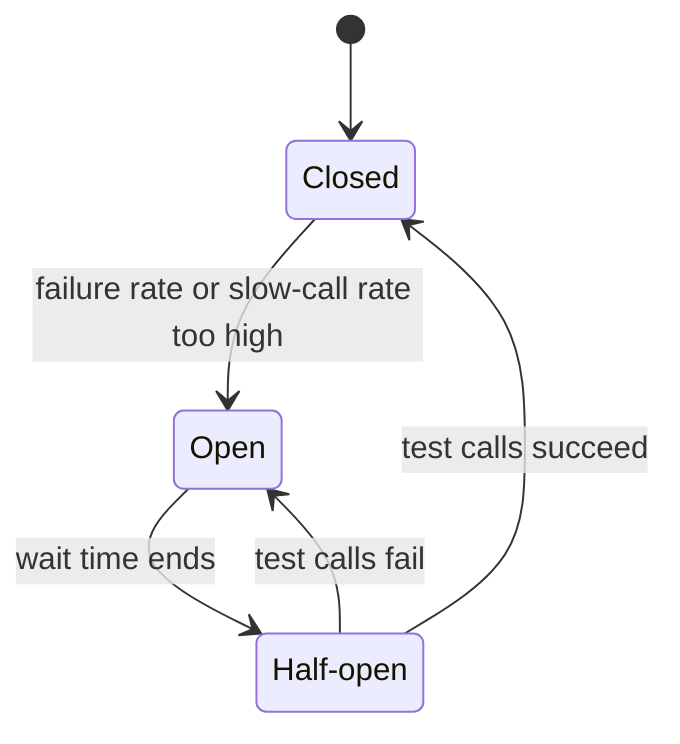
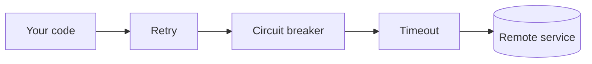

# Circuit Breaker

**Category:** Resilience · **Level:** Fundamentals · **Last updated:** 2026-10-20

> [!NOTE]
> Examples use Java 17, Spring Boot 3.2.4 and Resilience4j 2.2.0. The results in section 12 come from a real run of exactly this setup.

## In one minute

A circuit breaker watches calls to another service. If too many fail or run slow, it stops calling that service for a short time and answers immediately with a backup response. This keeps your own app responsive and gives the struggling service time to recover. After a wait, it tests the service with a few calls and goes back to normal if they work.

## Where it fits

This is step **1.5** of the [resilience track](01-resilience-overview.md). It is an **independent** pattern, not part of any other. Learn timeouts, retries and idempotency first (1.2 to 1.4); the breaker builds on them. It is a sibling of the [bulkhead](06-bulkhead.md): the bulkhead limits how many calls run at once, and the breaker stops calls after enough failures.

## Why it matters for your role

- **As an engineer:** you add the breaker to calls that leave your service, choose the timeouts and thresholds, write a safe fallback, test the open and half-open behaviour, and read the dashboards when it trips.
- **As an architect:** you decide which dependencies need protection, agree the fallback behaviour with the business, set a team standard (library or service mesh), and ask "what happens when this dependency is slow?" in every design review.

## 1. The problem

Your app has a limited number of worker threads (Tomcat's default is 200). When `checkout` calls `inventory`, the thread waits for the answer.

If `inventory` becomes slow (say 15 seconds), each request holds a thread for 15 seconds. New requests keep coming, all threads get stuck, and checkout stops answering everything, even pages that never call inventory. This is a **cascading failure**.

> [!IMPORTANT]
> A slow service is more dangerous than a dead one. A dead service fails fast and frees the thread. A slow one traps it.

## 2. Why timeouts and retries are not enough

| Tool | What it does | Its limit |
|---|---|---|
| Timeout | Stops waiting on one call after N seconds | Many waiting calls still add up |
| Retry | Tries again after a failure | Sends *more* traffic to a service that is already struggling (a "retry storm") |
| **Circuit breaker** | Remembers recent results and stops calling a broken service | Needs tuning, and needs a good fallback |

Timeouts and retries have no memory. The breaker has memory.

## 3. The three states



- **Closed:** calls go through. The breaker counts results.
- **Open:** calls are rejected immediately (about 1 ms), and the dependency receives nothing.
- **Half-open:** a small number of test calls go through. Success closes the breaker. Failure reopens it.

## 4. How it decides

It keeps a **sliding window** of recent calls (for example, the last 10) and checks two numbers:

- **Failure rate:** the percentage of failed calls.
- **Slow-call rate:** the percentage of calls slower than a time limit.

It also waits for a **minimum number of calls** before judging. With one call recorded, one failure would look like "100% failing".

Settings used in the example (`application.yml`):

| Setting | Value | Meaning |
|---|---:|---|
| `slidingWindowSize` | 10 | Look at the last 10 calls |
| `minimumNumberOfCalls` | 5 | Don't judge before 5 calls |
| `failureRateThreshold` | 50 | Open at 50% failures |
| `slowCallDurationThreshold` | 1s | A call over 1s is "slow" |
| `slowCallRateThreshold` | 80 | Open at 80% slow calls |
| `waitDurationInOpenState` | 10s | Stay open for 10s |
| `permittedNumberOfCallsInHalfOpenState` | 3 | Allow 3 test calls |

## 5. What counts as a failure

- **Counts:** HTTP 5xx, timeouts, connection errors.
- **Does not count:** business answers, such as a declined card (HTTP 402). The service worked correctly.

> [!WARNING]
> Use `ignoreExceptions` for business errors. Otherwise a run of declined cards could block every customer.

## 6. The fallback

The fallback is the answer given when the breaker is open or the call fails. Options:

- a saved value (cache),
- a default ("recommendations unavailable"),
- a deferred result (the example returns `PENDING` and settles the payment later),
- a clear error ("please try again shortly").

> [!TIP]
> A fallback may give *less*, but must never give something *false*. Choosing it is a business decision, not only a technical one.

## 7. How it works with timeouts and retries

Three layers of protection:

1. **Timeout:** don't wait forever on one call.
2. **Retry:** handle short glitches.
3. **Circuit breaker:** stop calling when the problem lasts.



In Resilience4j's default order, the retry wraps the breaker. Each retry attempt is counted by the breaker. Do not retry "breaker open" errors, since they can't succeed.

## 8. Using it in Spring Boot (Resilience4j)

```java
@CircuitBreaker(name = "payment", fallbackMethod = "pendingPayment")
public PaymentResult charge(String orderId) { ... }

PaymentResult pendingPayment(String orderId, Throwable t) { ... }
```

```yaml
resilience4j:
  circuitbreaker:
    instances:
      payment:
        slidingWindowSize: 10
        minimumNumberOfCalls: 5
        failureRateThreshold: 50
        slowCallDurationThreshold: 1s
        waitDurationInOpenState: 10s
        permittedNumberOfCallsInHalfOpenState: 3
        ignoreExceptions:
          - com.learning.circuitbreaker.PaymentDeclinedException
```

Needs: `resilience4j-spring-boot3`, `spring-boot-starter-aop` and `spring-boot-starter-actuator`. This configuration was run and checked with automated tests.

## 9. Where to place it

- One breaker **per dependency** (not one for the whole app).
- Around calls that leave your process: other services, databases, third-party APIs.
- Each app instance has its **own** breaker. With 4 pods, they won't all open together.

## 10. Watching it in production

Track: breaker state, failure rate, slow-call rate, and rejected calls. **Alert when a breaker stays open** for several minutes. An open breaker with a polite fallback can hide an outage for hours.

With Spring Boot Actuator (expose them in `management.endpoints.web.exposure.include`): `/actuator/circuitbreakers` shows each breaker's state and rates, and `/actuator/circuitbreakerevents` lists every state change and rejected call.

## 11. Common mistakes

1. No timeout, so the breaker can't count calls that never finish.
2. Counting business errors as failures.
3. A fallback that pretends success.
4. One shared breaker for everything.
5. Never tuning the numbers, which causes constant flapping between open and closed.
6. Calling the annotated method from inside the same class. The breaker works through a proxy, so a self-call skips it.
7. Too many test calls in half-open, which can knock over a service that has only just recovered.

## 12. Example run and results

**Setup:** a small Spring Boot service accepts an order and calls a payment service. The payment service can be switched at runtime to answer normally, return HTTP 500, answer slowly (2 seconds), or decline the card (HTTP 402). The breaker uses the settings from section 4, the fallback returns `PENDING`, and the read timeout is 3 seconds.

**What happened:**

| Situation | Result |
|---|---|
| 3 healthy + 3 failing calls | Opened at 3 failures out of 6 (50%). Earlier healthy calls count in the window. |
| 5 calls while open | Each took about 1.5 ms. The dependency received 0 of them. |
| After 10s | Moved to half-open on its own. 3 healthy test calls closed it. |
| 6 declined cards | Stayed closed. Declines aren't even recorded. |
| 2-second slow calls, no errors | Opened after 5 calls: failed=0, slow=5, slow rate 100%. |

## 13. Industry check

> [!NOTE]
> Last checked: 2026-10-20 by web search. Sources were mostly blogs and articles, so confirm versions on Maven Central or the project's GitHub releases page before upgrading. Re-verify this section when you revisit the note.

- **JVM:** Resilience4j is the standard choice. Netflix put Hystrix into maintenance mode in 2018 and uses Resilience4j for its own new projects. Don't use Hystrix for new work. Spring also announced in 2018 that its Spring Cloud Netflix projects were entering maintenance mode, and Resilience4j was the recommended replacement.
- **Versions:** the newest Resilience4j I found was **2.4.0 (March 2026)**. The examples in this note were run with 2.2.0. Before using a newer version, re-run your own tests, since defaults and behaviour can change.
- **Spring:** Spring Cloud Circuit Breaker is an abstraction, not a separate library. It offers one common API with Resilience4j as its implementation, useful if you don't want your code tied to one library.
- **Service mesh (Istio, Envoy):** can eject unhealthy servers at the proxy ("outlier detection") with no code changes. Simpler to roll out everywhere, but gives no control over the fallback response.
- **Related patterns:** bulkhead, rate limiting, load shedding, timeouts with retry and backoff.
- **Decision rule:** use the library when the fallback needs business logic. Use the mesh for a uniform baseline across many services. Many teams use both.

## 14. Quick Q&A (for review)

**Why can retries make an overloaded service worse?** Each failed request becomes several requests, so a service that is struggling gets more load. The breaker stops these calls after it opens.

**Would an error-only breaker help with a slow service?** No. Slow calls don't fail, so the error rate stays 0%. You need the slow-call setting, and a timeout helps too.

**The service is fixed, but the breaker is open. What happens?** It waits for the open time to end, moves to half-open, sends a few test calls, and closes if they succeed.

**Why ignore a declined card?** It's a correct business answer, not an outage.

**What should a payment fallback never do?** Pretend the payment succeeded.

## 15. Interview answer (60 seconds)

> "A circuit breaker watches recent calls to a dependency. If too many fail or run slow, it opens and rejects calls immediately, which protects my threads and gives the dependency room to recover. After a wait it goes half-open and sends a few test calls, then closes if they succeed. I use it together with timeouts and retries, one breaker per dependency, I ignore business errors, I choose honest fallbacks, and I alert when a breaker stays open."

## 16. Going further

- Martin Fowler, ["CircuitBreaker"](https://martinfowler.com/bliki/CircuitBreaker.html)
- Microsoft Azure Architecture Center, "Circuit Breaker pattern"
- Resilience4j documentation (CircuitBreaker, Retry, Bulkhead, TimeLimiter)
- Michael Nygard, *Release It!* (stability patterns)

**Next topics:** Timeouts (1.2), retries with backoff and jitter (1.3) and idempotency (1.4), which this note builds on; then rate limiting (1.7). The [bulkhead](06-bulkhead.md) (1.6) is already written.

Back to [the index](../README.md).
