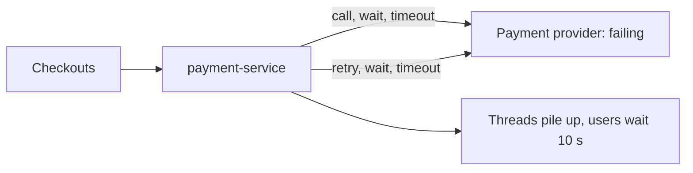
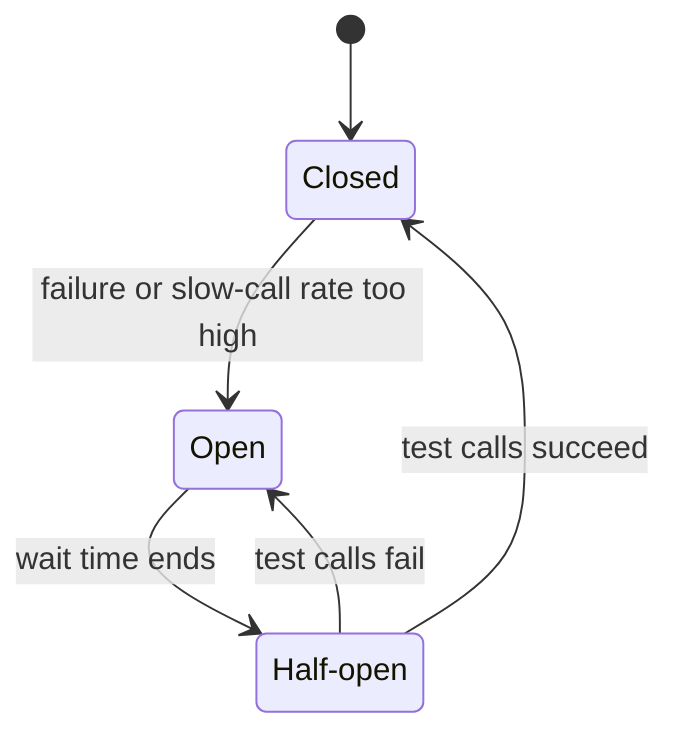

# Circuit Breaker

**Resilience · Step 1.5 · Fundamentals** · Last updated 2026-10-21

> [!TIP]
> **In one sentence:** a circuit breaker watches calls to a dependency, and when too many fail or run slow, it stops calling it for a while and answers at once with a fallback, then tests carefully before trusting it again.
>
> **Memory hook:** the **fuse box in your house**. A fault trips it so the wiring doesn't burn. You don't keep flipping it back on while the toaster is still shorted; you wait, then test it once.

## Where it fits

Step 1.5 of the [resilience track](01-resilience-overview.md). It builds on [timeouts](02-timeouts.md), [retries](03-retries-backoff-jitter.md) and [idempotency](04-idempotency.md): it is what stops retries once a dependency is clearly broken. It is an **independent** pattern and a sibling of the [bulkhead](06-bulkhead.md) (1.6): the bulkhead limits how many calls run at once, the breaker stops calls after enough failures.

## 1. The story

ShopFlow's external payment provider starts failing. `payment-service` keeps calling it: every checkout waits for a timeout, then retries, then waits again. Customers stare at spinners for 10 seconds before seeing an error, threads pile up, and the provider, already struggling, gets even more traffic from the retries.



## 2. The idea

Give the caller **memory**. A breaker keeps a short record of recent calls. When the failure rate (or slow-call rate) crosses a threshold, it **opens**: calls are rejected immediately, in about a millisecond, without touching the provider. This protects your threads *and* gives the provider room to recover. After a wait, it lets a few **test calls** through. If they succeed, it closes again.



While open, the caller gets a **fallback**: in ShopFlow, "payment pending, we'll confirm shortly", never a fake success.

## 3. Key terms

| Term | Plain meaning |
|---|---|
| **Closed** | Normal: calls flow, results are counted |
| **Open** | Calls rejected instantly; the dependency gets nothing |
| **Half-open** | A few test calls decide whether to close or reopen |
| **Sliding window** | The recent calls the breaker judges (for example the last 10) |
| **Failure-rate threshold** | The share of failures that opens the breaker |
| **Slow-call threshold** | Calls slower than this count as "slow" |
| **Minimum number of calls** | Don't judge until this many calls are recorded |
| **Fallback** | The answer given when the call is rejected or fails |

## 4. How it works, step by step

1. **Closed:** each call's result goes into the sliding window.
2. Once the minimum number of calls is reached, the breaker checks the failure rate and the slow-call rate.
3. If either crosses its threshold, it goes **open**.
4. While open, every call is rejected at once and the fallback answers.
5. After the wait time, it goes **half-open** and lets a small number of test calls through.
6. Test calls succeed: **closed**. They fail: **open** again.

**What counts as a failure:** timeouts, 5xx errors, connection errors. **Not** business answers: a declined card (HTTP 402) is a correct response and must be ignored, or a run of declines would block every customer.

## 5. Real-world examples

- **Travel booking sites:** when one airline's API goes down, a breaker per airline stops calls to it, and searches show the other airlines' results instead of timing out.
- **Banking apps:** a breaker around a credit-score provider opens during its outage, and loan applications are queued for later review instead of failing.
- **Video streaming:** a breaker around the personalisation service opens under errors, and the home page shows a cached generic row.

## 6. Design choices and trade-offs

| Choice | Guidance |
|---|---|
| **Scope** | One breaker **per dependency**, not one for the whole app |
| **Thresholds** | Tune from real traffic; too sensitive flaps, too lax reacts late |
| **Fallback** | A business decision: give less, never something false |
| **Library or service mesh** | Library when the fallback needs business logic; a mesh (Envoy, Istio) for a uniform baseline with no code; many teams use both |
| **Several instances** | Each pod has its own breaker; they won't all open together, which is usually fine |

**Breaker versus bulkhead:** the breaker reacts to *recent results*; the bulkhead limits *concurrent calls* from the first second. Use both.

## 7. Common mistakes

1. **No timeout**, so the breaker can't count calls that never finish.
2. **Counting business errors** (declined cards) as failures.
3. **A fallback that pretends success.**
4. **One shared breaker** for every dependency.
5. **Never tuning thresholds**, so it flaps open and closed.
6. **Calling the annotated method from the same class**: the annotation works through a proxy, so a self-call skips the breaker.
7. **Too many half-open test calls**, knocking over a service that has only just recovered.

## 8. In code

> [!NOTE]
> This configuration was run and checked with automated tests on Java 17, Spring Boot 3.2.4 and Resilience4j 2.2.0. The results below come from that run.

```java
@CircuitBreaker(name = "payment", fallbackMethod = "pendingPayment")
public PaymentResult charge(String orderId) { ... }

PaymentResult pendingPayment(String orderId, Throwable t) {
    if (t instanceof PaymentDeclinedException d) throw d;   // business answer: not a degradation
    return PaymentResult.pending(orderId);
}
```

```yaml
resilience4j.circuitbreaker.instances.payment:
  slidingWindowSize: 10
  minimumNumberOfCalls: 5
  failureRateThreshold: 50
  slowCallDurationThreshold: 1s
  slowCallRateThreshold: 80
  waitDurationInOpenState: 10s
  permittedNumberOfCallsInHalfOpenState: 3
  ignoreExceptions: [com.example.PaymentDeclinedException]
```

**What the example run showed:**

| Situation | Result |
|---|---|
| 3 healthy then 3 failing calls | Opened at 3 failures out of 6 (50%): earlier successes count in the window |
| Calls while open | About 1 ms each; the dependency received none |
| After 10 s | Half-open on its own; 3 healthy test calls closed it |
| Declined cards (402) | Stayed closed; declines weren't even recorded |
| 2-second calls, no errors | Opened after 5 calls on the slow-call rate (100%) |

The fallback method receives every exception, including ignored ones, which is why it rethrows the declined-card error. Spring Boot Actuator shows state at `/actuator/circuitbreakers` and every transition at `/actuator/circuitbreakerevents`.

## 9. Remember

- **Closed → open → half-open → closed.**
- **Slow calls count too**: a breaker that only watches errors misses the dangerous case.
- **Ignore business errors.**
- **A fallback may give less, never something false.**
- **Alert when a breaker stays open**: a polite fallback can hide an outage for hours.

## 10. Interview corner

**15-second answer:** "A circuit breaker stops calling a dependency after too many failures or slow calls, answers with a fallback, and sends a few test calls later before trusting it again."

**60-second answer:**
> "A circuit breaker watches recent calls to a dependency. When the failure or slow-call rate crosses a threshold, it opens and rejects calls immediately, which protects my threads and gives the dependency room to recover. After a wait it goes half-open, lets a few test calls through, and closes if they succeed. I use one breaker per dependency, behind timeouts and limited retries, ignore business errors like declined cards, return an honest fallback, and alert when a breaker stays open."

**Likely follow-up questions:**
- **Would an error-only breaker protect against a slow service?** No. Slow calls don't fail, so you need the slow-call threshold, and a timeout.
- **What happens when the dependency recovers?** Nothing until the wait ends; then half-open test calls decide.
- **Why a minimum number of calls?** So one failure out of one call doesn't look like "100% failing".
- **Library or service mesh?** Library when the fallback needs business logic; a mesh for a no-code baseline; often both.

**Architect angle:** "The fallback is a product decision I agree with the business, and an open breaker is an alert, not a silent success."

## 11. Industry check

> [!NOTE]
> Checked 2026-10-20 by web search; mostly blogs and articles. Re-verify when you revisit the note.

- **Confirmed:** Resilience4j is the standard JVM choice; Netflix put Hystrix into maintenance mode in 2018 and Spring Cloud Netflix followed, recommending Resilience4j. Spring Cloud Circuit Breaker is an abstraction with Resilience4j as an implementation. The newest Resilience4j found was 2.4.0 (March 2026); the example above used 2.2.0.
- **To verify:** service mesh outlier-detection features for your mesh version; defaults if you upgrade Resilience4j.
- **Decision rule:** a library breaker when the fallback needs business logic, a mesh for a uniform baseline, both for critical paths.

## 12. Going further

- Martin Fowler, ["CircuitBreaker"](https://martinfowler.com/bliki/CircuitBreaker.html)
- Microsoft Azure Architecture Center, "Circuit Breaker pattern"
- Resilience4j documentation
- Michael Nygard, *Release It!*

**Next:** [Bulkhead](06-bulkhead.md) (1.6).

Back to [the index](../README.md) · [Roadmap](../roadmap.md).
