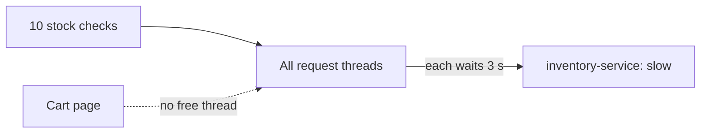
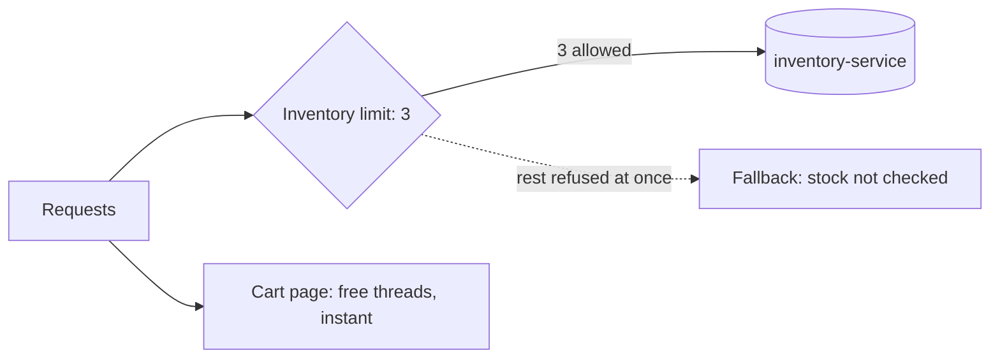

# Bulkhead

**Resilience · Step 1.6 · Fundamentals** · Last updated 2026-10-21

> [!TIP]
> **In one sentence:** a bulkhead limits how many calls can use one dependency at the same time, so a slow dependency can only tie up its own small share of your threads.
>
> **Memory hook:** the **sealed compartments of a ship's hull**. If one floods, the water stays there and the ship stays afloat. Or a **supermarket with a separate checkout for click-and-collect**: a long queue there doesn't block the other tills.

## Where it fits

Step 1.6 of the [resilience track](01-resilience-overview.md). It is **independent**, not part of the [circuit breaker](05-circuit-breaker.md): they are siblings that answer different questions and are often used together. A bulkhead also relies on [timeouts](02-timeouts.md), so a stuck call eventually frees its slot. Next: rate limiting (1.7).

## 1. The story

ShopFlow's `order-service` has a fixed pool of request threads. During a sale, `inventory-service` becomes slow, taking 3 seconds per stock check. Ten customers ask for stock at the same moment, and all request threads end up waiting on inventory. Then someone opens the **cart page**, which has nothing to do with inventory, and it has to queue for a free thread.



The slow call isn't the real danger. The danger is slow calls **using up threads everything else needs**.

## 2. The idea

Give each dependency its own **limit**. Calls inside the limit run normally. A call beyond it is **refused at once** and gets a fallback, such as "stock not checked". With a limit of 3, at most 3 threads can ever be stuck on inventory; the rest stay free.



## 3. Key terms

| Term | Plain meaning |
|---|---|
| **Bulkhead** | A per-dependency limit on concurrent calls |
| **Concurrent calls** | Calls in flight at the same moment |
| **Semaphore bulkhead** | Counts calls running at once, on the caller's thread |
| **Thread-pool bulkhead** | Runs calls in a separate small pool with a queue |
| **Max wait** | How long an extra caller may wait for a slot (0 = refuse at once) |
| **Thread starvation / exhaustion** | No free threads left for other work |

## 4. How it works, step by step

1. A call arrives for inventory.
2. If fewer than the limit are running, it gets a **permit** and runs.
3. If the limit is reached, it waits up to the max wait (usually zero), then is **refused**.
4. The refused call goes straight to the fallback.
5. When a running call finishes (or times out), its permit is returned.

**Two kinds in Resilience4j:** the **semaphore** bulkhead (cheap, for normal blocking code, the usual start) and the **thread-pool** bulkhead (for async code returning a `CompletableFuture`; costs extra threads).

## 5. Real-world examples

- **Airline websites:** the seat-map provider is slow on a busy day; a bulkhead caps calls to it, so search and check-in keep working and the seat map shows "try again".
- **SaaS platforms:** a separate limit (or separate pods) per large customer, so one tenant's heavy export can't starve everyone else.
- **Microservice gateways:** per-backend connection limits, so one slow backend can't take all the gateway's connections.

## 6. Design choices and trade-offs

| | Bulkhead | Circuit breaker |
|---|---|---|
| Question | How many calls at once? | Is the dependency healthy at all? |
| Looks at | Calls in flight right now | Results of recent calls |
| Reacts | Immediately, on every call | After enough failures or slow calls |
| Protects against | Running out of threads | Wasting calls on a broken service |

**Choosing the limit:** roughly requests per second × normal response time in seconds (30 requests/s at 100 ms is about 3 in flight), plus headroom. Keep the sum of all limits well below your total threads.

**Code or infrastructure:** a code-level bulkhead gives a per-dependency limit with a custom fallback; separate pods, resource limits or connection pools isolate more strongly.

## 7. Common mistakes

1. **One bulkhead for everything**: just a smaller shared pool, no isolation.
2. **A limit as big as the thread pool**, so nothing is protected.
3. **A long max wait**: waiting callers hold threads again.
4. **No fallback** for the "full" case.
5. **Not watching rejections**, hiding a capacity problem.
6. **Forgetting timeouts**: a bulkhead limits *how many* wait, not *how long*.

## 8. In code

> [!NOTE]
> This configuration was run and checked with automated tests on Java 17, Spring Boot 3.2.4 and Resilience4j 2.2.0. The results below come from that run.

```java
@Bulkhead(name = "inventory", type = Bulkhead.Type.SEMAPHORE, fallbackMethod = "stockUnknown")
public StockResult checkStock(String sku) { ... }
```

```yaml
resilience4j.bulkhead.instances.inventory:
  maxConcurrentCalls: 3
  maxWaitDuration: 0
```

**What the example run showed** (10 request threads, inventory taking 3 s, 10 customers at once, then the cart page):

| | Without bulkhead | With bulkhead (limit 3) |
|---|---|---|
| Stock checks that ran | 10 | 3 |
| Refused at once | 0 | 7 (about 1 ms each) |
| **Cart page** | **2.5 s** | **0.0015 s** |

Spring Boot Actuator lists every permitted and rejected call at `/actuator/bulkheadevents`, and `/actuator/metrics` has `resilience4j.bulkhead.available.concurrent.calls`.

## 9. Remember

- **A bulkhead limits calls at the same time**; a breaker reacts to failures. Siblings, not parent and child.
- **Refuse at once** (max wait 0); waiting callers hold threads.
- **One bulkhead per dependency.**
- **It doesn't replace a timeout.**
- **The proof:** cart page 2.5 s without, 0.0015 s with.

## 10. Interview corner

**15-second answer:** "A bulkhead caps concurrent calls per dependency, so a slow dependency can only use its own share of threads and the rest of the app stays fast."

**60-second answer:**
> "A slow dependency is dangerous because waiting calls hold threads until nothing is left for other features. A bulkhead gives each dependency its own limit on concurrent calls; extra calls are refused immediately and get a fallback, so unrelated pages keep working. I use a semaphore bulkhead per dependency, size it from request rate times response time, keep the wait at zero, and watch rejections. It works with timeouts and a circuit breaker, and for stronger isolation I separate workloads at the pod level."

**Likely follow-up questions:**
- **Bulkhead versus circuit breaker?** Bulkhead: how many at once, from the first second. Breaker: stop after observed failures.
- **Why max wait zero?** Waiting callers hold threads, so the protection disappears.
- **Semaphore or thread pool?** Semaphore for normal blocking code; thread pool for async code, at the cost of extra threads.
- **Do virtual threads make bulkheads unnecessary?** They make running out of threads less likely, but the dependency can still be overloaded, so a per-dependency limit is still useful.

**Architect angle:** "I decide where isolation lives: a code-level bulkhead per dependency, or separate pods and pools when the blast radius justifies it."

## 11. Industry check

> [!NOTE]
> Checked 2026-10-20 by web search (tutorials and a GitHub issue; the official docs did not come up). Re-verify when you revisit the note.

- **Confirmed:** Resilience4j offers semaphore and thread-pool bulkheads; the actuator endpoints and metrics above were checked against a running app.
- **To verify:** Resilience4j default values (reported as 25 concurrent calls and 0 wait); how virtual threads in your Spring Boot version change the picture; service-mesh connection limits for your mesh.
- **Decision rule:** a code-level bulkhead per dependency with a custom fallback; pod and resource isolation for workloads that must never affect each other; both for critical paths.

## 12. Going further

- Resilience4j documentation (Bulkhead)
- Microsoft Azure Architecture Center, "Bulkhead pattern"
- Michael Nygard, *Release It!* ("Bulkheads")

**Next:** [Rate limiting and throttling](07-rate-limiting.md) (1.7).

Back to [the index](../README.md) · [Roadmap](../roadmap.md).
