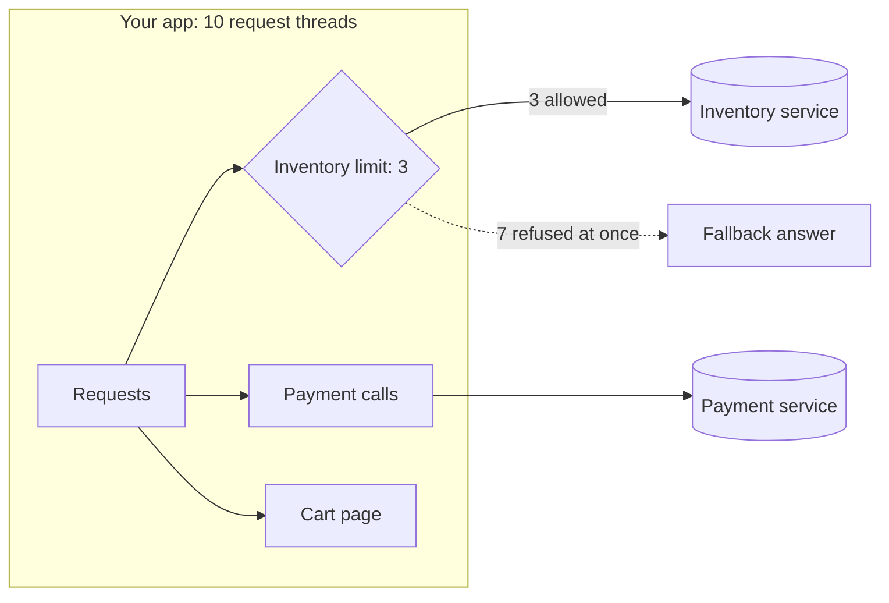

# Bulkhead

**Category:** Resilience · **Level:** Fundamentals · **Last updated:** 2026-10-20

> [!NOTE]
> Examples use Java 17, Spring Boot 3.2.4 and Resilience4j 2.2.0. The results in section 10 come from a real run of exactly this setup. Related: [Circuit Breaker](05-circuit-breaker.md).

## In one minute

A bulkhead limits how many calls can use one dependency at the same time. Extra callers are refused straight away instead of waiting. That way a slow dependency can only tie up its own small share of your threads, and the rest of your app keeps working. The name comes from the sealed compartments in a ship's hull: if one floods, the ship stays afloat.

## Where it fits

This is step **1.6** of the [resilience track](01-resilience-overview.md). It is an **independent** pattern: it is *not* part of the circuit breaker. They are siblings that answer different questions (how many calls at once, versus has this dependency failed enough to stop calling it) and are often used together. Learn it after the [circuit breaker](05-circuit-breaker.md).

## Why it matters for your role

- **As an engineer:** you add a bulkhead around each outside call that could be slow, choose the limit, write a fallback for the "full" case, and watch the rejection count.
- **As an architect:** you decide which dependencies get their own limit, how big each one is, what the user sees when it is full, and whether to isolate at the code level, the pod level or the service level.

## 1. The problem

Your app has a fixed number of request threads. In the example it is 10, set small on purpose (Tomcat's default is 200). Every request that calls a slow dependency keeps its thread until the answer comes back.

If 10 customers ask for stock while inventory takes 3 seconds, all 10 threads are busy. Nobody can open the cart page, even though the cart has nothing to do with inventory. One slow dependency used up a shared resource.

> [!IMPORTANT]
> The danger is not the slow call itself. The danger is that slow calls pile up and use up threads that everything else needs.

## 2. The core idea

Give each dependency its own **limit**. Calls inside the limit run normally. A call beyond the limit is turned away immediately and gets a fallback.



With the limit in place (3 in the example), at most 3 threads can ever be stuck on inventory. The other 7 threads stay free.

## 3. Bulkhead vs circuit breaker

They solve different problems and work well together.

| | Bulkhead | Circuit breaker |
|---|---|---|
| Question it answers | How many calls at once? | Is the dependency healthy at all? |
| Looks at | Number of calls in flight right now | Results of recent calls |
| Reacts | Immediately, on every call | After enough failures or slow calls |
| Protects against | Threads running out | Wasting calls on a broken service |
| Example | "No more than 3 inventory calls at once" | "Inventory has failed 50%, stop calling for 10s" |

The bulkhead protects you in the first seconds of a slowdown. The breaker takes over once the pattern is clear.

## 4. Two kinds in Resilience4j

| | Semaphore bulkhead | Thread-pool bulkhead |
|---|---|---|
| How it limits | Counts calls running at once | Runs calls in a separate small thread pool with a queue |
| The call runs on | The caller's own thread | A thread from the dedicated pool |
| Main settings | `maxConcurrentCalls`, `maxWaitDuration` | `maxThreadPoolSize`, `coreThreadPoolSize`, `queueCapacity` |
| Good for | Normal blocking code (what the example uses) | Async code that returns a `CompletableFuture` |
| Cost | Very cheap | Extra threads and context switches |

The example uses the semaphore kind, which is the usual starting point.

## 5. Settings used in the example

```yaml
resilience4j:
  bulkhead:
    instances:
      inventory:
        maxConcurrentCalls: 3     # at most 3 inventory calls at the same time
        maxWaitDuration: 0        # a 4th caller does not queue; it is refused immediately
```

```java
@Bulkhead(name = "inventory", type = Bulkhead.Type.SEMAPHORE, fallbackMethod = "stockFallback")
public StockResult checkStock(String sku) { ... }

StockResult stockFallback(String sku, BulkheadFullException e) { ... }
```

`maxWaitDuration: 0` means no queueing. A small wait can smooth short bursts, but a long wait puts the problem back, because waiting callers hold threads again.

## 6. How to choose the limit

Start from numbers, not guesses:

- **Rough rule:** limit ≈ requests per second to the dependency × its normal response time in seconds. For example, 30 requests/s at 100 ms gives 3 calls in flight on average. Add some headroom for bursts.
- **Keep the total sensible.** If you have 5 dependencies with a limit of 5 each, that is 25 threads. Make sure the sum still leaves threads free for everything else.
- **Check the dependency's own capacity.** If inventory can handle 20 parallel calls and you have 4 pods, each pod can allow about 5.
- **Tune from metrics.** Watch how often calls are refused. Constant refusals mean the limit is too low or the dependency is too slow.

## 7. What to do when it is full (the fallback)

The same rules as the circuit breaker fallback apply:

- A saved value or "stock not checked" (what the example returns).
- A default.
- A clear "busy, try again" error, ideally with a `Retry-After` hint.

> [!TIP]
> A refusal is information, not a failure. A fast "busy" answer is better than a slow answer that blocks everyone else.

## 8. Common mistakes

1. **One bulkhead for everything.** That is just a smaller shared pool, with no isolation between dependencies.
2. **A limit that is too big.** If the limit equals the number of request threads, nothing is protected.
3. **A long `maxWaitDuration`.** Waiting callers hold threads, so the protection disappears.
4. **No fallback** for the full case, so users see raw errors.
5. **Not watching rejections.** A bulkhead that quietly refuses 40% of calls hides a real capacity problem.
6. **Calling the annotated method from the same class.** The annotation works through a proxy, so a self-call skips it (the same gotcha as the circuit breaker).
7. **Forgetting timeouts.** A bulkhead limits how many calls wait, not how long each waits. You still need a timeout.

## 9. Operating it

Track: calls currently in progress, available permits, and **rejected calls**. Alert when rejections stay high for several minutes.

With Spring Boot Actuator (expose `bulkheads` and `bulkheadevents` in `management.endpoints.web.exposure.include`). Checked against a running app on Spring Boot 3.2.4 with Resilience4j 2.2.0:

- `/actuator/bulkheadevents` lists every `CALL_PERMITTED` and `CALL_REJECTED`.
- `/actuator/metrics` has `resilience4j.bulkhead.available.concurrent.calls` and `resilience4j.bulkhead.max.allowed.concurrent.calls`.
- `/actuator/bulkheads` only lists the bulkhead names.

## 10. Example run and results

**Setup:** a small Spring Boot service with 10 request threads. A stock check calls an inventory service that takes 3 seconds. The same check is exposed twice: once with no protection and once with the bulkhead (limit 3, no waiting). Ten customers ask for stock at the same moment, and half a second later someone opens the cart page, which has nothing to do with inventory.

**What happened:**

| | Without bulkhead | With bulkhead (limit 3) |
|---|---|---|
| Stock checks that ran | 10 | 3 |
| Stock checks refused at once | 0 | 7 (about 1 ms each) |
| Slowest stock reply | 3.0 s | 3.0 s |
| **Cart page (unrelated)** | **2.5 s** | **0.0015 s** |

Two automated tests checked the same thing: without a bulkhead the cart page waits for a free thread; with one, only 3 inventory calls are ever in flight and the cart page is instant.

## 11. Industry check

> [!NOTE]
> Last checked: 2026-10-20, by one web search (tutorials and a GitHub issue; the official Resilience4j docs did not come up). The defaults below are from secondary sources, so check the official docs before relying on them. Re-verify this section when you revisit the note.

- **Resilience4j** offers both the semaphore and the thread-pool bulkhead. Reported defaults: `maxConcurrentCalls` 25 and `maxWaitDuration` 0 (to verify).
- **Netflix Hystrix**, now in maintenance mode, popularised thread-pool isolation per dependency. Resilience4j's semaphore version is lighter and more common today.
- **Infrastructure-level bulkheads:** separate pods or deployments per workload, Kubernetes CPU and memory limits, separate connection pools and queues, separate consumer groups. These isolate more strongly than a code-level limit.
- **Service mesh (Envoy, Istio):** can limit concurrent connections and pending requests per upstream service, with no code changes.
- **Virtual threads (Java 21):** they make "running out of threads" much less likely, but the dependency can still be overloaded. A concurrency limit toward each dependency is still useful (to verify for your Spring Boot setup).
- **Decision rule:** use a code-level bulkhead for per-dependency limits with a custom fallback. Use pod and resource isolation for big workloads that must never affect each other. Use both for critical paths.

## 12. Quick Q&A (for review)

**What problem does a bulkhead solve?** One slow dependency using up all the shared threads, so unrelated features stop working.

**How is it different from a circuit breaker?** A bulkhead limits how many calls run at once. A breaker stops calls after it sees enough failures or slow calls. Use both.

**Why is `maxWaitDuration: 0` a good default?** Waiting callers hold threads. Refusing immediately keeps threads free.

**Does a bulkhead replace a timeout?** No. It limits how many calls wait, not how long each one waits.

**Where else can bulkheads exist besides in code?** Separate pods or deployments, resource limits, separate connection pools, separate consumer groups, and mesh connection limits.

## 13. Interview answer (60 seconds)

> "A bulkhead limits how many concurrent calls go to one dependency, so a slow dependency can only use its own small share of my threads. Extra calls are refused immediately and get a fallback, so unrelated features keep working. I'd use a semaphore bulkhead per dependency, size it from request rate times response time, keep the wait at zero, and watch the rejection count. It works together with timeouts and a circuit breaker, and for stronger isolation I'd separate workloads at the pod level."

## 14. Going further

- Resilience4j documentation: Bulkhead
- Microsoft Azure Architecture Center, "Bulkhead pattern"
- Michael Nygard, *Release It!* (the "Bulkheads" stability pattern)

**Next topics:** Timeouts, retries, backoff and jitter; rate limiting and load shedding.

Back to [the index](../README.md) · [Roadmap](../roadmap.md).
