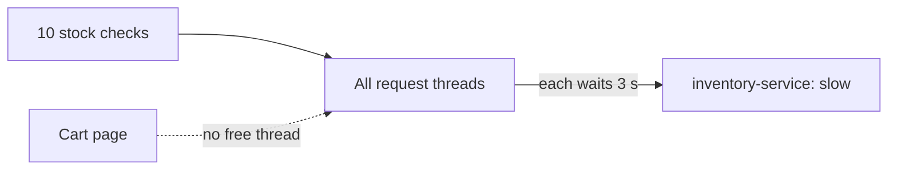
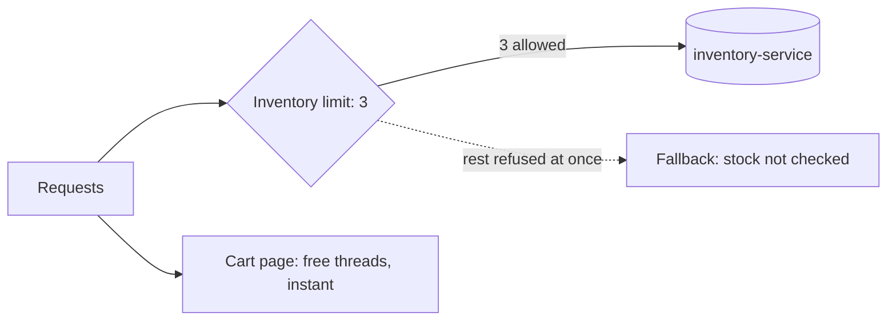

# Bulkhead

**Resilience · Step 1.6 · Fundamentals** · Last updated 2026-10-21
**Prerequisites:** [Timeouts](02-timeouts.md) (1.2), [Circuit breaker](05-circuit-breaker.md) (1.5, as the sibling pattern)

## 1. The concept in simple English

**What is it?** A bulkhead limits how many calls can use one dependency **at the same time**. Calls beyond the limit are refused immediately, so a slow dependency can only tie up its own small share of your threads.

**Why do we need it?** A slow dependency is dangerous because waiting calls hold threads. If all threads end up waiting on one dependency, unrelated features have nothing left to run on.

**When would I meet it?** Whenever one service calls several dependencies that share a thread pool or connection pool, such as a web service calling inventory, payment and recommendations.

> [!TIP]
> **Memory hook:** the sealed compartments of a ship's hull. If one floods, the water stays there and the ship stays afloat.

## 2. Mental model: ship compartments

| In the analogy | In the real system |
|---|---|
| A hull compartment | The **limit** for one dependency |
| Water in one compartment | A slow or failing dependency |
| The sealed wall | Refusing calls beyond the limit |
| The rest of the ship | Threads left for other features |

**Where the analogy breaks:** a hull wall is permanent. A bulkhead only limits *how many* calls wait at once; it doesn't limit *how long* each waits (that's the timeout), and it doesn't notice that a dependency is unhealthy (that's the circuit breaker).

## 3. Industry terms

| Term | Simple meaning | Why it matters | Example | Related terms |
|---|---|---|---|---|
| **Bulkhead** | A per-dependency limit on concurrent calls | Contains the blast radius | 3 stock checks at once | Blast radius |
| **Concurrent calls** | Calls in flight at the same moment | What the limit counts | 3 of 3 in use | Concurrency limit |
| **Semaphore bulkhead** | Counts calls running at once, on the caller's thread | Cheap; the usual start | Resilience4j `SEMAPHORE` | Thread-pool bulkhead |
| **Thread-pool bulkhead** | Runs calls in a separate small pool with a queue | Isolates threads, for asynchronous calls | Resilience4j `THREADPOOL` | Queue capacity |
| **Max wait** | How long an extra caller may wait for a slot (0 = refuse at once) | A long wait brings the problem back | `maxWaitDuration: 0` | Fail fast |
| **Thread exhaustion** | No free threads left for other work | The failure a bulkhead prevents | Cart page can't get a thread | Cascading failure |

## 4. In a real system (ShopFlow)

**The business problem.** A slow Inventory Service must not stop the cart page, which has nothing to do with inventory.

The Order Service has a fixed pool of request threads. During a sale, inventory takes 3 seconds per stock check. Ten customers ask for stock at the same moment, and all request threads end up waiting on inventory. Then someone opens the cart page and it has to queue for a thread.



**How the bulkhead helps.** With a limit of 3, at most 3 threads can ever be stuck on inventory; the other stock checks are refused at once with a fallback ("stock not checked"), and the cart page keeps its threads.

**What it costs.** Some requests are refused even though inventory could have answered them eventually; the limit has to be sized and monitored.

**Elsewhere:** SaaS platforms give each large customer its own limit (or pods), so one tenant's heavy export can't starve the others.

## 5. How it works



1. A call arrives for inventory.
2. If fewer than the limit are running, it gets a **permit** and runs.
3. If the limit is reached, it waits up to the max wait (usually zero), then is **refused**.
4. The refused call goes straight to the fallback.
5. When a running call finishes (or times out), its permit is returned.

In Resilience4j there are two kinds: the **semaphore** bulkhead (cheap, for normal blocking code, the usual start) and the **thread-pool** bulkhead (for asynchronous code returning a `CompletableFuture`; costs extra threads).

**Choosing the limit.** Roughly requests per second × normal response time in seconds (30 requests/s at 100 ms is about 3 in flight), plus headroom, and keep the sum of all limits well below the total thread count. Code-level bulkheads give a per-dependency limit with a custom fallback; separate pods, resource limits or connection pools isolate more strongly.

> [!NOTE]
> This configuration was run and checked with automated tests on Spring Boot 3.2.4 and Resilience4j 2.2.0 (the lab's tests and demo scripts also ran on Java 21.0.8 on 2026-10-21). The results below come from those runs.

```java
@Bulkhead(name = "inventory", type = Bulkhead.Type.SEMAPHORE, fallbackMethod = "stockUnknown")
public StockResult checkStock(String sku) { ... }
```

```yaml
resilience4j.bulkhead.instances.inventory:
  maxConcurrentCalls: 3
  maxWaitDuration: 0
```

**What the example runs showed** (10 request threads, inventory taking 3 s, 10 customers at once, then the cart page):

| | Without bulkhead | With bulkhead (limit 3) |
|---|---|---|
| Stock checks that ran | 10 | 3 |
| Refused at once | 0 | 7 (about 1 ms each) |
| **Cart page** | **2.5 s** | **0.0015 s** |

Spring Boot Actuator lists every permitted and rejected call at `/actuator/bulkheadevents`, and `/actuator/metrics` has `resilience4j.bulkhead.available.concurrent.calls`.

**Who guarantees what**

| Layer | Responsible for |
|---|---|
| Library | Counting permits and refusing calls beyond the limit |
| Application | Sizing the limit, the fallback, watching rejections |
| Timeout ([1.2](02-timeouts.md)) | Freeing a permit when a call hangs: the bulkhead alone never does |
| Platform (pods, pools) | Stronger isolation than an in-process limit |

## 6. Failure scenarios

### The bulkhead without a timeout

- **What happened?** Three calls hung forever; all three permits stayed taken and every later call was refused.
- **Why?** A bulkhead limits how many wait, not how long.
- **Solutions:** timeouts on every call ([1.2](02-timeouts.md)).

### A long max wait

- **What happened?** Extra callers waited 5 seconds for a permit, holding their threads again.
- **Solutions:** keep the wait at zero for request-handling threads.

### One bulkhead for everything

- **What happened?** A single shared limit across all dependencies behaved like a smaller shared pool: no isolation.
- **Solutions:** one bulkhead per dependency, sized from its own traffic.

## 7. Architectural decisions

| | Bulkhead | Circuit breaker |
|---|---|---|
| Question | How many calls at once? | Is the dependency healthy at all? |
| Looks at | Calls in flight right now | Results of recent calls |
| Reacts | Immediately, on every call | After enough failures or slow calls |
| Protects against | Running out of threads | Wasting calls on a broken service |

They are **siblings**, not parent and child. **Semaphore or thread pool?** Semaphore for blocking code; thread pool for asynchronous code, at the cost of extra threads. **Do virtual threads make it unnecessary?** They can make thread exhaustion less likely, but the dependency itself can still be overloaded, so a per-dependency limit remains useful (a reasoning point, not something measured here). **Common mistakes:** a limit as large as the whole pool; no fallback for the "full" case; not watching rejections, which hides a capacity problem.

## 8. Check your understanding

1. A bulkhead with limit 3 is full and one call hangs forever. What happens to the permit, and what should have prevented it?
2. Why is a max wait of zero the usual choice?
3. How do a bulkhead and a circuit breaker differ in what they react to?
4. How would you estimate a starting limit for a dependency?

Answers are at the end of this note.

## 9. Revision

**Remember**
- **A bulkhead limits calls at the same time**; a breaker reacts to failures. Siblings.
- **Refuse at once** (max wait 0); waiting callers hold threads.
- **One bulkhead per dependency.**
- **It doesn't replace a timeout.**
- **The proof:** cart page 2.5 s without, 0.0015 s with, in the example run.

**Explain in 15 seconds:** "A bulkhead caps concurrent calls per dependency, so a slow dependency can only use its own share of threads and the rest of the application stays fast."

**Explain in 60 seconds:**
> "Waiting calls hold threads until nothing is left for other features. A bulkhead gives each dependency its own limit on concurrent calls; extra calls are refused immediately and get a fallback, so unrelated pages keep working. I use a semaphore bulkhead per dependency, size it from request rate times response time, keep the wait at zero and watch rejections. It needs timeouts underneath and works alongside a circuit breaker, and for stronger isolation I separate workloads at the pod level."

**Likely follow-up questions:**
- **Semaphore or thread pool?** Semaphore for blocking code; thread pool for asynchronous code, with extra threads.
- **Do the numbers prove it?** They show the effect in one example run (cart page 2.5 s vs 0.0015 s), not a general speed-up.

**Architect's takeaway:** decide where isolation lives: a code-level bulkhead per dependency, or separate pods and pools when the blast radius justifies it.

**Next topic:** [Rate limiting and throttling](07-rate-limiting.md) (1.7)

## 10. Verification and sources

> [!NOTE]
> Checked 2026-10-20 and 2026-10-21. Re-verify when you revisit this note.

- **Confirmed:** Resilience4j offers semaphore and thread-pool bulkheads; the Resilience4j bulkhead documentation lists defaults of `maxConcurrentCalls` 25 and `maxWaitDuration` 0 for the semaphore bulkhead (the page states no version, so check your version); the Actuator endpoints and metrics above were checked against a running app, and the lab's tests and demos ran on 2026-10-21.
- **Assumptions and illustrations:** the ShopFlow story, the sizing rule of thumb and the "Elsewhere" example.
- **To verify:** how virtual threads in your Spring Boot version change the picture; service-mesh connection limits for your mesh.
- **Decision rule:** a code-level bulkhead per dependency with a custom fallback; pod and resource isolation for workloads that must never affect each other; both for critical paths.

**Sources:** Resilience4j documentation (Bulkhead); Microsoft Azure Architecture Center, "Bulkhead pattern"; Michael Nygard, *Release It!*.

## Answers

1. The permit stays taken until the hung call returns, so later calls are refused. A timeout on the call would free the permit.
2. Waiting callers hold their threads, which brings back the problem the bulkhead is meant to prevent.
3. The bulkhead reacts to the number of calls in flight, on every call; the breaker reacts to the results (failures, slow calls) of recent calls.
4. Requests per second to that dependency × its normal response time in seconds, plus headroom; check that all limits together stay well below the thread count, then watch rejections.

Back to [the resilience overview](01-resilience-overview.md) · [Index](../README.md) · [Roadmap](../roadmap.md).
