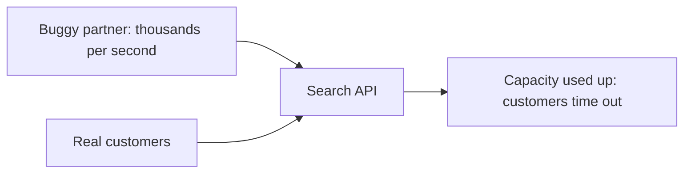
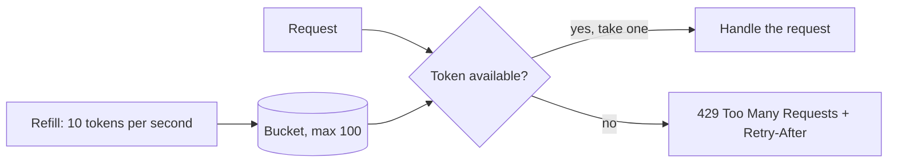

# Rate Limiting and Throttling

**Resilience · Step 1.7 · Fundamentals** · Last updated 2026-10-21

> [!TIP]
> **In one sentence:** a rate limiter caps how many requests a caller may make in a period of time and turns away the rest, so no single caller can take everyone's capacity.
>
> **Memory hook:** a **nightclub bouncer with a clicker**: only so many people per minute, everyone else waits outside. Or a **ticket dispenser** that refills at a steady pace: take a ticket to enter; no tickets, no entry.

## Where it fits

Step 1.7 of the [resilience track](01-resilience-overview.md). The earlier patterns protect you *from your dependencies*; rate limiting protects you *from your callers* (and protects fragile dependencies from you). It is related to the [bulkhead](06-bulkhead.md) (calls at the same time) and leads to [load shedding](08-load-shedding-backpressure.md) (1.8).

## 1. The story

A partner integrates with ShopFlow's public product API. Their code has a bug and calls the search endpoint in a tight loop, thousands of times per second. ShopFlow's search capacity is used up, and real customers' searches time out, even though they did nothing wrong.



## 2. The idea

Count requests **per caller** over time, and refuse those above the limit with **HTTP 429 Too Many Requests**, ideally with a **`Retry-After`** header saying when to come back. The buggy partner gets 429s; everyone else keeps their share.

The most common algorithm is the **token bucket**: a bucket fills with tokens at a steady rate up to a maximum, and each request takes one. A full bucket allows a short burst; after that, the steady rate applies.



## 3. Key terms

| Term | Plain meaning |
|---|---|
| **Rate limit / quota** | Maximum requests allowed per time window |
| **Rate limiting** | Rejecting requests above the limit |
| **Throttling** | Slowing requests down (often used loosely for both) |
| **Token bucket** | Tokens refill steadily; each request takes one; allows bursts |
| **Fixed / sliding window** | Count per clock window / over the last N seconds |
| **429 Too Many Requests** | The standard "slow down" response |
| **Noisy neighbour** | One tenant or client using everyone's capacity |

## 4. How it works, step by step

1. Identify the caller: API key, user, tenant, IP or service.
2. Find their policy, for example 100 requests per second with bursts of 200.
3. Take a token (or increase the counter). If none is left, reject with 429 and `Retry-After`.
4. The client backs off and retries later, with jitter.
5. With several service instances, either each counts on its own (cheap, looser) or they share a counter, for example in Redis (exact, but adds a dependency).

| Algorithm | Behaviour |
|---|---|
| Fixed window | Simple; allows a double burst around the window boundary |
| Sliding window | Smoother and fairer; a bit more costly |
| **Token bucket** | Bursts up to the bucket size, then a steady rate; the most common |
| Leaky bucket | Smooths traffic into a constant flow |

## 5. Real-world examples

- **Public APIs (maps, weather, social media):** limits per API key and per plan; exceeding them returns 429, and paid plans get higher limits.
- **Login pages:** a tight limit per account and per IP slows down password-guessing attacks.
- **Calling a paid or fragile third party:** an outgoing limiter keeps your app under the provider's quota, so you don't get blocked or billed for overage.

## 6. Design choices and trade-offs

| Where | Good for |
|---|---|
| **API gateway / edge** | One policy per client or plan, protecting everything behind it |
| **Inside the service** | Per-endpoint or per-tenant limits the gateway can't see |
| **On outgoing calls** | Staying under a dependency's own limits |

| | Rate limiter | Bulkhead | Circuit breaker |
|---|---|---|---|
| Limits | Calls **per time** | Calls **at the same time** | Calls after **observed failures** |
| Based on | A fixed policy | A fixed number | Recent results |

**Per-instance versus shared:** 4 instances with a local limit of 100 each allow 400 in total. A shared counter is exact, but you must decide what happens if the counter store fails (allow traffic, or block it).

## 7. Common mistakes

1. **One global limit**, so one client can use everyone's share.
2. **No `Retry-After`**, so clients retry at once and add load.
3. **Per-instance limits when a global one was intended.**
4. **The same limit for cheap and expensive endpoints**: search and exports need stricter limits.
5. **Rate-limiting health checks**, causing restarts.
6. **Limits nobody tunes**, blocking real users or letting abuse through.

## 8. In code

> [!NOTE]
> Untested sketch to show the shape. Check names and defaults for your versions.

```yaml
resilience4j:
  ratelimiter:
    instances:
      search:
        limitForPeriod: 100      # calls allowed per period
        limitRefreshPeriod: 1s
        timeoutDuration: 0       # don't wait for a permit: reject at once
```

```java
@RateLimiter(name = "search")
public List<Product> search(String query) { ... }
```

| Setting | What it controls |
|---|---|
| Limit per period | How many calls are allowed |
| Refresh period | How often the allowance resets |
| Wait for permit | Whether extra calls wait or are rejected |

At a gateway this is usually configuration; for example, Spring Cloud Gateway offers a Redis-backed request rate limiter.

## 9. Remember

- **Rate limiting protects you from your callers.**
- **Token bucket = bursts, then a steady rate.**
- **Reject with 429 + `Retry-After`**, and clients back off with jitter.
- **Limits per client, plan or tenant**, stricter for expensive endpoints.
- **Per-instance limits add up**; share the counter if a global limit matters.

## 10. Interview corner

**15-second answer:** "A rate limiter caps requests per caller per time, usually with a token bucket, and rejects the excess with 429 and Retry-After."

**60-second answer:**
> "A rate limiter makes sure no single caller can take everyone's capacity. I usually use a token bucket, because it allows short bursts and then a steady rate. I enforce limits at the gateway per client or plan, add finer limits in services for expensive endpoints or tenants, and use a shared counter when an exact global limit matters. Rejected calls get 429 with Retry-After, and clients back off with jitter. Rate limiting protects me from callers; bulkheads and circuit breakers protect me from dependencies."

**Likely follow-up questions:**
- **Token bucket versus fixed window?** Fixed window allows double bursts at the boundary; token bucket allows controlled bursts and a steady rate.
- **How do you rate-limit across 10 instances?** A shared counter (for example Redis), or local limits sized as total divided by instances, accepting some looseness.
- **Rate limiter versus bulkhead?** Per time versus at the same time.
- **What should clients do on 429?** Wait as `Retry-After` says, then retry with backoff and jitter.

**Architect angle:** "Limits are a product decision too: they define what each customer plan is promised, so they're documented, monitored and tuned."

## 11. Industry check

> [!NOTE]
> Checked 2026-10-21 by web search; mostly IETF drafts and blogs. Re-verify when you revisit the note.

- **Confirmed:** 429 Too Many Requests with `Retry-After` is the standard way to tell clients to slow down. IETF drafts propose standard `RateLimit` header fields (limit, remaining, reset); the newest draft in my results was from 2022.
- **To verify:** the current status of the `RateLimit` header drafts; Resilience4j `RateLimiter` defaults (one source reported 50 permits and a 5-second wait); your gateway's rate-limiter options.
- **Decision rule:** limit at the edge per client or plan, add finer limits in services, share counters when a global limit matters, always answer 429 with `Retry-After`.

## 12. Going further

- IETF drafts on RateLimit header fields (check status)
- Your API gateway's rate-limiting documentation
- Resilience4j documentation (RateLimiter)

**Next:** [Load shedding and backpressure](08-load-shedding-backpressure.md) (1.8).

Back to [the index](../README.md) · [Roadmap](../roadmap.md).
