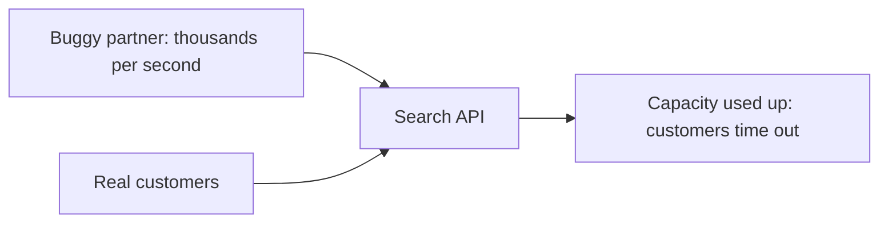
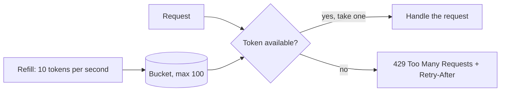

# Rate Limiting and Throttling

**Resilience · Step 1.7 · Fundamentals** · Last updated 2026-10-21
**Prerequisites:** [Resilience patterns: the big picture](01-resilience-overview.md) (1.1); related: [Bulkhead](06-bulkhead.md) (1.6)

## 1. The concept in simple English

**What is it?** A rate limiter caps how many requests a caller may make in a period of time and turns away the rest, so no single caller can use everyone's capacity.

**Why do we need it?** Capacity is shared. One buggy or greedy client can use it all, and well-behaved customers then time out through no fault of their own.

**When would I meet it?** At API gateways and public APIs, on login endpoints, and in front of any paid or fragile third-party service you call.

> [!TIP]
> **Memory hook:** a nightclub bouncer with a clicker: only so many people per minute, everyone else waits outside.

## 2. Mental model: a bouncer and a ticket dispenser

| In the analogy | In the real system |
|---|---|
| The bouncer's per-minute limit | The **rate limit** |
| A ticket dispenser that refills steadily | A **token bucket** |
| A full pocket of tickets | A permitted **burst** |
| "Come back in five minutes" | **429** with **`Retry-After`** |

**Where the analogy breaks:** a bouncer counts people at one door. With several service instances, each may count on its own, so a "100 per second" limit can quietly become 400 unless the counter is shared.

## 3. Industry terms

| Term | Simple meaning | Why it matters | Example | Related terms |
|---|---|---|---|---|
| **Rate limit / quota** | Maximum requests allowed per time window | The policy | 100 per second | Plan |
| **Rate limiting** | Rejecting requests above the limit | Protects you from callers | 429 responses | Throttling |
| **Throttling** | Slowing requests down (often used loosely for both) | Avoid confusing it with rejecting | Delay instead of reject | Backpressure ([1.8](08-load-shedding-backpressure.md)) |
| **Token bucket** | Tokens refill steadily; each request takes one; bursts allowed | The most common algorithm | 10/s, bucket 100 | Leaky bucket |
| **429 Too Many Requests** | The standard "slow down" response | Tells clients it is a limit, not an outage | HTTP 429 | `Retry-After` |
| **`Retry-After`** | Header saying how long to wait | Stops immediate retries | `Retry-After: 30` | Backoff ([1.3](03-retries-backoff-jitter.md)) |
| **Noisy neighbour** | One tenant using everyone's capacity | The problem limits solve | Heavy export job | Bulkhead |

## 4. In a real system (ShopFlow)

**The business problem.** ShopFlow's public product API must stay responsive for all partners, even when one partner's code misbehaves.

A partner has a bug and calls the search endpoint in a tight loop, thousands of times per second. Search capacity is used up and real customers' searches time out, though they did nothing wrong.



**How rate limiting helps.** Counting requests per partner means the buggy partner receives 429 responses while everyone else keeps their share.

**What it costs.** Limits to choose and explain to customers, a shared counter if the limit must be exact, and legitimate bursts that may be refused.

**Elsewhere:** login pages use a tight limit per account and per address to slow password guessing; an outgoing limiter keeps your calls under a third party's quota.

## 5. How it works



1. Identify the caller: API key, user, tenant, address or service.
2. Find their policy, for example 100 requests per second with bursts of 200.
3. Take a token. If none is left, reject with 429 and, ideally, `Retry-After`.
4. The client backs off and retries later, with jitter ([1.3](03-retries-backoff-jitter.md)).
5. With several instances, either each counts on its own (cheap, looser) or they share a counter, for example in Redis (exact, but a new dependency).

| Algorithm | Behaviour |
|---|---|
| Fixed window | Simple; allows a double burst around the window boundary |
| Sliding window | Smoother and fairer; a bit more costly |
| **Token bucket** | Bursts up to the bucket size, then a steady rate; the most common |
| Leaky bucket | Smooths traffic into a constant flow |

**Where to enforce it:** at the API gateway (one policy per client or plan), inside services (per endpoint or tenant), and on outgoing calls (staying under a dependency's limits).

**Who guarantees what**

| Layer | Responsible for |
|---|---|
| Gateway or library | Counting and rejecting over-limit requests (for example Spring Cloud Gateway's Redis rate limiter, a token bucket that returns 429 by default) |
| Shared counter store (Redis) | Making the limit exact across instances, and its own availability |
| Application / product | The limits per client or plan, and what happens if the counter store fails |
| Client | Honouring `Retry-After` and backing off |

> [!NOTE]
> Untested sketch to show the shape. Resilience4j's documented defaults are `limitForPeriod` 50, `limitRefreshPeriod` 500 ns and `timeoutDuration` 5 s (the page states no version): the default `timeoutDuration` makes an over-limit call **wait up to 5 seconds for a permit** rather than be rejected, so set it to `0` to reject at once.

```yaml
resilience4j:
  ratelimiter:
    instances:
      search:
        limitForPeriod: 100      # calls allowed per period
        limitRefreshPeriod: 1s
        timeoutDuration: 0       # reject at once instead of waiting for a permit
```

```java
@RateLimiter(name = "search")
public List<Product> search(String query) { ... }
```

At a gateway this is usually configuration. For example, Spring Cloud Gateway's `RequestRateLimiter` filter with the Redis implementation takes `replenishRate` (tokens per second) and `burstCapacity` (bucket size), returns 429 by default when denied, and denies requests whose key cannot be resolved unless configured otherwise.

## 6. Failure scenarios

### One global limit

- **What happened?** All callers shared one limit and one heavy caller exhausted it.
- **Solutions:** a limit per client, plan or tenant, stricter for expensive endpoints.

### A limit that waits instead of rejecting

- **What happened?** The limiter's default waits for a permit for seconds, so rejected callers still held threads.
- **Solutions:** set the wait to zero on request threads and return 429.

### Per-instance limits when a global one was intended

- **What happened?** Four instances each allowed 100 per second, so the real limit was 400.
- **Solutions:** a shared counter, or per-instance limits sized as total ÷ instances, accepting looseness; decide what happens if the counter store fails (allow or block).

### Rejected clients retry at once

- **Why?** No `Retry-After`, no backoff.
- **Solutions:** send `Retry-After`; clients honour it and add jitter.

## 7. Architectural decisions

| | Rate limiter | Bulkhead | Circuit breaker |
|---|---|---|---|
| Limits | Calls **per time** | Calls **at the same time** | Calls after **observed failures** |
| Based on | A fixed policy | A fixed number | Recent results |
| Protects | You, from callers | You, from slow dependencies | You, from broken dependencies |

**Rate limiting versus load shedding:** a limit is a fixed policy per caller; shedding ([1.8](08-load-shedding-backpressure.md)) reacts to how overloaded you are right now. Limits are also a product decision: they define what each plan is promised. **Common mistakes:** the same limit for cheap and expensive endpoints; rate-limiting health checks; limits nobody tunes.

## 8. Check your understanding

1. Four instances each allow 100 requests per second locally. What limit does a caller effectively get, and how would you make it exact?
2. What does `Retry-After` achieve that a bare 429 does not?
3. A limiter with default settings is "rejecting" over-limit calls, but threads are still piling up. What setting would you check?
4. How is a rate limiter different from load shedding?

Answers are at the end of this note.

## 9. Revision

**Remember**
- **Rate limiting protects you from your callers.**
- **Token bucket = bursts, then a steady rate.**
- **Reject with 429 + `Retry-After`**; clients back off with jitter.
- **Limits per client, plan or tenant**; per-instance limits add up.

**Explain in 15 seconds:** "A rate limiter caps requests per caller per time, usually with a token bucket, and rejects the excess with 429 and Retry-After."

**Explain in 60 seconds:**
> "A rate limiter makes sure no single caller can take everyone's capacity. I usually use a token bucket, because it allows short bursts and then a steady rate. I enforce limits at the gateway per client or plan, add finer limits in services for expensive endpoints or tenants, and use a shared counter when an exact global limit matters, deciding what happens if that counter fails. Rejected calls get 429 with Retry-After, and clients back off with jitter. Rate limiting protects me from callers; bulkheads and circuit breakers protect me from dependencies, and load shedding reacts to current overload."

**Likely follow-up questions:**
- **Token bucket versus fixed window?** A fixed window allows double bursts at the boundary; a token bucket allows controlled bursts and a steady rate.
- **How do you rate-limit across 10 instances?** A shared counter, or local limits of total ÷ instances, accepting looseness.

**Architect's takeaway:** limits are a product decision as well as a technical one, so document them, monitor them and tune them.

**Next topic:** [Load shedding and backpressure](08-load-shedding-backpressure.md) (1.8)

## 10. Verification and sources

> [!NOTE]
> Checked 2026-10-21. Re-verify when you revisit this note.

- **Confirmed:** Resilience4j's rate limiter documentation lists defaults `limitForPeriod` 50, `limitRefreshPeriod` 500 ns, `timeoutDuration` 5 s (no version stated on the page); the Spring Cloud Gateway documentation says `RequestRateLimiter` returns HTTP 429 by default when a request is denied, that the Redis implementation uses the token bucket algorithm with `replenishRate`, `burstCapacity` and `requestedTokens`, and that requests whose key cannot be resolved are denied by default. 429 with `Retry-After` is the standard way to tell clients to slow down (earlier check, standards and vendor guidance).
- **Assumptions and illustrations:** the ShopFlow story, example limits and the sketch (not run).
- **To verify:** the status of the IETF `RateLimit` header drafts; your gateway's rate-limiter options and defaults.
- **Decision rule:** limit at the edge per client or plan, add finer limits in services, share counters when a global limit matters, answer 429 with `Retry-After`.

**Sources:** Resilience4j documentation (RateLimiter); Spring Cloud Gateway reference, "RequestRateLimiter GatewayFilter Factory"; your API gateway's rate-limiting documentation.

## Answers

1. Up to 400 per second in total (each instance allows 100). Use a shared counter such as Redis, or size local limits as the total divided by instances and accept the looseness.
2. It tells well-behaved clients when to come back, so they don't retry immediately and add load.
3. The permit wait (`timeoutDuration`): the documented default of 5 seconds makes callers wait for a permit rather than be rejected; set it to 0.
4. A rate limiter applies a fixed per-caller policy; load shedding reacts to how overloaded the service currently is.

Back to [the resilience overview](01-resilience-overview.md) · [Index](../README.md) · [Roadmap](../roadmap.md).
