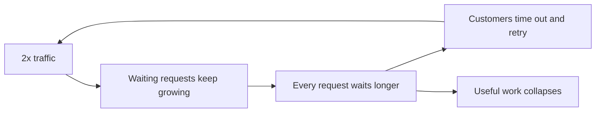
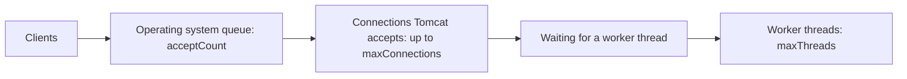

# Load Shedding and Backpressure

**Resilience · Step 1.8 · Intermediate** · Last updated 2026-10-21
**Prerequisites:** [Bulkhead](06-bulkhead.md) (1.6), [Rate limiting](07-rate-limiting.md) (1.7), [Retries](03-retries-backoff-jitter.md) (1.3)

## 1. The concept in simple English

**What is it?** **Load shedding** means rejecting some requests early when you are overloaded, so the ones you accept are served well. **Backpressure** means telling senders to slow down, instead of letting work pile up in a queue.

**Why do we need it?** When more work arrives than you can handle, trying to serve everything makes everything slow. Requests wait, time out, and are retried, and the server spends its capacity on work nobody is waiting for any more.

**When would I meet it?** Traffic spikes (an advert, a sale, a retry storm), slow consumers of a stream, and any server where the number of waiting requests can grow without limit.

> [!TIP]
> **Memory hook:** a restaurant on a packed night. A good host says "45-minute wait, or come back later" at the door (load shedding), and the kitchen tells the waiters to stop taking orders for ten minutes (backpressure). A bad one seats everyone, and nobody gets fed.

## 2. Mental model: a packed restaurant

| In the analogy | In the real system |
|---|---|
| The host turning people away at the door | **Load shedding**: a fast 503 or 429 |
| The kitchen telling waiters to pause | **Backpressure**: a full queue or slow consumer signals the sender |
| The waiting list | A **queue**: fine if short and bounded, harmful if endless |
| Seating regulars first | **Priority**: shed low-value requests first |

**Where the analogy breaks:** a restaurant guest who waits too long just leaves. A client that times out may **retry**, which adds more load; and the server may still do the work for a request whose client has already gone.

## 3. Industry terms

| Term | Simple meaning | Why it matters | Example | Related terms |
|---|---|---|---|---|
| **Overload** | More work arrives than the service can handle well | The condition we design for | 2× normal traffic | Saturation |
| **Goodput** | Throughput of *useful* work (completed in time, without errors) | What collapses under overload | Orders completed | Throughput |
| **Load shedding** | Deliberately rejecting some requests to protect the rest | Keeps accepted requests fast | Fast 503 + `Retry-After` | Rate limiting ([1.7](07-rate-limiting.md)) |
| **Backpressure** | A "slow down" signal travelling back to the sender | Prevents unbounded queues | Blocked producer, 429, pull-based consumer | Bounded queue |
| **Bounded queue** | A queue with a maximum size and maximum wait | Overload becomes visible, not hidden | 50 waiting, 2 s max | Queue |
| **Worker (request) threads** | The threads that run requests | The real capacity limit | Tomcat `maxThreads` 200 | Bulkhead ([1.6](06-bulkhead.md)) |
| **Connection backlog (`acceptCount`)** | The operating system's queue of connection requests waiting to be accepted | Often mistaken for a request queue | Tomcat `acceptCount` | `maxConnections` |

## 4. In a real system (ShopFlow)

**The business problem.** A TV advert sends twice ShopFlow's normal traffic in one minute. Checkout must keep working for the customers it can serve.

The Order Service accepts everything. Requests wait for a thread, each waits longer, and soon almost every request exceeds the customer's timeout, so customers refresh and retry. The servers are at full CPU doing work for customers who already gave up. The site looks "up" but almost no orders complete.



**How shedding and backpressure help.** The service accepts only as many requests as it can finish in time and rejects the rest at once, cheaply and with `Retry-After`, preferring checkout over recommendations. Waiting is bounded, so overload is visible instead of silent.

**What it costs.** Some customers see errors while the system is "up", priorities are a business decision, and shedding needs monitoring so it isn't mistaken for a bug.

**Elsewhere:** a ticket seller admits buyers through a waiting room at the rate the system can serve; a data pipeline's slow consumer pulls only what it can process, and the backlog waits in the log.

## 5. How it works

1. **Measure load** with a signal you trust: queue wait time, concurrency in flight, CPU or latency.
2. **Classify requests** by priority (checkout high, recommendations low).
3. **Over the threshold, reject low priority first**, before parsing bodies or touching the database.
4. **Drop requests whose deadline has passed**: nobody is waiting for them.
5. **Answer fast** with 503 and `Retry-After`; clients back off with jitter ([1.3](03-retries-backoff-jitter.md)).
6. **Autoscaling adds capacity** for sustained growth; shedding protects you while it catches up.

| | Rate limiting | Load shedding | Backpressure | Autoscaling |
|---|---|---|---|---|
| Trigger | Fixed policy per caller | Current load | Full queue or slow consumer | Sustained load |
| Action | Reject over quota | Reject some requests | Sender slows down | Add capacity |
| Speed | Immediate | Immediate | Immediate | Minutes |

### What Tomcat's limits really do

A Spring Boot application on embedded Tomcat has four numbers that people often mix up. The notes below follow the Tomcat 10.1 documentation (Spring Boot 3.2.4 embeds Tomcat 10.1.19) and Spring Boot 3.2.4's `ServerProperties`; defaults can differ in other versions.



| Setting (Spring Boot property) | Default in Spring Boot 3.2.4 | What it limits |
|---|---|---|
| `server.tomcat.threads.max` | 200 | Requests running at the same time |
| `server.tomcat.max-connections` | 8192 | Connections Tomcat accepts and processes at one time |
| `server.tomcat.accept-count` | 100 | Length of the **operating system's** queue of connection requests, used once `max-connections` is reached (Tomcat may not control the real size) |
| `server.tomcat.connection-timeout` | none set by Boot (Tomcat's own default 60 s) | How long Tomcat waits for the request line after accepting a connection |

What follows from this:

- **`accept-count` is not an application queue of HTTP requests.** It counts connection attempts that the operating system holds before Tomcat accepts them. The Tomcat documentation says the operating system may ignore the setting, and that when the queue is full it may refuse connections or let them time out.
- **Wording differs between sources.** Spring Boot 3.2.4's property description says it applies "when all possible request processing threads are in use", which is the older Tomcat wording; the Tomcat 10.1 documentation says it applies once `maxConnections` has been reached. Rely on the Tomcat 10.1 text and on the observations below.
- **Busy threads alone don't trigger it.** While fewer than `max-connections` connections are open, Tomcat accepts new connections and their requests **wait for a worker thread**; the documentation for a configured Tomcat executor lists `maxQueueSize` with a default of `Integer.MAX_VALUE`, so that waiting is effectively unbounded unless you bound it yourself.
- **It is not backpressure by itself.** When it does reject, clients get a connection error or a timeout, not a clean 503 with `Retry-After`, and a load balancer may read that as a dead node.

> [!NOTE]
> Run on 2026-10-21 against the lab's Spring Boot 3.2.4 application (Tomcat 10.1.19, Java 21.0.8, macOS), once each, with `threads.max=2`, a 3-second slow endpoint and 12 simultaneous requests. The limits were passed as command-line arguments; no repository file was changed. Operating-system queue behaviour differs between systems, so don't generalise the exact counts.

| Run | Settings | What happened to the 12 requests |
|---|---|---|
| A | `max-connections` default (8192), `accept-count=1` | **All 12 connections were accepted at once**, none refused; requests were served in waves of two, finishing at 3, 6, 9, 12, 15 and 18 s. The last customer waited 18 s. |
| B | `max-connections=4`, `accept-count=1` | 5 requests were served (two at 3 s, two at 6 s, one at 9 s); the other 7 **failed immediately at connection level** (curl exit codes 55, 56 and 7), without an HTTP response. |

Run A is the common production shape: overload turns into long waits, not into rejections. Run B shows what the operating-system queue and `max-connections` do once reached: abrupt connection failures, with no `Retry-After`.

**Who guarantees what**

| Layer | Responsible for |
|---|---|
| Operating system | The connection backlog; its real size and refusal behaviour |
| Tomcat | Accepting up to `maxConnections`, running up to `maxThreads` requests |
| Spring Boot | Mapping `server.tomcat.*` properties to Tomcat |
| Application | **Bounded waiting and clean shedding**: concurrency limits, max wait, priorities, 503 with `Retry-After`, timeouts |
| Client | Timeouts, backoff with jitter, honouring `Retry-After` |

**Choosing limits.** Start from concurrency ≈ requests per second × response time in seconds, then set `threads.max` to what the CPU and downstream pools can really sustain. Keep `max-connections` to what you can hold (each connection costs memory and a file descriptor). Treat `accept-count` as a small safety margin, not a tuning knob for fairness. Do the real shedding in the application, where you can choose priority and answer with 503.

> [!NOTE]
> Untested sketch to show the shape. Property names are for Spring Boot 3.x; check your version.

```yaml
server:
  tomcat:
    threads:
      max: 200            # requests running at the same time (worker threads)
    max-connections: 8192 # connections Tomcat accepts and processes at once
    accept-count: 100     # OS backlog of connection requests once max-connections is reached;
                          # not a request queue, and not used merely because worker threads are busy
```

```java
// Reactor: when the consumer is slower than the producer, drop the excess and count it
events.onBackpressureDrop(dropped -> metrics.increment("events.dropped"))
      .subscribe(this::handle);
```

## 6. Failure scenarios

### Unbounded waiting

- **What happened?** The story above, and run A: every connection was accepted, and the last of 12 requests waited 18 seconds.
- **Why?** Nothing bounded the waiting for a thread, so overload became latency.
- **What users see:** timeouts and refreshes, while the server works on abandoned requests.
- **Solutions:** a bounded concurrency limit with a short or zero wait, shed with 503, drop requests past their deadline.
- **Trade-offs:** some users are rejected on purpose.

### Expecting `accept-count` to cap the queue

- **What happened?** A team set `accept-count=100` and believed at most 100 requests could wait.
- **Why?** It is the operating system's queue of connection attempts, used only after `max-connections` is reached; before that, requests wait for threads without that limit.
- **Solutions:** bound waiting in the application; treat `accept-count` as a margin.

### Connection failures read as an outage

- **What happened?** At the limits, clients got connection errors; the load balancer marked the instance dead and shifted load to the others.
- **Solutions:** shed earlier, in the application, with 503 and `Retry-After`; set load balancer health checks that tolerate shedding.

### Retries turn shedding into a storm

- **Why?** Clients retry at once after a 503.
- **Solutions:** `Retry-After`, backoff with jitter, one retry layer ([1.3](03-retries-backoff-jitter.md)).

## 7. Architectural decisions

| Benefit | Cost |
|---|---|
| Stays useful at 2× capacity | Some users see errors while the system is "up" |
| Prevents collapse and slow recovery | Priorities are a business decision |
| Cheap to apply | Needs monitoring so shedding isn't mistaken for a bug |

**Never shed** health checks or the traffic that restores service. **Don't rely on autoscaling alone**: it is too slow for sudden spikes. **Common mistakes:** unbounded queues; shedding by accident through random timeouts instead of by design; only autoscaling; never testing overload.

## 8. Check your understanding

1. With defaults (`max-connections` 8192, `threads.max` 200), what happens to the 201st simultaneous request, and does `accept-count` come into play?
2. What do clients see when the operating system's connection queue is full, and why is that worse than a 503?
3. Why is "drop requests whose deadline has passed" useful?
4. Where would you implement shedding so you can prefer checkout over recommendations?

Answers are at the end of this note.

## 9. Revision

**Remember**
- **Serve some well rather than all badly.**
- **`accept-count` is the OS connection queue**, used once `max-connections` is reached; it is not an HTTP request queue.
- **Bound the waiting in the application** and shed with 503 + `Retry-After`.
- **Drop requests whose deadline has passed.**
- **Autoscaling is for sustained load; shedding is for spikes.**

**Explain in 15 seconds:** "Under overload I shed low-priority requests early with fast 503s and bound every queue, so backpressure reaches senders instead of everyone being served slowly."

**Explain in 60 seconds:**
> "When demand exceeds capacity, trying to serve everything makes everything slow, and timeouts and retries collapse useful throughput. Load shedding rejects some requests early and cheaply, chosen by priority, age or cost, with a fast 503 and Retry-After. Backpressure pushes the signal back: bounded queues, pull-based consumers, 429s. Tomcat's own limits don't do this for you: with defaults it accepts thousands of connections and lets requests wait for one of 200 threads, and accept-count is only the operating system's connection queue once max-connections is reached. So I bound waiting and shed in the application, never shed health checks, make clients back off with jitter, and use autoscaling for sustained growth."

**Likely follow-up questions:**
- **Load shedding versus rate limiting?** Rate limiting is a fixed per-caller policy; shedding reacts to current overload.
- **Why isn't autoscaling enough?** It takes minutes; overload starts in seconds.
- **Example of backpressure?** A bounded queue that blocks or rejects the producer, or a Kafka consumer that pulls only what it can process.

**Architect's takeaway:** define with the business which traffic is critical, so the system knows what to protect and what to drop at 2× load, and don't rely on server defaults to do it.

**Next topic:** [Fallbacks and graceful degradation](09-fallbacks-graceful-degradation.md) (1.9)

## 10. Verification and sources

> [!NOTE]
> Checked 2026-10-21 against the documents named below and by the two runs above. Re-verify for your versions.

- **Confirmed (Tomcat 10.1 HTTP connector documentation):** `acceptCount` is "the maximum length of the operating system provided queue for incoming connection requests when `maxConnections` has been reached", the operating system may ignore it, and a full queue may lead to refused or timed-out connections; default 100. `maxConnections` default 8192 (the server accepts but does not process one further connection beyond it); `maxThreads` default 200; `connectionTimeout` default 60000 ms. The Tomcat executor documentation lists `maxQueueSize` default `Integer.MAX_VALUE` and `maxThreads` 200.
- **Confirmed (Spring Boot 3.2.4 source, `ServerProperties`):** `accept-count` 100 with the description "when all possible request processing threads are in use", `max-connections` 8192, `threads.max` 200, `threads.min-spare` 10.
- **Confirmed (Amazon Builders' Library, "Using load shedding to avoid overload"):** overload makes latency rise and goodput fall; shedding rejects excess requests early; work for requests that already timed out is wasted; queues hide latency and should be bounded in size and time.
- **Observed:** runs A and B above (single runs on macOS).
- **Assumptions and illustrations:** the ShopFlow story and the "Elsewhere" examples; code (not run).
- **To verify:** the internal worker-queue behaviour of Tomcat's default thread pool when no executor is configured (observed, not documented on the pages read); adaptive concurrency-limit libraries for your stack; behaviour on your operating system.
- **Decision rule:** bound waiting in the application, shed by priority and age with fast 503s, limit concurrency, tell clients to back off, autoscale for sustained growth.

**Sources:** Apache Tomcat 10.1 documentation (HTTP connector, Executor); Spring Boot 3.2.4 `ServerProperties` source; Amazon Builders' Library, "Using load shedding to avoid overload"; Google, *Site Reliability Engineering* (handling overload); Project Reactor documentation.

## Answers

1. With defaults it is still accepted: fewer than 8192 connections are open, so Tomcat takes the connection and the request waits for one of the 200 threads. `accept-count` isn't involved until `max-connections` is reached.
2. Connection errors or timeouts at the network level, with no HTTP response, so no `Retry-After` and no clear reason. A load balancer may treat the instance as dead. A 503 tells the client it is overload and when to return.
3. The client has already given up, so finishing the work is wasted capacity that could serve requests someone is still waiting for.
4. In the application (or a gateway that knows the priorities): bounded concurrency with a short wait per priority class, answering 503 with `Retry-After` for low-priority work first.

Back to [the resilience overview](01-resilience-overview.md) · [Index](../README.md) · [Roadmap](../roadmap.md).
