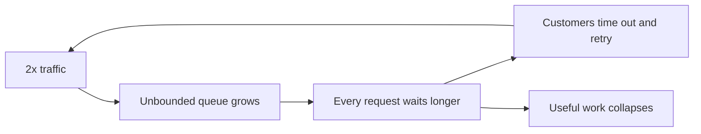
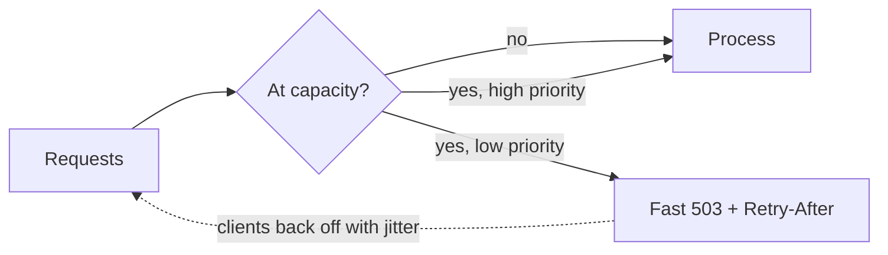

# Load Shedding and Backpressure

**Resilience · Step 1.8 · Intermediate** · Last updated 2026-10-21

> [!TIP]
> **In one sentence:** under overload, load shedding rejects some requests early so the accepted ones are served well, and backpressure tells senders to slow down instead of letting work pile up.
>
> **Memory hook:** a **restaurant on a packed night**. A good host says "45-minute wait, or come back later" at the door (load shedding) and the kitchen tells the waiters "stop taking orders for ten minutes" (backpressure). A bad one seats everyone, and nobody gets fed.

## Where it fits

Step 1.8 of the [resilience track](01-resilience-overview.md). [Rate limiting](07-rate-limiting.md) applies a fixed policy per caller; load shedding reacts to how overloaded you are *right now*. It builds on [timeouts](02-timeouts.md), [bulkheads](06-bulkhead.md) and [retries](03-retries-backoff-jitter.md), because careless retries turn shedding into a storm. Next: fallbacks (1.9).

## 1. The story

A TV advert sends twice ShopFlow's normal traffic to the site in one minute. `order-service` accepts everything. Requests queue up, each waits longer, and soon almost every request exceeds the customer's timeout, so customers refresh and retry. The servers are at full CPU, doing work for customers who already gave up. The site looks "up" but almost no orders complete.



Useful throughput (sometimes called **goodput**) collapses. Overload also feeds itself: more contention, context switching and garbage collection make every request cost more.

## 2. The idea

**Shed load early and cheaply.** When the service is at capacity, reject the excess at the door, before it uses expensive resources, with a fast **503 and `Retry-After`**. Choose *what* to drop: low-priority work first (recommendations before checkout), requests that have waited so long the customer has gone, or the most expensive operations.

**Apply backpressure.** Make every queue **bounded**, and let "full" travel back to the sender: a blocked producer, a 429 or 503, or a consumer that pulls only what it can handle.



A shop that serves 1,000 customers well and politely turns away 1,000 is far better than one that tries 2,000 and serves none.

## 3. Key terms

| Term | Plain meaning |
|---|---|
| **Overload** | More work arrives than the service can handle well |
| **Goodput** | Throughput of *useful* work (completed in time) |
| **Load shedding** | Deliberately rejecting some requests to protect the rest |
| **Backpressure** | A "slow down" signal travelling back to the sender |
| **Bounded queue** | A queue with a maximum size and wait |
| **Criticality / priority** | How important a request is; decides what is shed first |
| **Pull-based consumption** | The consumer asks for work when ready (Kafka consumers poll) |

## 4. How it works, step by step

1. **Measure load** with a signal you trust: queue length, queue wait time, concurrency, CPU or latency.
2. **Classify requests** by priority (checkout high, recommendations low).
3. **When over the threshold, reject low priority first**, before parsing bodies or touching the database.
4. **Drop requests whose deadline has passed**: nobody is waiting for them.
5. **Answer fast** with 503 and `Retry-After`; clients back off with jitter.
6. **Autoscaling adds capacity** for sustained growth; shedding protects you while it catches up.

| | Rate limiting | Load shedding | Backpressure | Autoscaling |
|---|---|---|---|---|
| Trigger | Fixed policy per caller | Current load | Full queue or slow consumer | Sustained load |
| Action | Reject over quota | Reject some requests | Sender slows down | Add capacity |
| Speed | Immediate | Immediate | Immediate | Minutes |

## 5. Real-world examples

- **Ticket sales for a big concert:** a virtual waiting room admits buyers at the rate the system can serve; everyone else waits in line rather than crashing the site.
- **Search engines and large web services:** under overload, they drop or simplify non-essential work (extra results, suggestions) to keep the core answer fast.
- **Data pipelines:** a slow consumer of a stream doesn't get flooded; it pulls only what it can process, and the backlog waits in the log.

## 6. Design choices and trade-offs

| Benefit | Cost |
|---|---|
| Stays useful at 2x capacity | Some users see errors while the system is "up" |
| Prevents collapse and slow recovery | Needs priorities, which are a business decision |
| Cheap to apply | Needs monitoring so shedding isn't mistaken for a bug |

**Never shed** health checks or the traffic that restores service. **Don't rely on autoscaling alone**: it is too slow for sudden spikes.

## 7. Common mistakes

1. **Unbounded queues** that hide overload until memory runs out.
2. **Shedding by accident** (random timeouts) instead of by design.
3. **Shedding health checks**, causing restarts.
4. **Clients that retry at once after a 503**, turning shedding into a storm.
5. **Only autoscaling**, with no protection for the first minutes.
6. **Never testing overload**, so the first test is a real outage.

## 8. In code

> [!NOTE]
> Untested sketch to show the shape. Setting names depend on your server and library versions.

```yaml
server:
  tomcat:
    threads:
      max: 200          # worker threads
    accept-count: 100   # connections that may wait when all threads are busy: a bounded queue
```

```java
// Reactor: when the consumer is slower than the producer, drop the excess and count it
events.onBackpressureDrop(dropped -> metrics.increment("events.dropped"))
      .subscribe(this::handle);
```

| Setting | What it controls |
|---|---|
| Queue size and max wait | How much work may pile up |
| Concurrency limit | Work in flight (a bulkhead is one form) |
| Priority rules | What is shed first |

## 9. Remember

- **Serve some well rather than all badly.**
- **Shed early, cheaply, by priority**, with 503 and `Retry-After`.
- **Bound every queue**; let "full" travel back as backpressure.
- **Drop requests whose deadline has passed.**
- **Autoscaling is for sustained load; shedding is for spikes.**

## 10. Interview corner

**15-second answer:** "Under overload I shed low-priority requests early with fast 503s and bound every queue so backpressure reaches the senders, instead of serving everyone slowly."

**60-second answer:**
> "When demand exceeds capacity, trying to serve everything makes everything slow; timeouts and retries then collapse useful throughput. Load shedding rejects some requests early and cheaply, choosing by priority, age or cost, with a fast 503 and Retry-After, so critical traffic like checkout survives. Backpressure pushes the signal back: bounded queues, pull-based consumers, 429s. I never shed health checks, make clients back off with jitter, and use autoscaling for sustained growth, because it's too slow for spikes."

**Likely follow-up questions:**
- **Load shedding versus rate limiting?** Rate limiting is a fixed per-caller policy; shedding reacts to current overload.
- **Which requests do you drop first?** Lowest priority, oldest (deadline passed), or most expensive.
- **Why isn't autoscaling enough?** It takes minutes; overload starts in seconds.
- **Example of backpressure?** A bounded queue that blocks or rejects the producer, or a Kafka consumer that only pulls what it can process.

**Architect angle:** "I define with the business which traffic is critical, so the system knows what to protect and what to drop at 2x load."

## 11. Industry check

> [!NOTE]
> Checked 2026-10-21 by web search; summaries of the primary sources. Re-verify when you revisit the note.

- **Confirmed:** Amazon's Builders' Library, "Using load shedding to avoid overload", recommends scaling proactively plus mechanisms that shed excess load gracefully, with monitoring and testing, and explains why latency rises under contention. Google's SRE material describes tagging requests with a criticality so an overloaded backend can drop less critical ones.
- **To verify:** adaptive concurrency-limit libraries (for example Netflix's concurrency-limits) for your stack; your server's queue settings.
- **Decision rule:** bound queues, shed by priority and age with fast 503s, limit concurrency, tell clients to back off, autoscale for sustained growth.

## 12. Going further

- Amazon Builders' Library, "Using load shedding to avoid overload"
- Google, *Site Reliability Engineering* (handling overload)
- Reactive Streams and Project Reactor documentation

**Next:** [Fallbacks and graceful degradation](09-fallbacks-graceful-degradation.md) (1.9).

Back to [the index](../README.md) · [Roadmap](../roadmap.md).
