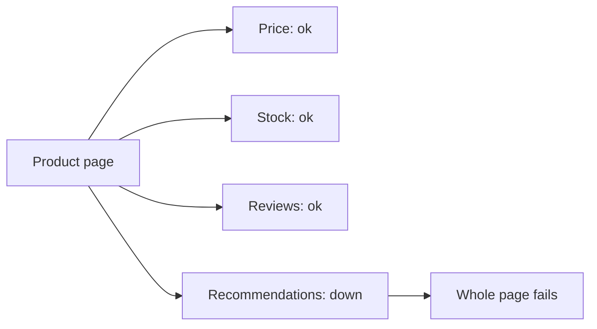
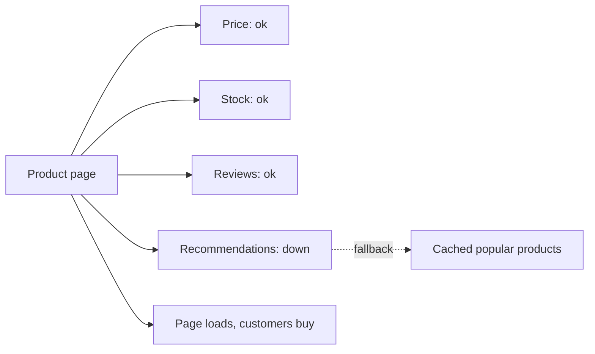

# Fallbacks and Graceful Degradation

**Resilience · Step 1.9 · Fundamentals** · Last updated 2026-10-21
**Prerequisites:** [Circuit breaker](05-circuit-breaker.md) (1.5), [Bulkhead](06-bulkhead.md) (1.6), [Load shedding](08-load-shedding-backpressure.md) (1.8)

## 1. The concept in simple English

**What is it?** A **fallback** is the answer you give when the real one isn't available. **Graceful degradation** means the system keeps its core job and drops optional features when something breaks.

**Why do we need it?** Every pattern before this one ends in a refusal: a timeout, an open breaker, a full bulkhead, a 429. Something has to decide what the user sees then. Without a plan, the user sees an error for a feature they didn't even need.

**When would I meet it?** Wherever a page or a flow calls several dependencies and only some of them are essential.

> [!TIP]
> **Memory hook:** a restaurant that's out of fresh bread serves the meal with crackers, and tells you. It doesn't close the restaurant, and it doesn't pretend the crackers are bread.

## 2. Mental model: a restaurant without bread

| In the analogy | In the real system |
|---|---|
| The meal | The **core function** (buy the product) |
| The bread | An **optional feature** (recommendations) |
| Serving crackers | A **fallback**: cached or default data |
| Telling the guest | **Flagging** the degraded answer |

**Where the analogy breaks:** crackers are visibly different from bread. A stale price or a "payment pending" message can look just like the real thing, so degraded answers must be **labelled** and must never claim something that isn't true.

## 3. Industry terms

| Term | Simple meaning | Why it matters | Example | Related terms |
|---|---|---|---|---|
| **Fallback** | The alternative answer when the real one can't be produced | What users see during failures | Cached popular products | Default value |
| **Graceful degradation** | Keeping the core function while dropping optional features | Limits the blast radius | Page without reviews | Fail fast |
| **Hard dependency** | The feature can't work without it | Decides where you must fail clearly | Price | Soft dependency |
| **Soft dependency** | The feature can skip it or use a default | Where fallbacks are cheap | Recommendations | Fallback |
| **Stale data** | Older, cached data used when fresh data isn't available | A common fallback | Price from 5 minutes ago | Staleness limit |
| **Deferred result** | "Accepted, we'll confirm shortly" with the work finished later | Needs a reliable way to finish | Payment pending | Reconciliation ([1.4](04-idempotency.md)) |

## 4. In a real system (ShopFlow)

**The business problem.** Customers must be able to buy even when an optional feature is down.

The product page calls four services: price, stock, reviews and recommendations. One evening the Recommendations Service goes down. The page code treats every call as required, so the whole page shows an error. Customers can't buy anything, all because of a "you may also like" strip.



**How graceful degradation helps.** Decide in advance which dependencies the page can't work without (price) and which it can live without (recommendations, reviews). For soft ones, prepare a fallback: a cached list, a default, or leaving the section out.



**What it costs.** More code paths to build, test and monitor; stale or partial data can mislead if not labelled; and a good fallback can hide a real outage.

**Elsewhere:** a streaming service shows generic "popular now" rows when personalisation fails, and playback is never blocked by recommendations; a banking app shows the balance from the core system while transaction search says "temporarily unavailable".

## 5. How it works

1. **List each feature's dependencies** and classify them: critical, important, optional.
2. **Pick a fallback per dependency**, from the ladder below, with the business.
3. **Wire it to every refusal**: timeout, breaker open, bulkhead full, rate-limited.
4. **Mark degraded answers** (a flag, a banner, a message) and count them.
5. **Test the fallback**, because untested ones fail exactly when needed ([1.10](10-testing-resilience.md)).

| Fallback (best first) | Example | Watch out for |
|---|---|---|
| Cached or stale data | Price from 5 minutes ago | How stale is acceptable? |
| Default value | "Recommendations unavailable" | Must be harmless |
| Partial result | Page without the reviews section | Say what's missing |
| Alternative source | A second provider | It can fail too, and may cost more |
| Deferred result | "Order accepted, payment confirming" | Needs a reliable way to finish later: track it and reconcile ([1.4](04-idempotency.md)) |
| Clear failure | "Please try again shortly" | Still better than a hang or a lie |

**The golden rule: a fallback may give less, never something false.** Showing "payment successful" when no payment happened is worse than an honest error. A "payment pending" answer is only honest if the pending payment is actually tracked and settled.

**Who guarantees what**

| Layer | Responsible for |
|---|---|
| Resilience library | Calling the fallback when a call is refused or fails |
| Application | What the fallback returns, keeping it local and cheap, flagging and counting it |
| Business | Which degraded behaviour is acceptable, for which feature |
| Monitoring | Alerting on fallbacks, so a polite answer doesn't hide an outage |

> [!NOTE]
> Untested sketch to show the shape. That a fallback method also receives exceptions the breaker ignores was observed in an earlier example run on Resilience4j 2.2.0.

```java
@CircuitBreaker(name = "recommendations", fallbackMethod = "popularInstead")
public List<Product> recommendationsFor(String customerId) { ... }

List<Product> popularInstead(String customerId, Throwable t) {
    if (t instanceof BusinessRuleException e) throw e;   // not an outage: don't degrade
    metrics.increment("fallback.recommendations");
    return popularProductsCache.top(10);                 // local, cheap, no network call
}
```

In that earlier run, a declined-card error reached the fallback and had to be rethrown so it wasn't turned into a fake "pending" answer.

## 6. Failure scenarios

### A fallback that pretends success

- **What happened?** A payment fallback returned "confirmed" when the provider was down.
- **What users see:** goods shipped, no money collected.
- **Solutions:** return "pending" or a clear failure, never success; track and reconcile deferred payments.

### A fallback that calls another fragile service

- **What happened?** The fallback called a second service that was also failing, so the failure just moved.
- **Solutions:** keep fallbacks local and cheap (cache, default), or use an alternative that is independent and reliable.

### Catching everything

- **What happened?** A catch-all returned a default for every exception, and a real bug disappeared.
- **Solutions:** degrade only for outage-type exceptions; rethrow business and programming errors; count fallbacks.

### Stale data that misleads

- **What happened?** A cached price from yesterday was shown as current.
- **Solutions:** limit staleness, label the data, and don't use stale data for decisions that must be exact (the final charge).

## 7. Architectural decisions

| Benefit | Cost |
|---|---|
| Customers keep the core function during failures | More code paths to build, test and monitor |
| Limits the blast radius | Stale or partial data can mislead if not labelled |
| Buys time to recover | A good fallback can hide a real outage |

Turn hard dependencies into soft ones wherever the product allows it. **Rules for good fallbacks:** keep them simple and local, limit staleness, make degradation visible, never hide failures from monitoring, and keep business errors separate (a declined card is a valid answer). **Common mistakes:** treating every dependency as critical; no metric or alert on fallbacks; never testing the fallback path.

## 8. Check your understanding

1. Classify price, stock, reviews and recommendations on a product page as hard or soft dependencies, and say why.
2. A payment fallback returns "pending". What must exist behind it for that to be honest?
3. Why is a fallback that queries another service risky?
4. How would you make sure a polite fallback doesn't hide an outage?

Answers are at the end of this note.

## 9. Revision

**Remember**
- **Give less, never something false.**
- **Classify dependencies**: hard versus soft; make as many soft as you reasonably can.
- **Keep fallbacks local and simple.**
- **Flag, count and alert** on degraded answers.
- **Test the fallback path.**

**Explain in 15 seconds:** "A fallback is what I return when the real answer isn't available; graceful degradation keeps the core working by dropping optional features, and it may give less but never something false."

**Explain in 60 seconds:**
> "I classify each dependency as critical or optional. For optional ones, the fallback is cached data, a default or a partial result, so the page still works without them; for critical ones I fail clearly or defer safely and reconcile later, and never fake success. Fallbacks are wired to every refusal, from timeouts to an open breaker, kept simple and local, flagged in the response, counted and alerted on, because a polite fallback can hide an outage for hours. And I test them, since untested fallbacks fail when you need them."

**Likely follow-up questions:**
- **What should a payment fallback be?** "Pending, we'll confirm", backed by tracking and reconciliation, or a clear error. Never "success".
- **Can a fallback call another service?** Only if that service is reliable and independent; otherwise you just move the failure.

**Architect's takeaway:** agree the fallback with the business per feature, and turn hard dependencies into soft ones wherever the product allows.

**Next topic:** [Testing resilience](10-testing-resilience.md) (1.10)

## 10. Verification and sources

> [!NOTE]
> Checked 2026-10-21 by web search; mostly translated copies of one AWS page. Re-verify when you revisit this note.

- **Confirmed:** the AWS Well-Architected Reliability pillar, "Implement graceful degradation to transform applicable hard dependencies into soft dependencies": components should keep working in a degraded way (stale, alternate or no data) when dependencies are unhealthy; anti-patterns include returning nothing when only one of several dependencies is down.
- **Assumptions and illustrations:** the ShopFlow story and the "Elsewhere" examples; the code (not run).
- **To verify:** fallback support details in your Resilience4j or Spring version.
- **Decision rule:** classify dependencies, agree degraded behaviour with the business, keep fallbacks simple and local, flag and monitor them.

**Sources:** AWS Well-Architected Framework, Reliability pillar, "Implement graceful degradation"; Michael Nygard, *Release It!*; Resilience4j and Spring documentation on fallback methods.

## Answers

1. Price is hard: the page can't sell without it. Stock is usually hard for checkout but may be softened ("check at checkout"). Reviews and recommendations are soft: the page works without them or with defaults.
2. A durable record of the pending payment, a reliable way to finish or retry it with the same key, and reconciliation against the provider, so the customer isn't left with a promise nobody keeps ([1.4](04-idempotency.md)).
3. If that service shares the failure, you just move it; and it adds another dependency to the failure path.
4. Count every fallback, alert when the rate or duration is high, alert when a breaker stays open, and review degraded answers regularly.

Back to [the resilience overview](01-resilience-overview.md) · [Index](../README.md) · [Roadmap](../roadmap.md).
