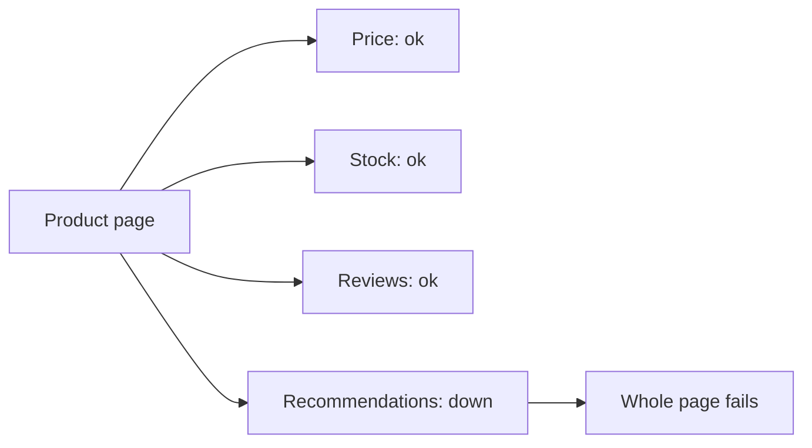
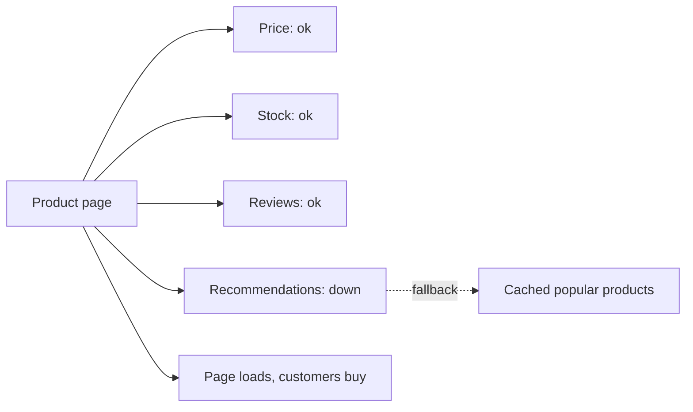

# Fallbacks and Graceful Degradation

**Resilience · Step 1.9 · Fundamentals** · Last updated 2026-10-21

> [!TIP]
> **In one sentence:** a fallback is the answer you give when the real one isn't available, and graceful degradation means the system keeps its core job and drops optional features when something breaks.
>
> **Memory hook:** a **restaurant that's out of fresh bread** serves the meal with crackers and tells you. It doesn't close the restaurant, and it doesn't pretend the crackers are bread.

## Where it fits

Step 1.9 of the [resilience track](01-resilience-overview.md). It ties the earlier patterns together: the [circuit breaker](05-circuit-breaker.md), [bulkhead](06-bulkhead.md), [rate limiter](07-rate-limiting.md) and [load shedding](08-load-shedding-backpressure.md) all end in a refusal, and the fallback decides what the user sees. Next: testing resilience (1.10).

## 1. The story

ShopFlow's product page calls four services: price, stock, reviews and recommendations. One evening the recommendations service goes down. The page code treats every call as required, so the whole product page shows an error. Customers can't buy anything, all because of a "you may also like" strip.



## 2. The idea

Not every dependency is equal. Decide in advance which ones the page **can't work without** (hard dependencies: price) and which it **can live without** (soft dependencies: recommendations, reviews). For soft ones, prepare a fallback: a cached list, a default, or simply leave the section out. The page loads, slightly smaller, and customers keep buying.



The golden rule: **a fallback may give less, never something false.** Showing "payment successful" when no payment happened is worse than an honest error.

## 3. Key terms

| Term | Plain meaning |
|---|---|
| **Fallback** | The alternative answer when the real one can't be produced |
| **Graceful degradation** | Keeping the core function while dropping optional features |
| **Hard dependency** | The feature can't work without it |
| **Soft dependency** | The feature can skip it or use a default |
| **Stale data** | Older, cached data used when fresh data isn't available |
| **Fail fast** | Return an error at once rather than hang |

## 4. How it works, step by step

1. **List each feature's dependencies** and classify them: critical, important, optional.
2. **Pick a fallback per dependency**, from the ladder below, with the business.
3. **Wire it to every refusal**: timeout, breaker open, bulkhead full, rate-limited.
4. **Mark degraded answers** (a flag, a banner, a message) and count them.
5. **Test the fallback**, because untested ones fail exactly when needed.

| Fallback (best first) | Example | Watch out for |
|---|---|---|
| Cached / stale data | Price from 5 minutes ago | How stale is acceptable? |
| Default value | "Recommendations unavailable" | Must be harmless |
| Partial result | Page without the reviews section | Say what's missing |
| Alternative source | A second provider | It can fail too, and may cost more |
| Deferred result | "Order accepted, payment confirming" | Needs a reliable way to finish later |
| Clear failure | "Please try again shortly" | Still better than a hang or a lie |

## 5. Real-world examples

- **Video streaming:** if personalised rows fail, the home page shows generic "popular now" rows; playback is never blocked by recommendations.
- **Online banking:** if the transaction-search service is down, the balance still shows (from the core system) and search displays "temporarily unavailable".
- **Ride-hailing:** if the precise fare estimate service fails, the app shows a fare range or "estimate unavailable" instead of refusing to book.

## 6. Design choices and trade-offs

| Benefit | Cost |
|---|---|
| Customers keep the core function during failures | More code paths to build, test and monitor |
| Limits the blast radius | Stale or partial data can mislead if not labelled |
| Buys time to recover | A good fallback can hide a real outage |

**Rules for good fallbacks:** keep them simple and local (no call to another flaky service), limit staleness, make degradation visible, never hide failures from monitoring, and keep business errors separate (a declined card is a valid answer, not a reason to degrade).

## 7. Common mistakes

1. **A fallback that pretends success.**
2. **Treating every dependency as critical**, so optional features take the page down.
3. **A fallback that calls another fragile service.**
4. **Catching all exceptions** and returning a default, so real bugs vanish.
5. **No metric or alert** on fallbacks.
6. **Never testing the fallback path.**

## 8. In code

> [!NOTE]
> Untested sketch to show the shape. The note about exceptions comes from an earlier example run on Resilience4j 2.2.0.

```java
@CircuitBreaker(name = "recommendations", fallbackMethod = "popularInstead")
public List<Product> recommendationsFor(String customerId) { ... }

List<Product> popularInstead(String customerId, Throwable t) {
    if (t instanceof BusinessRuleException e) throw e;   // not an outage: don't degrade
    metrics.increment("fallback.recommendations");
    return popularProductsCache.top(10);                 // local, cheap, no network call
}
```

A fallback method receives every exception, including ones the breaker ignores. In an earlier example run, a declined-card error reached the fallback and had to be rethrown so it wasn't turned into a fake "pending" answer.

## 9. Remember

- **Give less, never something false.**
- **Classify dependencies**: hard versus soft; make as many soft as you reasonably can.
- **Keep fallbacks local and simple.**
- **Flag, count and alert** on degraded answers.
- **Test the fallback path.**

## 10. Interview corner

**15-second answer:** "A fallback is what I return when the real answer isn't available; graceful degradation keeps the core working by dropping optional features, and it may give less but never something false."

**60-second answer:**
> "I classify each dependency as critical or optional. For optional ones, the fallback is cached data, a default or a partial result, so the page still works without them; for critical ones I fail clearly or defer safely, never fake success, so I'd never show a payment as complete when it isn't. Fallbacks are wired to every refusal, from timeouts to an open breaker, kept simple and local, flagged in the response, counted and alerted on, because a polite fallback can hide an outage for hours. And I test them, since untested fallbacks fail when you need them."

**Likely follow-up questions:**
- **Hard versus soft dependency?** Hard: the feature can't work without it. Soft: it can be skipped or defaulted.
- **What should a payment fallback be?** "Pending, we'll confirm", or a clear error. Never "success".
- **Why must fallbacks be monitored?** They hide failures from users, so they also hide them from you.
- **Can a fallback call another service?** Only if that service is reliable and independent; otherwise you just move the failure.

**Architect angle:** "The fallback is agreed with the business per feature; I turn hard dependencies into soft ones wherever the product allows it."

## 11. Industry check

> [!NOTE]
> Checked 2026-10-21 by web search; mostly translated copies of one AWS page. Re-verify when you revisit the note.

- **Confirmed:** the AWS Well-Architected Reliability pillar, "Implement graceful degradation to transform applicable hard dependencies into soft dependencies": components should keep working in a degraded way (stale, alternate or no data) when dependencies are unhealthy; anti-patterns include returning nothing when only one of several dependencies is down.
- **To verify:** fallback support details in your Resilience4j or Spring version.
- **Decision rule:** classify dependencies, agree degraded behaviour with the business, keep fallbacks simple and local, flag and monitor them.

## 12. Going further

- AWS Well-Architected Framework, Reliability pillar, "Implement graceful degradation"
- Michael Nygard, *Release It!*
- Resilience4j and Spring documentation on fallback methods

**Next:** [Testing resilience](10-testing-resilience.md) (1.10).

Back to [the index](../README.md) · [Roadmap](../roadmap.md).
