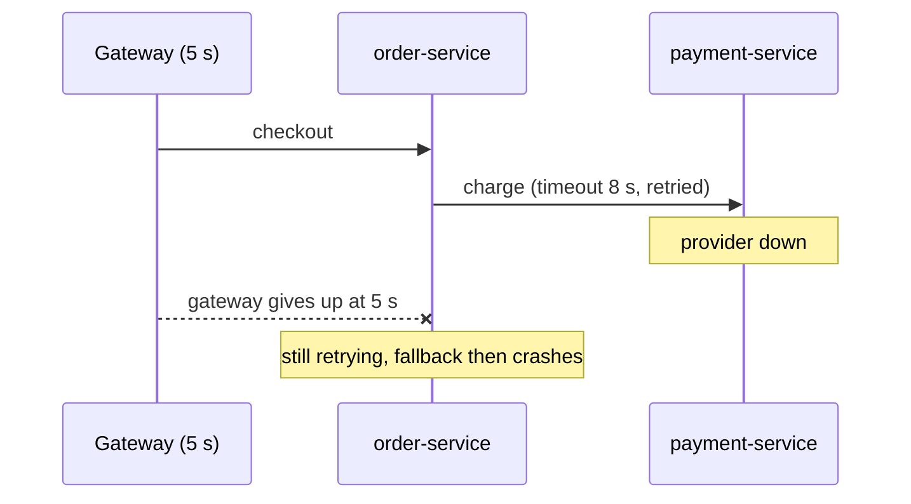
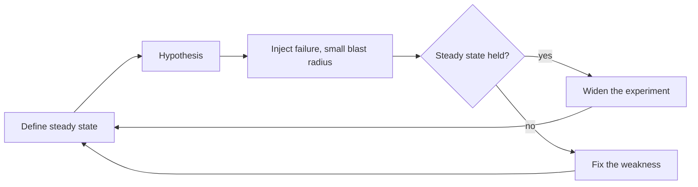

# Testing Resilience and Chaos Engineering

**Resilience · Step 1.10 · Intermediate** · Last updated 2026-10-21
**Prerequisites:** the earlier resilience notes, especially [Timeouts](02-timeouts.md) (1.2), [Circuit breaker](05-circuit-breaker.md) (1.5) and [Fallbacks](09-fallbacks-graceful-degradation.md) (1.9)

## 1. The concept in simple English

**What is it?** Resilience testing deliberately creates failures (slow calls, errors, lost servers) to check that timeouts, retries, breakers and fallbacks really work. **Chaos engineering** is the careful, experiment-based form of it.

**Why do we need it?** These mechanisms only matter during failures, which normal tests rarely create. Until you have seen one fail and recover on purpose, it is an assumption.

**When would I meet it?** Before go-live of a critical path, after changing a resilience setting, and in game days and incident follow-ups.

> [!TIP]
> **Memory hook:** a fire drill. You don't wait for a real fire to find out the exits are locked. You ring the alarm on purpose, on a calm day, with someone ready to stop it.

## 2. Mental model: a fire drill

| In the analogy | In the real system |
|---|---|
| Ringing the alarm on a calm day | **Fault injection** in a safe environment |
| The assembly point headcount | The **steady state** measurement |
| A drill that is stopped if someone is hurt | A **stop condition** |
| Fixing the locked exit afterwards | Fixing the weakness the experiment found |

**Where the analogy breaks:** a drill checks one fixed procedure. Failures in distributed systems combine in unexpected ways, so experiments also check **recovery** and the people and alerts around the system, not just the code.

## 3. Industry terms

| Term | Simple meaning | Why it matters | Example | Related terms |
|---|---|---|---|---|
| **Fault injection** | Deliberately adding delays, errors or outages | The core technique | 3 s delay on stock calls | Chaos engineering |
| **Steady state** | A measurable sign of normal | How you judge an experiment | Checkout success ≥ 99.5% | Observability |
| **Hypothesis** | Your prediction of what the failure will do | Makes it an experiment | "Checkout stays within steady state" | Experiment |
| **Blast radius** | How much the experiment can affect | Keep it small | One instance | Blast radius ([1.1](01-resilience-overview.md)) |
| **Stop condition** | A rule that ends the experiment if impact grows | Safety | Success rate under 95% | Abort |
| **Game day** | A planned session where the team breaks something and practises the response | Tests people and runbooks too | Kill a payment pod | Drill |
| **Chaos engineering** | Disciplined, repeated failure experiments to build confidence | The mature end of the ladder | Automated instance termination | Fault injection |

## 4. In a real system (ShopFlow)

**The business problem.** The team has added a timeout, a retry, a circuit breaker and a fallback to the Payment Service and wants evidence that they work together.

Code review looked fine. In the first real outage, the fallback threw a NullPointerException, the retry ran at two layers and tripled the load, and the timeout was longer than the gateway's, so customers saw gateway errors anyway. None of it had ever been exercised.



**How testing helps.** A fault-injection test would have shown the NullPointerException; a load test the retry multiplication; a review of the time budget the mismatched timeouts.

**What it costs.** Time, tooling and a safe environment; real damage if the blast radius isn't controlled; and good observability as a prerequisite.

**Elsewhere:** large streaming and cloud operators run experiments such as terminating instances so every service must survive losing one; banks run regular failover drills to prove that recovery times on paper are real.

## 5. How it works

A ladder from cheap to realistic:

1. **Unit tests:** make a fake dependency slow or failing and assert the timeout, retry and fallback behaviour.
2. **Integration tests with fault injection:** put a fault-injecting stub or proxy in front of the dependency (for example WireMock, which can add a fixed delay to a response, random delays, or faults such as a connection reset).
3. **Load and stress tests:** find real limits, shedding behaviour and retry storms.
4. **Game days** in staging: break something, and practise detection, alerts and runbooks.
5. **Chaos experiments**, automated and repeated, once monitoring is solid.



**What to check every time:** timeouts fire; retries are limited; the breaker opens and closes; the bulkhead refuses; 429s carry `Retry-After`; overload sheds low priority; fallbacks are flagged and harmless; deferred operations get reconciled; alerts fire; and **recovery** works, not just survival.

**Example experiment plan** (a plan, not a run):

| Item | Content |
|---|---|
| Steady state | Checkout success rate at least 99.5%, p99 under 400 ms |
| Hypothesis | 3 s of extra latency on stock calls keeps checkout within steady state, thanks to the bulkhead and fallback |
| Injection | 3 s latency on 100% of stock calls, staging, 10 minutes |
| Stop condition | Stop if checkout success drops below 95% |
| Evidence to look for | Rejections and fallbacks rise, breaker opens, no thread exhaustion |

**Who guarantees what**

| Layer | Responsible for |
|---|---|
| Test tooling | Injecting the fault as configured |
| Platform | Stop conditions and safe scope (for example alarms that end an experiment) |
| Team | Hypotheses, blast radius, fixing findings, repeating the experiment |
| Tests themselves | Show only the scenarios you tried; passing says nothing about faults you didn't inject |

> [!NOTE]
> Untested sketch to show the shape. The WireMock `withFixedDelay` call is described in WireMock's fault-simulation documentation; check the API for your version.

```java
@Test
void slowInventoryReturnsFallbackFast() {
    inventoryStub.stubFor(get(urlPathMatching("/stock/.*"))
        .willReturn(aResponse().withFixedDelay(3_000)));     // dependency takes 3 s

    long start = System.nanoTime();
    StockResult result = stockClient.checkStock("sku-1");
    long ms = (System.nanoTime() - start) / 1_000_000;

    assertThat(result.degraded()).isTrue();                   // fallback used
    assertThat(ms).isLessThan(1_500);                         // timeout fired, no 3 s wait
}
```

## 6. Failure scenarios

### Testing only the happy path

- **What happened?** All tests passed; the first real outage exposed the fallback bug.
- **Solutions:** a fault-injection test per resilience mechanism, in the build.

### An experiment without stop conditions

- **What happened?** A latency experiment in production kept running while checkout success fell.
- **Solutions:** a small blast radius, staging first, and automatic stop conditions tied to the steady-state metric.

### Failure tested, recovery not

- **What happened?** The system survived the outage, then stayed degraded: the breaker never closed and a reconciler never ran.
- **Solutions:** assert recovery explicitly: after removing the fault, steady state returns and pending operations settle.

## 7. Architectural decisions

| Benefit | Cost |
|---|---|
| Finds weaknesses before customers do | Time, tooling and a safe environment |
| Builds team confidence and skill | Real damage if the blast radius isn't controlled |
| Verifies alerts and runbooks too | Needs good observability first |

Start with fault-injection tests in the pipeline and a game day in staging; move to automated experiments once monitoring is solid; require failure testing for critical paths before go-live. **Common mistakes:** chaos without observability; starting in production before staging is covered; not fixing what you find, because a finding without an owner is just a story.

## 8. Check your understanding

1. Why does a green test suite say little about resilience?
2. What are the three things every experiment needs before it starts?
3. After the fault is removed, what should you check besides "no errors"?
4. Where would you start if the team has no chaos practice at all?

Answers are at the end of this note.

## 9. Revision

**Remember**
- **Untested resilience is an assumption.**
- **Steady state → hypothesis → small blast radius → compare → fix.**
- **Always have stop conditions.**
- **Test recovery, not just failure.**
- **Climb the ladder**: unit → integration → load → game day → chaos.

**Explain in 15 seconds:** "I test resilience by injecting failures on purpose: fault-injection tests first, then load tests, game days and chaos experiments with a small blast radius and stop conditions."

**Explain in 60 seconds:**
> "Timeouts, retries, breakers and fallbacks only matter during failures, which normal tests rarely create, so I test them deliberately. Cheap tests come first: unit and integration tests that make a dependency slow or failing and assert the behaviour. Then load tests to find real limits, game days to practise alerts and runbooks, and chaos experiments: define a steady state, state a hypothesis, inject a real failure with a small blast radius and stop conditions, and compare. I test recovery as well, and make sure every finding gets fixed and the experiment repeated. Passing tests only cover the faults I injected."

**Likely follow-up questions:**
- **What is a steady state?** A measurable sign of normal, like success rate or p99 latency, used to judge the experiment.
- **How do you limit the risk of chaos experiments?** Small blast radius, staging first, and automatic stop conditions.

**Architect's takeaway:** require failure testing before go-live for critical paths and schedule game days, because that's how the team learns which resilience is real.

**Next topic:** this completes the resilience area. Revise with the [resilience cheat sheet](99-resilience-cheat-sheet.md), then continue with [messaging](../02-messaging/01-messaging-overview.md) (2.1).

## 10. Verification and sources

> [!NOTE]
> Checked 2026-10-21 by web search; principles mostly from secondary pages, tools from more authoritative ones. Re-verify when you revisit this note.

- **Confirmed:** AWS Well-Architected recommends testing resiliency with chaos engineering; AWS Fault Injection Service runs experiments on AWS workloads with stop conditions tied to CloudWatch alarms and can integrate with Chaos Mesh and LitmusChaos; Chaos Monkey is Netflix's original instance-termination tool; WireMock's documentation describes a fixed delay (`withFixedDelay`, `fixedDelayMilliseconds`), random delay distributions and fault types such as connection reset.
- **Assumptions and illustrations:** the ShopFlow story, the experiment plan and the code (not run).
- **To verify:** the canonical wording at principlesofchaos.org; current APIs of Toxiproxy and Testcontainers.
- **Decision rule:** fault-injection tests in the pipeline and game days in staging first; automated experiments once monitoring is solid; always a blast radius and stop conditions.

**Sources:** Principles of Chaos Engineering (principlesofchaos.org); AWS Well-Architected Framework, Reliability pillar; WireMock documentation, "Simulating faults"; Casey Rosenthal and Nora Jones, *Chaos Engineering*.

## Answers

1. Normal tests don't create slow or failing dependencies, so the timeouts, breakers and fallbacks are never exercised; green only covers the faults you tried.
2. A defined steady state, a hypothesis, and a limited blast radius with stop conditions.
3. That steady state actually returns: breakers close, queues drain, pending operations are reconciled and alerts clear.
4. Fault-injection tests in the build pipeline, then a game day in staging with a small, prepared scenario.

Back to [the resilience overview](01-resilience-overview.md) · [Index](../README.md) · [Roadmap](../roadmap.md).
