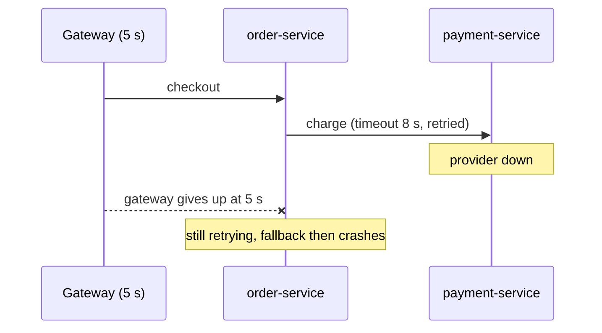
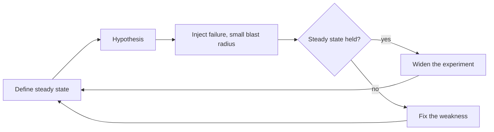

# Testing Resilience and Chaos Engineering

**Resilience · Step 1.10 · Intermediate** · Last updated 2026-10-21

> [!TIP]
> **In one sentence:** resilience testing deliberately creates failures (slow calls, errors, lost servers) to check that timeouts, retries, breakers and fallbacks really work, and chaos engineering is the careful, experiment-based form of it.
>
> **Memory hook:** a **fire drill**. You don't wait for a real fire to find out the exits are locked. You ring the alarm on purpose, on a calm day, with someone ready to stop it.

## Where it fits

Step 1.10, the last step of the [resilience track](01-resilience-overview.md). It tests everything before it: [timeouts](02-timeouts.md), [retries](03-retries-backoff-jitter.md), the [circuit breaker](05-circuit-breaker.md), the [bulkhead](06-bulkhead.md), [rate limiting](07-rate-limiting.md), [load shedding](08-load-shedding-backpressure.md) and [fallbacks](09-fallbacks-graceful-degradation.md).

## 1. The story

ShopFlow's team added a timeout, a retry, a circuit breaker and a fallback to `payment-service`. Code review looked fine. In the first real outage, the fallback threw a NullPointerException, the retry ran at two layers and tripled the load, and the timeout was longer than the gateway's, so customers saw gateway errors anyway. None of it had ever been exercised.



## 2. The idea

Treat every resilience mechanism as an **untested assumption** until you have seen it fail and recover on purpose. Start with cheap, automatic tests in the build, then move to realistic experiments as monitoring matures.

**Chaos engineering** turns this into a scientific experiment: define what "normal" looks like, predict what a failure will do, inject it with a small **blast radius** and **stop conditions**, and learn from the difference.



## 3. Key terms

| Term | Plain meaning |
|---|---|
| **Fault injection** | Deliberately adding delays, errors or outages |
| **Steady state** | A measurable sign of normal, such as success rate or p99 latency |
| **Hypothesis** | Your prediction of what the failure will do |
| **Blast radius** | How much the experiment can affect |
| **Stop condition** | A rule that ends the experiment automatically if impact grows |
| **Game day** | A planned session where the team breaks something and practises the response |
| **Chaos engineering** | Disciplined, repeated failure experiments to build confidence |

## 4. How it works, step by step

A ladder from cheap to realistic:

1. **Unit tests:** make a fake dependency slow or failing, assert the timeout, retry and fallback behaviour.
2. **Integration tests with fault injection:** put a fault-injecting stub or proxy (for example WireMock, Toxiproxy) in front of the dependency.
3. **Load and stress tests** (for example k6, Gatling, JMeter): find real limits, shedding behaviour and retry storms.
4. **Game days** in staging: break something, and practise detection, alerts and runbooks.
5. **Chaos experiments**, automated and repeated, once monitoring is solid.

**What to check every time:** timeouts fire; retries are limited; the breaker opens and closes; the bulkhead refuses; 429s carry `Retry-After`; overload sheds low priority; fallbacks are flagged and harmless; alerts fire; and **recovery** works, not just survival.

## 5. Real-world examples

- **Video streaming:** randomly terminating servers in production (the idea behind Netflix's Chaos Monkey) forces every service to survive losing an instance.
- **Cloud platforms:** managed fault-injection services run experiments such as stopping instances or adding latency, with alarms as automatic stop conditions.
- **Banks and payment companies:** regular game days and disaster-recovery drills, such as failing over to a second region, to prove recovery times on paper are real.

## 6. Design choices and trade-offs

| Benefit | Cost |
|---|---|
| Finds weaknesses before customers do | Time, tooling and a safe environment |
| Builds team confidence and skill | Real damage if the blast radius isn't controlled |
| Verifies alerts and runbooks too | Needs good observability first |

**Example experiment plan** (a plan, not a run):

| Item | Content |
|---|---|
| Steady state | Checkout success rate at least 99.5%, p99 under 400 ms |
| Hypothesis | 3 s of extra latency on stock calls keeps checkout within steady state, thanks to the bulkhead and fallback |
| Injection | 3 s latency on 100% of stock calls, staging, 10 minutes |
| Stop condition | Stop if checkout success drops below 95% |
| Evidence to look for | Rejections and fallbacks rise, breaker opens, no thread exhaustion |

## 7. Common mistakes

1. **Testing only the happy path.**
2. **Chaos without observability**, so you can't tell what happened.
3. **No stop conditions.**
4. **Starting in production** before staging is covered.
5. **Testing failure but not recovery.**
6. **Not fixing what you find**: a finding without an owner is just a story.

## 8. In code

> [!NOTE]
> Untested sketch to show the shape. Check the WireMock API for your version.

```java
@Test
void slowInventoryReturnsFallbackFast() {
    inventoryStub.stubFor(get(urlPathMatching("/stock/.*"))
        .willReturn(aResponse().withFixedDelay(3_000)));     // dependency takes 3 s

    long start = System.nanoTime();
    StockResult result = stockClient.checkStock("sku-1");
    long ms = (System.nanoTime() - start) / 1_000_000;

    assertThat(result.degraded()).isTrue();                   // fallback used
    assertThat(ms).isLessThan(1_500);                         // timeout fired, no 3 s wait
}
```

## 9. Remember

- **Untested resilience is an assumption.**
- **Steady state → hypothesis → small blast radius → compare → fix.**
- **Always have stop conditions.**
- **Test recovery, not just failure.**
- **Climb the ladder**: unit → integration → load → game day → chaos.

## 10. Interview corner

**15-second answer:** "I test resilience by injecting failures on purpose: unit and integration fault tests first, then load tests, game days and chaos experiments with a small blast radius and stop conditions."

**60-second answer:**
> "Timeouts, retries, breakers and fallbacks only matter during failures, which normal tests rarely create, so I test them deliberately. Cheap tests come first: unit and integration tests that make a dependency slow or failing and assert the behaviour. Then load tests to find real limits, game days to practise alerts and runbooks, and chaos experiments: define a steady state, state a hypothesis, inject a real failure with a small blast radius and stop conditions, and compare. I test recovery as well, and make sure every finding gets fixed and the experiment repeated."

**Likely follow-up questions:**
- **What is a steady state?** A measurable sign of normal, like success rate or p99 latency, used to judge the experiment.
- **How do you limit the risk of chaos experiments?** Small blast radius, staging first, and automatic stop conditions.
- **Why test recovery?** Systems often survive the failure but don't return to normal afterwards.
- **Where would you start with no chaos practice at all?** Fault-injection tests in the pipeline and a game day in staging.

**Architect angle:** "I require failure testing before go-live for critical paths and schedule game days, because that's how we learn which resilience is real."

## 11. Industry check

> [!NOTE]
> Checked 2026-10-21 by web search; principles mostly from secondary pages, tools from more authoritative ones. Re-verify when you revisit the note.

- **Confirmed:** AWS Well-Architected recommends testing resiliency with chaos engineering. AWS Fault Injection Service runs experiments on AWS workloads with stop conditions tied to CloudWatch alarms, and can integrate with Chaos Mesh and LitmusChaos (open-source chaos tools for Kubernetes). Chaos Monkey is Netflix's original instance-termination tool.
- **To verify:** the canonical wording at principlesofchaos.org; current APIs of WireMock, Toxiproxy and Testcontainers.
- **Decision rule:** fault-injection tests in the pipeline and game days in staging first; automated experiments once monitoring is solid; always a blast radius and stop conditions.

## 12. Going further

- Principles of Chaos Engineering (principlesofchaos.org)
- AWS Well-Architected Framework, Reliability pillar
- Casey Rosenthal and Nora Jones, *Chaos Engineering*

**This completes the resilience track.** Revise with the [resilience cheat sheet](99-resilience-cheat-sheet.md).

Back to [the index](../README.md) · [Roadmap](../roadmap.md).
