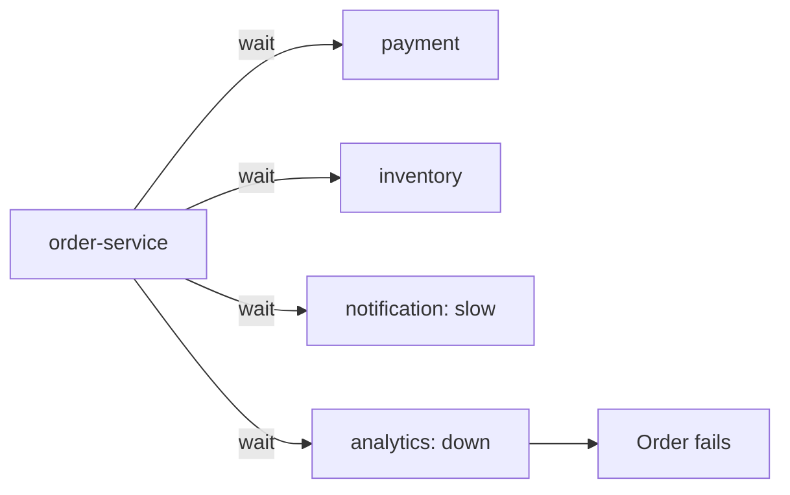
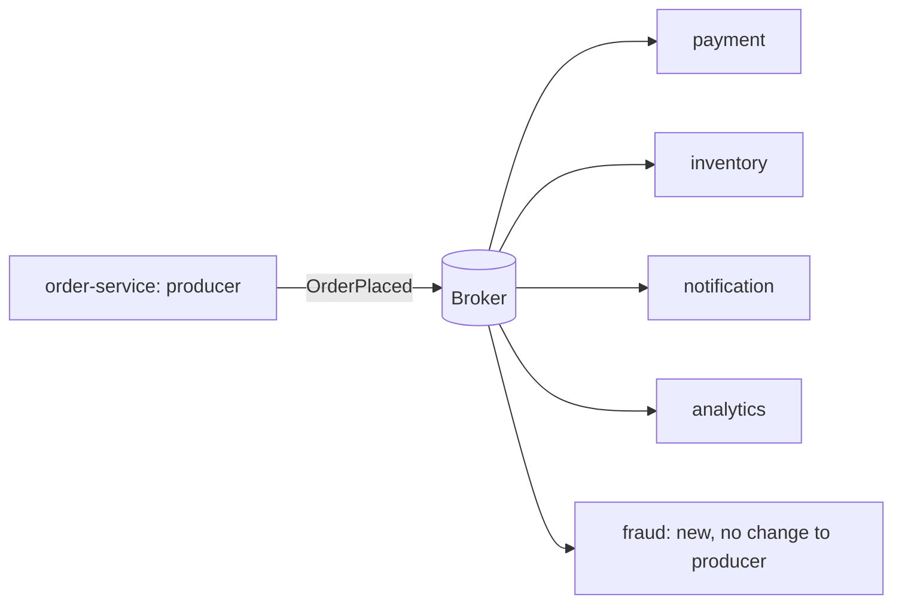

# Messaging and Event-Driven Design: The Big Picture

**Messaging · Step 2.1 · Fundamentals** · Last updated 2026-10-21

> [!TIP]
> **In one sentence:** messaging lets services talk by sending messages through a broker instead of calling each other directly, which decouples them in time and knowledge, at the cost of duplicates, ordering questions and eventual consistency.
>
> **Memory hook:** a **phone call versus a letter in a mailbox**. A call needs both people available right now. A letter waits in the mailbox until the reader is ready, and many people can receive a copy.

Read this first. It is the map for the whole messaging area, including the Kafka and RabbitMQ series.

## Where it fits

Step 2.1, the start of the messaging track. It builds on the resilience track (messaging is one way to stop one slow service from slowing others), and leads into the [Kafka series](02-kafka/01-kafka-overview.md) (2.2) and the RabbitMQ series (2.3).

## 1. The story

When a customer places an order, ShopFlow's `order-service` calls payment, inventory, notification and analytics over HTTP, one after the other. When the email provider is slow, customers wait at checkout. When analytics is down, orders fail. And when the fraud team wants to react to orders too, `order-service` has to be changed and redeployed.

This is **tight coupling**: the caller must know every receiver, and all of them must be up at the same moment.

## 2. The idea

`order-service` publishes one message, `OrderPlaced`, to a **broker** and moves on. Everyone who cares reads it in their own time. Adding a fraud check means adding a reader; `order-service` doesn't change.

**What you gain:** decoupling in time (a reader can be down and catch up), in knowledge (the producer doesn't know the readers), load levelling (bursts wait in the broker), and resilience (a slow reader doesn't slow the producer).

**What it costs:** results arrive *eventually*, messages can arrive twice or out of order, and you now run a broker and debug across services.

## 3. Key terms

| Term | Plain meaning |
|---|---|
| **Broker** | The middleman that stores and delivers messages |
| **Producer / consumer** | Who sends / who receives |
| **Queue** | Messages wait; each is taken by one consumer and then removed |
| **Log** | Messages are appended and kept; each reader keeps its own position |
| **Command** | "Do this", addressed to one receiver (`ChargeCard`) |
| **Event** | "This happened", for anyone interested (`OrderPlaced`) |
| **At-least-once delivery** | A message may arrive more than once, never zero times |
| **Dead-letter queue / topic** | Where messages that keep failing are parked |
| **Eventual consistency** | All parts agree after a short delay, not instantly |

## 4. The two families, and the four questions

**Queue or log** is the most useful idea in this area:

| | Queue (RabbitMQ, SQS) | Log (Kafka, Kinesis) |
|---|---|---|
| Think of it as | **Work to do** | **Facts that happened** |
| After reading | Removed once acknowledged | Kept until retention ends |
| Replay | Normally no | Yes |
| Many independent readers | A queue per reader | Each reader has its own position |
| Strengths | Routing, task distribution, low latency | Throughput, history, many consumers |

**Every messaging design must answer four questions:**

1. **Delivery:** at most once, at least once, or "exactly once" (in practice: at least once plus idempotent handling)? Most systems use at least once.
2. **Ordering:** which messages must stay in order? Usually only inside one queue or partition.
3. **Duplicates:** make consumers **idempotent**, so a second copy is harmless.
4. **Failures:** retry with backoff, then move a stubborn ("poison") message to a **dead-letter** queue.

## 5. Real-world examples

- **E-commerce order flows:** one `OrderPlaced` event drives payment, stock, emails and analytics, each team owning its own consumer.
- **Banking notifications:** transactions publish events; SMS, push and statement services consume them independently, so a slow SMS gateway never delays a payment.
- **Background jobs:** a video platform puts "transcode this video" commands on a queue; a pool of workers takes them one at a time and scales with the backlog.

## 6. Design choices and trade-offs

| Choose a queue when | Choose a log when |
|---|---|
| Messages are tasks to do once | Messages are facts others may need later |
| You need flexible routing per message | Many independent readers need the same data |
| Low latency per message matters most | You need replay, history or very high volume |

**Messaging versus direct calls:** use direct calls when you need an immediate answer (price, authorisation); use messaging when the work can happen after the response (emails, analytics, shipping).

**Industry patterns** (from *Enterprise Integration Patterns*, Hohpe and Woolf): point-to-point channel, publish-subscribe channel, competing consumers, request-reply, dead letter channel, idempotent receiver, and the transactional outbox (microservices track).

## 7. Notes in this area, in learning order

| Step | Topic | Status |
|---|---|---|
| 2.1 | This overview | Done |
| 2.2 | Apache Kafka series (2.2.1 to 2.2.18): start at the [Kafka overview](02-kafka/01-kafka-overview.md) | Done |
| 2.3 | RabbitMQ series (2.3.1 to 2.3.14) | Planned |
| 2.4 | Choosing a messaging system | Planned |
| | [Messaging cheat sheet](99-messaging-cheat-sheet.md) (revision) | Growing |

## 8. Remember

- **A queue is about work; a log is about facts.**
- **Messaging trades instant answers for independence.**
- **At least once + idempotent consumers** is the normal answer to delivery.
- **Order only inside one queue or partition.**
- **Name events in the past tense** (`OrderPlaced`), commands in the imperative (`ChargeCard`).

## 9. Interview corner

**15-second answer:** "Messaging decouples services through a broker; queues hold work to be done once, logs like Kafka keep facts for many readers and replay."

**60-second answer:**
> "With messaging, a producer publishes to a broker and consumers read in their own time, so services are decoupled in time and knowledge, bursts are levelled, and one slow consumer doesn't slow the producer. There are two families: queues, where a message is removed once handled, good for tasks and routing, and logs like Kafka, where events are kept and each reader tracks its own position, good for many consumers and replay. Every design must answer delivery, ordering, duplicates and failures: I use at-least-once delivery with idempotent consumers, keep order with keys, and dead-letter poison messages."

**Likely follow-up questions:**
- **When would you not use messaging?** When the caller needs the answer now, such as a price or a payment authorisation.
- **Command versus event?** A command asks one receiver to act; an event announces a fact to anyone.
- **How do you get exactly-once?** In practice, at-least-once delivery plus idempotent processing.
- **What is a poison message?** One that always fails; after limited retries it goes to a dead-letter queue.

**Architect angle:** "I decide per interaction: synchronous when the user needs the answer now, events when the work can follow, and a log when several teams need the same facts."

## 10. Industry check

> [!NOTE]
> Checked 2026-10-20 by web search; mostly vendor and blog articles. Re-verify when you revisit the note.

- **Confirmed:** "log versus queue" is the standard way to compare Kafka and RabbitMQ; common guidance is a log for throughput, replay and many consumers, and a queue for task distribution, routing and low latency. The gap is narrowing: RabbitMQ has added Streams, and Kafka 4.0 has early work on queue-style consumption.
- **To verify:** the current state of RabbitMQ Streams and Kafka queue support; managed cloud options (SQS and SNS, Azure Service Bus, Google Pub/Sub), covered in 2.4.
- **Decision rule:** start from what the messages are (work or facts), then who reads them and whether they need replay.

## 11. Going further

- Gregor Hohpe and Bobby Woolf, *Enterprise Integration Patterns*
- Martin Kleppmann, *Designing Data-Intensive Applications* (stream processing)
- Apache Kafka and RabbitMQ documentation

Back to [the index](../README.md) · [Roadmap](../roadmap.md).
