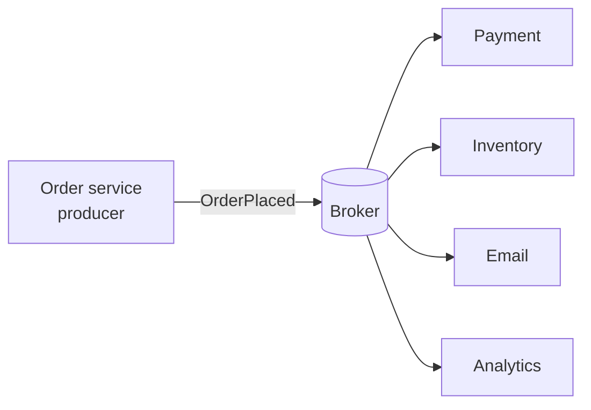

# Messaging and Event-Driven Design: The Big Picture

**Category:** Messaging · **Level:** Fundamentals · **Last updated:** 2026-10-20

> [!NOTE]
> Read this first. It is the map for the whole messaging area. Each topic and each product (Kafka, RabbitMQ) has its own notes; this page shows how the ideas relate and in what order to learn them.

## In one minute

**Messaging** means services talk to each other by sending **messages** through a middleman called a **broker**, instead of calling each other directly. The sender doesn't wait for the receiver, and doesn't even need to know who it is. This makes systems more independent and better at coping with slow or failed parts, but it brings new problems: duplicates, ordering and data that is only eventually consistent.

## Why it matters for your role

- **As an engineer:** you publish and consume messages, handle duplicates and failures, and choose settings such as acknowledgements and retries.
- **As an architect:** you decide where messaging replaces direct calls, which kind of broker fits (queue or log), what delivery guarantees the business really needs, and how teams share events as contracts.

## 1. The problem

An `order-service` takes an order and then calls payment, inventory, email and analytics, one after the other, over HTTP. Three things go wrong:

- If email is slow, the customer waits, even though the email isn't needed to finish the order.
- If analytics is down, the order fails.
- To add a new consumer (say, a fraud check), you have to change and redeploy the order service.

This is **tight coupling**: the caller must know every receiver, and all of them must be available at the same time.

## 2. The core idea

The order service publishes one message, "OrderPlaced", to a broker and moves on. Anyone who cares about orders reads it from the broker, in their own time.

What you gain:
- **Decoupling in time:** the receiver can be down for a while and catch up later.
- **Decoupling in knowledge:** the producer doesn't know who the consumers are, so adding one costs nothing.
- **Load levelling:** a burst of messages waits in the broker instead of overwhelming a consumer.
- **Resilience:** one slow consumer doesn't slow the producer (this links to the resilience track).

What it costs:
- Results are **eventually consistent**; there is no instant answer.
- Messages can arrive **more than once**, and sometimes out of order.
- You now operate a broker, and debugging crosses several services.

## 3. Two families of brokers

Almost every messaging product is one of two designs. This is the most useful idea in the whole area.

| | Queue (broker routes) | Log (consumers read a retained stream) |
|---|---|---|
| Picture | A mailbox: messages wait, one consumer takes each, then it's gone | A ledger: messages are appended and kept, each reader keeps its own bookmark |
| After a message is read | Removed once acknowledged | Stays until the retention time ends |
| Replay old messages | Normally no | Yes, by moving the bookmark |
| Several independent readers of the same data | Needs a copy of the queue per reader | Natural: each reader has its own position |
| Strengths | Flexible routing, task distribution, low latency | High throughput, history, replay, many consumers |
| Examples | RabbitMQ, Amazon SQS | Apache Kafka, Amazon Kinesis |

> [!IMPORTANT]
> A queue is about **work to be done** (take it, do it, it's gone). A log is about **facts that happened** (keep them, anyone can read them, any time).

The lines are blurring: RabbitMQ has added streams, and Kafka is adding queue-style features. The mental model still holds.

## 4. Kinds of messages

| Kind | Meaning | Example |
|---|---|---|
| **Command** | "Do this." Addressed to one receiver | `ChargeCard` |
| **Event** | "This happened." Announced to anyone interested | `OrderPlaced` |
| **Document / data** | Carries data for others to use | A product catalogue update |

Naming an event in the past tense (`OrderPlaced`, not `PlaceOrder`) keeps producers from depending on what consumers do with it.

## 5. The four questions every messaging design must answer

1. **Delivery guarantee.** At most once (may lose), at least once (may duplicate), or "exactly once" (really: at least once plus safe handling of duplicates). Most real systems use at least once.
2. **Ordering.** Which messages must stay in order (for one order, one customer)? Order is usually guaranteed only inside one queue or partition.
3. **Duplicates.** Make consumers **idempotent**: handling the same message twice must be harmless. This ties directly to the idempotency topic in the resilience track.
4. **Failure.** What happens to a message that keeps failing (a "poison message")? Retry with backoff, then move it to a **dead-letter** queue or topic for inspection.

## 6. Industry patterns you will meet

These names come from *Enterprise Integration Patterns* (Hohpe and Woolf), the standard vocabulary for messaging.

| Pattern | Idea |
|---|---|
| Point-to-point channel | One message goes to one consumer (a queue) |
| Publish-subscribe channel | One message goes to every subscriber |
| Competing consumers | Several consumers share one queue to spread the work |
| Request-reply | A message asks a question, and a reply message comes back |
| Dead letter channel | Where undeliverable messages go |
| Idempotent receiver | A consumer that tolerates duplicates |
| Transactional outbox | Write the message in the same database transaction as your data, then publish it (covered in the microservices track) |

## 7. Notes in this area, in learning order

Step numbers match the [roadmap](../roadmap.md). Finished notes are linked; the rest are planned.

| Step | Topic | Why in this position | Status |
|---|---|---|---|
| 2.1 | This overview | Gives the map and the vocabulary | Done |
| 2.2 | Apache Kafka series (2.2.1 to 2.2.18) | The log family, fundamentals to advanced. Start at the [Kafka overview](02-kafka/01-kafka-overview.md) | Learning |
| 2.3 | RabbitMQ series (2.3.1 to 2.3.14) | The queue family, fundamentals to advanced | Planned |
| 2.4 | Choosing a messaging system | Compares what you have learned and gives a decision guide | Planned |
| | [Messaging cheat sheet](99-messaging-cheat-sheet.md) (revision) | One page for quick review | Growing |

Shared ideas (delivery guarantees, dead letters, idempotent consumers) are explained once, here and in the first series, and later notes show only what differs.

## 8. Industry check

> [!NOTE]
> Last checked: 2026-10-20 by web search. Sources were mostly vendor and blog articles, so treat details as directional and check the official documentation before relying on them. Re-verify this section when you revisit the note.

- **Log versus queue** is the standard way to compare Kafka with RabbitMQ. Kafka retains messages for a set time and lets each consumer track its own position; RabbitMQ routes messages through exchanges to queues and removes them once acknowledged.
- **The gap is narrowing:** RabbitMQ has added Streams (reported since version 3.9), which keep data for replay, and Apache Kafka 4.0 has early work on queue-style messaging. Check each project's documentation for the current state.
- **Common guidance:** choose a log for high throughput, replay and many independent consumers; choose a queue for task distribution, complex routing and low latency.
- **Managed cloud options** (for example Amazon SQS and SNS, Azure Service Bus, Google Pub/Sub) cover similar ground with less to operate; the comparison note (2.4) will cover when they are the better choice. To verify when that note is written.
- **Decision rule:** start from what the messages *are* (work to do, or facts that happened), then from who needs to read them and whether they need to replay them.

## 9. Quick Q&A (for review)

**Why use messaging instead of direct calls?** It decouples services in time and knowledge, levels load, and stops one slow consumer from slowing the producer.

**What is the main difference between a queue and a log?** A queue removes a message once handled, and is about work to do. A log keeps messages and lets each reader keep its own position, so it supports replay and many readers.

**Why must consumers be idempotent?** Most systems deliver at least once, so a message can arrive twice. Handling it twice must be harmless.

**What is a dead-letter queue?** A place for messages that keep failing, so they don't block everything else and can be inspected.

**Command versus event?** A command asks one receiver to do something. An event announces that something already happened to anyone interested.

## 10. Going further

- Gregor Hohpe and Bobby Woolf, *Enterprise Integration Patterns*
- Martin Kleppmann, *Designing Data-Intensive Applications*, the chapter on stream processing
- Apache Kafka and RabbitMQ official documentation

Back to [the index](../README.md) · [Roadmap](../roadmap.md).
