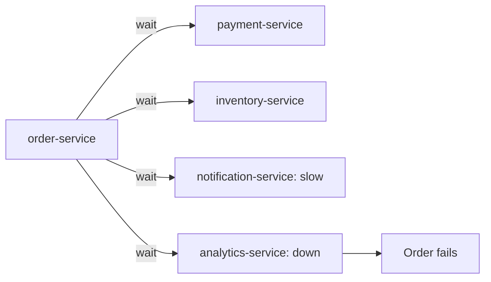
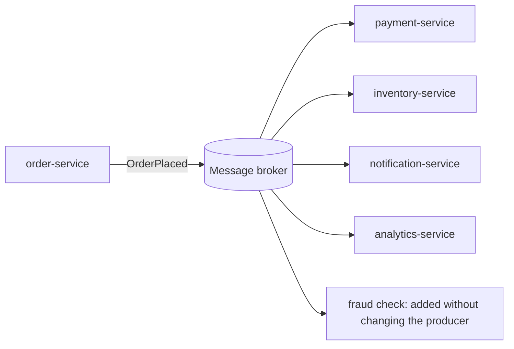

# Messaging and Event-Driven Design: The Big Picture

**Messaging · Step 2.1 · Overview** · Last updated 2026-10-21
**Prerequisites:** [Resilience patterns](../01-resilience/01-resilience-overview.md) (helpful, not required)

Read this first. It is the map of the messaging area: the problem messaging solves, the two families of brokers, the questions every design must answer, and the learning order.

## 1. What it is and why it matters

**What is it?** Messaging lets services talk by leaving messages with a middleman, a **message broker**, instead of calling each other directly.

**Why do we need it?** With direct calls, every service must be up and fast at the same moment, and the caller must know every receiver. Messaging removes both constraints.

**When would I meet it?** When one action (an order) must trigger work in several services (payment, stock, email, analytics), or when work can happen a little later than the user's request.

> [!TIP]
> **Memory hook:** a phone call needs both people now; a letter waits in the mailbox until the reader is ready.

## 2. Mental model: a parcel delivery service

Sending a message is like sending a parcel. You hand it to the courier and go on with your day. The courier stores it, delivers it when the recipient is available, and can confirm delivery. Undeliverable parcels go to a returns depot.

| In the analogy | In the real system |
|---|---|
| Sender | **Producer** (for example the Order Service) |
| Courier company and its depots | **Message broker** (Kafka, RabbitMQ) |
| Address or delivery route | **Topic** or **queue** |
| Recipient | **Consumer** (for example the Notification Service) |
| Delivery confirmation | **Acknowledgement (ack)** |
| Returns depot for undeliverable parcels | **Dead-letter queue or topic** |

**Where the analogy breaks:** a parcel exists once and is gone when delivered. A message can be **delivered more than once** after failures, and in a log-based broker such as Kafka it **stays after reading**, so many recipients can read the same message, and read it again later.

## 3. Industry terms

| Term | Simple meaning | Why it matters | Example | Related terms |
|---|---|---|---|---|
| **Message broker** | The middleman that stores and delivers messages | Services no longer need to be up at the same time | Kafka cluster | Queue, log |
| **Event** | "This happened", for anyone interested | The producer doesn't need to know who reacts | `OrderPlaced` | Command |
| **Command** | "Do this", for one receiver | Has an owner and an expected action | `ChargeCard` | Event |
| **Queue** | Each message goes to one consumer at a time and is removed once acknowledged; if it isn't acknowledged it is redelivered | Distributes work | RabbitMQ queue, Amazon SQS | Log |
| **Log** | Messages are kept; each reader has its own position | Many readers and replay | Kafka topic | Retention |
| **Delivery guarantee** | What the system promises about loss and duplication | Drives how consumers must be written | At-least-once | At-most-once, exactly-once |
| **Eventual consistency** | All parts agree after a short delay | The price of decoupling | Stock updated just after the order | Strong consistency |

All terms are defined in the [messaging glossary](98-messaging-glossary.md).

## 4. In a real system (ShopFlow)

**The business problem.** When an order is placed, the Order Service must make sure payment, stock reservation, the confirmation email and analytics all happen, without making the customer wait for all of them and without failing the order because one of them is down.

With direct HTTP calls, the Order Service calls each service in turn. A slow email provider slows checkout; analytics being down fails orders; adding a fraud check means changing and redeploying the Order Service.

**How messaging helps.** The Order Service publishes one `OrderPlaced` event to the broker and moves on. Each service reads it in its own time; a new fraud service simply starts reading.

**What it costs.** Results become **eventually consistent**; a message can arrive **twice** or **out of order**; you operate a broker; and debugging now spans several services. Work the customer must see immediately (price, payment authorisation) usually stays a direct call.

**Elsewhere:** in banking, one transaction event feeds SMS, push and statement services independently, so a slow SMS gateway never delays a payment; on a video platform, "transcode this video" commands go on a queue, and a pool of workers takes them one at a time and scales with the backlog.

## 5. How it works: two families and four questions

**Queue or log** is the most useful distinction in this area:

| | Queue (RabbitMQ, SQS) | Log (Kafka, Kinesis) |
|---|---|---|
| Think of it as | Work to do | Facts that happened |
| After a message is processed | Removed once acknowledged | Kept until retention ends |
| Replay | Normally not | Yes, by moving the reader's position |
| Many independent readers | A queue per reader | Each reader has its own position |
| Strengths | Flexible routing, task distribution | Throughput, history, many consumers |

The two families are converging: RabbitMQ has added streams, and Kafka has added queue-style **share groups** (early access in 4.0, production-ready in 4.2). The mental model still holds: first decide whether your messages are work to do or facts to keep.

**Every messaging design must answer four questions:**

1. **Delivery:** may a message be lost, or repeated? Most systems choose **at-least-once**: not lost (as long as it is retried until processed, within retention), sometimes repeated.
2. **Ordering:** which messages must stay in order? Usually only those for one entity, such as one order. A queue with several competing consumers, or with redelivery, can reorder messages; a Kafka partition keeps order, but only within that partition.
3. **Duplicates:** consumers must be **idempotent**, so a repeated message does no extra harm to the state the consumer controls. Effects on other systems (an email, a card charge) need those systems' own idempotency.
4. **Failures:** a message that keeps failing is retried with backoff, then moved to a **dead-letter queue or topic**.

**Who guarantees what:** the broker stores and delivers messages under its stated guarantee; the application decides keys, handles duplicates and failures, and performs side effects. No broker can make an email or an HTTP call happen exactly once on its own.

## 6. Architectural decisions

| Use messaging when | Prefer a direct call when | Alternatives |
|---|---|---|
| Work can happen after the response | The caller needs the answer now | Synchronous HTTP or gRPC |
| Several services react to one fact | Exactly one service is involved and must answer | A scheduled batch job |
| You need to absorb bursts | Strong consistency is required immediately | A shared database (rarely a good idea between services) |

**Queue or log?** Choose a **queue** for tasks done once with rich routing; a **log** when several teams need the same facts, replay, or high volume. The comparison note (2.4) covers this in depth against concrete workloads.

## 7. Notes in this area, in learning order

| Step | Topic | Status |
|---|---|---|
| 2.1 | This overview | Done |
| 2.2 | [Apache Kafka series](02-kafka/01-kafka-overview.md) ([2.2.1](02-kafka/01-kafka-overview.md) to [2.2.18](02-kafka/18-multi-cluster-disaster-recovery.md)) | Done |
| 2.3 | RabbitMQ series (2.3.1 to 2.3.14) | Planned |
| 2.4 | Choosing a messaging system | Planned |
| | [Messaging glossary](98-messaging-glossary.md) | Revision |
| | [Messaging cheat sheet](99-messaging-cheat-sheet.md) | Revision |

Industry patterns used throughout come from *Enterprise Integration Patterns* (Hohpe and Woolf): point-to-point channel, publish-subscribe channel, competing consumers, request-reply, dead letter channel, idempotent receiver. The transactional outbox is covered in the microservices track and in [Kafka Connect and CDC](02-kafka/15-kafka-connect-cdc.md).

## 8. Check your understanding

1. Why does a slow email provider slow down checkout when the Order Service calls services directly, but not when it publishes an event?
2. What happens if the Notification Service is down for an hour while orders keep coming, in a queue-based design and in a log-based design?
3. A consumer sometimes sends two confirmation emails for one order. Which of the four design questions was not answered properly?
4. The fraud team needs the last 30 days of orders to train a model. Queue or log, and why?

Answers are at the end of this note.

## 9. Revision

**Remember**
- Messaging trades **instant answers** for **independence**.
- A **queue** is about work to do; a **log** is about facts that happened.
- Every design answers **delivery, ordering, duplicates, failures**.
- **At-least-once + idempotent consumers** is the usual combination.

**Explain in 15 seconds:** "Messaging decouples services through a broker: the producer publishes and moves on, and consumers process in their own time. Queues hold work done once; logs keep facts for many readers and replay."

**Explain in 60 seconds:**
> "With messaging, a producer publishes to a broker and consumers read in their own time, so services are decoupled in time and knowledge, bursts are absorbed, and one slow consumer doesn't slow the producer. There are two families: queues, where a message is removed once handled, good for tasks and routing, and logs like Kafka, where events are kept and each reader tracks its position, good for many consumers and replay. The cost is eventual consistency and the possibility of duplicates and reordering, so every design must decide delivery guarantees, ordering scope, idempotent handling and dead-lettering."

**Likely follow-up questions:**
- **When would you not use messaging?** When the caller needs the answer now, such as a price or a payment authorisation.
- **Command or event?** A command asks one receiver to act (`ChargeCard`); an event announces a fact to anyone (`OrderPlaced`).
- **How do you get "exactly once" across services?** Not end to end: use at-least-once delivery plus idempotent processing, which gives *effectively once*.
- **What is a poison message?** One that always fails; after limited retries it is moved to a dead-letter queue or topic.

**Architect's takeaway:** decide per interaction: synchronous when the user needs the answer now, events when the work can follow, and a log when several teams need the same facts.

**Next topic:** [Apache Kafka: the big picture](02-kafka/01-kafka-overview.md) (2.2.1)

## 10. Verification and sources

> [!NOTE]
> Checked 2026-10-20 and 2026-10-21 by web search. Re-verify when you revisit this note.

- **Confirmed:** comparing Kafka and RabbitMQ as log versus queue is standard; Kafka retains messages for a configured time and lets each consumer track its position, while RabbitMQ routes messages through exchanges to queues and removes them once acknowledged (vendor and comparison articles); RabbitMQ has added streams; Kafka's queue-style share groups (KIP-932) were early access in 4.0, a preview in 4.1 and production-ready in 4.2 (Apache Kafka 4.2 upgrade notes).
- **Assumptions and illustrations:** ShopFlow is an illustrative system; the examples describe common patterns, not specific companies.
- **To verify:** the current status of RabbitMQ streams; client-library support for Kafka share groups; managed alternatives (Amazon SQS and SNS, Azure Service Bus, Google Pub/Sub), to be covered in 2.4.
- **Decision rule:** start from what the messages are (work or facts), then who reads them and whether they need replay.

**Sources:** Gregor Hohpe and Bobby Woolf, *Enterprise Integration Patterns*; Martin Kleppmann, *Designing Data-Intensive Applications*; Apache Kafka and RabbitMQ documentation.

## Answers

1. With direct calls the Order Service waits for each response, so the slowest dependency sets checkout time. With an event, it hands one message to the broker and returns; the email is sent later, independently.
2. In both designs, messages wait in the broker and are processed when the service comes back, so nothing is lost (within the broker's retention or queue limits). In a queue they wait until consumed and are then removed; in a log they stay for the retention period and the service resumes from its saved position.
3. **Duplicates.** At-least-once delivery means a message can arrive twice; the consumer should record which orders already got an email.
4. **A log.** A queue keeps messages only until they are consumed, so 30 days of history wouldn't be there. A log with sufficient retention lets the new consumer read the history from the start.

Back to [the index](../README.md) · [Roadmap](../roadmap.md).
