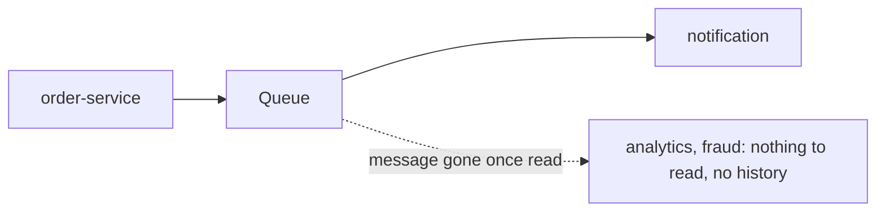
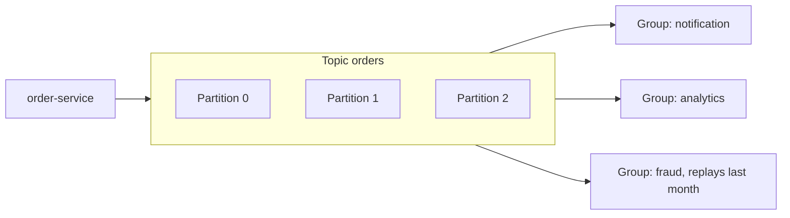

# Apache Kafka: The Big Picture

**Messaging · Kafka · Step 2.2.1 · Fundamentals** · Last updated 2026-10-21

> [!TIP]
> **In one sentence:** Kafka is a distributed, durable log of events: producers append to the end, consumers read at their own pace with their own bookmark, and events are kept for a set time whether or not anyone has read them.
>
> **Memory hook:** a **ship's logbook that never gets torn up**. Entries are only ever added at the end. Anyone can read it, each with their own bookmark, and a newcomer can start from page one.

Read this first. It is the map for the Kafka series: the big idea, the vocabulary and the learning order.

## Where it fits

Step 2.2.1, the start of the Kafka series inside the [messaging area](../01-messaging-overview.md). Kafka is the *log* family; RabbitMQ (2.3) is the *queue* family. Next: [the log, topics, partitions and offsets](02-log-topics-partitions-offsets.md) (2.2.2).

## 1. The story

ShopFlow used a queue for `OrderPlaced`. It worked until three new needs arrived: analytics wanted every order too, a new fraud service wanted the **last month** of orders to train on, and a bug in notifications meant yesterday's events had to be **processed again**. With a queue, a message is gone once it's consumed: each new reader needs its own copy, and there's no history to replay.

## 2. The idea

Treat events as a durable **record of what happened**, not tasks that vanish. Kafka keeps every event for a retention period. Each group of readers keeps its own **offset** (bookmark), so notification, analytics and fraud each read everything at their own speed, and anyone can move their bookmark back to replay. To handle huge volume, each topic is split into **partitions** spread over many brokers.

## 3. Key terms

| Term | Plain meaning |
|---|---|
| **Event / record** | One entry: key, value, timestamp |
| **Topic** | A named log, such as `orders` |
| **Partition** | A slice of a topic; an ordered, append-only sequence |
| **Offset** | An event's position inside its partition: the bookmark |
| **Broker** | A Kafka server; a cluster has several |
| **Producer / consumer** | Writes events / reads events |
| **Consumer group** | Consumers sharing a topic's work; each partition goes to one member |
| **Replication** | Copies of each partition on other brokers |
| **Retention** | How long events are kept (default 7 days) |

## 4. How it works, step by step

1. Producers append events to a topic; the **key** decides the partition.
2. Each partition lives on a **leader** broker and is copied to followers.
3. Consumers in a **group** split the partitions between them.
4. Each group stores its own offsets, so groups never affect each other.
5. Events stay until retention ends; reading doesn't delete them.

Three rules explain most of Kafka's behaviour: **order exists only inside a partition**; **parallelism is capped by the number of partitions**; **reading doesn't delete**.

## 5. Real-world examples

- **Activity tracking:** large websites stream clicks and page views into Kafka, and many teams (recommendations, analytics, monitoring) read the same stream.
- **Change data capture:** database changes are streamed into Kafka so search indexes, caches and data warehouses stay in sync.
- **Payments and fraud:** transaction events are read in real time by fraud detection, and later replayed to test new fraud rules on past data.

## 6. Design choices: when Kafka, and when not

| Good fit | Poor fit |
|---|---|
| High-throughput event streams | Rich per-message routing (a queue broker is simpler) |
| Many independent consumers of the same events | Small task queues needing priorities or per-message delays |
| Replay and event history | Request-reply conversations |
| Integrating systems, stream processing | Teams unwilling to run a cluster when a managed queue would do |
| | Querying data by arbitrary fields (it's a log, not a database) |

## 7. Notes in this series, in learning order

### Fundamentals

| Step | Topic | Status |
|---|---|---|
| 2.2.1 | This overview | Done |
| 2.2.2 | [The log: topics, partitions and offsets](02-log-topics-partitions-offsets.md) | Done |
| 2.2.3 | [Producers: keys, partitioning, acks and batching](03-producers-keys-acks-batching.md) | Done |
| 2.2.4 | [Consumers and consumer groups](04-consumers-consumer-groups.md) | Done |
| 2.2.5 | [Offset commits and delivery guarantees](05-offset-commits-delivery-guarantees.md) | Done |
| 2.2.6 | [Brokers, replication and leader election](06-brokers-replication-leader-election.md) | Done |

### Intermediate

| Step | Topic | Status |
|---|---|---|
| 2.2.7 | Rebalancing and static membership | Planned |
| 2.2.8 | Error handling, retries and dead-letter topics | Planned |
| 2.2.9 | Idempotent producer and transactions (exactly-once) | Planned |
| 2.2.10 | Schemas and evolution (Avro, Schema Registry) | Planned |
| 2.2.11 | Ordering, partition planning and hot partitions | Planned |
| 2.2.12 | Kafka with Spring Boot | Planned |

### Advanced

| Step | Topic | Status |
|---|---|---|
| 2.2.13 | Retention, log compaction and tiered storage | Planned |
| 2.2.14 | Stream processing basics (Kafka Streams) | Planned |
| 2.2.15 | Kafka Connect and change data capture | Planned |
| 2.2.16 | Security: TLS, SASL and ACLs | Planned |
| 2.2.17 | Monitoring, consumer lag and capacity planning | Planned |
| 2.2.18 | Multi-cluster and disaster recovery | Planned |

Steps 2.2.8 and 2.2.9 build on the resilience notes on [retries](../../01-resilience/03-retries-backoff-jitter.md) and [idempotency](../../01-resilience/04-idempotency.md).

## 8. Remember

- **The log is the source of truth; consumers are readers with bookmarks.**
- **Order only inside a partition**; the key picks the partition.
- **Partitions cap parallelism.**
- **Reading doesn't delete**; each group has its own offsets.
- **Kafka is a log, not a database and not a task queue.**

## 9. Interview corner

**15-second answer:** "Kafka is a distributed, durable log: producers append events to partitioned topics, and consumer groups read at their own pace with their own offsets, so many teams can read and replay the same data."

**60-second answer:**
> "Kafka is a distributed, durable log. Producers append events to topics, which are split into partitions for scale; order is guaranteed within a partition, so I use a key to keep related events together. Consumers read at their own pace, each group tracking its own offset, so many teams can read the same events and replay them, because events are kept for a retention period instead of being deleted when read. I choose Kafka for high throughput, event history and many independent consumers, and a queue like RabbitMQ when the messages are tasks to be done once with flexible routing."

**Likely follow-up questions:**
- **Topic versus partition?** The topic is the named log; partitions are its ordered slices and the unit of scale.
- **Does reading remove a message?** No; it stays until retention ends.
- **Why can't more consumers always help?** Each partition goes to one consumer per group; extras sit idle.
- **Kafka versus RabbitMQ in one line?** Kafka keeps facts for many readers and replay; RabbitMQ routes tasks to be done once.

**Architect angle:** "I choose Kafka when events are shared, long-lived facts, and avoid it when a managed queue would solve a simple task problem with less to operate."

## 10. Industry check

> [!NOTE]
> Checked 2026-10-20 by web search; mostly blog and vendor articles. Re-verify when you revisit the note.

- **Confirmed:** Kafka 4.0 (March 2025) removed ZooKeeper; metadata is managed by KRaft, now the only mode. A ZooKeeper-based cluster can't be upgraded straight to 4.0 (reported path: move to 3.9.x first). 4.0 also introduced a new consumer group protocol (KIP-848) and early access to queue-style consumption (KIP-932).
- **To verify:** which Kafka release is newest today; managed offerings (Confluent Cloud, Amazon MSK) for your needs.
- **Decision rule:** Kafka for many independent consumers, replay and throughput; a queue for tasks with rich routing.

## 11. Going further

- Apache Kafka documentation (kafka.apache.org)
- Neha Narkhede, Gwen Shapira and Todd Palino, *Kafka: The Definitive Guide*
- Martin Kleppmann, *Designing Data-Intensive Applications*

Back to [the messaging overview](../01-messaging-overview.md) · [Index](../../README.md) · [Roadmap](../../roadmap.md).
