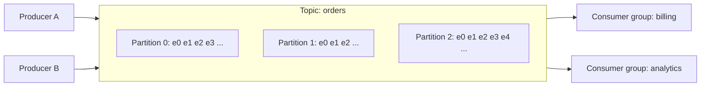

# Apache Kafka: The Big Picture

**Category:** Messaging · **Series:** Kafka (2.2) · **Level:** Fundamentals · **Last updated:** 2026-10-20

> [!NOTE]
> Read this first. It is the map for the whole Kafka series: the big idea, the vocabulary, and the order to learn things in. Each later note goes deep on one part.

## In one minute

Kafka is a distributed, durable **log** of events. Producers **append** events to the end of a log, and consumers **read** from it at their own pace, each keeping its own bookmark. Events are kept for a set time whether or not anyone has read them, so many different consumers can read the same data, and a consumer can go back and read it again. The log is split into **partitions**, which is how Kafka scales to very high volumes.

## Where it fits

This is step **2.2.1**, the start of the Kafka series inside the [messaging area](../01-messaging-overview.md). Kafka is the *log* family of brokers; RabbitMQ (series 2.3) is the *queue* family. Read the messaging overview first if "log versus queue" is new.

## Why it matters for your role

- **As an engineer:** you write producers and consumers, choose keys and settings, handle duplicates and failures, and read lag dashboards.
- **As an architect:** you decide what becomes an event, how many partitions and how long to retain data, how teams share event contracts, and whether Kafka is the right tool at all.

## 1. The problem Kafka solves

A queue-style broker works well for "do this task once". But some needs don't fit:

- **Many independent readers** of the same data (billing, analytics, search, fraud), each at its own speed.
- **History and replay:** a new service must be able to read everything that happened since last month, or a bug fix must reprocess yesterday's events.
- **Very high volume:** millions of events per second, in order per customer, spread over many machines.

Kafka is designed for exactly this. It treats events as a durable record of what happened, not as tasks that disappear once done.

> [!IMPORTANT]
> The core idea: **the log is the source of truth, and consumers are just readers with bookmarks.**

## 2. The core idea, step by step

The words you need, each defined once:

| Word | Meaning |
|---|---|
| **Event / record** | One entry in the log: a key, a value, a timestamp |
| **Topic** | A named log, such as `orders`. Producers write to it, consumers read from it |
| **Partition** | A topic is split into partitions. Each partition is an ordered, append-only sequence |
| **Offset** | The number of an event inside its partition (0, 1, 2, ...). It acts as the bookmark |
| **Broker** | A Kafka server. A cluster has several, and they share the partitions |
| **Producer** | A client that appends events to a topic |
| **Consumer** | A client that reads events from a topic |
| **Consumer group** | Consumers that share the work of one topic. Each partition is read by one member of the group |
| **Replication** | Each partition is copied to other brokers, so losing one broker doesn't lose data |
| **Retention** | How long events are kept (by time or size), whether or not they were read. The default is 7 days |

Three rules follow from these, and they explain most of Kafka's behaviour:

1. **Order is guaranteed only inside a partition**, not across a whole topic. To keep all events for one order in order, give them the same **key**, so they land in the same partition.
2. **Parallelism is capped by the number of partitions.** A group with more consumers than partitions leaves the extras idle.
3. **Reading does not delete.** Each group keeps its own offset, so one group's progress never affects another's.

## 3. What Kafka is good at, and what it isn't

| Good at | Not a good fit |
|---|---|
| High-throughput event streams | Complex per-message routing rules (a queue broker is simpler) |
| Many independent consumers of the same events | A small number of tasks that need priorities or per-message delays |
| Replay and event history | Request-reply conversations |
| Connecting systems (change data capture, data pipelines) | Teams with no appetite to operate a cluster, if a managed queue would do |
| Event-driven architectures and stream processing | Storing data you need to query in arbitrary ways (it's a log, not a database) |

## 4. Notes in this series, in learning order

Step numbers match the [roadmap](../../roadmap.md). The topic list is a proposal and will be refined as the series is written. Finished notes are linked; the rest are planned.

### Fundamentals

| Step | Topic | Role | Status |
|---|---|---|---|
| 2.2.1 | This overview | Both | Done |
| 2.2.2 | The log: topics, partitions and offsets | Engineer | Planned |
| 2.2.3 | Producers: keys, partitioning, acks and batching | Engineer | Planned |
| 2.2.4 | Consumers and consumer groups | Both | Planned |
| 2.2.5 | Offset commits and delivery guarantees | Both | Planned |
| 2.2.6 | Brokers, replication and leader election | Both | Planned |

### Intermediate

| Step | Topic | Role | Status |
|---|---|---|---|
| 2.2.7 | Rebalancing and static membership | Both | Planned |
| 2.2.8 | Error handling, retries and dead-letter topics | Engineer | Planned |
| 2.2.9 | Idempotent producer and transactions (exactly-once) | Both | Planned |
| 2.2.10 | Schemas and evolution (Avro, Schema Registry) | Architect | Planned |
| 2.2.11 | Ordering, partition planning and hot partitions | Architect | Planned |
| 2.2.12 | Kafka with Spring Boot | Engineer | Planned |

### Advanced

| Step | Topic | Role | Status |
|---|---|---|---|
| 2.2.13 | Retention, log compaction and tiered storage | Architect | Planned |
| 2.2.14 | Stream processing basics (Kafka Streams) | Both | Planned |
| 2.2.15 | Kafka Connect and change data capture | Both | Planned |
| 2.2.16 | Security: TLS, SASL and ACLs | Both | Planned |
| 2.2.17 | Monitoring, consumer lag and capacity planning | Both | Planned |
| 2.2.18 | Multi-cluster and disaster recovery | Architect | Planned |

> [!TIP]
> Steps 2.2.8 and 2.2.9 build on the resilience topics timeouts, retries and idempotency (1.2 to 1.4). If those are still unread when you reach them, read them first.

## 5. Industry check

> [!NOTE]
> Last checked: 2026-10-20 by web search. Sources were mostly blog and vendor articles, so check the Apache Kafka site and release notes for the current version and details before relying on them. Re-verify this section when you revisit the note.

- **Kafka 4.0** (released March 2025) removed ZooKeeper completely. Cluster metadata is managed by **KRaft** (Kafka's built-in consensus), which is now the only mode. You cannot upgrade a ZooKeeper-based cluster straight to 4.0; the reported path is to move to 3.9.x first, which supports both.
- **4.0 also introduced** a new consumer group protocol (KIP-848) for faster, smoother rebalances, and early access to queue-style consumption (KIP-932). Both are covered in later notes.
- **Version note:** I did not find which Kafka release is newest today. Check the official release notes before choosing a version.
- **Managed options:** Confluent Cloud, Amazon MSK and other hosted Kafka services remove most of the operating work. To verify when the comparison note (2.4) is written.
- **Decision rule:** pick Kafka when you need many independent consumers, replay and high throughput. Pick a queue (RabbitMQ, SQS) when the messages are tasks to be done once, with rich routing.

## 6. Quick Q&A (for review)

**What is Kafka, in one sentence?** A distributed, durable log of events that producers append to and consumers read from at their own pace.

**What is the difference between a topic and a partition?** A topic is the named log. It is split into partitions, each an ordered, append-only sequence, and partitions are how Kafka scales.

**Where is order guaranteed?** Only inside one partition. Use the same key to send related events to the same partition.

**Does reading a message remove it?** No. Events stay until the retention time ends. Each consumer group keeps its own offset.

**Why can't more consumers always help?** Within a group, each partition is read by only one consumer, so extra consumers beyond the partition count sit idle.

## 7. Interview answer (60 seconds)

> "Kafka is a distributed, durable log. Producers append events to topics, which are split into partitions for scale. Order is guaranteed within a partition, so I use a key to keep related events together. Consumers read at their own pace, each group tracking its own offset, so many teams can read the same events and replay them, because events are kept for a retention period instead of being deleted when read. I'd choose Kafka for high throughput, event history and many independent consumers, and a queue like RabbitMQ when the messages are tasks to be done once with flexible routing."

## 8. Going further

- Apache Kafka documentation (kafka.apache.org)
- Neha Narkhede, Gwen Shapira and Todd Palino, *Kafka: The Definitive Guide*
- Martin Kleppmann, *Designing Data-Intensive Applications*, chapters on logs and stream processing

Back to [the messaging overview](../01-messaging-overview.md) · [Index](../../README.md) · [Roadmap](../../roadmap.md).
