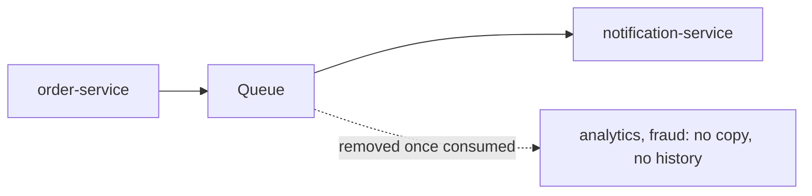
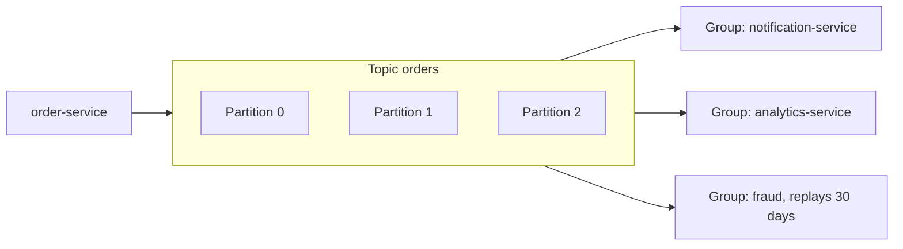

# Apache Kafka: The Big Picture

**Messaging · Kafka · Step 2.2.1 · Series overview** · Last updated 2026-10-21
**Prerequisites:** [Messaging and event-driven design](../01-messaging-overview.md) (2.1)

Read this first. It is the map of the Kafka series: the big idea, the core vocabulary and the learning order from fundamentals to advanced.

## 1. What it is and why it matters

**What is it?** Apache Kafka is a distributed, durable **log** of events. Producers add events to the end; consumers read at their own pace, each with its own bookmark; events are kept for a set time whether or not anyone has read them.

**Why do we need it?** Some data must be read by many independent services, replayed later, and handled at high volume. A queue that deletes messages once processed can't do that.

**When would I meet it?** Event-driven microservices, activity tracking, change data capture, data pipelines and stream processing.

> [!TIP]
> **Memory hook:** a logbook that never gets torn up: entries only added at the end, many readers, each with their own bookmark.

## 2. Mental model: a shared logbook

| In the analogy | In Kafka |
|---|---|
| The logbook | A **topic** |
| Several volumes of the logbook, kept on different shelves | **Partitions**, spread over **brokers** |
| A line number in one volume | An **offset** |
| A reader's bookmark | A consumer group's **committed offset** |
| Photocopies kept in other rooms | **Replicas** |

**Where the analogy breaks:** a logbook is read in one sequence; Kafka keeps order **only within each partition**, not across the whole topic. And old pages are removed after the **retention** period, so "never torn up" is true only for that window.

## 3. Industry terms

| Term | Simple meaning | Why it matters | Example | Related terms |
|---|---|---|---|---|
| **Topic** | A named log for one kind of event | Unit of naming, retention and access | `orders` | Partition |
| **Partition** | An ordered, append-only slice of a topic | Unit of order and parallelism | `orders` partition 3 | Key |
| **Offset** | An event's position in its partition | The consumer's bookmark | Offset 42 | Committed offset |
| **Broker** | A Kafka server | Unit of storage, failure and capacity | Three brokers | Replication |
| **Consumer group** | Consumers sharing a topic's partitions | Parallelism and independent readers | `inventory-service` group | Rebalance |
| **Retention** | How long events are kept | Sets how far back replay can go | 7 days by default | Log compaction |
| **KRaft** | Kafka's built-in metadata quorum | Since 4.0 the only mode; no ZooKeeper | 3 controllers | Controller |

## 4. In a real system (ShopFlow)

**The business problem.** ShopFlow first used a queue for `OrderPlaced`. Then analytics wanted every order too, a new fraud service wanted the last month of orders to train on, and a bug fix in the Notification Service required yesterday's events to be processed again. A queue removes messages once consumed: each new reader needs its own copy, and there is no history.

**How Kafka helps.** Events are kept for the retention period. Each consumer group keeps its own offsets, so notification, analytics and fraud read everything independently, and any group can move its offsets back to replay.

**What it costs.** A cluster to operate (or a managed service to pay for), ordering only within partitions, and the responsibility for idempotent consumers.

**Elsewhere:** websites stream clicks and page views into Kafka for recommendation, analytics and monitoring teams to read independently; database changes are streamed into Kafka to keep search indexes and warehouses in sync ([2.2.15](15-kafka-connect-cdc.md)); payment events are scored for fraud in real time and later replayed to test new rules on past data.

## 5. How it works, in five steps

1. Producers append events to a topic; the **key** chooses the partition.
2. Each partition has a **leader** broker and follower copies on other brokers.
3. Consumers in a **group** split the partitions; each partition goes to one member.
4. Each group commits its own offsets; groups never affect each other.
5. Events stay until retention removes them; reading does not delete.

Three rules explain most behaviour: **order exists only within a partition**; **partitions cap consumer parallelism**; **reading doesn't delete**.

## 6. Architectural decisions: when Kafka, and when not

| Good fit | Poor fit |
|---|---|
| High-volume event streams | Rich per-message routing (a queue broker is simpler) |
| Many independent consumers of the same facts | Small task queues needing priorities or per-message delays |
| Replay and history | Request-reply conversations |
| Integration and stream processing | Teams unwilling to operate a cluster when a managed queue would do |
| | Querying data by arbitrary fields (it's a log, not a database) |

**Kafka as a queue?** Since Kafka 4.2, **share groups** (KIP-932) are production-ready: several consumers can take records from the same partition one at a time and acknowledge each record, as in a queue. They give up per-partition ordering and offer no priorities or delays, so they widen Kafka's reach without replacing a queue broker. The comparison note (2.4) will cover the choice.

## 7. Notes in this series, in learning order

### Fundamentals

| Step | Topic | Prerequisites | Status |
|---|---|---|---|
| 2.2.1 | This overview | 2.1 | Done |
| 2.2.2 | [The log: topics, partitions and offsets](02-log-topics-partitions-offsets.md) | 2.2.1 | Done |
| 2.2.3 | [Producers: keys, partitioning, acks and batching](03-producers-keys-acks-batching.md) | [2.2.2](02-log-topics-partitions-offsets.md) | Done |
| 2.2.4 | [Consumers and consumer groups](04-consumers-consumer-groups.md) | [2.2.2](02-log-topics-partitions-offsets.md) | Done |
| 2.2.5 | [Offset commits and delivery guarantees](05-offset-commits-delivery-guarantees.md) | [2.2.4](04-consumers-consumer-groups.md), 1.4 | Done |
| 2.2.6 | [Brokers, replication and leader election](06-brokers-replication-leader-election.md) | [2.2.3](03-producers-keys-acks-batching.md) | Done |

### Intermediate

| Step | Topic | Prerequisites | Status |
|---|---|---|---|
| 2.2.7 | [Rebalancing and static membership](07-rebalancing-static-membership.md) | [2.2.4](04-consumers-consumer-groups.md), [2.2.5](05-offset-commits-delivery-guarantees.md) | Done |
| 2.2.8 | [Error handling, retries and dead-letter topics](08-error-handling-retries-dlt.md) | [2.2.5](05-offset-commits-delivery-guarantees.md), 1.3 | Done |
| 2.2.9 | [Idempotent producer and transactions](09-idempotent-producer-transactions.md) | [2.2.3](03-producers-keys-acks-batching.md), [2.2.5](05-offset-commits-delivery-guarantees.md) | Done |
| 2.2.10 | [Schemas and evolution](10-schemas-evolution.md) | [2.2.3](03-producers-keys-acks-batching.md) | Done |
| 2.2.11 | [Ordering, partition planning and hot partitions](11-ordering-partition-planning-hot-partitions.md) | [2.2.2](02-log-topics-partitions-offsets.md), [2.2.8](08-error-handling-retries-dlt.md) | Done |
| 2.2.12 | [Kafka with Spring Boot](12-kafka-with-spring-boot.md) | [2.2.3](03-producers-keys-acks-batching.md) to [2.2.9](09-idempotent-producer-transactions.md) | Done |

### Advanced

| Step | Topic | Prerequisites | Status |
|---|---|---|---|
| 2.2.13 | [Retention, log compaction and tiered storage](13-retention-compaction-tiered-storage.md) | [2.2.2](02-log-topics-partitions-offsets.md) | Done |
| 2.2.14 | [Stream processing basics (Kafka Streams)](14-kafka-streams-basics.md) | [2.2.9](09-idempotent-producer-transactions.md), [2.2.13](13-retention-compaction-tiered-storage.md) | Done |
| 2.2.15 | [Kafka Connect and change data capture](15-kafka-connect-cdc.md) | [2.2.8](08-error-handling-retries-dlt.md) | Done |
| 2.2.16 | [Security: TLS, SASL and ACLs](16-security-tls-sasl-acls.md) | 2.2.1 | Done |
| 2.2.17 | [Monitoring, consumer lag and capacity planning](17-monitoring-lag-capacity.md) | [2.2.6](06-brokers-replication-leader-election.md), [2.2.11](11-ordering-partition-planning-hot-partitions.md) | Done |
| 2.2.18 | [Multi-cluster and disaster recovery](18-multi-cluster-disaster-recovery.md) | [2.2.6](06-brokers-replication-leader-election.md), [2.2.15](15-kafka-connect-cdc.md) | Done |

Steps 1.3 and 1.4 are the resilience notes on [retries](../../01-resilience/03-retries-backoff-jitter.md) and [idempotency](../../01-resilience/04-idempotency.md). Notes with a "Try it yourself" section: [2.2.2](02-log-topics-partitions-offsets.md), [2.2.4](04-consumers-consumer-groups.md), [2.2.5](05-offset-commits-delivery-guarantees.md), [2.2.7](07-rebalancing-static-membership.md), [2.2.13](13-retention-compaction-tiered-storage.md). Revise with the [glossary](../98-messaging-glossary.md) and [cheat sheet](../99-messaging-cheat-sheet.md).

## 8. Check your understanding

1. Why can three different consumer groups read the same events without affecting each other?
2. A topic has 4 partitions and a group has 6 consumers. What happens, and what does that tell you about planning?
3. Is Kafka a good choice for "a job queue where some tasks must run before others regardless of arrival"? Why?

Answers are at the end of this note.

## 9. Revision

**Remember**
- The log is the source of truth; consumers are readers with bookmarks.
- Order only within a partition; the key picks the partition.
- Partitions cap parallelism; reading doesn't delete.
- Kafka is a log first: not a database, and its queue-style share groups (4.2+) are newer and narrower than a queue broker.

**Explain in 15 seconds:** "Kafka is a distributed, durable log: producers append to partitioned topics, and each consumer group reads at its own pace with its own offsets, so many teams can read and replay the same events."

**Explain in 60 seconds:**
> "Kafka is a distributed, durable log. Producers append events to topics, split into partitions for scale; order is guaranteed only within a partition, so related events share a key. Consumers read at their own pace, each group tracking its own offsets, and events are kept for a retention period, so many teams can read the same events and replay them. I choose Kafka for high throughput, history and many independent consumers, and a queue broker when messages are tasks done once with flexible routing, remembering that consumers must handle duplicates because delivery is usually at-least-once."

**Likely follow-up questions:**
- **Topic versus partition?** The topic is the named log; partitions are its ordered slices and the unit of scale.
- **Does reading remove a message?** No; it stays until retention (or compaction) removes it.
- **Kafka versus RabbitMQ in one line?** Kafka keeps facts for many readers and replay; RabbitMQ routes tasks to be done once.

**Architect's takeaway:** choose Kafka when events are shared, long-lived facts; don't introduce a cluster where a managed queue solves a simple task problem.

**Next topic:** [The log: topics, partitions and offsets](02-log-topics-partitions-offsets.md) (2.2.2)

## 10. Verification and sources

> [!NOTE]
> Checked 2026-10-20 by web search. Re-verify when you revisit this note.

- **Confirmed:** Kafka 4.0 (March 2025) removed ZooKeeper; KRaft is the only metadata mode; a ZooKeeper-based cluster can't be upgraded straight to 4.0 (the reported path is 3.9.x first). Kafka 4.0 made the new consumer group protocol (KIP-848) generally available and added early access to queue-style share groups (KIP-932), which became production-ready in Kafka 4.2. The default retention is 7 days (`log.retention.hours=168`).
- **Assumptions and illustrations:** the ShopFlow scenario and the real-world uses in this series are illustrative.
- **To verify:** the newest Kafka release when you read this; managed offerings for your needs.
- **Decision rule:** Kafka for many independent consumers, replay and throughput; a queue for tasks with rich routing.

**Sources:** Apache Kafka documentation and release notes; *Kafka: The Definitive Guide*; *Designing Data-Intensive Applications*.

## Answers

1. Each group stores its own committed offsets per partition, and reading doesn't delete events, so one group's progress never changes what another group sees.
2. Each partition is assigned to one member of the group, so 4 consumers work and 2 are idle standbys. Plan partitions for the parallelism you need at peak.
3. Not a natural fit. Kafka keeps order within a partition by arrival and has no per-message priorities (share groups don't add them either); a queue broker with priority or routing features fits better.

Back to [the messaging overview](../01-messaging-overview.md) · [Index](../../README.md) · [Roadmap](../../roadmap.md).
