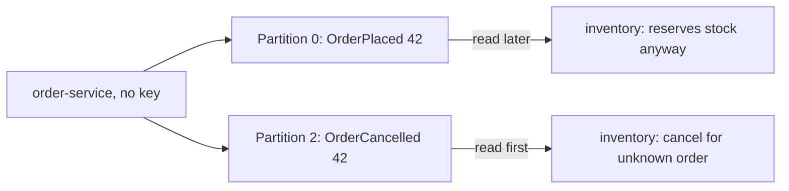
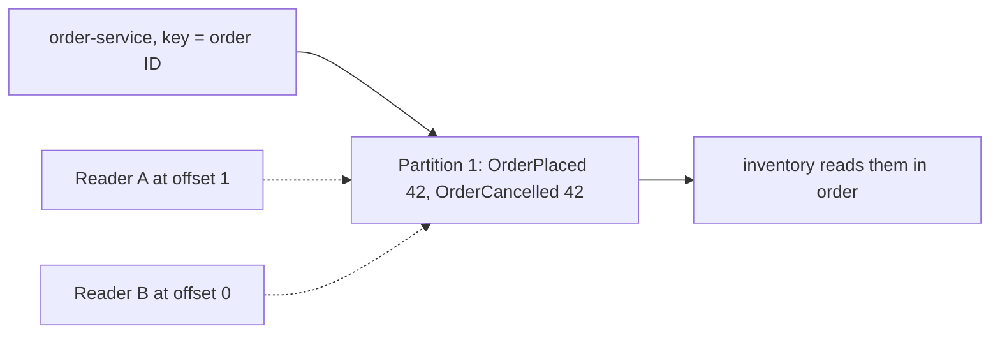

# The Log: Topics, Partitions and Offsets

**Messaging · Kafka · Step 2.2.2 · Fundamentals** · Last updated 2026-10-21

> [!TIP]
> **In one sentence:** Kafka stores events in append-only logs; a topic is split into partitions, each with its own numbered positions called offsets, and order exists only inside one partition.
>
> **Memory hook:** a **supermarket with several checkout lanes**. Each lane (partition) serves customers strictly in order, and each receipt has a number in that lane (offset). Your family (same key) always uses the same lane, so you stay together and in order; across lanes, there's no order at all.

## Where it fits

Step 2.2.2, the first detailed note of the [Kafka series](01-kafka-overview.md). It is the storage model everything else depends on. Next: [producers](03-producers-keys-acks-batching.md) (2.2.3), which write into it, and [consumers](04-consumers-consumer-groups.md) (2.2.4), which read from it.

## 1. The story

ShopFlow sends order events to a topic with three partitions, without a key. For order 42, `OrderPlaced` lands in partition 0 and `OrderCancelled` lands in partition 2. The inventory consumer reading partition 2 happens to be faster, so it processes the cancellation **before** the order exists, ignores it, and then reserves stock for an order that was already cancelled.



## 2. The idea

A **log** is a file you only add to at the end. Each new event gets the next number, its **offset**. A **topic** is split into **partitions**, and each partition is its own independent log with offsets starting at 0. **Order is guaranteed only inside a partition.**

So send related events with the same **key**. The key is hashed to pick the partition, and the same key always goes to the same partition (as long as the partition count doesn't change). With order 42 as the key, both events land in the same partition, in order.



Two readers can read the same partition at different positions, because each keeps its own bookmark. An event's full address is **topic + partition + offset**; "offset 3" alone exists in every partition.

## 3. Key terms

| Term | Plain meaning |
|---|---|
| **Log** | Append-only sequence; existing entries never change |
| **Topic** | A named stream of one kind of event |
| **Partition** | One independent log inside a topic; the unit of order and scale |
| **Offset** | An event's number inside its partition, starting at 0 |
| **Key** | The value hashed to choose the partition |
| **Segment** | One of the files a partition is stored in on disk |
| **Retention** | How long events are kept, read or not |
| **Hot partition** | One partition getting far more traffic than the others |

## 4. How it works, step by step

1. The producer sends an event with a key (or without one).
2. **With a key:** the key is hashed to choose the partition. The Java client's default is a murmur2 hash, modulo the number of partitions. **Without a key:** events are spread across partitions.
3. The partition's leader appends the event at the end and gives it the next offset.
4. On disk, the partition is a series of **segment files**; when the active one reaches 1 GB (the default) a new one starts.
5. Segments older than the **retention** time (7 days by default) are removed by periodic cleanup, whether or not anyone read them.
6. Readers ask "give me events from offset N" and move forward at their own pace.

Kafka is fast largely because it reads and writes sequentially and relies on the operating system's file cache.

## 5. Real-world examples

- **Ride-hailing:** trip events keyed by trip ID, so "requested", "accepted", "started" and "completed" for one trip always arrive in order.
- **Banking:** account events keyed by account number, so deposits and withdrawals for one account are applied in order, while millions of accounts spread across partitions.
- **IoT sensors:** readings keyed by device ID; a few very chatty devices can create hot partitions, so device keys are chosen and monitored carefully.

## 6. Design choices and trade-offs

**How many partitions?**

| More partitions | Fewer partitions |
|---|---|
| More consumer parallelism and throughput | Less overhead (files, memory, recovery) |
| Order split across more lanes | Simpler operations |

- Size from **peak throughput you need ÷ what one partition handles** (measure it), plus headroom.
- **You can add partitions later but not remove them**, and **adding them changes where keys land**: a key on partition 1 with 3 partitions may move with 6, breaking per-key order across the change. Plan ahead for keyed topics.
- **One topic per kind of event** (`order-placed`), not one giant topic, so retention and partitions can be set per kind.
- **Choose the key from the ordering you need.** A key with few values, or one value used by most events, creates hot partitions.
- **Retention is a business and cost decision**: how far back must a new reader replay, and how much disk is that?

## 7. Common mistakes

1. **Expecting order across the whole topic.**
2. **No key for related events**, so they lose order (the story above).
3. **Adding partitions to a keyed topic** without planning for the break.
4. **A key with only a handful of values**, causing hot partitions.
5. **Too few partitions**, capping how many consumers can work.
6. **Treating the topic as a database** to query by arbitrary fields.
7. **Assuming every client hashes keys the same way.**

## 8. In code

> [!NOTE]
> Untested sketch to show the shape. Command options vary by Kafka version.

```bash
kafka-topics.sh --bootstrap-server localhost:9092 \
  --create --topic orders --partitions 3 --replication-factor 1
kafka-topics.sh --bootstrap-server localhost:9092 --describe --topic orders
kafka-console-consumer.sh --bootstrap-server localhost:9092 \
  --topic orders --partition 0 --offset 0
```

```java
@Bean
NewTopic orders() {
    return TopicBuilder.name("orders").partitions(6).replicas(3).build();
}
```

| Setting | What it controls |
|---|---|
| Partitions | Parallelism and ordering lanes |
| Replication factor | Copies of each partition (see 2.2.6) |
| `log.retention.hours` | How long events are kept (default 168 = 7 days) |
| `log.segment.bytes` | Segment file size (default 1 GB) |

## 9. Remember

- **Partition = ordered, append-only log; offset = position in one partition.**
- **Order only inside a partition**; same key, same partition.
- **Topic + partition + offset** identifies an event.
- **You can add partitions, not remove them**, and adding moves keys.
- **Reading doesn't delete**; retention does (7 days by default).

## 10. Interview corner

**15-second answer:** "A topic is split into partitions, each an append-only log with its own offsets; order holds only inside a partition, so related events share a key."

**60-second answer:**
> "Kafka stores events in append-only logs. A topic is split into partitions, each its own ordered log with offsets starting at zero, and an event is identified by topic, partition and offset. Order is guaranteed only inside a partition, so I choose a key, like the order ID, that sends related events to the same partition. The partition count caps consumer parallelism; it can be increased but not reduced, and increasing it changes where keys land, so I size it up front from measured throughput. Events are kept for a retention period, seven days by default, whether or not they were read."

**Likely follow-up questions:**
- **How do you keep all events of one order in order?** Same key (the order ID), so they share a partition.
- **What happens if you add partitions?** New events for a key may land on a different partition, breaking order across the change.
- **What is a hot partition and how do you avoid it?** One overloaded partition from a skewed key; choose keys with many, evenly used values.
- **Is a Kafka topic a database?** No: it's a log with limited retention, read sequentially.

**Architect angle:** "Partition count and key choice are the expensive-to-change decisions, so I make them from the ordering requirement and measured throughput before go-live."

## 11. Industry check

> [!NOTE]
> Checked 2026-10-21 by web search (vendor documentation and archived Kafka configuration pages). Re-verify when you revisit the note.

- **Confirmed:** `log.retention.hours` defaults to 168 (7 days) and `log.segment.bytes` to 1 GB; segments roll when full and expired ones are removed by periodic cleanup. The Java client's default partitioner uses a murmur2 hash of the key modulo the partition count, so the mapping holds only while the count is unchanged; librdkafka-based clients may use CRC32 instead.
- **To verify:** that Kafka cannot reduce a topic's partition count (general knowledge my search didn't confirm), and how events without a key are spread in your client version.
- **Decision rule:** key from the ordering you need, partitions from measured throughput with headroom, one topic per event type, retention from replay and cost needs.

## 12. Going further

- Apache Kafka documentation: design and topic configuration
- Jay Kreps, "The Log: What every software engineer should know about real-time data's unifying abstraction"
- *Kafka: The Definitive Guide*

**Next:** [Producers: keys, partitioning, acks and batching](03-producers-keys-acks-batching.md) (2.2.3).

Back to [the Kafka overview](01-kafka-overview.md) · [Messaging overview](../01-messaging-overview.md) · [Index](../../README.md) · [Roadmap](../../roadmap.md).
