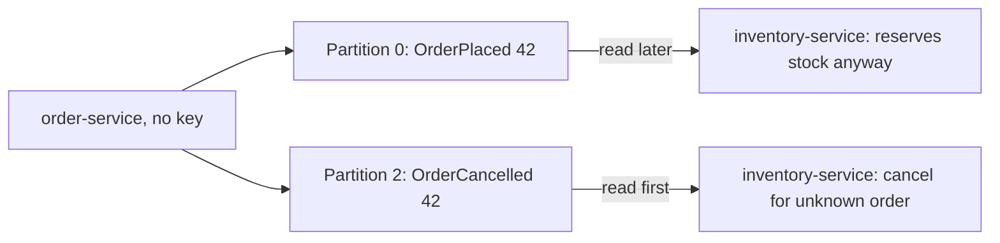
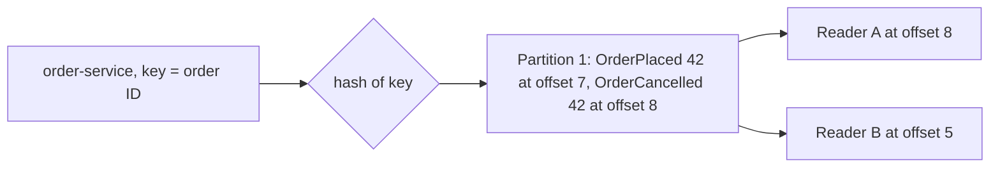

# The Log: Topics, Partitions and Offsets

**Messaging · Kafka · Step 2.2.2 · Fundamentals** · Last updated 2026-10-21
**Prerequisites:** [Apache Kafka: the big picture](01-kafka-overview.md) (2.2.1)

## 1. What it is and why it matters

**What is it?** Kafka stores events in **logs**: files you only add to at the end. A **topic** is split into **partitions**, each its own log, and every event in a partition gets a number called its **offset**.

**Why do we need it?** A single log on one machine can't handle huge volume. Splitting it into partitions spreads the work, and the append-only design makes reading, re-reading and many readers cheap.

**When would I meet it?** Every time you create a topic, choose a key, or wonder why two events arrived in the "wrong" order.

> [!TIP]
> **Memory hook:** checkout lanes: each lane serves customers in order, receipts are numbered per lane, and a family always uses the same lane.

## 2. Mental model: checkout lanes

| In the analogy | In Kafka |
|---|---|
| The supermarket's checkout area | A **topic** |
| One checkout lane | A **partition** |
| The receipt number in that lane | The **offset** |
| A family sticking together | Events with the same **key** |
| One overloaded lane | A **hot partition** |

**Where the analogy breaks:** shoppers leave once served; Kafka events **stay** after being read, until retention removes them, so several readers can process the same lane independently.

## 3. Industry terms

| Term | Simple meaning | Why it matters | Example | Related terms |
|---|---|---|---|---|
| **Log** | An append-only sequence | Existing events never change, so readers can re-read safely | A partition | Segment |
| **Topic** | A named stream of one kind of event | Retention, access and naming are set per topic | `orders` | Partition |
| **Partition** | One independent log within a topic | Unit of order and of parallelism | `orders` partition 2 | Key |
| **Offset** | An event's number within its partition, from 0 | A position only makes sense with topic and partition | Offset 42 | Committed offset |
| **Key** | The value hashed to choose the partition | Keeps related events together and in order | Order ID | Partitioner |
| **Segment** | One of the files a partition is stored in | Retention deletes whole segments | 1 GB segment files | Retention |
| **Hot partition** | A partition with far more traffic than the others | One consumer falls behind | Most events share one key | Key cardinality |

## 4. In a real system (ShopFlow)

**The business problem.** The Inventory Service must apply `OrderPlaced` before `OrderCancelled` for the same order; otherwise it reserves stock for an order that no longer exists.

ShopFlow sent order events to a 3-partition topic **without a key**. For order 42, `OrderPlaced` landed in partition 0 and `OrderCancelled` in partition 2. The consumer of partition 2 was faster, so it processed the cancellation first, ignored it ("unknown order"), and then reserved stock.



**How partitions and keys help.** Using the order ID as the **key** sends both events to the same partition, in the order they were produced, so the Inventory Service reads them in order.

**What it costs.** Order is guaranteed only within a partition. The partition count caps parallelism and is expensive to change later.

**Elsewhere:** ride-hailing keys trip events by trip ID, so "requested", "accepted" and "completed" stay in order; banks key account events by account number, so each account's deposits and withdrawals apply in order while millions of accounts spread across partitions; IoT platforms key readings by device ID and watch for a few chatty devices creating hot partitions.

## 5. How it works



1. **What starts it:** a producer sends an event, with or without a key.
2. **Choosing the partition:** with a key, the Java client's default partitioner hashes the key (murmur2) modulo the number of partitions; without a key, the client fills a batch for one partition and then moves to another (the sticky partitioner, since Kafka 2.4), so load spreads evenly over time but consecutive keyless events often share a partition.
3. **Appending:** the partition's leader adds the event at the end and assigns the next offset.
4. **Storage:** the partition is a series of segment files on disk; the active segment rolls to a new file at 1 GB by default.
5. **Removal:** segments older than the retention time (7 days by default) are deleted by a periodic cleanup, read or not.
6. **Reading:** a reader asks "events from offset N" and moves forward at its own pace. An event's full address is **topic + partition + offset**.

> [!IMPORTANT]
> The key-to-partition mapping holds **only while the partition count stays the same**. Other client libraries may hash keys differently (some use CRC32), so mixing libraries can route the same key differently.

> [!NOTE]
> Untested sketch to show the shape. Option names vary by Kafka version.

```bash
# Create a topic with 3 partitions (replication factor 1: local learning only)
kafka-topics.sh --bootstrap-server localhost:9092 --create --topic orders --partitions 3 --replication-factor 1
kafka-topics.sh --bootstrap-server localhost:9092 --describe --topic orders    # leader and replicas per partition
```

## 6. Failure scenarios

### Related events lose their order

- **What happened?** `OrderCancelled` was processed before `OrderPlaced` (the story above).
- **Why?** No key, so the events went to different partitions, and Kafka has no order across partitions.
- **What the business sees:** stock reserved for cancelled orders.
- **Solutions:** key by the entity whose events must stay in order (the order ID).
- **Trade-offs:** ordering then exists only per order, which is usually exactly what is needed.

### Partitions are added to a keyed topic

- **What happened?** During a busy day the team raised the partition count from 3 to 6.
- **Why?** The partition is "hash modulo partition count", so many keys now map to different partitions; an order's earlier events are in the old partition and its new events in another.
- **What the business sees:** occasional out-of-order processing for orders in flight.
- **Solutions:** size partitions up front; for keyed topics, create a new, larger topic and migrate deliberately (see [2.2.11](11-ordering-partition-planning-hot-partitions.md)).
- **Trade-offs:** more planning up front, or a migration project.

## 7. Architectural decisions

| More partitions | Fewer partitions |
|---|---|
| More consumer parallelism and throughput | Less overhead (files, memory, recovery time) |
| Order split into more lanes | Simpler operations |

- Choose the **key** from the ordering you need; prefer keys with many, evenly used values.
- Choose **one topic per kind of event** (`order-placed`, or `orders` for one entity's lifecycle), not one topic for everything.
- **Retention** is a business and cost decision: how far back must replay go, and how much disk does that take?
- Partitions can be added later but never removed (Kafka doesn't support reducing the count), so size them from measured throughput ([2.2.11](11-ordering-partition-planning-hot-partitions.md)).

**Common mistakes:** expecting order across the whole topic; no key for related events; adding partitions to a keyed topic without a plan; a key with only a handful of values; too few partitions for the consumers you need; treating a topic as a database to query by field; assuming every client library hashes keys the same way.

## 8. Try it yourself

> [!NOTE]
> Status: run on Apache Kafka 4.3.2 (single-node KRaft broker, official binary, macOS) on 2026-10-21; the results below are from that run. It needs a local broker; in Kafka 4.3 `--property` is deprecated in favour of `--reader-property` (producer) and `--formatter-property` (consumer), while older versions only accept `--property`.

**Predict first:** you produce five events with key `A` and five with key `B` to a 3-partition topic. How many partitions will they occupy, and in what order will a reader see key `A`'s events?

```bash
kafka-topics.sh --bootstrap-server localhost:9092 --create --topic orders --partitions 3 --replication-factor 1

kafka-console-producer.sh --bootstrap-server localhost:9092 --topic orders \
  --reader-property parse.key=true --reader-property key.separator=:
# type: A:1  A:2  B:1  A:3  B:2 ... one per line

kafka-console-consumer.sh --bootstrap-server localhost:9092 --topic orders --from-beginning \
  --formatter-property print.key=true --formatter-property print.partition=true --formatter-property print.offset=true
```

**Observe:** each key stays in one partition with increasing offsets; the two keys may or may not share a partition. In the example run, all ten events (five per key) landed in partition 1, offsets 0 to 9, each key in its order. **Break it:** produce without keys. With 12 events, all 12 went to a single partition (the sticky partitioner fills one batch before moving on); with 200,000 events they spread across the three partitions (63,213, 77,227 and 59,560). Check with `kafka-get-offsets.sh --bootstrap-server localhost:9092 --topic <name>`. **Clean up:** `kafka-topics.sh --bootstrap-server localhost:9092 --delete --topic orders`.

## 9. Check your understanding

1. Why is "offset 7" alone not enough to identify an event?
2. What happens to an event after every consumer group has read it?
3. A topic keyed by country has 12 partitions, but one consumer is always far behind. What is the likely cause?
4. You must guarantee the order of all events for one customer. What key do you choose, and what is the cost?

Answers are at the end of this note.

## 10. Revision

**Remember**
- A partition is an ordered, append-only log; an offset is a position in one partition.
- **Order only within a partition**; the same key goes to the same partition while the count is unchanged.
- **Topic + partition + offset** identifies an event.
- **Reading doesn't delete**; retention does (7 days by default).

**Explain in 15 seconds:** "A topic is split into partitions, each an append-only log with its own offsets; order holds only within a partition, so related events share a key."

**Explain in 60 seconds:**
> "Kafka stores events in append-only logs. A topic is split into partitions, each with offsets starting at zero, and an event is identified by topic, partition and offset. Order is guaranteed only within a partition, so I key events by the entity that needs ordering, like the order ID. The partition count caps consumer parallelism, and changing it remaps keys, so I size it up front. Events stay for a retention period, seven days by default, whether or not they were read."

**Likely follow-up questions:**
- **What happens if you add partitions?** New events for a key may land in a different partition, so order breaks across the change; existing data doesn't move.
- **Is a Kafka topic a database?** No: it's a log with limited retention, read sequentially by offset.
- **Why do segments matter?** Retention and compaction work on whole segment files, not on single events.

**Architect's takeaway:** the key and the partition count are the expensive-to-change decisions; make them from the ordering requirement and measured throughput.

**Next topic:** [Producers: keys, partitioning, acks and batching](03-producers-keys-acks-batching.md) (2.2.3)

## 11. Verification and sources

> [!NOTE]
> Checked 2026-10-21 by web search. Re-verify when you revisit this note.

- **Confirmed:** `log.retention.hours` defaults to 168 (7 days) and `log.segment.bytes` to 1 GB; segments roll when full and expired segments are removed periodically (Kafka configuration documentation and vendor references). The Java client's default partitioner hashes the key with murmur2 modulo the partition count; librdkafka-based clients may use CRC32. Kafka doesn't support reducing a topic's partition count, and adding partitions doesn't move existing data (Kafka operations documentation).
- **Assumptions and illustrations:** the ShopFlow story; the console commands (not run).
- **Also confirmed:** keyless records use the sticky partitioner since Kafka 2.4, made strictly uniform in Kafka 3.3 (KIP-794).
- **To verify:** the `apache/kafka` image tag and tool paths.
- **Decision rule:** key from the ordering need; partitions from measured throughput with headroom; one topic per event type.

**Sources:** Apache Kafka documentation (design, topic configuration); Jay Kreps, "The Log"; *Kafka: The Definitive Guide*.

## Answers

1. Every partition has its own offsets starting at 0, so offset 7 exists in every partition. You need topic, partition and offset together.
2. Nothing: it stays until retention (or compaction) removes it. Each group only moves its own offset.
3. A **hot partition**: a few countries produce most of the traffic, so the partitions holding those keys are overloaded. Choose a key with more, evenly used values, or shard the heavy keys ([2.2.11](11-ordering-partition-planning-hot-partitions.md)).
4. The customer ID. All that customer's events share one partition and stay in order; the cost is that one very active customer can make that partition hot, and parallelism is per partition.

Back to [the Kafka overview](01-kafka-overview.md) · [Index](../../README.md) · [Roadmap](../../roadmap.md).
