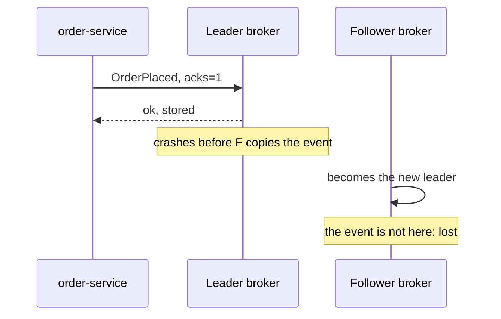
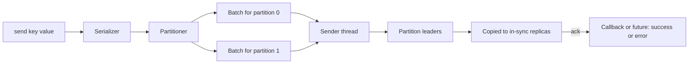

# Producers: Keys, Partitioning, Acks and Batching

**Messaging · Kafka · Step 2.2.3 · Fundamentals** · Last updated 2026-10-21
**Prerequisites:** [The log, topics, partitions and offsets](02-log-topics-partitions-offsets.md) (2.2.2); helpful: [retries](../../01-resilience/03-retries-backoff-jitter.md), [idempotency](../../01-resilience/04-idempotency.md)

## 1. The concept in simple English

**What is it?** A **producer** is the client that writes events to Kafka. It picks a partition, groups events into batches, sends them to the right broker and waits for a confirmation called an **acknowledgement (ack)**.

**Why do we need it?** Writing safely and quickly involves choices: how many copies must exist before a write counts, how to avoid duplicates when retrying, and how to batch for speed.

**When would I meet it?** Whenever a service publishes events, for example the Order Service publishing `OrderPlaced`.

> [!TIP]
> **Memory hook:** a courier who sorts parcels by address (key → partition), drives full vans (batching) and asks for signatures (acks).

## 2. Mental model: a courier

| In the analogy | In Kafka |
|---|---|
| Sorting parcels by address | The **partitioner** choosing a partition from the key |
| Waiting until a van is full | **Batching** (`batch.size`, `linger.ms`) |
| Asking for a signature | **Acks** |
| Signatures from every depot holding an up-to-date copy | `acks=all`: every **in-sync replica** must have the event |
| Not delivering the same parcel twice | The **idempotent producer** |

**Where the analogy breaks:** a courier knows when a parcel was lost; a producer whose request timed out often **doesn't know** whether the broker stored the event. That uncertainty is why idempotence exists.

## 3. Industry terms

| Term | Simple meaning | Why it matters | Example | Related terms |
|---|---|---|---|---|
| **Acks** | Who must confirm a write: nobody (`0`), the leader (`1`), all in-sync replicas (`all`) | Durability versus latency | `acks=all` | `min.insync.replicas` |
| **In-sync replicas (ISR)** | Copies fully caught up with the leader | Only they count for `acks=all` | 2 of 3 in sync | Replication ([2.2.6](06-brokers-replication-leader-election.md)) |
| **`min.insync.replicas`** | In-sync copies required for an `acks=all` write | Makes `acks=all` meaningful | 2 with replication factor 3 | Acks |
| **Batching / linger** | Grouping events per partition; waiting briefly to fill a batch | Throughput for a few milliseconds | `linger.ms=10` | Compression |
| **Idempotent producer** | The broker drops duplicates caused by producer retries, per partition and within one producer session | Safe retries, order kept; a restarted application gets a new producer ID, so re-sending after a restart is not deduplicated | `enable.idempotence=true` | Transactions ([2.2.9](09-idempotent-producer-transactions.md)) |
| **Delivery timeout** | Time limit for a send, including all retries | When the producer gives up | `delivery.timeout.ms` | `request.timeout.ms` |

## 4. In a real system (ShopFlow)

**The business problem.** Every `OrderPlaced` must reach Kafka exactly as the Order Service intended: not lost, not duplicated, not reordered, and fast enough for a sale day.

On ShopFlow's busiest day: a broker restart lost events that the leader had confirmed but not yet copied (they used `acks=1`); a retry after a timeout duplicated an event that had in fact arrived (an old client configuration had idempotence switched off); and sending one event at a time couldn't keep up.



**How producer settings help.** `acks=all` with `min.insync.replicas=2` means an event is confirmed only after two copies exist; idempotence lets the broker drop retried duplicates; batching and compression raise throughput.

**What it costs.** A few milliseconds more latency per event, and writes that **fail with an error** when too few replicas are in sync (which is the safe behaviour).

**Elsewhere:** a bank uses the safe profile for payment events, keyed by account ID; a ride-hailing app sends driver locations every few seconds with `acks=1`, larger batches and compression, because the next update replaces a lost one; a clickstream pipeline sends without a key so events spread evenly, with heavy batching and compression.

## 5. How it works



1. **What starts it:** your code calls `send`. It normally returns quickly, but it can **block for up to `max.block.ms` (default 60 s)** if the producer's buffer is full or the topic's metadata isn't available yet.
2. The record is serialised and the partitioner picks its partition.
3. It waits in that partition's batch until the batch is full or `linger.ms` passes.
4. A background sender thread sends the batch to the partition **leader**, which appends it; followers copy it.
5. **On success:** the leader acknowledges according to `acks`; your callback or future reports the partition and offset.
6. **On failure:** the producer retries until `delivery.timeout.ms` (2 minutes by default) runs out, then reports an error to the callback. If you ignore the callback, the failure is invisible.

**Who guarantees what**

| Layer | Responsible for |
|---|---|
| Broker | Storing the event on the in-sync replicas required by `acks` and `min.insync.replicas`; dropping retried duplicates when idempotence is on |
| Producer client | Batching, retrying within the delivery timeout, reporting the result |
| Framework (Spring Kafka) | `KafkaTemplate` wraps the producer and returns a future |
| Application | Handling send failures; storing critical events durably first if they must never be lost (transactional outbox) |

> [!NOTE]
> Untested sketch to show the shape. Property names can differ between versions.

```yaml
spring:
  kafka:
    producer:
      acks: all                       # wait for all in-sync replicas
      compression-type: lz4           # smaller batches on the network and disk
      properties:
        enable.idempotence: true      # retried duplicates are dropped by the broker
        linger.ms: 10                 # wait up to 10 ms to fill a batch
```

```java
kafkaTemplate.send("orders", orderId, orderJson)          // key = order ID: same partition, same order
    .whenComplete((result, error) -> {
        if (error != null) { /* record, alert, or keep for a later retry: never ignore */ }
    });
```

## 6. Failure scenarios

### Confirmed event lost after a broker failure

- **What happened?** The leader confirmed the event and crashed before followers copied it.
- **Why?** `acks=1` waits for the leader only.
- **What the business sees:** some orders never reach inventory, payment or email.
- **Solutions:** `acks=all`, replication factor 3, `min.insync.replicas=2`.
- **Trade-offs:** slightly higher latency; with two replicas down, writes are refused instead of risked.

### Duplicate event after a retry

- **What happened?** A request timed out, the producer retried, and the broker stored the event twice.
- **Why?** The first attempt had succeeded; the acknowledgement was lost.
- **What the business sees:** duplicate processing downstream, such as two emails.
- **Solutions:** the idempotent producer (on by default since Kafka 3.0 unless conflicting settings are used; set it explicitly anyway); idempotent consumers as the second line of defence.
- **Trade-offs:** negligible for idempotence; it does not remove duplicates created by your own application re-sending a new record.

### Send failed and nobody noticed

- **What happened?** The delivery timeout expired during a broker outage; the error went to an unhandled callback.
- **Why?** `send` is asynchronous; failures arrive later.
- **What the business sees:** silently missing events.
- **Solutions:** always handle the result; for critical events use a **transactional outbox** so the event is stored in the database first and published reliably ([2.2.15](15-kafka-connect-cdc.md)).
- **Trade-offs:** more code or an outbox table and relay.

## 7. Architectural decisions

| Profile | Settings | Choose for | Costs |
|---|---|---|---|
| Fire and forget | `acks=0` | Data you can lose (debug logs) | Silent loss |
| Balanced | `acks=1` | High-volume, low-value events | Loss if a leader fails at the wrong moment |
| **Safe** | `acks=all`, replication factor 3, `min.insync.replicas=2`, idempotence | Business events | More latency; writes fail when two replicas are down |

- Make the safe profile the **platform default**, and relax it per event type only with a reason.
- **Batching:** real-time features lean towards small `linger.ms`; bulk pipelines towards larger batches and compression.
- **Share one producer** per application; it is thread-safe, and one per message is slow and wasteful.

**Common mistakes:** never checking the send result; `acks=1` for business events; `acks=all` with `min.insync.replicas=1`; no key where order matters; retries without idempotence; a new producer per message.

## 8. Check your understanding

1. With `acks=all`, replication factor 3 and `min.insync.replicas=1`, how many copies must exist before a write is confirmed?
2. What happens to a `send` call if the producer's buffer is full during a broker outage?
3. The Order Service logs no errors, yet some orders never reach Kafka. What is the most likely cause in the code?
4. For ride-hailing location updates every few seconds, would you choose the safe profile? Why or why not?

Answers are at the end of this note.

## 9. Revision

**Remember**
- `send` is asynchronous and can block up to `max.block.ms`; **always handle the result**.
- **The key picks the partition**; order exists only within a partition.
- **Safe profile:** `acks=all` + replication factor 3 + `min.insync.replicas=2` + idempotence.
- `acks=all` is only as strong as `min.insync.replicas`.
- Batching trades milliseconds for throughput.

**Explain in 15 seconds:** "A producer picks a partition by key, batches events and sends them to the partition leader; acks decide how many replicas must confirm, so I use acks=all with idempotence for business events."

**Explain in 60 seconds:**
> "A Kafka producer serialises each event, picks a partition by hashing the key, and batches events per partition before sending them to the leader. The send is asynchronous, so the result comes in a callback, and it can block when the buffer is full. Durability is set by acks: for business events I use acks=all with replication factor 3 and min.insync.replicas 2, so one broker can fail without losing confirmed data, and idempotence so retries don't duplicate or reorder. The producer can't make an event durable if the application ignores send failures, so critical events go through a transactional outbox."

**Likely follow-up questions:**
- **What happens when `min.insync.replicas` can't be met?** The write is refused with an error instead of being stored with too few copies.
- **How does the idempotent producer avoid duplicates?** Each producer has an ID and numbers its batches per partition; the broker drops a sequence number it has already written. This covers retries within one producer session, not an application that restarts and sends the same business event again.
- **How do you make sure an order event is never lost end to end?** Safe producer settings, handled send results, an outbox for the database-plus-event case, and consumers that commit only after processing ([2.2.5](05-offset-commits-delivery-guarantees.md)).

**Architect's takeaway:** choose the producer profile per event type from the cost of losing it versus the cost of delay, and make the safe profile the default.

**Next topic:** [Consumers and consumer groups](04-consumers-consumer-groups.md) (2.2.4)

## 10. Verification and sources

> [!NOTE]
> Checked 2026-10-21 by web search. Re-verify when you revisit this note.

- **Confirmed:** the safe baseline `acks=all`, replication factor 3, `min.insync.replicas=2`, and writes failing with an error when the minimum can't be met (Red Hat and Confluent documentation); the idempotent producer uses a producer ID and sequence numbers and keeps order with up to 5 in-flight requests; `linger.ms` defaults to 0 up to Kafka 3.9 and 5 ms from 4.0 (KIP-1030); `max.block.ms` defaults to 60 s and bounds how long `send` waits for buffer space and metadata; since Kafka 3.0 (KIP-679) the producer defaults are `acks=all` and `enable.idempotence=true`, but a bug in early 3.x releases (KAFKA-13598) left idempotence off unless set explicitly, and Kafka Connect disables idempotence for its producers by default (Apache Kafka 3.0 and 3.1 upgrade notes).
- **Observed (Kafka 4.3.2 client libraries, 2026-10-21):** `acks` all, `enable.idempotence` true, `linger.ms` 5, `max.block.ms` 60000, `batch.size` 16384, `delivery.timeout.ms` 120000, `request.timeout.ms` 30000, `max.in.flight.requests.per.connection` 5, `retries` 2147483647 (read from the producer's configuration definitions).
- **Assumptions and illustrations:** the ShopFlow story; the code (not run).
- **To verify:** the exact releases that fixed KAFKA-13598, if you run an early 3.x client (set `enable.idempotence=true` explicitly to be safe).
- **Also confirmed:** `batch.size` defaults to 16,384 bytes and `delivery.timeout.ms` to 120,000 ms; keyless records use a sticky partitioner since Kafka 2.4, made strictly uniform in 3.3 (KIP-794) (Apache Kafka producer configuration; KIP-794).
- **Decision rule:** safe profile for business events; faster profiles only for data you can lose; always handle the send result.

**Sources:** Apache Kafka producer configuration and 3.0 upgrade notes; KIP-679; KIP-1030; Confluent "Optimize clients for durability"; *Kafka: The Definitive Guide*.

## Answers

1. One: with `min.insync.replicas=1`, `acks=all` can be satisfied by the leader alone if the followers are out of sync, so it can behave like `acks=1`.
2. It blocks for up to `max.block.ms` (60 s by default) waiting for buffer space, then throws an exception if none becomes available.
3. The send results are ignored: failures after the delivery timeout go to a callback or future nobody checks.
4. Probably not. A lost location update is replaced seconds later, so `acks=1`, larger batches and compression give better speed and cost; the key (driver ID) still keeps each driver's updates in order.

Back to [the Kafka overview](01-kafka-overview.md) · [Index](../../README.md) · [Roadmap](../../roadmap.md).
