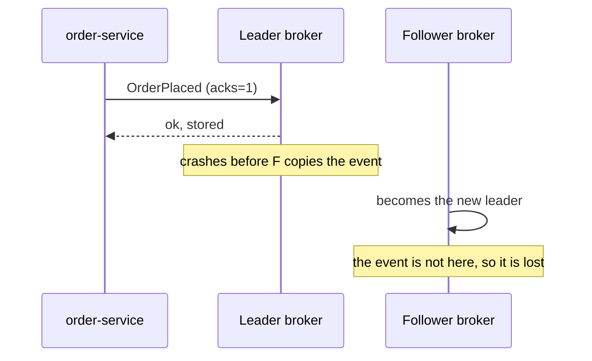
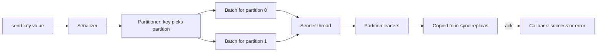

# Producers: Keys, Partitioning, Acks and Batching

**Messaging · Kafka · Step 2.2.3 · Fundamentals** · Last updated 2026-10-21

> [!TIP]
> **In one sentence:** a producer is the client that writes events to Kafka. It picks a partition, groups events into batches, and waits for the broker to confirm, and its settings trade safety against speed.
>
> **Memory hook:** a producer is a **courier**. It sorts parcels by address (the **key** picks the partition), drives full vans instead of one parcel at a time (**batching**), and asks for signatures before leaving (**acks**). `acks=all` means every guard on duty must sign.

## Where it fits

Step 2.2.3. It writes to the [log, topics and partitions](02-log-topics-partitions-offsets.md) from 2.2.2, and it uses three resilience ideas you already know: [timeouts](../../01-resilience/02-timeouts.md), [retries](../../01-resilience/03-retries-backoff-jitter.md) and [idempotency](../../01-resilience/04-idempotency.md). Next: [consumers and consumer groups](04-consumers-consumer-groups.md) (2.2.4).

## 1. The story

On ShopFlow's busiest sale day, `order-service` publishes `OrderPlaced` for every order. Three things go wrong:

- A broker restarts. Its partition leader had confirmed some events but crashed before the copies were made. Those orders **never reach** inventory or notifications.
- After a timeout, the producer retries an event that had in fact arrived. One order is **shipped twice**.
- The team sends events one at a time, and the producer **can't keep up** with the sale traffic.



## 2. The idea

The producer has three dials, and each fixes one of those problems.

**Where:** the **key** decides the partition. Use the order ID as the key, and all events for one order stay together and in order.

**How safe:** **acks** decides who must confirm before the send counts as done. With `acks=all`, the event must be copied to the in-sync replicas first, so a single broker crash can't lose it. **Idempotence** lets the broker drop duplicates that retries create.

**How fast:** events are **batched** per partition, optionally **compressed**, and sent together. A few milliseconds of waiting buys much more throughput.



## 3. Key terms

| Term | Plain meaning |
|---|---|
| **Record** | One event: key, value, timestamp |
| **Partitioner** | Chooses the partition, by hashing the key if there is one |
| **Batch** | Events for one partition sent together |
| **Linger** | How long to wait for a batch to fill (`linger.ms`) |
| **Acks** | Who must confirm the write: nobody, the leader, or all in-sync replicas |
| **In-sync replicas (ISR)** | The copies of a partition that are up to date with the leader |
| **`min.insync.replicas`** | The minimum number of in-sync copies needed for an `acks=all` write to succeed |
| **Idempotent producer** | The broker removes duplicates caused by retries |
| **Delivery timeout** | The time limit for a send, including all its retries |

## 4. How it works, step by step

1. Your code calls `send`. It **returns at once**; the result comes later in a callback or future.
2. The record is serialised, and the partitioner picks its partition.
3. It waits in that partition's batch until the batch is full or the linger time passes.
4. A background sender thread sends the batch to the partition's **leader** broker.
5. The leader writes it, and followers copy it.
6. The leader confirms according to `acks`. If something fails, the producer retries until the delivery timeout runs out, then reports an error to your callback.

## 5. Real-world examples

- **Payments (banking):** every payment event matters. Use the safe profile (`acks=all`, idempotence) and the account ID as the key, so one account's payments stay in order.
- **Ride-hailing driver locations:** each car sends its position every few seconds. Losing one update is harmless because the next one arrives soon, so `acks=1`, more batching and compression give speed. The driver ID is the key, so each car's positions stay in order.
- **Website clickstream for analytics:** huge volume, and order between users doesn't matter. Send without a key so events spread evenly, and use heavy batching and compression to save network and disk.

## 6. Design choices and trade-offs

| Profile | Settings | Choose it for | It costs |
|---|---|---|---|
| **Fire and forget** | `acks=0` | Data you can lose (debug logs) | Silent loss |
| **Balanced** | `acks=1` | High-volume, low-value events | Loss if a leader crashes at the wrong moment |
| **Safe** | `acks=all`, replication factor 3, `min.insync.replicas=2`, idempotence on | Orders, payments, anything that matters | More latency; writes fail when two replicas are down |

With the safe profile, one broker can be down and writes still succeed without losing data. If too few replicas are in sync, the producer gets an **error instead of a silent loss**, which is what you want.

**Batching versus latency:** a larger `linger.ms` and batch size raise throughput but add a few milliseconds per event. Real-time features lean towards low linger; bulk pipelines lean towards high.

## 7. Common mistakes

1. **Never checking the send result**, so failures disappear.
2. **`acks=1` for business events**, then losing some during a broker restart.
3. **`acks=all` with `min.insync.replicas=1`**: it looks safe, but only one copy may be confirmed.
4. **No key where order matters**, so one order's events land on different partitions.
5. **Retries without idempotence**, causing duplicates or reordering.
6. **A new producer per message.** Producers are thread-safe, so create one and share it.

## 8. In code

> [!NOTE]
> Untested sketch to show the shape. Property names can differ between versions.

```yaml
spring:
  kafka:
    producer:
      acks: all
      compression-type: lz4
      properties:
        enable.idempotence: true
        linger.ms: 10
```

```java
kafkaTemplate.send("orders", orderId, orderJson)
    .whenComplete((result, error) -> {
        if (error != null) { /* record it, alert, or keep it for a later retry */ }
    });
```

| Setting | What it controls |
|---|---|
| `acks` | Who must confirm a write |
| `min.insync.replicas` (topic) | How many copies `acks=all` really needs |
| `enable.idempotence` | Duplicate-free retries, order preserved |
| `linger.ms` | Wait for batches to fill (default 0 up to Kafka 3.9, 5 ms from 4.0) |
| `compression.type` | Smaller batches over the network and on disk |

## 9. Remember

- `send` is asynchronous: **always handle the result.**
- **The key picks the partition**, and order exists only inside a partition.
- **Safe profile:** `acks=all` + replication factor 3 + `min.insync.replicas=2` + idempotence.
- `acks=all` is only as strong as `min.insync.replicas`.
- **Batching trades milliseconds for throughput.**

## 10. Interview corner

**15-second answer:** "A producer picks a partition by key, batches events, and sends them to the partition leader; acks decide how many replicas must confirm, so I use acks=all with idempotence for important data."

**60-second answer:**
> "A Kafka producer serialises each event, picks a partition by hashing the key, and batches events per partition before sending them to the partition leader, asynchronously, with the result in a callback. Durability is set by acks: for business events I use acks=all with replication factor 3 and min.insync.replicas 2, so one broker can fail without losing data, and idempotence so retries can't duplicate or reorder. Batching and compression raise throughput for a few milliseconds of delay. I always handle the send result, and for critical events I'd add a transactional outbox."

**Likely follow-up questions:**
- **What happens when `min.insync.replicas` can't be met?** The write is rejected and the producer gets an error, instead of the data being stored with too few copies.
- **Why not use `acks=all` everywhere?** It adds latency, and writes fail when too many replicas are down. For data you can lose, faster settings are a valid choice.
- **How does the idempotent producer avoid duplicates?** Each producer gets an ID and numbers its events per partition; the broker drops a number it has already written.
- **How do you make sure an order event is never lost end to end?** Safe producer settings, handling the send result, a transactional outbox for the database-plus-event case, and consumers that commit only after processing (2.2.5).
- **How do you keep events for one order in order?** Use the order ID as the key, and keep idempotence on so retries don't reorder.

**Architect angle:** "I pick the producer profile per event type from the cost of losing it versus the cost of delay, and I make the safe profile the platform default."

## 11. Industry check

> [!NOTE]
> Checked 2026-10-21 by web search. Re-verify when you revisit the note.

- **Confirmed:** the safe baseline `acks=all`, replication factor 3, `min.insync.replicas=2`, and that writes fail with an error when the minimum can't be met (Red Hat and Confluent documentation). The idempotent producer uses a producer ID and sequence numbers, and keeps order with up to 5 in-flight requests. `linger.ms` defaults to 0 up to Kafka 3.9 and 5 ms from Kafka 4.0 (KIP-1030 and a version table).
- **To verify** against the Apache Kafka producer configuration for your version: the default `acks` and idempotence settings and the version they changed in (reported as 3.0), the default `batch.size` and `delivery.timeout.ms`, and how events without a key are spread across partitions.
- **Decision rule:** safe profile for business events, faster profiles only for data you can lose, and always handle the send result.

## 12. Going further

- Apache Kafka documentation: producer configuration and delivery semantics
- KIP-1030, "Change constraints and default values for various configurations"
- Neha Narkhede, Gwen Shapira and Todd Palino, *Kafka: The Definitive Guide*

**Next:** [Consumers and consumer groups](04-consumers-consumer-groups.md) (2.2.4).

Back to [the Kafka overview](01-kafka-overview.md) · [Messaging overview](../01-messaging-overview.md) · [Index](../../README.md) · [Roadmap](../../roadmap.md).
