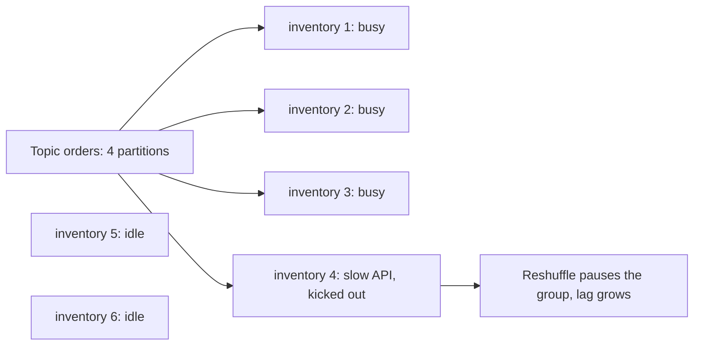
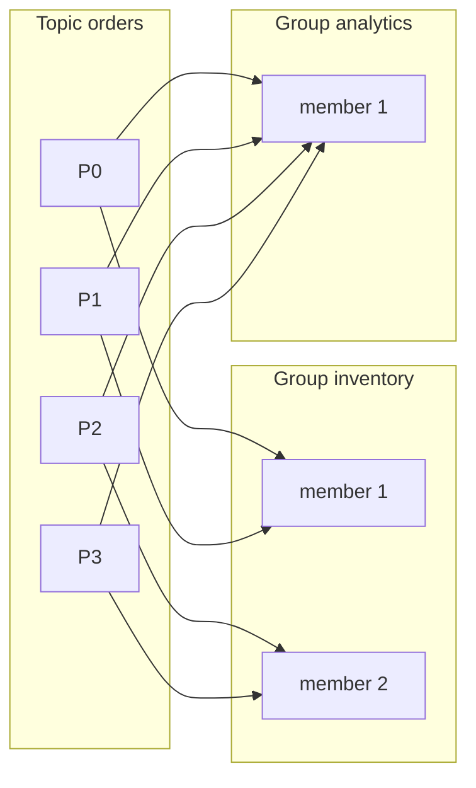

# Consumers and Consumer Groups

**Messaging · Kafka · Step 2.2.4 · Fundamentals** · Last updated 2026-10-21

> [!TIP]
> **In one sentence:** a consumer reads events from a topic in a loop, and consumers that share a `group.id` form a consumer group that splits the topic's partitions between them, so each partition is read by exactly one member.
>
> **Memory hook:** a **team of cashiers and checkout lanes**. Each lane (partition) has exactly one cashier from the team (group) at a time. More cashiers than lanes means some stand idle. A second team (another group) can serve the same lanes completely independently, like an auditor reading every receipt.

## Where it fits

Step 2.2.4 of the [Kafka series](01-kafka-overview.md). It reads from the [log and partitions](02-log-topics-partitions-offsets.md) (2.2.2) that [producers](03-producers-keys-acks-batching.md) (2.2.3) write to. Next: [offset commits and delivery guarantees](05-offset-commits-delivery-guarantees.md) (2.2.5), which decide *when* a consumer's progress is saved; rebalancing gets its own note: [rebalancing and static membership](07-rebalancing-static-membership.md) (2.2.7).

## 1. The story

During ShopFlow's sale, one `inventory-service` instance reads the `orders` topic (4 partitions). It can't keep up: the gap between the newest event and what it has processed (the **lag**) grows to thousands of orders, and stock reservations run minutes behind. The team scales to 6 instances, but only 4 start working; 2 sit idle. Then one instance calls a slow warehouse API inside its loop, takes too long between polls, gets kicked out of the group, and the reshuffle pauses everyone.



## 2. The idea

Consumers with the same **`group.id`** form a **consumer group**. Kafka splits the topic's partitions between the members, and **each partition goes to exactly one member**. That gives parallelism (up to the number of partitions) and keeps per-partition order, because one partition is never read by two members at once.

Different groups are **completely independent**: each has its own position in every partition. So `inventory-service` and `analytics-service` both read every order, at their own speed, without affecting each other.



A member must **keep polling** and **keep sending heartbeats**. If it stops, the group decides it is dead and hands its partitions to someone else. That reshuffle is a **rebalance**.

## 3. Key terms

| Term | Plain meaning |
|---|---|
| **Consumer** | A client that reads events from topics |
| **Consumer group (`group.id`)** | Consumers sharing the work of a topic; each partition to one member |
| **Poll loop** | The consumer repeatedly asks for the next batch, then processes it |
| **Consumer lag** | How far a group is behind the newest events in a partition |
| **Group coordinator** | The broker that manages a group's members and assignment |
| **Heartbeat** | A regular "I'm alive" signal from a member |
| **Rebalance** | Reassigning partitions when members join, leave or are judged dead |
| **`auto.offset.reset`** | Where a group starts when it has no saved position: `earliest` or `latest` |

## 4. How it works, step by step

1. The consumer starts with a `group.id` and **subscribes** to a topic.
2. The **group coordinator** (a broker) registers it and assigns partitions to members.
3. The consumer **polls**: it fetches a batch of events (up to `max.poll.records`, default 500) from its partitions.
4. It **processes** the batch, then polls again. Progress is saved as committed offsets (2.2.5).
5. In the background it sends **heartbeats**. No heartbeat within the session timeout, or no poll within `max.poll.interval.ms` (default 5 minutes), and it is treated as failed.
6. When a member joins, leaves or fails, the group **rebalances** and partitions move.
7. A brand-new group with no saved position starts where `auto.offset.reset` says: from the beginning (`earliest`) or only new events (`latest`).

**Kafka 4.0's new protocol:** the next-generation consumer group protocol (KIP-848) is generally available. The broker computes assignments and only the partitions that actually move are paused, so rebalances are shorter. Clients opt in with `group.protocol=consumer`; groups on the old protocol are called "classic" groups.

## 5. Real-world examples

- **Food delivery:** `OrderPlaced` is read by a dispatch group (assigns couriers), a restaurant-notification group and an analytics group. Dispatch runs as many instances as there are partitions at peak dinner time.
- **Banking:** a fraud-scoring group must keep lag near zero, so lag is alerted on in seconds; a reporting group can run hours behind without harm, because the groups are independent.
- **Media platforms:** a new recommendation service starts a fresh group with `auto.offset.reset=earliest` to read the full retained history and build its model, without touching existing consumers.

## 6. Design choices and trade-offs

| Consumers in a group versus partitions | Result |
|---|---|
| Fewer consumers than partitions | Each consumer reads several partitions |
| Equal | One partition each: maximum parallelism |
| More consumers than partitions | Extras sit **idle**, ready as standby |

- **One group per application.** All instances of `inventory-service` share one `group.id`; different applications never share one.
- **Need more parallelism than partitions?** Add partitions (planning for keys moving), or process in parallel inside the consumer while keeping per-key order, which is more complex.
- **Keep the poll loop fast.** Slow work between polls (a blocking HTTP call) risks exceeding `max.poll.interval.ms` and triggering rebalances. Use timeouts on calls, smaller batches, or hand slow work off carefully.
- **Classic or new protocol?** On Kafka 4.0 and later, the new protocol gives shorter rebalances; check your client library's support first.

## 7. Common mistakes

1. **Scaling consumers past the partition count** and expecting more throughput.
2. **Two different applications sharing a `group.id`**, so each gets only part of the events.
3. **Slow, blocking work inside the poll loop**, causing members to be kicked out and endless rebalances.
4. **Not watching consumer lag**, so a falling-behind consumer is noticed by customers first.
5. **Forgetting `auto.offset.reset` for a new group**, so it either skips history or replays everything unexpectedly.
6. **No timeouts on calls made while processing**, so one slow dependency stalls a partition.

## 8. In code

> [!NOTE]
> Untested sketch to show the shape.

```java
@KafkaListener(topics = "orders", groupId = "inventory-service", concurrency = "4")
public void onOrder(ConsumerRecord<String, OrderEvent> record) {
    inventory.reserve(record.value());     // keep this fast and protected by timeouts
}
```

```yaml
spring:
  kafka:
    consumer:
      group-id: inventory-service
      auto-offset-reset: earliest
      max-poll-records: 200
```

In Spring Kafka, `concurrency = "4"` starts 4 consumers in this instance, and each one is a group member.

| Setting | What it controls |
|---|---|
| `group.id` | Which group the consumer belongs to |
| `auto.offset.reset` | Where a group with no saved position starts |
| `max.poll.records` | Batch size per poll (default 500) |
| `max.poll.interval.ms` | Max time between polls before the member is judged stuck (default 5 minutes) |
| `group.protocol` | Classic or the new consumer protocol (Kafka 4.0 and later) |

## 9. Remember

- **One partition, one member per group**; members beyond the partition count are idle.
- **Groups are independent**: each has its own positions.
- **One `group.id` per application.**
- **Keep polling and keep it fast**, or you trigger rebalances.
- **Watch consumer lag**: it's the health signal of a consumer.

## 10. Interview corner

**15-second answer:** "Consumers with the same group.id share a topic's partitions, one member per partition, so a group scales up to the partition count, and separate groups read the same data independently."

**60-second answer:**
> "A Kafka consumer polls batches of events in a loop. Consumers with the same group ID form a consumer group, and the group coordinator assigns each partition to exactly one member, which gives parallelism up to the partition count while keeping per-partition order. Different groups have their own offsets, so many applications read the same topic independently. Members must keep polling and heartbeating; if one stops or processing takes longer than the max poll interval, the group rebalances. I size consumers to partitions, use one group per application, keep the poll loop fast with timeouts, and alert on consumer lag."

**Likely follow-up questions:**
- **What happens with 6 consumers and 4 partitions?** 4 work, 2 are idle standbys.
- **How can two services both get every event?** Use different `group.id`s.
- **What triggers a rebalance?** A member joining, leaving, or missing heartbeats or the poll deadline.
- **What is consumer lag and why watch it?** How far behind the newest event a group is; rising lag means the consumer can't keep up.
- **What does KIP-848 change?** The broker assigns partitions and only moving partitions pause, so rebalances are shorter.

**Architect angle:** "I plan partitions for peak consumer parallelism, give every application its own group, and treat consumer lag as a service-level signal with alerts."

## 11. Industry check

> [!NOTE]
> Checked 2026-10-21 by web search (Apache Kafka docs, Confluent, Conduktor). Re-verify when you revisit the note.

- **Confirmed:** `max.poll.interval.ms` defaults to 300000 (5 minutes); `session.timeout.ms` defaults to 45 seconds from Kafka 3.0 (10 seconds in older versions); `heartbeat.interval.ms` defaults to 3 seconds and should be at most a third of the session timeout; `max.poll.records` defaults to 500. KIP-848, the next-generation consumer rebalance protocol, is generally available in Kafka 4.0 and enabled on the broker by default; clients opt in with `group.protocol=consumer`, and with it some classic settings (such as `session.timeout.ms` and `partition.assignment.strategy` on the client) are not supported. Support in librdkafka-based clients was still early access as of librdkafka 2.10.
- **To verify:** the default `auto.offset.reset` for your client (commonly `latest`), the default partition assignor in your version, and the broker-side heartbeat and session settings under the new protocol.
- **Decision rule:** one group per application, consumers sized to partitions, a fast poll loop with timeouts, and lag alerts.

## 12. Going further

- Apache Kafka documentation: consumer configuration and "Consumer Rebalance Protocol"
- Confluent blog on KIP-848
- *Kafka: The Definitive Guide* (consumers)

**Next:** [Offset commits and delivery guarantees](05-offset-commits-delivery-guarantees.md) (2.2.5).

Back to [the Kafka overview](01-kafka-overview.md) · [Messaging overview](../01-messaging-overview.md) · [Index](../../README.md) · [Roadmap](../../roadmap.md).
