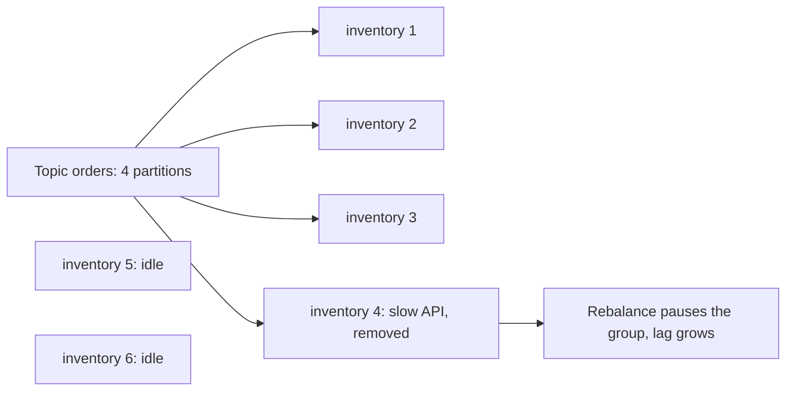
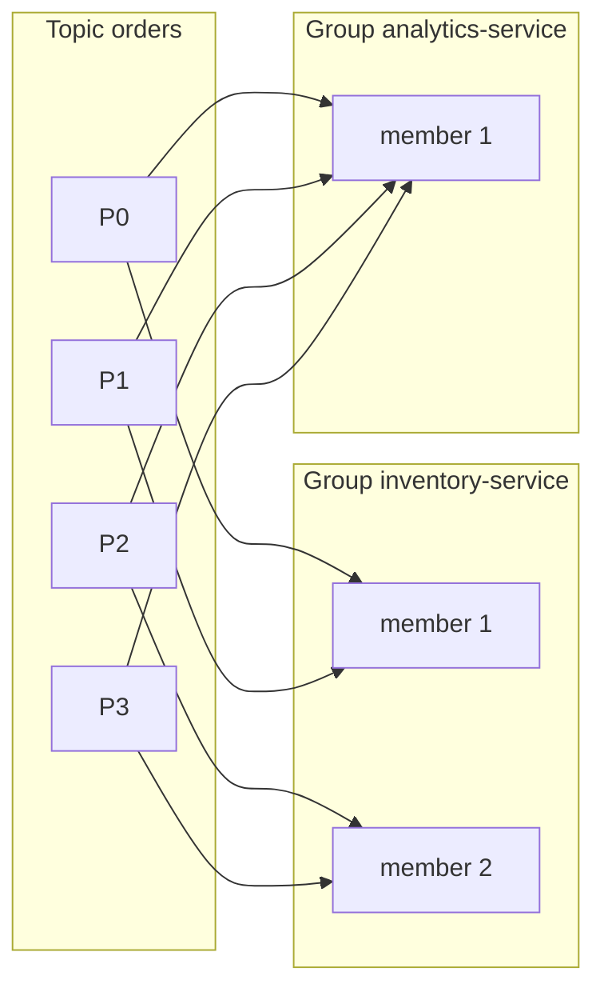

# Consumers and Consumer Groups

**Messaging · Kafka · Step 2.2.4 · Fundamentals** · Last updated 2026-10-21
**Prerequisites:** [The log, topics, partitions and offsets](02-log-topics-partitions-offsets.md) (2.2.2)

## 1. The concept in simple English

**What is it?** A **consumer** reads events from a topic in a loop. Consumers that share a `group.id` form a **consumer group**, which splits the topic's partitions between its members: at any moment each partition is read by exactly one member of the group (a rebalance or a member that has lost its session can briefly blur this, which is one reason duplicates happen).

**Why do we need it?** One consumer can't keep up with a busy topic. A group spreads the work while keeping each partition's order, and separate groups let different applications read the same events independently.

**When would I meet it?** Whenever you scale a service that consumes Kafka, or a second team wants to read the same topic.

> [!TIP]
> **Memory hook:** one cashier per lane; extra cashiers stand idle; another team can serve the same lanes independently.

## 2. Mental model: cashiers and lanes

| In the analogy | In Kafka |
|---|---|
| A team of cashiers | A **consumer group** |
| One cashier | A group **member** (consumer instance or thread) |
| A checkout lane | A **partition** |
| A second team auditing every receipt | Another consumer group |
| The queue of waiting customers | **Consumer lag** |

**Where the analogy breaks:** if a cashier leaves, the lanes are reassigned (a **rebalance**), which can pause some or all of the team briefly, and the new cashier may re-serve a few customers the previous one had already served (duplicates, see [2.2.5](05-offset-commits-delivery-guarantees.md)).

## 3. Industry terms

| Term | Simple meaning | Why it matters | Example | Related terms |
|---|---|---|---|---|
| **Consumer group** | Consumers sharing a topic's partitions | Parallelism plus per-partition order | `inventory-service` | `group.id` |
| **Poll loop** | Fetch a batch, process it, fetch again | Must stay fast, or the member is judged stuck | `consumer.poll(...)` | `max.poll.interval.ms` |
| **Consumer lag** | How far a group is behind the newest events | The consumer's health signal | Lag of 5,000 events | Monitoring ([2.2.17](17-monitoring-lag-capacity.md)) |
| **Group coordinator** | The broker that manages a group's members | Runs membership and assignment | One broker per group | Rebalance |
| **Heartbeat** | A regular "I'm alive" signal | Missing heartbeats remove a member | Every 3 s by default | Session timeout |
| **Rebalance** | Reassigning partitions when members change | Pauses work; can cause duplicates | A pod restart | [2.2.7](07-rebalancing-static-membership.md) |
| **`auto.offset.reset`** | Where a group with no saved position starts | Decides whether a new group sees history | `earliest` or `latest` | Committed offset |

## 4. In a real system (ShopFlow)

**The business problem.** During a sale, stock must be reserved within seconds of an order, and the Analytics Service must read the same orders without slowing the Inventory Service down.

One Inventory Service instance reading a 4-partition `orders` topic fell minutes behind. The team scaled to 6 instances; only 4 started working. Then one instance called a slow warehouse API inside its loop, took longer than the poll deadline, was removed from the group, and the reassignment paused everyone.



**How consumer groups help.** With 4 partitions, 4 members work in parallel, each partition in order. The Analytics Service uses its own group, so it reads every order without affecting inventory.

**What it costs.** Parallelism is capped by partitions; a slow member triggers rebalances; and consumers must handle occasional duplicates after a reassignment.

**Elsewhere:** in food delivery, dispatch, restaurant-notification and analytics groups all read `OrderPlaced`, and dispatch runs as many instances as partitions at the dinner peak; a bank alerts on a fraud-scoring group's lag within seconds, while a reporting group may run hours behind; a new recommendation service starts a fresh group with `auto.offset.reset=earliest` to read the retained history without touching other consumers.

## 5. How it works



1. **What starts it:** a consumer starts with a `group.id` and subscribes to a topic.
2. The **group coordinator** registers it and assigns partitions; each partition goes to one member of the group.
3. The consumer **polls** a batch (up to `max.poll.records`, default 500) and processes it; progress is saved as committed offsets ([2.2.5](05-offset-commits-delivery-guarantees.md)).
4. A background thread sends **heartbeats**. No heartbeat within the session timeout (default 45 s since Kafka 3.0), or no poll within `max.poll.interval.ms` (default 5 minutes), and the member is treated as failed.
5. **On membership change:** the group **rebalances** and partitions move ([2.2.7](07-rebalancing-static-membership.md)).
6. **A new group** with no committed offsets starts where `auto.offset.reset` says: `earliest` (from the beginning) or `latest` (only new events; the Java client's default). Set it explicitly.

**Kafka 4.0:** the new consumer group protocol (KIP-848) is generally available; the broker computes assignments and only partitions that move are paused. Clients opt in with `group.protocol=consumer`.

> [!NOTE]
> Untested sketch to show the shape.

```java
@KafkaListener(topics = "orders", groupId = "inventory-service", concurrency = "2")
public void onOrder(OrderPlaced event) {
    inventory.reserve(event);           // keep it fast, with timeouts on any remote calls
}
```

In Spring Kafka, `concurrency = "2"` runs two consumers in this instance; each is a group member, so concurrency × instances should not exceed the partition count.

## 6. Failure scenarios

### More consumers, no more throughput

- **What happened?** Six instances on a four-partition topic; lag didn't improve.
- **Why?** Each partition is assigned to one member; two members had nothing to read.
- **What the business sees:** stock reservations still late.
- **Solutions:** more partitions (planned, see [2.2.11](11-ordering-partition-planning-hot-partitions.md)), faster processing, or parallel processing per key inside the consumer.
- **Trade-offs:** more partitions remap keys; per-key parallelism adds complexity.

### Slow processing triggers rebalances

- **What happened?** A blocking call made one batch take longer than `max.poll.interval.ms`.
- **Why?** No poll within the deadline means "stuck", so the member is removed and its partitions reassigned.
- **What the business sees:** periodic pauses and duplicate processing.
- **Solutions:** timeouts on remote calls, smaller batches (`max.poll.records`), or handing slow work off carefully.
- **Trade-offs:** smaller batches cost some throughput; handing off work complicates offset commits.

### A new group skips history (or replays all of it)

- **What happened?** A new reporting service saw no past orders.
- **Why?** With no committed offsets it started at `latest`.
- **What the business sees:** reports missing earlier data.
- **Solutions:** set `auto.offset.reset=earliest` for groups that must read history.
- **Trade-offs:** reading the full retention can take time and load the cluster.

## 7. Architectural decisions

| Consumers versus partitions | Result |
|---|---|
| Fewer consumers than partitions | Some members read several partitions |
| Equal | Maximum parallelism |
| More consumers than partitions | Extras idle (useful as standbys) |

- **One `group.id` per application.** Two different applications sharing one group each receive only part of the events.
- **Classic or new protocol?** On Kafka 4.0 and later the new protocol shortens rebalances; check your client library's support.
- **Treat consumer lag as a service-level signal** with alerts per group ([2.2.17](17-monitoring-lag-capacity.md)).

**Common mistakes:** scaling consumers past the partition count; two applications sharing a `group.id`; slow blocking work in the poll loop; not watching lag; forgetting `auto.offset.reset` for a new group; no timeouts on calls made while processing.

## 8. Try it yourself

> [!NOTE]
> Status: run on Apache Kafka 4.3.2 (single-node KRaft broker, official binary, macOS) on 2026-10-21; the results below are from that run. Needs a 3-partition `orders` topic (see [2.2.2](02-log-topics-partitions-offsets.md)).

**Predict first:** you start three console consumers in group `demo`, then a fourth. What does the fourth one receive?

```bash
kafka-console-consumer.sh --bootstrap-server localhost:9092 --topic orders --group demo   # run in 3 terminals, then a 4th
kafka-consumer-groups.sh --bootstrap-server localhost:9092 --describe --group demo        # partition owners and lag
```

**Observe:** the describe output shows which member owns which partition, its committed offset and its lag. In the example run, the three consumers each owned one partition (0, 1 and 2), and the fourth appeared as a member with **0 partitions** (`--describe --members --verbose` shows it). **Break it:** stop one consumer and run describe again to see its partitions move. **Clean up:** stop the consumers.

## 9. Check your understanding

1. Six consumers in one group read a topic with four partitions. How many receive events?
2. What happens if a consumer's processing of one batch takes ten minutes with default settings?
3. Two services both need every `OrderPlaced` event. How must they be configured?
4. Lag on one consumer group keeps rising during a sale while the others are fine. Name two things to check.

Answers are at the end of this note.

## 10. Revision

**Remember**
- **One partition, one member per group**; members beyond the partition count are idle.
- **Groups are independent**: one `group.id` per application.
- **Keep polling and keep it fast**, or the member is removed and the group rebalances.
- **Watch consumer lag** per group.

**Explain in 15 seconds:** "Consumers with the same group.id share a topic's partitions, one member per partition, so a group scales up to the partition count, and different groups read the same data independently."

**Explain in 60 seconds:**
> "A Kafka consumer polls batches in a loop. Consumers with the same group ID form a consumer group, and the coordinator assigns each partition to one member at a time, giving parallelism up to the partition count while keeping per-partition order. Different groups have their own offsets, so many applications can read the same topic. Members must keep polling and heartbeating; if processing exceeds the max poll interval, the member is removed and the group rebalances, which pauses work and can cause duplicates. I size consumers to partitions, use one group per application, keep the poll loop fast and alert on lag."

**Likely follow-up questions:**
- **What triggers a rebalance?** A member joining or leaving, missed heartbeats, or a missed poll deadline ([2.2.7](07-rebalancing-static-membership.md)).
- **What does KIP-848 change?** The broker computes assignments and only partitions that move pause, so rebalances are shorter.
- **Can one consumer read several partitions?** Yes; with fewer members than partitions, some members read several.

**Architect's takeaway:** plan partitions for peak consumer parallelism and give every application its own group; lag is the signal that tells you when the plan is wrong.

**Next topic:** [Offset commits and delivery guarantees](05-offset-commits-delivery-guarantees.md) (2.2.5)

## 11. Verification and sources

> [!NOTE]
> Checked 2026-10-21 by web search. Re-verify when you revisit this note.

- **Confirmed:** `max.poll.interval.ms` defaults to 300000 (5 minutes); `session.timeout.ms` defaults to 45 s from Kafka 3.0 (10 s before); `heartbeat.interval.ms` defaults to 3 s; `max.poll.records` defaults to 500 (Apache and Confluent configuration references). KIP-848 is generally available in Kafka 4.0, enabled on the broker by default, with clients opting in via `group.protocol=consumer`; some classic client settings are not supported with it.
- **Assumptions and illustrations:** the ShopFlow story; the code and commands (not run).
- **Also confirmed:** `auto.offset.reset` defaults to `latest` in the Java client (Apache Kafka consumer configuration).
- **Observed (Kafka 4.3.2 client libraries, 2026-10-21):** `session.timeout.ms` 45000, `heartbeat.interval.ms` 3000, `max.poll.interval.ms` 300000, `max.poll.records` 500, `enable.auto.commit` true, `auto.commit.interval.ms` 5000, `auto.offset.reset` latest, `isolation.level` read_uncommitted, `partition.assignment.strategy` `[RangeAssignor, CooperativeStickyAssignor]` (read from the client's configuration definitions; earlier-version values are as cited above).
- **To verify:** your client library's KIP-848 support.
- **Decision rule:** one group per application, consumers sized to partitions, a fast poll loop with timeouts, lag alerts.

**Sources:** Apache Kafka consumer configuration and "Consumer Rebalance Protocol" documentation; Confluent blog on KIP-848; *Kafka: The Definitive Guide*.

## Answers

1. Four. Each partition is assigned to one member; the other two are idle standbys.
2. With `max.poll.interval.ms` at 5 minutes, the consumer is treated as stuck, removed from the group, and its partitions reassigned; its uncommitted work will be processed again by the new owner.
3. Each service uses its **own** `group.id`, so each group gets every partition and keeps its own offsets.
4. Whether that group's processing has slowed (a slow dependency, missing timeouts, frequent rebalances), and whether a hot partition concentrates traffic on one member; also whether the group has as many members as it can use.

Back to [the Kafka overview](01-kafka-overview.md) · [Index](../../README.md) · [Roadmap](../../roadmap.md).
