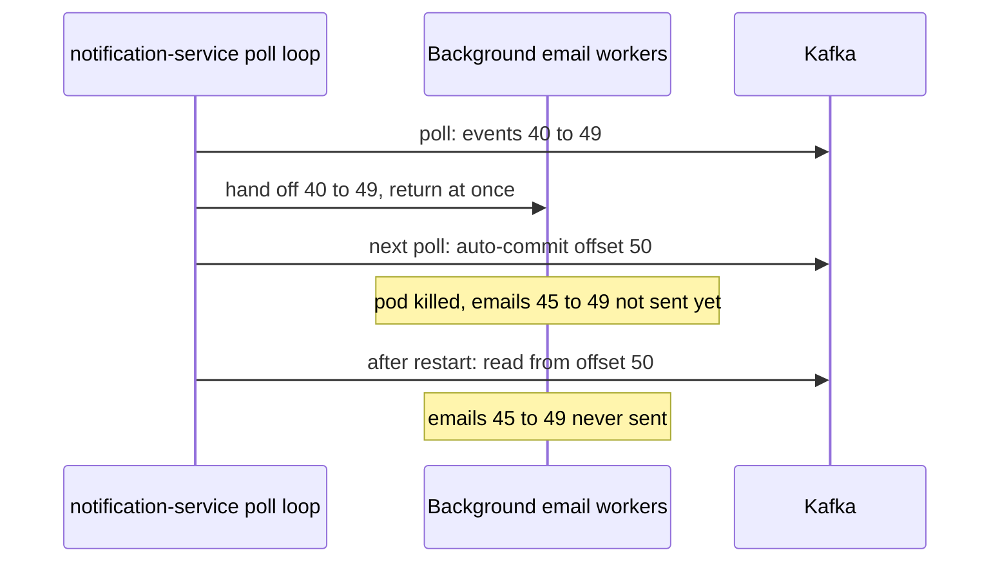
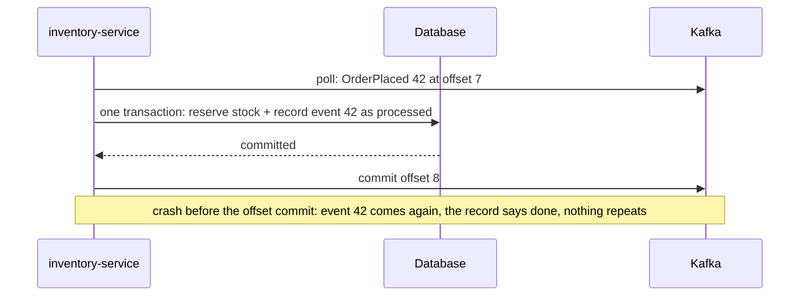

# Offset Commits and Delivery Guarantees

**Messaging · Kafka · Step 2.2.5 · Fundamentals** · Last updated 2026-10-21
**Prerequisites:** [Consumers and consumer groups](04-consumers-consumer-groups.md) (2.2.4), [Idempotency](../../01-resilience/04-idempotency.md) (1.4)

## 1. The concept in simple English

**What is it?** A consumer saves its progress by **committing an offset**: "next time, start from here". The order of *processing* and *committing* decides what a crash does: skip events, or repeat them.

**Why do we need it?** Consumers crash, restart and lose partitions in rebalances. Without saved progress they would start over; with careless saving they lose or duplicate work.

**When would I meet it?** Every consumer that changes something, such as reserving stock, writing to a database or sending an email.

> [!TIP]
> **Memory hook:** a bookmark: move it before reading and a nap makes you skip a page; move it after reading and you may reread one. Rereading is safe only if reading twice does no harm.

## 2. Mental model: a bookmark on the train

| In the analogy | In Kafka |
|---|---|
| The page you're on | The consumer's position (in memory) |
| The bookmark | The **committed offset**, stored by Kafka |
| Falling asleep | A crash, restart or rebalance |
| Rereading a page harmlessly | An **idempotent consumer** |

**Where the analogy breaks:** rereading a page has no side effects, but reprocessing an event can send a second email or a second charge. Making reprocessing harmless is the application's job, not Kafka's.

## 3. Industry terms

| Term | Simple meaning | Why it matters | Example | Related terms |
|---|---|---|---|---|
| **Committed offset** | The group's saved position: the **next** event to read | Where reading resumes | Commit 43 after processing 42 | `__consumer_offsets` |
| **`__consumer_offsets`** | The internal topic storing committed offsets | Kafka keeps progress per group and partition | Group `notification-service` | Consumer group |
| **Auto-commit** | The client commits periodically while polling | Safe only if each batch is fully processed before the next poll | `enable.auto.commit=true` | Manual commit |
| **Manual commit** | The application or framework commits after processing | Explicit control | `commitSync`, Spring `acknowledge()` | Ack mode |
| **Ack mode** (Spring Kafka) | When the listener container commits | Framework-level delivery behaviour | `BATCH`, `RECORD`, `MANUAL` | Committed offset |
| **At-most-once** | May lose, never repeats | Only for data you can lose | Commit before processing | At-least-once |
| **At-least-once** | Doesn't lose (while retained and retried), may repeat | The normal choice | Commit after processing | Idempotent consumer |
| **Effectively once** | Repeats happen but have no extra effect | What most systems really need | At-least-once + deduplication | Exactly-once ([2.2.9](09-idempotent-producer-transactions.md)) |

## 4. In a real system (ShopFlow)

**The business problem.** Every confirmed order must get its confirmation email (a rare duplicate is acceptable, a missing email is not), and stock must be reserved only once per order, even when consumers crash or restart.

The Notification Service first handed each event to a background thread pool and returned from its loop immediately, with auto-commit on. The client committed those offsets on the next poll, although the emails were still waiting in the pool. A pod was killed, and those customers **never got their email**.



**How commits help.** Commit only after the work is really done, and make the work safe to repeat. Then a crash means "repeat some events", not "lose them". Repeating is only harmless for effects you can make idempotent; the next sections say which those are.

**What it costs.** Duplicates become normal, so every consumer needs a deduplication strategy, and some side effects (email, payments) need special care because they can't join a database transaction.

**Elsewhere:** a bank's ledger consumer records each transaction ID with a unique constraint in the same database transaction as the posting; a metrics pipeline uses plain auto-commit with synchronous processing, because a repeated or occasionally lost CPU sample doesn't matter; a notification service prefers an occasional duplicate push message over a missing one.

## 5. How it works



1. **What starts it:** the consumer polls a batch.
2. It processes each event (database write, email, API call).
3. **On success:** it commits the offset of the **next** event (processed 7, commit 8).
4. Kafka stores the commit in `__consumer_offsets` for this group and partition.
5. **On failure or restart:** the partition's owner resumes from the last committed offset; anything processed but not committed is **delivered again**.

**Auto-commit, precisely:** the Java client commits automatically (every 5 s by default) during `poll()`, committing the position of records already returned. If your code finishes every record before calling `poll()` again on the same thread, this behaves as at-least-once. It loses events when processing continues **after** the next poll: background threads, or records buffered across polls (the example in Kafka's own Javadoc).

**Committed offsets expire:** when a group has had no active members for longer than `offsets.retention.minutes` (7 days by default since Kafka 2.0), its committed offsets are deleted. When it comes back, it starts wherever `auto.offset.reset` says, which can mean skipping or replaying a lot of events.

**Who guarantees what**

| Layer | Responsible for |
|---|---|
| Kafka broker | Storing committed offsets durably per group and partition |
| Consumer client | Committing when told to (auto or manual); `commitSync` blocks and retries until success, an unrecoverable error or its timeout (`default.api.timeout.ms`); `commitAsync` doesn't retry |
| Spring Kafka | Committing on the chosen ack mode; it disables the client's auto-commit by default and defaults to `BATCH` |
| Application | Committing only after work is done; making processing idempotent |
| External systems | Email or HTTP providers: their own guarantees; they don't join your transaction |

> [!NOTE]
> Untested sketch to show the shape.

```yaml
spring:
  kafka:
    listener:
      ack-mode: manual      # required for the Acknowledgment parameter; the default BATCH mode doesn't provide one
```

```java
@KafkaListener(topics = "orders", groupId = "inventory-service")
public void onOrder(OrderPlaced e, Acknowledgment ack) {
    reservations.apply(e);        // @Transactional: stock + "processed" record in one database transaction
    ack.acknowledge();            // commit the offset only after the database transaction committed
}

@Transactional
public void apply(OrderPlaced e) {
    if (!processed.markIfNew(e.eventId())) return;   // unique key on event ID: false if seen before
    stock.reserve(e.orderId(), e.items());
}
```

## 6. Failure scenarios

### Database transaction succeeded, offset commit failed

- **What happened?** Stock was reserved and committed in the database, then the consumer crashed before committing the offset.
- **Why?** The database and Kafka are separate systems; there is no shared transaction.
- **What the business sees:** nothing bad, *if* the deduplication record was written in the same database transaction: the event is redelivered and skipped.
- **Solutions:** store the processed-event ID (or the offset itself) in the same database transaction as the business change.
- **Boundary:** this protects only what happens **inside that database transaction**. If the same handler also calls an email provider or another service, the dedupe row does not stop that call being repeated: the call can succeed and the transaction then roll back (or the process die before it commits), and the redelivered event will make the call again.
- **Trade-offs:** an extra table and a unique key; the stored IDs must be kept longer than any redelivery or replay window you support, then cleaned up; two members processing the same event at once are stopped only by the unique constraint (one transaction fails and is retried).

### External call succeeded, crash before recording it

- **What happened?** The email provider accepted the email; the consumer crashed before recording "sent".
- **Why?** An email (or HTTP call) can't be part of your database transaction.
- **What the business sees:** depends on your order of steps. **Record first, then send:** a crash in between loses the email. **Send first, then record:** a crash in between sends a duplicate.
- **Solutions:** choose the lesser harm (usually an occasional duplicate email over a missing one); pass an idempotency key if the provider supports it. An outbox makes the *intent* to send durable, but whatever sends from it faces the same choice.
- **Trade-offs:** no option gives a guaranteed single external effect without the provider's cooperation.

### Background processing with auto-commit

- **What happened?** The story above: events were committed while still being processed elsewhere.
- **Solutions:** process on the poll thread, or disable auto-commit and commit only completed work.
- **Trade-offs:** less parallelism, or more careful offset tracking.

## 7. Architectural decisions

| Strategy | Effect on a crash | Use for |
|---|---|---|
| Commit before processing | May **skip** events (at-most-once) | Rare: data where repeats are worse than loss |
| Auto-commit, synchronous processing | May **repeat** events (at-least-once) | Simple consumers with idempotent work |
| **Manual commit after processing + idempotent consumer** | Repeats are harmless for effects inside the deduplicated transaction; external effects still need their own idempotency | **Business events (the default)** |
| Kafka transactions | Exactly-once for topic-to-topic work | Stream processing ([2.2.9](09-idempotent-producer-transactions.md)) |

- **Per record or per batch?** Per record shrinks the repeat window but costs more commits; per batch is cheaper. Both are fine with idempotent processing.
- **Replay is a feature:** resetting offsets reprocesses history after a bug fix, so every consumer should be safe to rerun.

**Common mistakes:** auto-commit with work handed to other threads; committing before the database transaction commits; calling it "exactly once" without idempotency; committing the processed offset instead of the next one with the plain client; ignoring commit failures during a rebalance.

## 8. Try it yourself

> [!NOTE]
> Status: run on Apache Kafka 4.3.2 (single-node KRaft broker, official binary, macOS) on 2026-10-21; the results below are from that run. Needs the `orders` topic from [2.2.2](02-log-topics-partitions-offsets.md).

**Predict first:** after a group has read everything, you reset its offsets to the earliest position. What happens when the consumer starts again?

```bash
kafka-console-consumer.sh --bootstrap-server localhost:9092 --topic orders --group replay-demo --from-beginning   # read all, then stop
kafka-consumer-groups.sh --bootstrap-server localhost:9092 --group replay-demo --reset-offsets --to-earliest --topic orders --execute
kafka-consumer-groups.sh --bootstrap-server localhost:9092 --describe --group replay-demo
```

**Observe:** the committed offsets drop back to 0 and the consumer re-reads everything. In the example run, partition 1 went from committed offset 10 (lag 0) to 0 (lag 10). Add `--dry-run` instead of `--execute` to preview the new offsets first. **Break it:** try the reset while the consumer is running; the tool refused with "Assignments can only be reset if the group is inactive, but the current state is Stable". **Clean up:** `kafka-consumer-groups.sh --bootstrap-server localhost:9092 --delete --group replay-demo`.

## 9. Check your understanding

1. After processing offset 41, which offset should be committed, and why?
2. With auto-commit on, a consumer processes each record synchronously before the next poll. Can it lose events? Can it duplicate them?
3. The consumer writes to the database and then crashes before committing the offset. What happens next, and what makes it safe?
4. Should the Notification Service record "email sent" before or after calling the email provider? Justify.

Answers are at the end of this note.

## 10. Revision

**Remember**
- **Committed offset = the next event to read.**
- **Commit before processing may lose; commit after may repeat.**
- **Business events: commit after processing + idempotent consumer.**
- Auto-commit is safe only when each batch is finished before the next poll.
- **External side effects** (email, HTTP) can't join your database transaction: choose duplicate over loss, or use the provider's idempotency key.

**Explain in 15 seconds:** "Consumers commit offsets to save progress; committing after processing gives at-least-once delivery, and idempotent processing makes the repeats harmless for the state the consumer controls; external calls need their own safeguard."

**Explain in 60 seconds:**
> "A consumer's progress is its committed offset per partition, the next event to read. Commit before processing and a crash skips events; commit after and a crash repeats them. For business events I commit after processing and make the consumer idempotent, for example by recording the event ID in the same database transaction as the change, so a redelivered event is skipped. Auto-commit is only safe if every record is finished before the next poll. External side effects like emails can't join that transaction, so I choose the lesser harm, usually a rare duplicate, or use the provider's idempotency key."

**Likely follow-up questions:**
- **Where are offsets stored?** In the internal `__consumer_offsets` topic, per group and partition.
- **`commitSync` or `commitAsync`?** Async in the loop for speed; sync on shutdown or when partitions are revoked, because async doesn't retry.
- **How do you reprocess after a bug fix?** Reset the group's offsets while the group is stopped, and rely on idempotent consumers.

**Architect's takeaway:** standardise at-least-once with idempotent consumers, and treat every external side effect as a deliberate decision about duplicates versus loss.

**Next topic:** [Brokers, replication and leader election](06-brokers-replication-leader-election.md) (2.2.6)

## 11. Verification and sources

> [!NOTE]
> Checked 2026-10-21 by web search. Re-verify when you revisit this note.

- **Confirmed:** `enable.auto.commit` defaults to `true` and `auto.commit.interval.ms` to 5 s in the Java client; with auto-commit, records are considered consumed once returned by `poll()`, so failures after polling but before processing completes can lose them (Kafka `KafkaConsumer` Javadoc); the committed offset should be the next message to consume; committed offsets are stored in `__consumer_offsets`; `commitSync` blocks until success, an unrecoverable error or the API timeout, and `commitAsync` doesn't retry. Spring Kafka sets the client's `enable.auto.commit` to false by default (since 2.3) and its default ack mode is `BATCH` (Spring Kafka container properties reference).
- **Assumptions and illustrations:** the ShopFlow stories; the code and commands (not run).
- **Also confirmed:** Spring Kafka ack modes: `RECORD` commits after each record; `BATCH` (default) after all records from one poll; `TIME` and `COUNT` after a time or number of records; `MANUAL` queues acknowledgements and commits once the poll's records are processed; `MANUAL_IMMEDIATE` commits at once when acknowledged on the consumer thread. An `Acknowledgment` listener parameter needs a manual ack mode; with a custom container factory, set it on the factory (Spring Kafka `AckMode` Javadoc and reference). `offsets.retention.minutes` defaults to 10080 (7 days) since Kafka 2.0 (KIP-186).
- **To verify:** your Spring Boot version's handling of `spring.kafka.listener.ack-mode` with custom container factories.
- **Decision rule:** commit after processing; idempotent consumers; explicit choices for external side effects.

**Sources:** Apache Kafka `KafkaConsumer` Javadoc; Spring for Apache Kafka reference (committing offsets, container properties); *Kafka: The Definitive Guide*.

## Answers

1. **42.** The committed offset is the next event to read; committing 41 would make the consumer reprocess 41 after a restart.
2. It shouldn't lose events, because auto-commit during `poll()` only covers records already returned, and each was finished before the next poll. It **can** duplicate events: a crash after processing but before the next periodic commit makes those records arrive again.
3. The partition's owner resumes from the last committed offset, so the event is delivered again. It's safe if the processing is idempotent, for example the event ID was stored in the same database transaction as the change, so the repeat is skipped.
4. Usually **after**: sending first and recording second can produce a rare duplicate email after a crash, while recording first can lose an email entirely. Better still, pass the event ID as an idempotency key if the email provider supports one.

Back to [the Kafka overview](01-kafka-overview.md) · [Index](../../README.md) · [Roadmap](../../roadmap.md).
