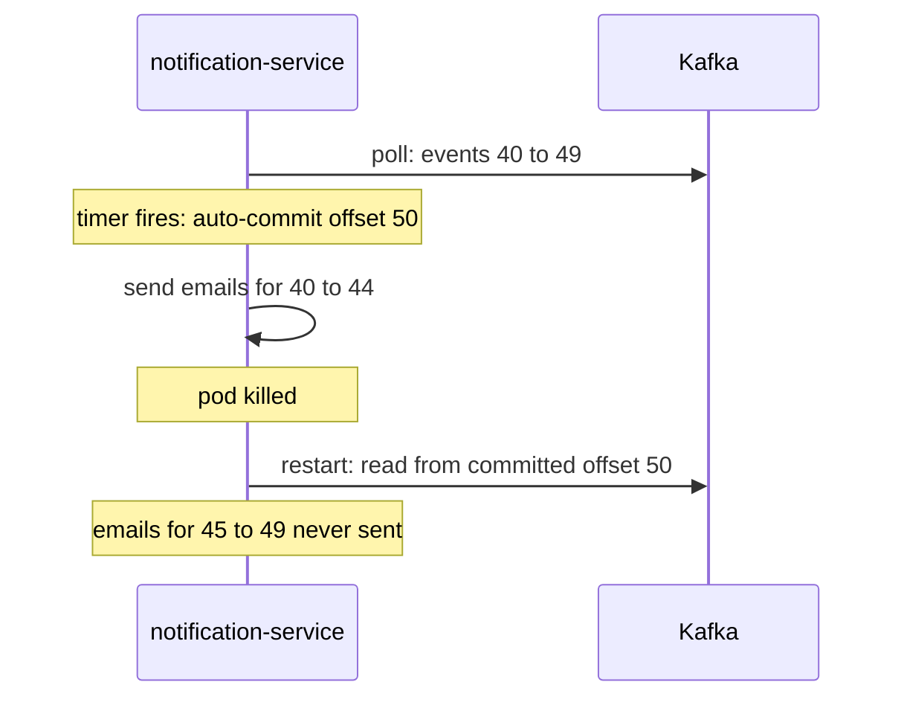
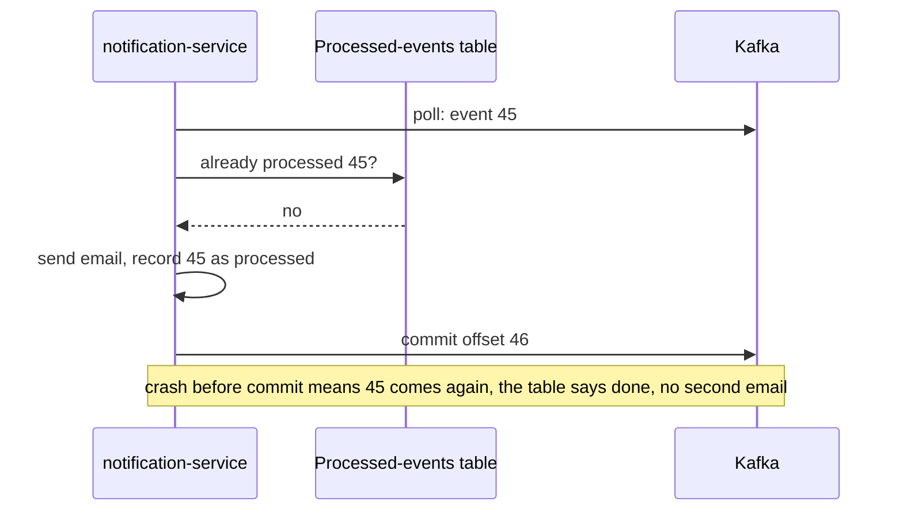

# Offset Commits and Delivery Guarantees

**Messaging · Kafka · Step 2.2.5 · Fundamentals** · Last updated 2026-10-21

> [!TIP]
> **In one sentence:** a consumer saves its progress by committing offsets, and *when* it commits (before or after processing) decides whether a crash loses events (at most once) or repeats them (at least once).
>
> **Memory hook:** a **bookmark in a book you read on the train**. Move the bookmark *before* reading a page and fall asleep: you skip that page (lost). Move it *after* reading and fall asleep before moving it: you reread a page (duplicate). Rereading is annoying but safe; skipping is not.

## Where it fits

Step 2.2.5 of the [Kafka series](01-kafka-overview.md). It completes [consumers and consumer groups](04-consumers-consumer-groups.md) (2.2.4): the group knows *who* reads each partition; offsets record *how far* it got. It relies on [idempotency](../../01-resilience/04-idempotency.md) from the resilience track. Next: [brokers, replication and leader election](06-brokers-replication-leader-election.md) (2.2.6); exactly-once with transactions comes in 2.2.9.

## 1. The story

ShopFlow's `notification-service` reads `OrderPlaced` and sends confirmation emails, with automatic offset commits every few seconds. One afternoon a pod is killed mid-batch. The auto-commit had already saved positions for events whose emails were never sent, so after the restart those customers **never get their email**. The team switches to committing after sending. Weeks later a crash happens *after* sending but *before* the commit, and a few customers get **the same email twice**.



## 2. The idea

A consumer's position is its **committed offset**, stored by Kafka per group and partition. After a restart or rebalance, reading resumes from there. The committed offset is the **next** event to read: after processing offset 41, you commit 42.

The order of "process" and "commit" is a choice between two kinds of failure:

- **Commit, then process:** a crash in between **skips** events. That's *at most once*.
- **Process, then commit:** a crash in between **repeats** events. That's *at least once*.

For business events, choose **at least once** and make the consumer **idempotent**, so a repeat is harmless. That combination is what people usually mean by "effectively exactly once".



## 3. Key terms

| Term | Plain meaning |
|---|---|
| **Committed offset** | The saved position of a group in a partition: the next event to read |
| **`__consumer_offsets`** | The internal Kafka topic where committed offsets are stored |
| **Auto-commit** | The client commits on a timer in the background |
| **Manual commit** | Your code (or framework) commits after processing |
| **At most once** | Never repeated, but may be lost |
| **At least once** | Never lost, but may be repeated |
| **Exactly once (effectively)** | Each event's effect happens once: at least once + idempotency, or transactions |
| **Idempotent consumer** | A consumer that recognises and skips events it has already handled |
| **Offset reset / replay** | Moving a group's position back (or forward) on purpose |

## 4. How it works, step by step

1. The consumer polls a batch from its partitions.
2. It processes the events (updates a database, sends an email, calls a service).
3. It commits the offset **after** the events are fully handled.
4. Kafka stores the commit in `__consumer_offsets` for this group and partition.
5. On restart or rebalance, whoever owns the partition reads from the committed offset.
6. Anything processed but not yet committed **will be delivered again**, so the handler checks whether it has seen the event before.

**Auto-commit:** by default the Java client commits automatically every 5 seconds. It commits on a timer, not after your processing, so a crash can skip or repeat events. **Manual commit:** `commitSync` waits and retries until it succeeds; `commitAsync` doesn't block and doesn't retry, so a common pattern is async commits in the loop and a final sync commit on shutdown.

## 5. Real-world examples

- **Banking ledgers:** posting a transaction twice is unacceptable, missing one is worse. Ledger consumers use at least once and record each transaction ID with a unique constraint in the same database transaction as the posting.
- **Metrics and monitoring:** losing a few CPU samples after a crash doesn't matter, so simple auto-commit (closer to at most once) is fine and cheap.
- **Email and push notifications:** a missed message is worse than an occasional duplicate, so at least once with a processed-message table keeps duplicates rare.

## 6. Design choices and trade-offs

| Strategy | Guarantee | Use for | Cost |
|---|---|---|---|
| Auto-commit on a timer | Neither, strictly: may skip or repeat | Data you can lose or repeat | Least effort |
| Commit before processing | At most once | Rare: data where repeats are worse than loss | Losses on crash |
| **Commit after processing + idempotent consumer** | **At least once, effectively once** | **Business events (the default choice)** | A dedupe check per event |
| Kafka transactions (read-process-write to Kafka) | Exactly once within Kafka | Stream processing from topic to topic | Complexity; covered in 2.2.9 |

**Per record or per batch?** Committing after every record shrinks the repeat window but costs more requests; committing per batch is cheaper but repeats more after a crash. Both are fine with an idempotent consumer.

**Replay is a feature:** because the log keeps events, you can reset a group's offset to reprocess after a bug fix. Plan for it: consumers must be safe to rerun.

## 7. Common mistakes

1. **Trusting auto-commit for business events.** It commits on time, not on success.
2. **Auto-commit plus processing on another thread**: offsets move on before the work finishes.
3. **Committing before the work is truly done** (for example before the database transaction commits).
4. **Calling it "exactly once" without idempotency.**
5. **Committing the processed offset instead of the next one** when using the raw API (frameworks handle this).
6. **Ignoring commit failures during a rebalance**, then being surprised by repeats.

## 8. In code

> [!NOTE]
> Untested sketch to show the shape.

```yaml
spring:
  kafka:
    consumer:
      enable-auto-commit: false      # the container commits after processing instead
    listener:
      ack-mode: manual
```

```java
@KafkaListener(topics = "orders", groupId = "notification-service")
public void onOrder(ConsumerRecord<String, OrderEvent> record, Acknowledgment ack) {
    if (processed.insertIfAbsent(record.value().eventId())) {   // unique constraint: false if seen
        email.sendConfirmation(record.value());
    }
    ack.acknowledge();                                          // commit only after handling
}
```

| Setting | What it controls |
|---|---|
| `enable.auto.commit` | Timer-based commits (default `true` in the Java client) |
| `auto.commit.interval.ms` | How often auto-commit runs (default 5 seconds) |
| Spring `ack-mode` | When the container commits: after each record (`RECORD`), after each poll's batch (`BATCH`), or when you call `acknowledge()` (`MANUAL`, `MANUAL_IMMEDIATE`) |

## 9. Remember

- **Committed offset = the next event to read.**
- **Commit before processing = may lose. Commit after = may repeat.**
- **Business events: commit after processing + idempotent consumer.**
- **Auto-commit commits on a timer, not on success.**
- **Replay is possible**, so every consumer should be safe to rerun.

## 10. Interview corner

**15-second answer:** "Consumers commit offsets to save progress; committing after processing gives at-least-once delivery, and an idempotent consumer makes repeats harmless."

**60-second answer:**
> "A consumer's progress is its committed offset per partition, stored in Kafka, and it means the next event to read. If you commit before processing, a crash skips events: at most once. If you commit after processing, a crash repeats events: at least once. For business events I disable auto-commit, which works on a timer rather than on success, commit after processing, and make the consumer idempotent with a processed-events table or unique constraint, so repeats are harmless. That gives effectively-once results. Kafka transactions give exactly-once for topic-to-topic processing."

**Likely follow-up questions:**
- **Why is auto-commit risky?** It commits on a schedule, so a crash can skip events that were committed but not processed.
- **Can Kafka give exactly once?** Within Kafka (read from a topic, write to a topic) with transactions; with external systems, use at least once plus idempotency.
- **Where are offsets stored?** In the internal `__consumer_offsets` topic, per group and partition.
- **commitSync or commitAsync?** Async in the loop for speed, sync on shutdown or before giving up partitions, because async doesn't retry.
- **How do you reprocess after a bug?** Reset the group's offsets, and rely on idempotent consumers.

**Architect angle:** "I standardise at-least-once with idempotent consumers for business events, and reserve 'exactly once' claims for Kafka transactions or idempotent sinks."

## 11. Industry check

> [!NOTE]
> Checked 2026-10-21 by web search (Conduktor references, a consumer guide, slides, Spring Kafka API docs). Re-verify when you revisit the note.

- **Confirmed:** `enable.auto.commit` defaults to `true` and `auto.commit.interval.ms` to 5 seconds in the Java client; the committed offset should be the next message to consume; committed offsets live in `__consumer_offsets`; `commitSync` retries until success or an unrecoverable error, `commitAsync` does not retry. Spring Kafka's `AckMode` values behave as listed in section 8.
- **To verify:** Spring Kafka's default `AckMode` (commonly `BATCH`) and whether it disables the client's auto-commit by default; the broker setting for how long committed offsets are kept (`offsets.retention.minutes`).
- **Decision rule:** commit after processing, idempotent consumers, auto-commit only for data you can lose or repeat.

## 12. Going further

- Apache Kafka documentation: consumer configuration and delivery semantics
- Spring for Apache Kafka reference: committing offsets
- *Kafka: The Definitive Guide* (commits and offsets)

**Next:** [Brokers, replication and leader election](06-brokers-replication-leader-election.md) (2.2.6).

Back to [the Kafka overview](01-kafka-overview.md) · [Messaging overview](../01-messaging-overview.md) · [Index](../../README.md) · [Roadmap](../../roadmap.md).
