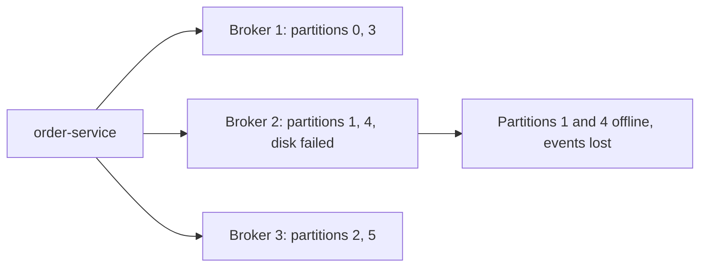
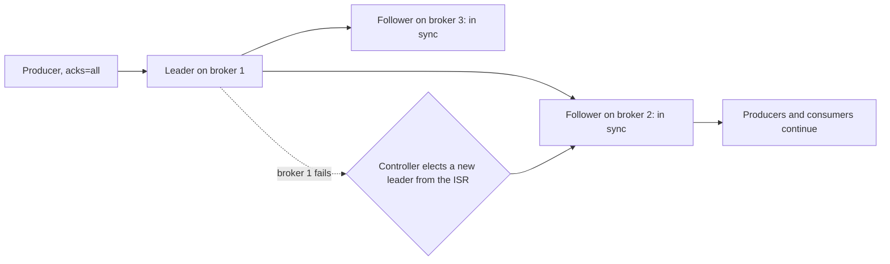

# Brokers, Replication and Leader Election

**Messaging · Kafka · Step 2.2.6 · Fundamentals** · Last updated 2026-10-21
**Prerequisites:** [Producers](03-producers-keys-acks-batching.md) (2.2.3)

## 1. The concept in simple English

**What is it?** Every partition is copied to several **brokers** (Kafka servers). One copy, the **leader**, serves reads and writes; the others, **followers**, copy it. If the leader's broker fails, an up-to-date follower takes over.

**Why do we need it?** Disks and servers fail. Without copies, one failure makes partitions unavailable and can lose data.

**When would I meet it?** When creating topics (replication factor), choosing producer acks, planning availability zones, or reading an incident report about "under-replicated partitions".

> [!TIP]
> **Memory hook:** a head chef and sous-chefs: only a sous-chef who has followed every step may take over.

## 2. Mental model: a kitchen

| In the analogy | In Kafka |
|---|---|
| Head chef taking every order | The partition **leader** |
| Sous-chefs copying every step | **Followers** |
| Sous-chefs who are fully caught up | **In-sync replicas (ISR)** |
| The manager who picks the new head chef | The **controller** |
| Dishes served only once every caught-up sous-chef has the recipe | The **high watermark** |

**Where the analogy breaks:** a kitchen can improvise; Kafka must not. If no caught-up copy is left, Kafka by default **waits** (the partition is unavailable) rather than promote a copy that is missing data.

## 3. Industry terms

| Term | Simple meaning | Why it matters | Example | Related terms |
|---|---|---|---|---|
| **Replication factor** | Copies per partition | Survives broker failures | 3 | ISR |
| **Leader / follower** | Copy that serves / copies that replicate | Failover means a new leader | Leader on broker 1 | Leader election |
| **In-sync replicas (ISR)** | Copies caught up with the leader | Only they can safely take over | 2 of 3 in sync | `replica.lag.time.max.ms` |
| **`min.insync.replicas`** | In-sync copies required for an `acks=all` write | Real durability of `acks=all` | 2 | Acks |
| **High watermark** | Offset that all in-sync replicas have | Consumers never read past it | Offset 1000 | ISR |
| **Unclean leader election** | Letting an out-of-date copy become leader | Restores availability, risks losing data | Off by default | Durability |
| **Controller (KRaft)** | Raft quorum managing metadata and electing leaders | Needs a majority to change metadata | 3 controllers | KRaft |

## 4. In a real system (ShopFlow)

**The business problem.** Orders must keep flowing, and no confirmed order event may be lost, even when a server or a whole availability zone fails.

ShopFlow's first cluster had three brokers but topics with **replication factor 1**. During the sale, a disk failed: every partition stored only on that broker went **offline** and its events were **gone**.



**How replication helps.** With replication factor 3, each partition has copies on three brokers (ideally in three zones). A follower takes over when the leader fails, and producers and consumers switch automatically.

**What it costs.** Three times the storage and replication traffic, and a deliberate choice between availability and durability when too many copies are down.

**Elsewhere:** cloud deployments spread brokers across three availability zones with rack-aware placement, replication factor 3 and `min.insync.replicas=2`, so losing a zone keeps every partition writable; a payments platform keeps unclean leader election off and accepts a short outage over losing a confirmed transaction; a clickstream team may accept weaker settings because a few lost clicks don't matter.

## 5. How it works



1. **What starts it:** a topic is created with a replication factor; each partition gets a leader and followers on different brokers.
2. Producers write to the leader; followers fetch and copy.
3. A follower lagging longer than `replica.lag.time.max.ms` (default 30 s) leaves the ISR and rejoins when caught up.
4. An `acks=all` write succeeds only when at least `min.insync.replicas` copies have it; otherwise the producer gets `NotEnoughReplicasException`.
5. The **high watermark** advances as all in-sync replicas copy data; consumers read up to it. Since Kafka 4.0 (KIP-966) it also **cannot advance while the ISR is smaller than `min.insync.replicas`**, whatever the producer's `acks`: a write the lone leader accepted with `acks=1` stays invisible to consumers until enough replicas are back in sync.
6. **On leader failure:** the controller elects a new leader from the ISR.
7. **If no in-sync copy is left:** the partition waits, unless unclean leader election is enabled (off by default).

**The controller:** since Kafka 4.0, KRaft is the only mode. Controller nodes form a Raft quorum over the metadata log and need a majority: 3 controllers tolerate 1 failure, 5 tolerate 2. If the quorum is lost, metadata changes stop (no topic changes, no leader elections, no ISR changes), while existing leaders keep serving traffic for now. Restore the quorum quickly: if a broker fails in the meantime, nobody can elect replacement leaders.

**Who guarantees what**

| Layer | Responsible for |
|---|---|
| Brokers | Copying data, tracking the ISR, enforcing `min.insync.replicas` for `acks=all` |
| Controller quorum | Electing leaders from the ISR; metadata changes |
| Producer | Asking for `acks=all` (acks `0` or `1` bypass these protections) |
| Application | Handling refused writes (retry later, outbox, alert) |
| Operations | Spreading replicas across racks or zones |

> [!NOTE]
> Untested sketch to show the shape.

```bash
kafka-topics.sh --bootstrap-server localhost:9092 --create --topic orders \
  --partitions 6 --replication-factor 3 --config min.insync.replicas=2
kafka-topics.sh --bootstrap-server localhost:9092 --describe --topic orders   # Leader, Replicas, Isr per partition
```

## 6. Failure scenarios

### One broker fails

- **What happened?** Broker 1 crashed.
- **Why it's fine:** with replication factor 3 and `min.insync.replicas=2`, two in-sync copies remain; a new leader is elected and `acks=all` writes continue.
- **What the business sees:** a brief pause for affected partitions.
- **Trade-off:** none beyond the cost of three copies.

### Two of three brokers are down

- **What happened?** Only one copy of a partition is in sync.
- **Why writes stop:** `acks=all` requires two in-sync copies, so writes are refused with an error.
- **What the business sees:** orders can't be published until a broker returns, unless the application buffers them (outbox).
- **Solutions:** restore brokers; spread replicas across zones so one incident can't take two.
- **Trade-off:** availability is given up deliberately to avoid losing confirmed data.

### No in-sync copy left, and unclean election is on

- **What happened?** The only remaining copy was out of date and became leader.
- **What the business sees:** events that producers had seen confirmed are missing.
- **Solution:** keep unclean leader election off for business data.
- **Trade-off:** longer unavailability while waiting for an in-sync copy to return.

## 7. Architectural decisions

| Choice | Gives | Costs |
|---|---|---|
| Replication factor 1 | Cheapest | Any failure loses data and availability |
| **Factor 3, `min.insync.replicas=2`** | **One broker can fail with no loss and writes continue** | 3× storage and traffic |
| `min.insync.replicas=3` with factor 3 | Strongest durability | Writes stop when any broker is down |
| Unclean leader election on | Stays available when all in-sync copies are gone | Can lose confirmed data |

- Replication within one cluster protects against broker and zone failures, **not** against losing a whole region ([2.2.18](18-multi-cluster-disaster-recovery.md)).
- Run an odd number of controllers, usually 3 or 5.

**Common mistakes:** replication factor 1 in production; `acks=all` with the default `min.insync.replicas=1`; `min.insync.replicas` higher than the replication factor (on Kafka 4.3.2 an `acks=all` write to a 1-replica topic with `min.insync.replicas=2` was accepted, so the setting protected nothing); all replicas in one rack or zone; unclean leader election on business topics; too few controllers, or an even number.

## 8. Check your understanding

1. With replication factor 3 and `min.insync.replicas=2`, what happens to `acks=all` writes when one broker fails? When two fail?
2. Why can't a consumer read an event that only the leader has?
3. A producer uses `acks=1`. Does `min.insync.replicas=2` protect its writes?
4. Your controller quorum has lost its majority. Can orders still be produced?

Answers are at the end of this note.

## 9. Revision

**Remember**
- Leader serves, followers copy, in-sync followers can take over.
- **Factor 3 + `min.insync.replicas=2` + `acks=all`** survives one broker failure with no loss.
- Consumers read only up to the **high watermark**.
- Unclean leader election trades data for availability; keep it off for business data.
- KRaft controllers need a majority.

**Explain in 15 seconds:** "Each partition has a leader and followers on different brokers; in-sync followers take over on failure, and with factor 3, min.insync.replicas 2 and acks=all, one broker can fail with no data loss."

**Explain in 60 seconds:**
> "Kafka replicates each partition to several brokers. The leader serves reads and writes, followers copy it, and those that are caught up form the in-sync replica set. If the leader fails, the KRaft controller quorum elects a new leader from the ISR, so confirmed data isn't lost, and consumers only ever read up to the high watermark that all in-sync replicas have. For business data I use replication factor 3, min.insync.replicas 2 and acks=all across availability zones, and keep unclean leader election off, accepting a short unavailability over data loss. Producers using acks=1 don't get this protection."

**Likely follow-up questions:**
- **Why isn't replication factor 2 enough?** With `min.insync.replicas=2`, one failure stops writes; with a minimum of 1, one failure can lose data.
- **Can consumers still read when writes are refused?** Yes: already committed data can be read from the leader while it is alive.
- **What does the controller do?** Manages cluster metadata and elects partition leaders; in KRaft it is a Raft quorum that needs a majority.

**Architect's takeaway:** replication settings are where you choose durability versus availability, per topic, explicitly.

**Next topic:** [Rebalancing and static membership](07-rebalancing-static-membership.md) (2.2.7)

## 10. Verification and sources

> [!NOTE]
> Checked 2026-10-21 by web search. Re-verify when you revisit this note.

- **Observed (Apache Kafka 4.3.2, three local brokers, replication factor 3, `min.insync.replicas=2`, 2026-10-21):** with all brokers up and with one down, `acks=all` writes succeeded; with two down (ISR of 1) an `acks=all` write failed with `NotEnoughReplicasException`; an `acks=1` write was accepted but was not readable by a consumer until a broker rejoined and the ISR recovered. With a 1-replica topic and `min.insync.replicas=2`, an `acks=all` write succeeded. The high-watermark rule is described in KIP-966 and the Kafka 4.x operations documentation (eligible leader replicas).
- **Confirmed:** `unclean.leader.election.enable` defaults to `false` (since 0.11); `replica.lag.time.max.ms` defaults to 30 s (since 2.5, earlier 10 s); `min.insync.replicas` defaults to 1, and `acks=all` producers get `NotEnoughReplicasException` when the ISR is smaller (Conduktor configuration reference, AxonOps documentation). Consumers read only up to the high watermark, the minimum log-end offset across the ISR. KRaft controllers form a Raft quorum and need a majority; without a leader in the quorum, metadata changes stop while existing partition leaders keep serving (Confluent KRaft documentation and operations guides).
- **Assumptions and illustrations:** the ShopFlow story; commands (not run).
- **Observed (Kafka 4.3.2 broker defaults):** `unclean.leader.election.enable` false, `replica.lag.time.max.ms` 30000, `min.insync.replicas` 1, `default.replication.factor` 1.
- **To verify:** whether the 1-replica case is capped by design in every version (secondary sources disagree; KIP-579 proposes rejecting such configurations); rack-aware placement (`broker.rack`) and preferred-leader rebalancing in your version.
- **Decision rule:** factor 3, `min.insync.replicas=2`, `acks=all`, replicas across zones, unclean election off, 3 or 5 controllers.

**Sources:** Apache Kafka documentation (replication, KRaft); Confluent "KRaft overview"; *Kafka: The Definitive Guide*.

## Answers

1. One broker down: two copies remain in sync, so writes continue. Two down: only one in-sync copy remains, below the minimum of 2, so `acks=all` writes fail with an error.
2. The high watermark only advances when all in-sync replicas have the event, and consumers can't read past it; that prevents reading data that could disappear in a failover.
3. No. `min.insync.replicas` only makes `acks=all` writes fail: with `acks=1` the leader confirms alone, so the write is accepted and could still be lost if that leader fails. On Kafka 4.0 and later the high watermark also can't advance while the ISR is below the minimum, so consumers wouldn't see that write until the ISR recovers (it was accepted, but not yet safe or visible).
4. Yes, as long as partition leaders are alive: existing leaders keep serving produce and fetch traffic. What stops is metadata change, including electing new leaders and recording ISR changes, so the cluster can't adapt to a further failure until the quorum is back.

Back to [the Kafka overview](01-kafka-overview.md) · [Index](../../README.md) · [Roadmap](../../roadmap.md).
