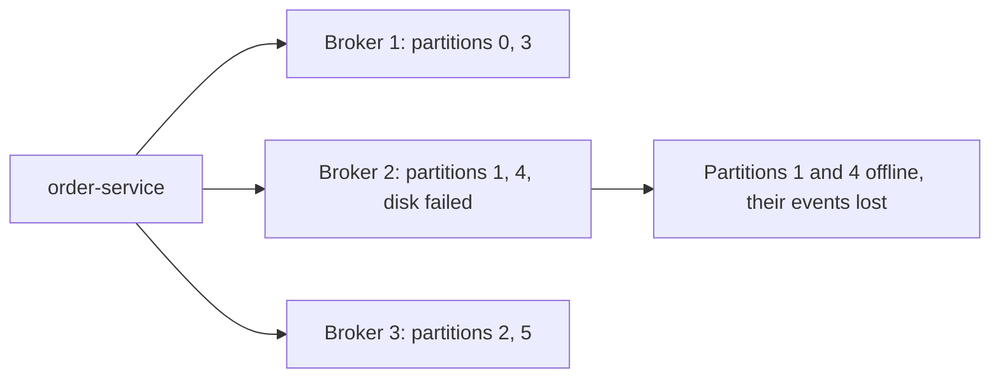
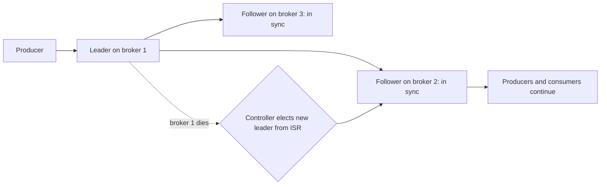

# Brokers, Replication and Leader Election

**Messaging · Kafka · Step 2.2.6 · Fundamentals** · Last updated 2026-10-21

> [!TIP]
> **In one sentence:** every partition is copied to several brokers; one copy is the leader that serves reads and writes, the up-to-date copies form the in-sync replicas, and if the leader dies, one of them takes over.
>
> **Memory hook:** a **head chef and sous-chefs**. The head chef (leader) takes every order; the sous-chefs (followers) copy every step. Only sous-chefs who are fully caught up (in sync) may take over when the head chef walks out, otherwise dishes would be forgotten.

## Where it fits

Step 2.2.6, the last fundamentals note of the [Kafka series](01-kafka-overview.md). It explains *why* the [producer's](03-producers-keys-acks-batching.md) `acks=all` and `min.insync.replicas` protect data, and what consumers can safely read. Next: [rebalancing and static membership](07-rebalancing-static-membership.md) (2.2.7), the start of the intermediate level.

## 1. The story

ShopFlow's first Kafka cluster had three brokers but topics with **one copy** of each partition. During the sale, the disk on broker 2 failed. Every partition stored only on broker 2 went **offline**: `order-service` couldn't publish those orders, and the events already on that disk were **gone**.



## 2. The idea

Keep **several copies (replicas)** of every partition on different brokers. A **replication factor of 3** means three copies. One replica is the **leader**: producers write to it and consumers read from it. The others are **followers** that copy the leader. Followers that are fully caught up form the **in-sync replicas (ISR)**.

If the leader's broker dies, the cluster **elects a new leader from the ISR**, and producers and consumers switch to it automatically. Because only in-sync replicas can become leader, no confirmed event is lost.



Consumers only see events up to the **high watermark**: the point that every in-sync replica has copied. So a consumer never reads an event that could disappear in a failover.

## 3. Key terms

| Term | Plain meaning |
|---|---|
| **Broker** | A Kafka server that stores partitions |
| **Replica** | One copy of a partition |
| **Replication factor** | How many copies each partition has |
| **Leader / follower** | The copy that serves traffic / copies that replicate it |
| **In-sync replicas (ISR)** | Copies fully caught up with the leader |
| **High watermark** | The offset up to which all in-sync replicas have the data; consumers read only up to here |
| **`min.insync.replicas`** | How many in-sync copies an `acks=all` write needs |
| **Unclean leader election** | Letting an out-of-date copy become leader (risks losing data) |
| **Controller (KRaft)** | The component that manages metadata and elects partition leaders |

## 4. How it works, step by step

1. A topic is created with a replication factor, say 3; each partition gets a leader and two followers on different brokers.
2. Producers write to the leader; followers fetch and copy new events.
3. A follower that falls too far behind (longer than `replica.lag.time.max.ms`, default 30 seconds) is **removed from the ISR**; it rejoins when it catches up.
4. An `acks=all` write succeeds only when at least `min.insync.replicas` copies have it; otherwise the producer gets an error (`NotEnoughReplicasException`) instead of a silent risk.
5. The high watermark advances as all in-sync replicas copy the data; consumers read up to it.
6. If a leader's broker fails, the **controller** picks a new leader from the ISR.
7. If *no* in-sync replica is left, Kafka waits (the partition is unavailable) unless **unclean leader election** is enabled, which is off by default because it can lose data.

**Who is the controller?** Since Kafka 4.0, KRaft is the only mode: a small group of controller nodes forms a **Raft quorum** that owns the cluster's metadata log. The quorum needs a majority: 3 controllers tolerate 1 failure, 5 tolerate 2. If the controller quorum is down, metadata changes stop (no new topics, no leader changes), but existing partition leaders keep serving traffic.

## 5. Real-world examples

- **Cloud deployments:** brokers are spread across three availability zones with replication factor 3 and `min.insync.replicas=2`, so losing a whole zone keeps every partition writable and nothing confirmed is lost.
- **Payments:** a bank keeps unclean leader election off and accepts a short outage over any risk of losing a confirmed transaction.
- **Clickstream analytics:** a team that values staying up over perfect completeness may accept weaker settings, because a few lost clicks don't matter.

## 6. Design choices and trade-offs

| Setting choice | Gives | Costs |
|---|---|---|
| Replication factor 1 | Cheapest | Any broker failure loses data and availability |
| **Replication factor 3, `min.insync.replicas=2`** | **Survives one broker failure with no loss and still accepts writes** | 3x storage and replication traffic |
| `min.insync.replicas=3` with factor 3 | Maximum durability | Writes stop when any one broker is down |
| Unclean leader election on | Stays available when all in-sync copies are gone | Can lose confirmed data |

**Availability versus durability:** with factor 3 and minimum 2 in sync, one broker can be down and writes continue; with two down, `acks=all` writes are refused. That refusal is the system choosing **safety over availability**, on purpose.

**Spread copies across failure domains:** put replicas in different racks or availability zones, so one rack or zone failure can't take out all copies.

## 7. Common mistakes

1. **Replication factor 1 in production.** One disk failure loses data.
2. **`acks=all` with `min.insync.replicas=1`** (the default), which can behave like `acks=1`.
3. **Raising `min.insync.replicas` later without checking**, then finding earlier writes were only on one copy.
4. **All replicas in one rack or availability zone.**
5. **Enabling unclean leader election** on business-critical topics.
6. **Too few controllers**, or an even number: 3 or 5 is the usual choice.

## 8. In code

> [!NOTE]
> Untested sketch to show the shape.

```bash
kafka-topics.sh --bootstrap-server localhost:9092 --create --topic orders \
  --partitions 6 --replication-factor 3 --config min.insync.replicas=2

kafka-topics.sh --bootstrap-server localhost:9092 --describe --topic orders
# each partition shows its Leader, its Replicas and its Isr (in-sync replicas)
```

```java
@Bean
NewTopic orders() {
    return TopicBuilder.name("orders").partitions(6).replicas(3)
        .config(TopicConfig.MIN_IN_SYNC_REPLICAS_CONFIG, "2")
        .build();
}
```

| Setting | What it controls |
|---|---|
| Replication factor | Copies per partition |
| `min.insync.replicas` | In-sync copies needed for an `acks=all` write (default 1) |
| `unclean.leader.election.enable` | Whether an out-of-date copy may become leader (default `false`) |
| `replica.lag.time.max.ms` | How long a follower may lag before leaving the ISR (default 30 seconds) |

## 9. Remember

- **Leader serves, followers copy, in-sync followers can take over.**
- **Factor 3 + `min.insync.replicas=2` + `acks=all`** survives one broker failure with no loss.
- **Consumers read only up to the high watermark**, so they never see data that could vanish.
- **Unclean leader election trades data for availability**; keep it off for business data.
- **KRaft controllers need a majority**: 3 tolerate 1 failure, 5 tolerate 2.

## 10. Interview corner

**15-second answer:** "Each partition has a leader and followers on different brokers; in-sync followers can take over when the leader fails, and with replication factor 3, min.insync.replicas 2 and acks=all, one broker can fail with no data loss."

**60-second answer:**
> "Kafka replicates each partition to several brokers. One replica is the leader and serves reads and writes; followers copy it, and the ones that are caught up form the in-sync replica set. If the leader's broker fails, the controller, which in KRaft is a Raft quorum of controller nodes, elects a new leader from the in-sync replicas, so confirmed data isn't lost. Consumers only read up to the high watermark, the point all in-sync replicas have. For business data I use replication factor 3, min.insync.replicas 2 and acks=all, spread across availability zones, and keep unclean leader election off, choosing a brief unavailability over losing data."

**Likely follow-up questions:**
- **What happens if two of three replicas are down?** `acks=all` writes are refused with an error; reads of already-committed data can continue from the leader if it's alive.
- **What is the high watermark?** The offset all in-sync replicas have; consumers can't read past it.
- **What is unclean leader election?** Electing an out-of-date replica when no in-sync one is left; it restores availability but can lose data.
- **How many controllers should you run?** An odd number, usually 3 (tolerates 1 failure) or 5 (tolerates 2).
- **Why isn't replication factor 2 enough?** With `min.insync.replicas=2`, one failure stops writes; with minimum 1, one failure risks loss.

**Architect angle:** "Replication settings are where I make the durability-versus-availability decision explicitly, per topic, and document it."

## 11. Industry check

> [!NOTE]
> Checked 2026-10-21 by web search (Conduktor configuration reference, AxonOps documentation, Confluent KRaft documentation, Kafka issue tracker). Re-verify when you revisit the note.

- **Confirmed:** `unclean.leader.election.enable` defaults to `false` (since Kafka 0.11); `replica.lag.time.max.ms` defaults to 30 seconds (since 2.5, earlier 10 seconds); `min.insync.replicas` defaults to 1, and `acks=all` producers get `NotEnoughReplicasException` when the ISR is smaller. Consumers read only up to the high watermark, the minimum log-end offset across the ISR. KRaft controllers form a Raft quorum over the metadata log; a majority is needed; if the quorum has no leader, metadata changes stop but existing partition leaders keep serving.
- **To verify:** the default `default.replication.factor`; rack-aware replica placement settings (`broker.rack`) and preferred-leader rebalancing for your version.
- **Decision rule:** replication factor 3, `min.insync.replicas=2`, `acks=all`, replicas across availability zones, unclean election off for business data, 3 or 5 controllers.

## 12. Going further

- Apache Kafka documentation: replication and KRaft
- Confluent documentation, "KRaft overview"
- *Kafka: The Definitive Guide* (reliable data delivery)

**Next:** [Rebalancing and static membership](07-rebalancing-static-membership.md) (2.2.7), the first intermediate topic.

Back to [the Kafka overview](01-kafka-overview.md) · [Messaging overview](../01-messaging-overview.md) · [Index](../../README.md) · [Roadmap](../../roadmap.md).
