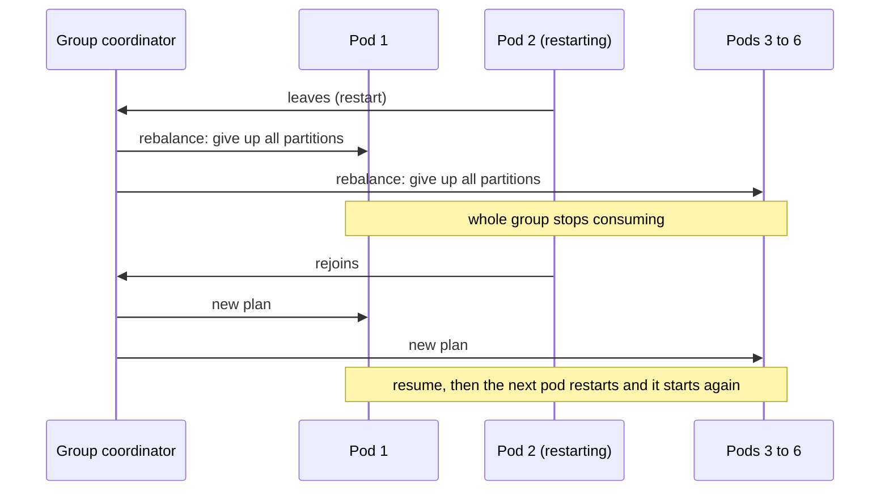
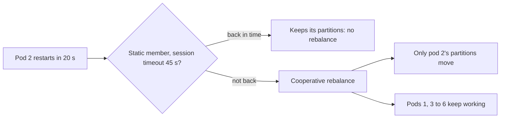

# Rebalancing and Static Membership

**Messaging · Kafka · Step 2.2.7 · Intermediate** · Last updated 2026-10-21

> [!TIP]
> **In one sentence:** a rebalance is the consumer group reshuffling which member owns which partition when members join, leave or fail; cooperative rebalancing and static membership make it rare and short.
>
> **Memory hook:** a **restaurant reassigning tables to waiters**. The old way (eager): every waiter drops all their tables while the manager redraws the whole plan, and no guest is served. The better way (cooperative): only the tables that change hands pause. And a waiter on a short break (static membership) keeps their tables instead of triggering a new plan.

## Where it fits

Step 2.2.7, the first intermediate note of the [Kafka series](01-kafka-overview.md). It goes deeper into what [consumers and consumer groups](04-consumers-consumer-groups.md) (2.2.4) introduced, and uses [offset commits](05-offset-commits-delivery-guarantees.md) (2.2.5) to avoid duplicates during a reshuffle. Next: [error handling, retries and dead-letter topics](08-error-handling-retries-dlt.md) (2.2.8).

## 1. The story

ShopFlow runs 6 `inventory-service` pods. Every deployment restarts them one by one, and **each restart reshuffles the whole group**: all six pods stop, give up every partition, wait for a new plan, and start again. Six restarts, six pauses; lag spikes after every release. On sale day it gets worse: one pod calls a slow warehouse API, misses its poll deadline, is kicked out, rejoins, and triggers yet another reshuffle. The group spends more time rebalancing than working: a **rebalance storm**.



## 2. The idea

Three changes turn the storm into a non-event:

1. **Cooperative (incremental) rebalancing:** members give up **only the partitions that actually move**, over two short rounds, and keep processing all the others.
2. **Static membership:** each pod gets a stable identity (`group.instance.id`). A restarting pod keeps its partitions until its session times out, so a quick restart causes **no rebalance at all**.
3. **A fast poll loop:** slow work no longer exceeds the poll deadline, so healthy pods aren't kicked out.



Kafka 4.0's new consumer group protocol (KIP-848) takes this further: the broker computes assignments and only the moving partitions pause.

## 3. Key terms

| Term | Plain meaning |
|---|---|
| **Rebalance** | Reassigning partitions among the members of a group |
| **Eager rebalancing** | Everyone gives up all partitions first: a "stop the world" pause |
| **Cooperative (incremental) rebalancing** | Only the partitions that move are given up; the rest keep working |
| **Sticky assignment** | Keep partitions with the same member where possible |
| **Static membership** | A member with a fixed `group.instance.id` keeps its partitions through short absences |
| **Rebalance listener** | Callbacks when partitions are revoked, assigned or lost |
| **Rebalance storm** | Rebalances triggering more rebalances, so the group barely works |

## 4. How it works, step by step

**What triggers a rebalance:** a member joins; a member leaves; a member is judged dead (missed heartbeats within the session timeout, or no poll within `max.poll.interval.ms`); the topic's partitions or the subscription change.

**Classic eager rebalance:**
1. Every member gives up all its partitions.
2. The group agrees on a new assignment.
3. Everyone starts again on the new partitions. Nothing is consumed in between.

**Cooperative rebalance:**
1. The new plan is computed; members give up **only** the partitions that must move.
2. A second short round hands those partitions to their new owners.
3. Every partition that didn't move kept processing throughout.

**Rebalance listener callbacks:**
- `onPartitionsRevoked`: partitions are being taken away. **Commit your offsets here**, so the next owner doesn't repeat your work.
- `onPartitionsAssigned`: you got new partitions; load state if needed.
- `onPartitionsLost`: partitions were taken without a clean handover (your session expired). Another member may already own them, so **don't commit** here.

## 5. Real-world examples

- **Kubernetes deployments:** consumers in a StatefulSet use the pod name as `group.instance.id`, so a rolling restart that takes less than the session timeout causes no rebalances.
- **Stream processing with local state:** apps that keep state per partition (such as Kafka Streams) suffer most from reshuffles, because moved partitions must rebuild their state; cooperative and sticky assignment minimise the moves.
- **Autoscaling on lag:** scaling consumers up and down rebalances the group every time; teams add a stabilisation window so the group isn't constantly reshuffled.

## 6. Design choices and trade-offs

| Option | Gives | Costs |
|---|---|---|
| Eager rebalancing | Simple | Whole group pauses on every change |
| **Cooperative rebalancing** | Only moving partitions pause | Two rounds; careful upgrade from very old clients |
| **New protocol (KIP-848, Kafka 4.0+)** | Broker-driven, shorter rebalances | Client support varies by library |
| Dynamic membership | A dead member is replaced quickly | Every restart rebalances |
| **Static membership** | Restarts don't rebalance | A truly dead member's partitions stall until the session timeout expires |

**Static membership tuning:** set the session timeout longer than a normal restart, but short enough that a truly dead pod's partitions don't stall too long. That's a trade-off between fewer rebalances and slower failure detection.

## 7. Common mistakes

1. **Staying on eager rebalancing**, so every deploy pauses the whole group.
2. **Slow work in the poll loop**, causing members to be kicked out and storms.
3. **Not committing offsets in `onPartitionsRevoked`**, so the next owner repeats work.
4. **Committing in `onPartitionsLost`**: the partitions may already belong to someone else.
5. **Static membership with duplicate `group.instance.id`s**, for example two pods with the same ID.
6. **Aggressive autoscaling**, constantly reshuffling the group.

## 8. In code

> [!NOTE]
> Untested sketch to show the shape. Check how your framework derives instance IDs when one pod runs several consumer threads.

```yaml
spring:
  kafka:
    consumer:
      group-id: inventory-service
      properties:
        partition.assignment.strategy: org.apache.kafka.clients.consumer.CooperativeStickyAssignor
        group.instance.id: ${HOSTNAME}        # stable pod name, for example from a StatefulSet
        session.timeout.ms: 60000             # longer than a normal restart
```

```java
consumer.subscribe(List.of("orders"), new ConsumerRebalanceListener() {
    public void onPartitionsRevoked(Collection<TopicPartition> parts) {
        consumer.commitSync(currentOffsetsFor(parts));    // hand over cleanly
    }
    public void onPartitionsAssigned(Collection<TopicPartition> parts) { }
    public void onPartitionsLost(Collection<TopicPartition> parts) {
        // already owned by someone else: do not commit
    }
});
```

| Setting | What it controls |
|---|---|
| `partition.assignment.strategy` | How partitions are assigned (cooperative sticky recommended on the classic protocol) |
| `group.instance.id` | Static membership identity |
| `session.timeout.ms` | How long a silent member keeps its partitions |
| `max.poll.interval.ms` | Max time between polls before a member is judged stuck (default 5 minutes) |
| `group.protocol` | Classic or the new consumer protocol (Kafka 4.0+) |

## 9. Remember

- **Rebalance = reshuffle of partitions when members change.**
- **Eager stops everyone; cooperative pauses only what moves.**
- **Static membership: quick restarts don't rebalance.**
- **Commit in "revoked", never in "lost".**
- **Most storms come from slow poll loops and constant scaling.**

## 10. Interview corner

**15-second answer:** "A rebalance reassigns partitions when group members change; I use cooperative sticky assignment, static membership and a fast poll loop so rebalances are rare and only pause the partitions that move."

**60-second answer:**
> "A consumer group rebalances when a member joins, leaves or is judged dead, or when partitions change. With the old eager protocol every member gives up all its partitions, so the whole group pauses, and rolling deploys cause one pause per pod. I use cooperative sticky assignment, so only partitions that actually move are paused, and static membership with a stable group.instance.id, so a quick restart doesn't trigger a rebalance at all. I commit offsets in onPartitionsRevoked to avoid duplicates, never in onPartitionsLost, and keep the poll loop fast so healthy members aren't kicked out. On Kafka 4.0, the new consumer protocol makes rebalances broker-driven and shorter."

**Likely follow-up questions:**
- **What triggers a rebalance?** Members joining, leaving or missing heartbeats or the poll deadline, and partition or subscription changes.
- **Eager versus cooperative?** Eager revokes everything; cooperative revokes only moving partitions, in two rounds.
- **What's the downside of static membership?** A truly dead member's partitions stall until the session timeout expires.
- **Why not commit in `onPartitionsLost`?** The partitions may already belong to another member, so the commit may fail or overwrite.
- **What causes a rebalance storm?** Slow processing exceeding the poll deadline, frequent restarts, and aggressive autoscaling.

**Architect angle:** "I treat rebalances as an availability concern: cooperative assignment and static membership are platform defaults, and deploy and autoscaling policies are designed around them."

## 11. Industry check

> [!NOTE]
> Checked 2026-10-21 by web search (Apache Kafka Javadoc and KIP pages, Conduktor). Re-verify when you revisit the note.

- **Confirmed:** under eager rebalancing every member gives up all partitions; under cooperative rebalancing (KIP-429, the cooperative sticky assignor, available since Kafka 2.4) only moving partitions are given up, over two rounds; upgrading from 2.3 or earlier needs a specific path. A static member (`group.instance.id`) keeps its slot until the session timeout instead of triggering a rebalance. Javadoc: `onPartitionsLost` may run after others own the partitions, so commits may fail there; Kafka recommends committing in the revoke callback; with cooperative rebalancing, revoke and lost callbacks fire only for non-empty sets. KIP-848 is generally available in Kafka 4.0 (see 2.2.4).
- **To verify:** the default `partition.assignment.strategy` in your client version; the Kafka version that introduced static membership (KIP-345); how your framework sets instance IDs with several consumer threads per pod.
- **Decision rule:** cooperative assignment (or the new protocol), static membership for stable pods, commit on revoke, fast poll loops, calm autoscaling.

## 12. Going further

- Apache Kafka Javadoc: `ConsumerRebalanceListener`
- KIP-429 (incremental cooperative rebalancing), KIP-345 (static membership), KIP-848 (new consumer protocol)
- *Kafka: The Definitive Guide* (consumer groups and rebalancing)

**Next:** [Error handling, retries and dead-letter topics](08-error-handling-retries-dlt.md) (2.2.8).

Back to [the Kafka overview](01-kafka-overview.md) · [Messaging overview](../01-messaging-overview.md) · [Index](../../README.md) · [Roadmap](../../roadmap.md).
