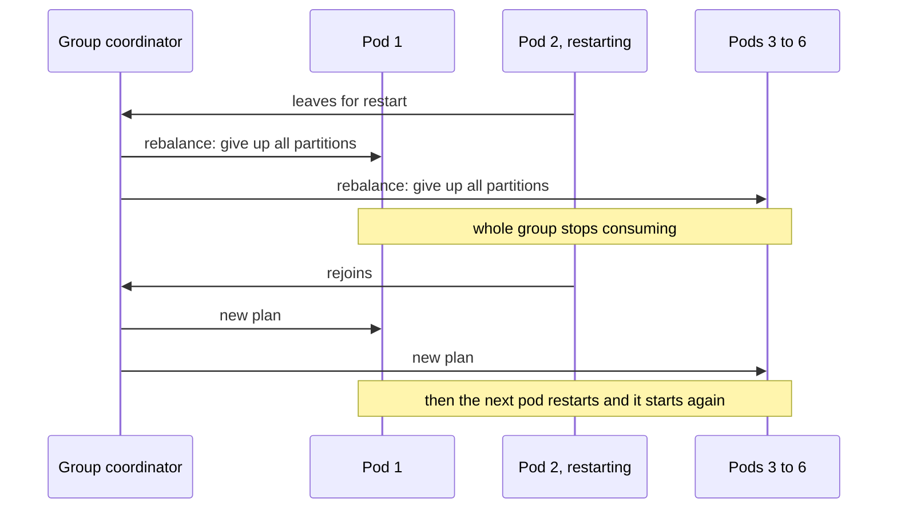
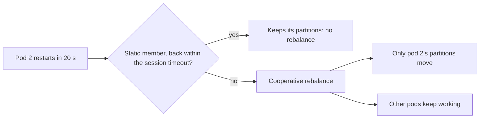

# Rebalancing and Static Membership

**Messaging · Kafka · Step 2.2.7 · Intermediate** · Last updated 2026-10-21
**Prerequisites:** [Consumers and consumer groups](04-consumers-consumer-groups.md) (2.2.4), [Offset commits](05-offset-commits-delivery-guarantees.md) (2.2.5)

## 1. The concept in simple English

**What is it?** A **rebalance** is a consumer group reassigning partitions when members join, leave or are judged dead. **Cooperative rebalancing** and **static membership** make rebalances rarer and shorter.

**Why do we need it?** Reassignment keeps every partition owned, but a careless rebalance pauses the whole group, and frequent ones (during deployments or under slow processing) stall consumption and cause duplicates.

**When would I meet it?** Rolling deployments, autoscaling consumers, or lag spikes that coincide with "rebalance" in the logs.

> [!TIP]
> **Memory hook:** reassigning tables to waiters: the old way stops all service; the better way moves only some tables; a waiter on a short break keeps theirs.

## 2. Mental model: waiters and tables

| In the analogy | In Kafka |
|---|---|
| Waiters | Group **members** |
| Tables | **Partitions** |
| Redrawing the whole plan while nobody serves | **Eager** rebalancing |
| Moving only the tables that must change | **Cooperative** rebalancing |
| A waiter on a short break keeping their tables | **Static membership** |

**Where the analogy breaks:** a waiter on a break who never comes back still holds their tables until the session timeout expires; with static membership, a dead member's partitions **stall** for that time.

## 3. Industry terms

| Term | Simple meaning | Why it matters | Example | Related terms |
|---|---|---|---|---|
| **Rebalance** | Reassigning partitions among members | Pauses work; can cause duplicates | A pod restart | Group coordinator |
| **Eager rebalancing** | Everyone gives up all partitions first | "Stop the world" pause | Classic range assignment | Cooperative |
| **Cooperative (incremental) rebalancing** | Only moving partitions are given up | Most partitions keep working | `CooperativeStickyAssignor` | Sticky assignment |
| **Static membership** | A fixed `group.instance.id` keeps partitions through short absences | Restarts without rebalances | Pod name as ID | Session timeout |
| **Rebalance listener** | Callbacks when partitions are revoked, assigned or lost | Where to commit before handing over | `onPartitionsRevoked` | Offset commits |
| **Rebalance storm** | Rebalances causing more rebalances | The group barely works | Slow poll loop + deploys | `max.poll.interval.ms` |

## 4. In a real system (ShopFlow)

**The business problem.** ShopFlow deploys several times a day, yet stock reservations must not stall during deployments or sale-day spikes.

Six Inventory Service pods restarted one by one in every deployment; each restart reshuffled the whole group, so there were six full pauses per release. On sale day a slow warehouse API made one pod miss its poll deadline, get removed and rejoin, triggering yet more rebalances.



**How the techniques help.** Cooperative rebalancing pauses only the partitions that move; static membership means a quick restart causes no rebalance; a fast poll loop stops healthy pods from being removed.

**What it costs.** With static membership, a truly dead pod's partitions wait for the session timeout; with cooperative rebalancing, a rebalance takes two rounds.

**Elsewhere:** Kubernetes consumers in a StatefulSet use the pod name as `group.instance.id`, so a rolling restart shorter than the session timeout causes no rebalance; stream-processing apps with local state suffer most from reshuffles, because moved partitions must rebuild state ([2.2.14](14-kafka-streams-basics.md)); teams that autoscale on lag add a stabilisation window so the group isn't constantly reshuffled.

## 5. How it works



1. **What starts it:** a member joins, leaves, or misses its heartbeat or poll deadline; or partitions or subscriptions change.
2. **Eager:** all members give up all partitions, a new plan is agreed, everyone restarts on the new partitions.
3. **Cooperative:** members give up only partitions that must move; a second short round assigns them; everything else keeps processing.
4. **Static membership:** a member with a `group.instance.id` that returns within the session timeout keeps its partitions without a rebalance.
5. **Listener callbacks:** `onPartitionsRevoked` (commit your offsets so the next owner doesn't repeat work), `onPartitionsAssigned` (prepare), `onPartitionsLost` (partitions taken without a clean handover; **don't commit**, another member may own them).
6. **Who commits on revoke:** in Spring Kafka the listener container commits pending offsets itself when partitions are revoked; with the plain Java client, your rebalance listener must do it.

**Kafka 4.0:** with the new consumer group protocol (KIP-848), the broker computes assignments and only moving partitions pause.

> [!NOTE]
> Untested sketch to show the shape. Check how your framework derives instance IDs when one pod runs several consumers.

```yaml
spring:
  kafka:
    consumer:
      group-id: inventory-service
      properties:
        partition.assignment.strategy: org.apache.kafka.clients.consumer.CooperativeStickyAssignor
        group.instance.id: ${HOSTNAME}     # stable pod name, for example from a StatefulSet
        session.timeout.ms: 60000          # longer than a normal restart
```

## 6. Failure scenarios

### Rolling deployments cause repeated pauses

- **What happened?** Every pod restart triggered an eager rebalance of the whole group.
- **What the business sees:** lag spikes after every release; delayed stock reservations.
- **Solutions:** cooperative sticky assignment (or the new protocol); static membership.
- **Trade-offs:** static membership delays detection of truly dead pods.

### Slow processing causes a rebalance storm

- **What happened?** A blocking call exceeded `max.poll.interval.ms`; the member was removed, rejoined, and the cycle repeated.
- **What the business sees:** the group spends more time rebalancing than processing; duplicates after each reassignment.
- **Solutions:** timeouts on calls, smaller batches, faster processing.
- **Trade-offs:** slightly lower throughput per poll.

### Committing after partitions were lost

- **What happened?** A member's session expired; it tried to commit in `onPartitionsLost`.
- **Why it's wrong:** another member may already own and be processing those partitions.
- **Solution:** commit in `onPartitionsRevoked`, never in `onPartitionsLost`.

## 7. Architectural decisions

| Option | Gives | Costs |
|---|---|---|
| Eager rebalancing | Simple | Whole group pauses on every change |
| **Cooperative rebalancing** | Only moving partitions pause | Two rounds; careful upgrade from very old clients |
| **New protocol (KIP-848, Kafka 4.0+)** | Broker-driven, shorter rebalances | Client support varies |
| **Static membership** | Restarts don't rebalance | Dead members' partitions stall until the session timeout |

Set the session timeout longer than a normal restart but short enough that a dead pod's partitions don't stall too long. Calm autoscaling (stabilisation windows) avoids constant reshuffles.

**Common mistakes:** staying on eager rebalancing; slow work in the poll loop; not committing on revoke with the plain client; committing in `onPartitionsLost`; two pods with the same `group.instance.id`; aggressive autoscaling.

## 8. Try it yourself

> [!NOTE]
> Status: run on Apache Kafka 4.3.2 (single-node KRaft broker, official binary, macOS) on 2026-10-21; the results below are from that run. Needs the `orders` topic from [2.2.2](02-log-topics-partitions-offsets.md). This run used the classic group protocol and the default timeouts.

**Predict first:** two consumers share three partitions. You stop one. How long until its partitions move, and what does the other consumer do meanwhile?

```bash
kafka-console-consumer.sh --bootstrap-server localhost:9092 --topic orders --group rebalance-demo   # two terminals
kafka-consumer-groups.sh --bootstrap-server localhost:9092 --describe --group rebalance-demo --members --verbose
```

**Observe:** the assignment per member before and after you stop one consumer. In the example run, one consumer owned partitions 0 and 1 and the other partition 2. **Break it:** kill a consumer with `kill -9` instead of Ctrl+C and compare how long reassignment takes. In the example run the dead member was still listed for about 45 seconds (the session timeout), and then the survivor owned all three partitions; a consumer that shuts down cleanly sends a leave-group request instead (not timed in this run), so its partitions move much sooner. **Clean up:** stop the consumers.

## 9. Check your understanding

1. What triggers a rebalance?
2. A pod with static membership crashes and never returns. What happens to its partitions?
3. Why commit offsets in `onPartitionsRevoked`?
4. Lag spikes after every deployment of a six-pod service. Name two changes that would help.

Answers are at the end of this note.

## 10. Revision

**Remember**
- Rebalance = reassignment of partitions when members change.
- **Eager stops everyone; cooperative pauses only what moves.**
- **Static membership: quick restarts don't rebalance.**
- **Commit in "revoked", never in "lost".**
- Most storms come from slow poll loops and constant scaling.

**Explain in 15 seconds:** "A rebalance reassigns partitions when group members change; cooperative assignment, static membership and a fast poll loop make rebalances rare and partial."

**Explain in 60 seconds:**
> "A consumer group rebalances when members join, leave or miss their deadlines. With eager rebalancing every member gives up everything, so the group pauses, and rolling deploys cause one pause per pod. I use cooperative sticky assignment so only moving partitions pause, and static membership with a stable instance ID so a quick restart doesn't rebalance at all, accepting that a truly dead pod's partitions wait for the session timeout. I commit offsets in onPartitionsRevoked and never in onPartitionsLost, keep the poll loop fast, and on Kafka 4.0 consider the new broker-driven protocol."

**Likely follow-up questions:**
- **Eager versus cooperative?** Eager revokes everything; cooperative revokes only partitions that move, in two rounds.
- **What causes a rebalance storm?** Processing that exceeds the poll deadline, frequent restarts and aggressive autoscaling.
- **What if two consumers share a `group.instance.id`?** The newer one fences the older one, which then fails; instance IDs must be unique per consumer.

**Architect's takeaway:** treat rebalances as an availability concern; deployment and autoscaling policies should be designed around them.

**Next topic:** [Error handling, retries and dead-letter topics](08-error-handling-retries-dlt.md) (2.2.8)

## 11. Verification and sources

> [!NOTE]
> Checked 2026-10-21 by web search. Re-verify when you revisit this note.

- **Confirmed:** under eager rebalancing all partitions are given up; cooperative rebalancing (KIP-429, the cooperative sticky assignor, since Kafka 2.4) gives up only moving partitions over two rounds; upgrades from 2.3 or earlier need a specific path. A static member (`group.instance.id`) keeps its slot until the session timeout instead of triggering a rebalance. Javadoc: `onPartitionsLost` may run after others own the partitions, so commits may fail there; Kafka recommends committing in the revoke callback; with cooperative rebalancing, revoke and lost callbacks fire only for non-empty sets. KIP-848 is generally available in Kafka 4.0. Spring Kafka's container commits pending offsets during revocation; its `onPartitionsRevokedAfterCommit` hook runs after that commit (Spring for Apache Kafka reference, rebalance listeners).
- **Assumptions and illustrations:** the ShopFlow story; configuration and commands (not run).
- **To verify:** the default `partition.assignment.strategy` in your client version; whether static membership (KIP-345) arrived in Kafka 2.3 or 2.4 (sources disagree); console tool options.
- **Decision rule:** cooperative assignment (or the new protocol), static membership for stable pods, commit on revoke, fast poll loops, calm autoscaling.

**Sources:** Apache Kafka `ConsumerRebalanceListener` Javadoc; KIP-429, KIP-345, KIP-848; *Kafka: The Definitive Guide*.

## Answers

1. A member joining or leaving; a member missing heartbeats within the session timeout or not polling within `max.poll.interval.ms`; and changes to the topic's partitions or the group's subscription.
2. Its partitions stay assigned to it, unprocessed, until the session timeout expires; then the group rebalances and others take them over.
3. So the next owner starts after the work you have finished, instead of repeating it.
4. Cooperative sticky assignment (or the new protocol), and static membership with a session timeout longer than a normal restart; also check that processing stays well within the poll deadline.

Back to [the Kafka overview](01-kafka-overview.md) · [Index](../../README.md) · [Roadmap](../../roadmap.md).
