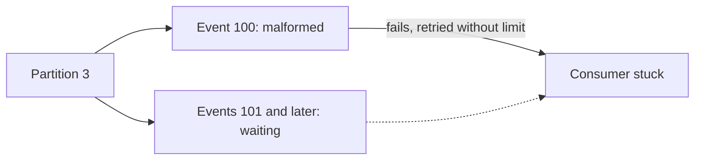
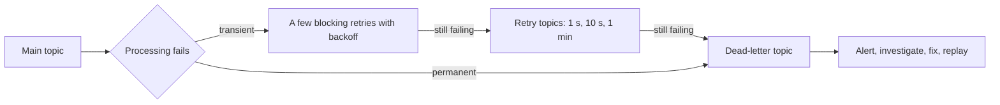

# Error Handling, Retries and Dead-Letter Topics

**Messaging · Kafka · Step 2.2.8 · Intermediate** · Last updated 2026-10-21
**Prerequisites:** [Offset commits](05-offset-commits-delivery-guarantees.md) (2.2.5), [Retries, backoff and jitter](../../01-resilience/03-retries-backoff-jitter.md) (1.3)

## 1. The concept in simple English

**What is it?** A plan for events a consumer can't process: **retry** those that may succeed later, and move those that never will to a **dead-letter topic (DLT)**, so the rest keep flowing.

**Why do we need it?** A partition is processed in order. One event that always fails, retried forever, blocks every event behind it.

**When would I meet it?** Malformed data from a partner, a validation bug, a downstream database outage, or a schema change consumers can't read.

> [!TIP]
> **Memory hook:** a sorting line with an "undeliverable" shelf: try a smudged label once or twice, then shelve it and keep the belt moving.

## 2. Mental model: a parcel sorting line

| In the analogy | In Kafka |
|---|---|
| A parcel with a smudged label | A **poison message** |
| Trying again in a moment | **Blocking retry** |
| Putting the parcel on a later belt | **Retry topic** (non-blocking retry) |
| The undeliverable shelf | **Dead-letter topic** |
| Someone checking the shelf every morning | DLT **alerting and ownership** |

**Where the analogy breaks:** parcels on a later belt don't care about order, but events do: moving one event aside lets later events for the same order overtake it.

## 3. Industry terms

| Term | Simple meaning | Why it matters | Example | Related terms |
|---|---|---|---|---|
| **Transient error** | May succeed if retried | Worth retrying with backoff | Database timeout | Retry |
| **Permanent error** | Will never succeed | Retrying wastes time and blocks | Invalid product code | Poison message |
| **Poison message** | An event that always fails | Can block a partition | Malformed JSON | DLT |
| **Blocking retry** | Retry in place; the partition waits | Keeps order, delays everything behind | 3 quick attempts | Backoff |
| **Retry topic** | Delayed retry on a separate topic | Main topic keeps flowing; may reorder | Retry after 1 s, 10 s, 1 min | Non-blocking retry |
| **Dead-letter topic (DLT)** | Where unprocessable events are parked with error details | Keeps the flow moving; needs an owner | `payments` DLT | Dead-letter queue (DLQ) |
| **Recoverer** | What runs after the last retry | Usually "publish to the DLT" | Spring `DeadLetterPublishingRecoverer` | Error handler |

## 4. In a real system (ShopFlow)

**The business problem.** Orders from a partner integration must be reserved quickly; one bad event must not delay everyone else's orders.

A partner sent `OrderPlaced` with a malformed product code. The Inventory Service's own retry loop retried it with no limit; every event behind it in that partition waited, lag climbed into the thousands, and real orders weren't reserved.



**How the plan helps.** Classify errors: retry transient ones with backoff, send permanent ones to the DLT at once, alert, and keep the partition moving.

**What it costs.** Events in the DLT need an owner and a replay path; retry topics can reorder events; and replays mean consumers must be idempotent.

**Elsewhere:** a payments platform sends events to retry topics with growing delays while a card network is down, and only after hours to the DLT; partner integrations send invalid supplier data straight to the DLT and alert the integration team; an analytics pipeline dead-letters records it can't deserialize after a bad schema release, keeps running, and replays them after the fix.

## 5. How it works



1. **What starts it:** the listener throws an exception.
2. **Classify:** permanent errors (validation, deserialization) skip retries; transient ones are retried.
3. **Blocking retries:** a few attempts in place with backoff; the partition's later events wait, and order is kept.
4. **Non-blocking retries (optional):** the event is published to a retry topic with a "not before" time; later events in the main topic continue.
5. **Dead-letter:** after the last attempt, the event is published to the DLT with headers (original topic, partition, offset, exception), and its offset is committed so the partition moves on. By default Spring writes to the **same partition number** in the DLT, so create the DLT with at least as many partitions as the original topic, and set its name explicitly: the default suffix changed between Spring Kafka versions.
6. **Operate the DLT:** alert, fix, replay.

**A DLT entry is not a success.** Dead-lettering commits the offset so the partition can move on, but the business operation for that event did **not** happen (no stock reserved, no email sent). Later events for the same key are processed meanwhile, and a replay arrives after them, so order for that key is no longer guaranteed. If a later event depends on the parked one, handle that case (version numbers, parking the key's later events too) or accept the gap.

**Deserialization errors** happen before your code runs. Spring's `ErrorHandlingDeserializer` delivers the failure to the error handler, where it is treated as fatal (no retries) and can be dead-lettered.

**If you configure nothing:** Spring's `DefaultErrorHandler` tries a failing record 10 times with no delay, then only logs it and moves on. There is no back-off and no DLT, so the event is effectively dropped. Always configure the error handler.

**Who guarantees what**

| Layer | Responsible for |
|---|---|
| Kafka broker | Storing the main, retry and dead-letter topics; no error handling of its own |
| Spring Kafka | Retries (`DefaultErrorHandler`, back-off), retry topics (`@RetryableTopic`), DLT publishing |
| Application | Classifying errors, idempotent processing, DLT ownership and replay |
| External systems | Whatever failed: their availability decides whether an error is transient |

> [!NOTE]
> Untested sketch to show the shape. Defaults (back-off, DLT naming) vary by Spring Kafka version; set them explicitly.

```java
@Bean
DefaultErrorHandler errorHandler(KafkaTemplate<Object, Object> template) {
    var recoverer = new DeadLetterPublishingRecoverer(template);   // publish failures to a DLT
    var backOff = new ExponentialBackOff(500, 2.0);
    backOff.setMaxElapsedTime(5_000);                               // a few quick blocking retries
    var handler = new DefaultErrorHandler(recoverer, backOff);
    handler.addNotRetryableExceptions(ValidationException.class);   // permanent: straight to the DLT
    return handler;
}
```

## 6. Failure scenarios

### A poison message blocks a partition

- **What happened?** The story above.
- **Why?** Unlimited retries of a permanent error; later events can't pass in an ordered partition.
- **What the business sees:** orders in that partition aren't processed.
- **Solutions:** classify the error as non-retryable; dead-letter it with context; alert.
- **Trade-offs:** the order now needs manual handling or a replay after a fix.

### Retry topics reorder business events

- **What happened?** `OrderPlaced` 42 failed and went to a retry topic; `OrderCancelled` 42 succeeded first.
- **Why?** Non-blocking retries let later events in the main topic overtake the one moved aside.
- **What the business sees:** stock handled in the wrong order.
- **Solutions:** blocking retries for ordered flows; or park all of a key's later events too; or make handlers tolerate out-of-order events (version numbers).
- **Trade-offs:** blocking retries delay the partition; parking per key is complex.

### A dependency outage floods the DLT

- **What happened?** The inventory database was down for an hour; every event exhausted its retries and went to the DLT.
- **Why?** The failure wasn't the events' fault.
- **What the business sees:** thousands of good events parked, needing replay.
- **Solutions:** pause the listener container while the dependency is down (for example when a [circuit breaker](../../01-resilience/05-circuit-breaker.md) opens) and resume when it recovers.
- **Trade-offs:** lag grows during the pause, but nothing is lost.

## 7. Architectural decisions

| Approach | Keeps order? | Blocks the partition? | Use for |
|---|---|---|---|
| Blocking retries (few, short) | Yes | Yes, briefly | Short blips; ordered flows |
| Retry topics | No | No | Longer transient failures where order doesn't matter |
| Straight to DLT | The rest keep flowing, but order for that key is broken once the parked event is replayed | No | Permanent errors |
| Pause consumption | Yes | Yes, deliberately | Dependency outages |

Spring's retry topics are not supported with batch listeners or container transactions.

**Common mistakes:** treating a DLT entry as handled (the work wasn't done, and replays can arrive out of order); retrying permanent errors forever; a DLT nobody watches (silent data loss); treating a dependency outage as poison; retrying without idempotency; non-blocking retries where order matters; DLT records without context headers; retrying deserialization errors.

## 8. Check your understanding

1. Why does one failing event block others in Kafka, but not necessarily in a queue broker with many consumers?
2. A payment event fails because the card network is down. Transient or permanent, and what should happen?
3. After introducing retry topics, cancellations are sometimes processed before their orders. Why?
4. What should happen to events in a DLT, and who should own that?

Answers are at the end of this note.

## 9. Revision

**Remember**
- **Transient: retry with backoff. Permanent: dead-letter at once.**
- Never let one poison message block a partition.
- **Retry topics keep the flow moving but can reorder** events for a key.
- **A dependency outage is not poison**: pause, don't dead-letter.
- A DLT needs alerts, an owner and a replay path; replays need idempotent consumers.

**Explain in 15 seconds:** "I classify consumer errors: transient ones get retries with backoff, permanent ones go straight to a dead-letter topic with alerts, so one bad event never blocks a partition."

**Explain in 60 seconds:**
> "Because a partition is processed in order, an event that always fails can block everything behind it. Transient failures get a few blocking retries with backoff, which keep order, and if they last longer, retry topics with growing delays, accepting that later events can overtake. Permanent failures, like validation or deserialization errors, go straight to a dead-letter topic with the original topic, offset and error in headers, and someone owns and replays it after a fix, which is why consumers must be idempotent. If a dependency is down, I pause consumption rather than dead-letter good events."

**Likely follow-up questions:**
- **Blocking versus non-blocking retries?** Blocking keeps order but holds the partition; retry topics keep it flowing but can reorder.
- **How do you handle deserialization errors?** Wrap the deserializer (`ErrorHandlingDeserializer`) so the bad record reaches the error handler and can be dead-lettered.
- **What does Spring do if you configure nothing?** Ten immediate attempts, then it logs the record and moves on, without a DLT.

**Architect's takeaway:** define the error policy per topic: which errors are transient, whether order matters, the retry schedule, and who owns the DLT and its replay.

**Next topic:** [Idempotent producer and transactions](09-idempotent-producer-transactions.md) (2.2.9)

## 10. Verification and sources

> [!NOTE]
> Checked 2026-10-21 by web search. Re-verify when you revisit this note.

- **Confirmed:** Spring Kafka offers non-blocking retries with `@RetryableTopic` (since 2.7; on class-level listeners since 3.2); they are not supported with batch listeners or container transactions; blocking and non-blocking retries can be combined (since 2.8.4); a retry-topic consumer pauses the partition until a record's delay is due. `ErrorHandlingDeserializer` lets deserialization failures reach the error handler, and `DeserializationException` is treated as fatal. If a schema registry is unreachable, every record can fail deserialization: an outage, not poison (Spring for Apache Kafka reference; Conduktor).
- **Assumptions and illustrations:** the ShopFlow stories; code (not run).
- **Also confirmed:** without configuration, `DefaultErrorHandler` uses `FixedBackOff(0, 9)` (10 attempts, no delay) and then logs the record (Spring for Apache Kafka reference, handling exceptions).
- **Also confirmed:** `DeadLetterPublishingRecoverer`'s default destination is the original topic plus a suffix (`.DLT` in older releases, `-dlt` in Spring Kafka 4.x) and the same partition, so the DLT needs at least as many partitions (Spring Kafka API documentation).
- **To verify:** the exact release in which the default suffix changed.
- **Decision rule:** classify errors; brief blocking retries; retry topics only where order doesn't matter; immediate DLT for permanent errors; pause on dependency outages; an owned DLT with replay.

**Sources:** Spring for Apache Kafka reference (error handling, non-blocking retries); *Enterprise Integration Patterns* ("Dead Letter Channel"); Conduktor, "Dead Letter Topics: Handling Poison Pills".

## Answers

1. A Kafka partition is read in order by one consumer, so the failing event must be resolved before the next one is processed. In a queue with many competing consumers, other consumers keep taking other messages (unless strict ordering is configured).
2. Transient. Retry with backoff; if the outage lasts, use retry topics with growing delays or pause consumption, and only dead-letter after a long period, with alerts.
3. A failed `OrderPlaced` moved to a retry topic while later events, including its `OrderCancelled`, continued on the main topic, so the cancellation overtook it.
4. Alert on new entries, investigate the cause, fix it, then replay the events into the main flow. The team that owns the consuming service should own its DLT.

Back to [the Kafka overview](01-kafka-overview.md) · [Index](../../README.md) · [Roadmap](../../roadmap.md).
