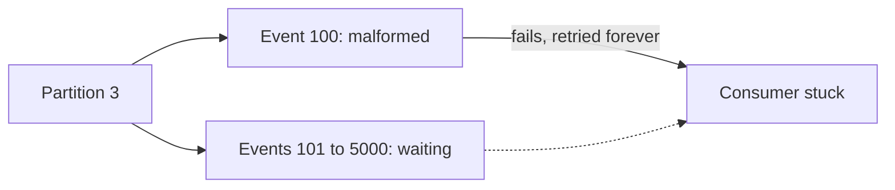
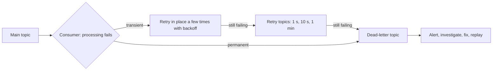

# Error Handling, Retries and Dead-Letter Topics

**Messaging · Kafka · Step 2.2.8 · Intermediate** · Last updated 2026-10-21

> [!TIP]
> **In one sentence:** when a consumer can't process an event, retry it if the failure is temporary, and move it aside to a dead-letter topic if it never will succeed, so one bad event can't block everything behind it.
>
> **Memory hook:** a **post office sorting line**. A parcel with a smudged label gets one or two more tries; if it still can't be read, it goes to the **"undeliverable" shelf** to be checked by a person, and the belt keeps moving. Nobody stops the whole line for one parcel.

## Where it fits

Step 2.2.8 of the [Kafka series](01-kafka-overview.md). It applies the resilience ideas of [retries with backoff](../../01-resilience/03-retries-backoff-jitter.md), [idempotency](../../01-resilience/04-idempotency.md) and the [circuit breaker](../../01-resilience/05-circuit-breaker.md) to consumers, and depends on [offset commits](05-offset-commits-delivery-guarantees.md) (2.2.5). Next: the [idempotent producer and transactions](09-idempotent-producer-transactions.md) (2.2.9).

## 1. The story

A partner integration sends ShopFlow an `OrderPlaced` event with a malformed product code. `inventory-service` throws an exception, and the consumer keeps retrying the same event. Because a partition is read in order, **every event behind it waits**. Lag on that partition climbs into the thousands, and real orders aren't reserved. The bad event is a **poison message**: no number of retries will ever fix it.



## 2. The idea

**Sort failures into two kinds**, and treat them differently:

- **Transient** (the warehouse API timed out, the database was briefly down): **retry**, with backoff, because a later attempt can succeed.
- **Permanent** (malformed data, a validation error, a deserialization failure): **don't retry**. Send the event straight to a **dead-letter topic (DLT)** with the error details, alert, and keep the partition moving.

Transient failures that last longer are moved to **retry topics** with growing delays (non-blocking retries), so they don't hold up the main topic either.



## 3. Key terms

| Term | Plain meaning |
|---|---|
| **Poison message (pill)** | An event that will always fail, whatever you do |
| **Transient error** | Temporary; may succeed on retry |
| **Permanent error** | Will never succeed (bad data, validation) |
| **Blocking retry** | Retrying in place; the partition waits meanwhile |
| **Non-blocking retry** | Moving the event to a retry topic with a delay, so the main topic keeps flowing |
| **Dead-letter topic (DLT)** | Where events that can't be processed are parked, with error details |
| **Recoverer** | What happens after the last retry (for example, publish to the DLT) |
| **Replay (redrive)** | Sending events from the DLT back for processing after a fix |

## 4. How it works, step by step

1. **The handler throws.** The framework's error handler decides what to do.
2. **Classify the exception.** Permanent ones (validation, deserialization) skip retries; transient ones are retried.
3. **Blocking retries:** a few quick attempts in place, with backoff, for short blips.
4. **Non-blocking retries (optional):** publish the event to a retry topic with a "not before" time; a retry consumer waits until then and tries again, through one or more retry topics.
5. **Dead-letter:** after the last attempt, publish the event to the DLT with headers such as original topic, partition, offset and exception, and commit the original offset so the partition moves on.
6. **Operate the DLT:** alert on new entries, investigate, fix the cause, and replay the events. The consumer must be [idempotent](../../01-resilience/04-idempotency.md), because replays and retries repeat work.

**Deserialization errors** happen before your code runs. Wrap the real deserializer in Spring's `ErrorHandlingDeserializer`, so a bad record arrives with the error attached and can go straight to the DLT instead of failing the whole poll.

## 5. Real-world examples

- **Payments:** when a card network is down, payment events go to retry topics with increasing delays instead of blocking all payments; after several hours they land in the DLT for manual handling.
- **Partner integrations:** events with invalid data from a supplier go straight to the DLT, and an alert tells the integration team to contact that supplier.
- **Analytics pipelines:** after a producer ships an incompatible schema, records that can't be deserialized go to the DLT, the pipeline keeps running, and the records are replayed once the schema is fixed.

## 6. Design choices and trade-offs

| Approach | Keeps order? | Blocks the partition? | Use for |
|---|---|---|---|
| **Blocking retries** (a few, short backoff) | Yes | Yes, briefly | Short blips, or when order must be kept |
| **Non-blocking retry topics** | **No**: later events for the same key can be processed first | No | Longer transient failures where order doesn't matter |
| **Straight to DLT** | Yes for the rest | No | Permanent errors, poison messages |

**When order matters** (all events for one order must be applied in sequence), moving one event aside lets later ones overtake it. Prefer blocking retries, or park the whole key's events, or pause the consumer.

**When a dependency is down** (not the event's fault), sending every event to the DLT would empty the whole topic into it. Better: a [circuit breaker](../../01-resilience/05-circuit-breaker.md) that **pauses consumption** until the dependency recovers.

## 7. Common mistakes

1. **Retrying permanent errors forever**, blocking the partition (the story).
2. **Sending to a DLT nobody watches**: that's just silent data loss.
3. **Treating a dependency outage as poison**, flooding the DLT with good events.
4. **Retrying without idempotency**, so retries and replays double the effect.
5. **Non-blocking retries where order matters.**
6. **No context on DLT records** (original topic, offset, error), making investigation hard.
7. **Retrying deserialization errors**, which can never succeed.

## 8. In code

> [!NOTE]
> Untested sketch to show the shape. Defaults (back-off, DLT naming) vary by Spring Kafka version; set them explicitly.

```java
@Bean
DefaultErrorHandler errorHandler(KafkaTemplate<Object, Object> template) {
    var recoverer = new DeadLetterPublishingRecoverer(template);   // publishes to a dead-letter topic
    var backOff = new ExponentialBackOff(500, 2.0);
    backOff.setMaxElapsedTime(5_000);                               // a few quick blocking retries
    var handler = new DefaultErrorHandler(recoverer, backOff);
    handler.addNotRetryableExceptions(ValidationException.class);   // permanent: straight to DLT
    return handler;
}
```

```java
@RetryableTopic(attempts = "4", backoff = @Backoff(delay = 1000, multiplier = 2.0))
@KafkaListener(topics = "payments", groupId = "payment-service")
public void onPayment(PaymentEvent event) { gateway.charge(event); }

@DltHandler
public void onDeadLetter(PaymentEvent event) { alerts.raise("payment parked in DLT", event); }
```

| Setting | What it controls |
|---|---|
| Back-off (fixed or exponential) | How many blocking retries, and the waits |
| Not-retryable exceptions | Which errors skip retries |
| `@RetryableTopic` attempts and back-off | Non-blocking retry topics and their delays |
| `ErrorHandlingDeserializer` | Turns deserialization failures into records you can dead-letter |

## 9. Remember

- **Transient: retry with backoff. Permanent: dead-letter at once.**
- **Never let one poison message block a partition.**
- **Retry topics keep flowing but break per-key order.**
- **A dependency outage is not poison**: pause, don't dead-letter.
- **A DLT needs alerts, an owner and a replay path.**

## 10. Interview corner

**15-second answer:** "I classify consumer errors: transient ones are retried with backoff, in place or through retry topics, and permanent ones go straight to a dead-letter topic with alerts, so one bad message never blocks a partition."

**60-second answer:**
> "Because a partition is processed in order, a message that always fails can block everything behind it. So I classify errors. Transient failures, like a timeout, get a few blocking retries with backoff, and if they last longer, non-blocking retry topics with increasing delays, accepting that this can reorder events for a key. Permanent failures, like validation or deserialization errors, go straight to a dead-letter topic with the original topic, offset and exception in headers. The DLT is alerted on and owned, and events are replayed after a fix, which is why consumers must be idempotent. If a dependency is down, I pause consumption with a circuit breaker instead of dead-lettering good events."

**Likely follow-up questions:**
- **Blocking versus non-blocking retries?** Blocking keeps order but holds the partition; retry topics keep it flowing but can reorder.
- **What is a poison message?** One that will always fail; it must be moved aside, not retried forever.
- **What do you do with the DLT?** Alert, investigate, fix the cause, then replay with an idempotent consumer.
- **How do you handle deserialization errors?** Wrap the deserializer so the bad record can be dead-lettered instead of failing the poll.
- **What if the downstream database is down for an hour?** Pause consumption (circuit breaker), don't dead-letter every event.

**Architect angle:** "I define the error policy per topic: which errors are transient, whether order matters, the retry schedule, and who owns the DLT and its replay."

## 11. Industry check

> [!NOTE]
> Checked 2026-10-21 by web search (Spring for Apache Kafka reference, Conduktor, community articles). Re-verify when you revisit the note.

- **Confirmed:** Spring Kafka offers `@RetryableTopic` for non-blocking retries (since 2.7; on class-level listeners since 3.2); non-blocking retries are not supported with batch listeners or container transactions; blocking and non-blocking retries can be combined (since 2.8.4); a retry-topic consumer pauses the partition until a record's back-off time is due. A back-off such as `FixedBackOff(0, 2)` gives three attempts. `ErrorHandlingDeserializer` lets a deserialization failure reach the error handler, and `DeserializationException` is treated as fatal (not retried). If a schema registry is unreachable, every record can fail deserialization, so check for that before treating failures as poison.
- **To verify:** the `DefaultErrorHandler` default back-off and the default dead-letter topic name in your Spring Kafka version; the exact ordering behaviour of retry topics in your setup.
- **Decision rule:** classify errors; brief blocking retries; retry topics only where order doesn't matter; immediate DLT for permanent errors; pause on dependency outages; an owned DLT with replay.

## 12. Going further

- Spring for Apache Kafka reference: error handling, and non-blocking retries ("retry topics")
- Gregor Hohpe and Bobby Woolf, *Enterprise Integration Patterns* ("Dead Letter Channel")
- Conduktor, "Dead Letter Topics: Handling Poison Pills"

**Next:** [The idempotent producer and transactions (exactly-once)](09-idempotent-producer-transactions.md) (2.2.9).

Back to [the Kafka overview](01-kafka-overview.md) · [Messaging overview](../01-messaging-overview.md) · [Index](../../README.md) · [Roadmap](../../roadmap.md).
