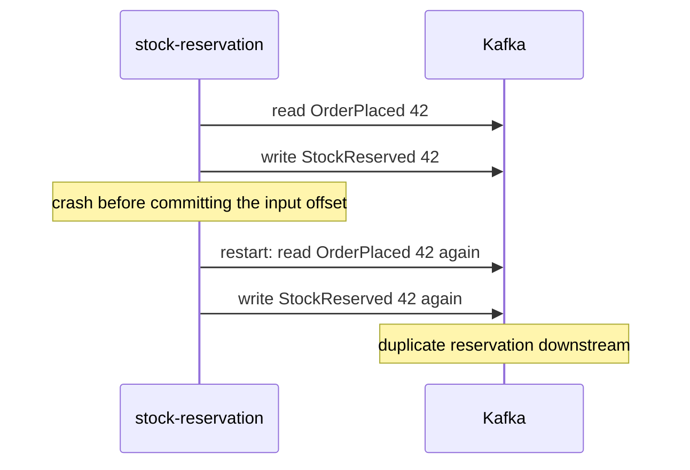
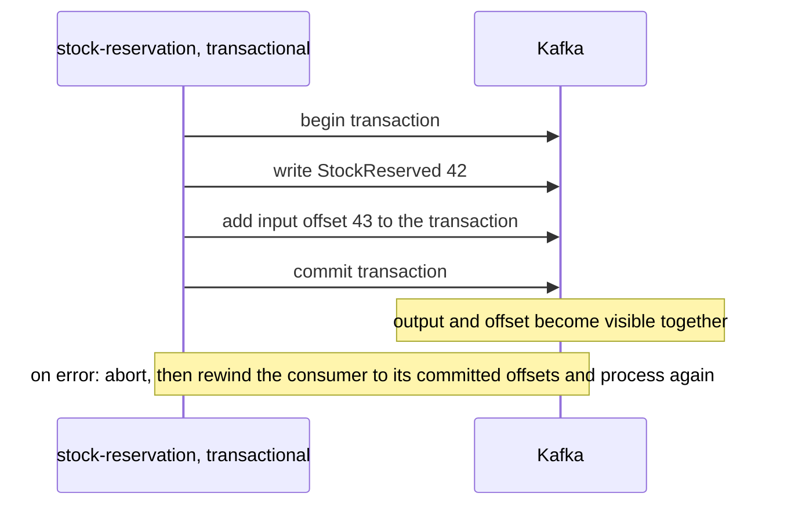

# Idempotent Producer and Transactions (Exactly-Once)

**Messaging · Kafka · Step 2.2.9 · Intermediate** · Last updated 2026-10-21
**Prerequisites:** [Producers](03-producers-keys-acks-batching.md) (2.2.3), [Offset commits](05-offset-commits-delivery-guarantees.md) (2.2.5)

## 1. The concept in simple English

**What is it?** Kafka's **exactly-once** support has two parts: the **idempotent producer**, which stops duplicates caused by retries, and **transactions**, which make "write these output events" and "mark these input events as done" happen together or not at all.

**Why do we need it?** A service that reads from Kafka and writes back to Kafka can crash between writing its output and committing its input offset, producing duplicate output on restart.

**When would I meet it?** Stream processing pipelines (topic in, topic out), Kafka Streams applications, and design discussions where someone says "exactly once".

> [!TIP]
> **Memory hook:** a bank transfer: debit and credit together or not at all, and the old cheque book is cancelled when a new one is issued.

## 2. Mental model: a bank transfer

| In the analogy | In Kafka |
|---|---|
| Debit one account, credit another | Write output events, commit input offsets |
| "Both or neither" | A **transaction** |
| Cancelling the old cheque book | **Fencing** an older producer with the same `transactional.id` |
| Only completed transfers on your statement | Consumers with **`read_committed`** |

**Where the analogy breaks:** a bank transfer stays inside one bank. A Kafka transaction stays **inside Kafka**: a database write or an email sent in the middle is not part of it.

## 3. Industry terms

| Term | Simple meaning | Why it matters | Example | Related terms |
|---|---|---|---|---|
| **Exactly-once semantics (EOS)** | Each input's effect appears once in the output | Within Kafka only | Kafka Streams `exactly_once_v2` | Effectively once |
| **Idempotent producer** | The broker drops duplicates from producer retries, within one producer session | Safe retries; a restart starts a new session | `enable.idempotence=true` | Producer ID, sequence numbers |
| **Transaction** | Writes and offset commits made visible together | No partial results | Output plus offsets | Commit, abort |
| **`transactional.id`** | A stable name for a transactional producer | Enables fencing across restarts | `stock-reservation-0` | Epoch |
| **Fencing** | Rejecting an older producer with the same ID | Stops "zombie" instances writing | `ProducerFencedException` | Epoch |
| **`read_committed`** | Consumers see only committed transactions | Hides aborted output | Downstream consumer setting | `read_uncommitted` |

## 4. In a real system (ShopFlow)

**The business problem.** The stock-reservation pipeline reads `OrderPlaced` and writes `StockReserved`. Each order must produce exactly one reservation event, even when instances crash or are replaced.

It crashed after writing `StockReserved` but before committing the input offset; on restart it read the order again and wrote a second reservation. Another time, an instance froze in a long garbage-collection pause, was replaced, then woke up and kept writing as a **zombie**.



**How transactions help.** Output and input offsets are committed in one transaction; a crash aborts it, so nothing half-done becomes visible. A stable `transactional.id` lets Kafka fence the zombie.

**What it costs.** Output is visible only when the transaction commits (extra latency), more complex code, and it covers nothing outside Kafka.

**Elsewhere:** a Kafka Streams app sums transactions per account into a balance topic with `exactly_once_v2`, so a crash never double-counts; a currency-conversion pipeline uses transactions so restarts don't duplicate converted prices; a team that needs results in PostgreSQL skips Kafka transactions and instead upserts by event ID, storing the offset in the same database transaction.

## 5. How it works



1. **`initTransactions()`**: registers the `transactional.id`, completes any unfinished transaction from a previous instance, and fences older producers with the same ID.
2. **`beginTransaction()`**, then consume and process a batch.
3. **Send** the output events.
4. **`sendOffsetsToTransaction(...)`** adds the consumed offsets to the same transaction (instead of a normal commit).
5. **On success:** `commitTransaction()`; outputs and offsets become visible together.
6. **On failure:** `abortTransaction()`, then **reset the consumer to its last committed offsets** before polling again. Aborting does not move the consumer back by itself; without the reset, the aborted batch would be skipped.
7. Downstream consumers use **`isolation.level=read_committed`** to skip aborted data. The default is `read_uncommitted`, so this must be set explicitly.

Kafka Streams does all of this with `processing.guarantee=exactly_once_v2`.

> [!IMPORTANT]
> Exactly-once covers only **consume from Kafka → process → produce to Kafka**. A database write, an email or an HTTP call made during processing is **not** covered; those still need idempotency or the transactional outbox.

**Who guarantees what**

| Layer | Responsible for |
|---|---|
| Kafka broker and protocol | Deduplicating producer retries; atomic visibility of transactional writes and offsets; fencing |
| Client (or Kafka Streams) | Running the transaction steps; `read_committed` filtering |
| Spring Kafka | Transaction management via `transaction-id-prefix` and a Kafka transaction manager |
| Application | Rewinding after aborts (plain clients), keeping transactions short, handling side effects outside Kafka |
| External systems | Not covered by Kafka transactions |

> [!NOTE]
> Untested sketch to show the shape (plain Java client).

```java
producer.initTransactions();
while (running) {
    var batch = consumer.poll(Duration.ofMillis(500));
    if (batch.isEmpty()) continue;
    producer.beginTransaction();
    try {
        for (var rec : batch) producer.send(new ProducerRecord<>("stock-reserved", rec.key(), reserve(rec.value())));
        producer.sendOffsetsToTransaction(nextOffsets(batch), consumer.groupMetadata());
        producer.commitTransaction();
    } catch (ProducerFencedException fenced) {
        producer.close();                          // a newer instance owns this ID: stop
        break;
    } catch (KafkaException e) {                    // abortable errors; fatal ones (such as authorisation) need close()
        producer.abortTransaction();               // nothing becomes visible
        rewindToCommitted(consumer);               // seek each partition back to its committed offset
    }
}
```

## 6. Failure scenarios

### Crash between output and offset commit

- **What happened?** The story above, without transactions.
- **What the business sees:** duplicate `StockReserved` events.
- **Solutions:** transactions with offsets in the transaction; or idempotent downstream consumers.
- **Trade-offs:** transactions add latency and complexity; idempotent consumers need a deduplication store.

### Abort without rewinding

- **What happened?** A transaction aborted; the loop polled again and continued with new records.
- **Why?** The consumer's in-memory position was already past the aborted batch.
- **What the business sees:** some orders never get a reservation.
- **Solutions:** reset to committed offsets after every abort (or let Kafka Streams or a framework do it).
- **Trade-offs:** the batch is processed again, which is safe: its aborted output was never visible to `read_committed` consumers.

### "Exactly-once" with a database write in the middle

- **What happened?** The pipeline also updated a database row inside the loop; a retry after an abort updated it twice.
- **Why?** The database isn't part of the Kafka transaction.
- **Solutions:** make the database write idempotent, or move it to a separate consumer that uses the outbox or deduplication.
- **Trade-offs:** an extra component or a dedupe table.

## 7. Architectural decisions

| Need | Use | Cost |
|---|---|---|
| Side effects outside Kafka | At-least-once + idempotent consumer ([2.2.5](05-offset-commits-delivery-guarantees.md)) | A dedupe store |
| Topic-to-topic processing | Kafka transactions | Latency, complexity |
| Stream-processing apps | Kafka Streams `exactly_once_v2` | Some throughput and latency |
| Database change and event together | Transactional outbox ([2.2.15](15-kafka-connect-cdc.md)) | Outbox table and relay |

Keep transactions short; `read_committed` consumers see output only after the commit.

**Common mistakes:** believing exactly-once covers databases or HTTP calls; downstream consumers left on `read_uncommitted`; a random `transactional.id` on every start, so zombies are never fenced; the same `transactional.id` on two live instances; long transactions; transactions where an idempotent consumer would be simpler.

## 8. Check your understanding

1. What two problems does the idempotent producer *not* solve on its own?
2. After `abortTransaction()`, a consumer immediately polls again. What goes wrong?
3. A pipeline uses Kafka transactions and also sends an email per order. Is the email exactly-once?
4. Why do downstream consumers need `read_committed`?

Answers are at the end of this note.

## 9. Revision

**Remember**
- **Idempotent producer:** no duplicates from retries. **Transactions:** outputs + offsets all or nothing.
- **Fencing** via a stable `transactional.id` stops zombies.
- After an **abort, rewind** the consumer to its committed offsets.
- Downstream consumers use **`read_committed`**.
- **Exactly-once stops at Kafka's edge.**

**Explain in 15 seconds:** "Kafka exactly-once is an idempotent producer plus transactions that commit outputs and input offsets together, with read_committed consumers and zombie fencing, and it covers only Kafka-to-Kafka processing."

**Explain in 60 seconds:**
> "The idempotent producer stops duplicates from retries. Transactions make output writes and consumed offsets one atomic unit: begin, send, add the offsets with sendOffsetsToTransaction, commit, or abort and rewind the consumer to its committed offsets. Consumers use read_committed so they never see aborted data, and a stable transactional ID with an epoch fences zombie instances. Kafka Streams turns this on with exactly_once_v2. The key limit is the boundary: databases, emails and HTTP calls aren't covered, so for those I use at-least-once with idempotent handling or an outbox."

**Likely follow-up questions:**
- **What is a zombie producer?** An instance that was replaced but is still running; fencing rejects its writes.
- **Exactly-once versus effectively once?** Exactly-once is Kafka's guarantee inside Kafka; effectively once is at-least-once plus idempotent handling, which works across systems.
- **What does it cost?** Latency (output is visible only at commit), some throughput, and complexity.

**Architect's takeaway:** when someone says "exactly once", ask "between which systems?"; Kafka's guarantee holds only inside Kafka.

**Next topic:** [Schemas and evolution](10-schemas-evolution.md) (2.2.10)

## 10. Verification and sources

> [!NOTE]
> Checked 2026-10-21 by web search. Re-verify when you revisit this note.

- **Confirmed:** only one producer per `transactional.id` can be active; zombies are fenced by an epoch; `initTransactions` completes in-progress transactions; the read-process-write pattern adds offsets with `sendOffsetsToTransaction`; `ProducerFencedException` signals another active producer (KIP-98). After `abortTransaction()`, the consumer must be reset to its last committed positions to reprocess the aborted records (Confluent "Handle transactional errors"; SmallRye Kafka transactions guide). Kafka Streams `exactly_once_v2` comes from KIP-447 (introduced as beta in 2.6, renamed in 3.0); the original mode was removed in 4.0. Exactly-once covers only the consume-process-produce cycle inside Kafka.
- **Assumptions and illustrations:** the ShopFlow story; code (not run); `rewindToCommitted` and `nextOffsets` are helper names, not library methods.
- **Also confirmed:** consumers default to `isolation.level=read_uncommitted`; `transaction.timeout.ms` defaults to 60 s, after which the coordinator aborts an open transaction (Apache Kafka configuration; Conduktor configuration reference).
- **To verify:** which parts of KIP-890 shipped in your version.
- **Decision rule:** transactions or Streams EOS for topic-to-topic work; idempotent consumers or the outbox everywhere else.

**Sources:** KIP-98, KIP-447, KIP-732; Confluent documentation, "Handle transactional errors"; Apache Kafka documentation (transactions, Streams processing guarantees).

## Answers

1. It doesn't make "write output + commit input" atomic (a crash between them still duplicates output), and it doesn't stop duplicates your application creates by sending a new record twice.
2. Its position is already past the aborted batch, so those records are skipped. It must seek each partition back to the last committed offset first.
3. No. The email is outside Kafka; an aborted and retried batch can send it again. It needs idempotent handling or a separate, deduplicated step.
4. Without it, consumers can read records from transactions that are later aborted, seeing output that officially never happened.

Back to [the Kafka overview](01-kafka-overview.md) · [Index](../../README.md) · [Roadmap](../../roadmap.md).
