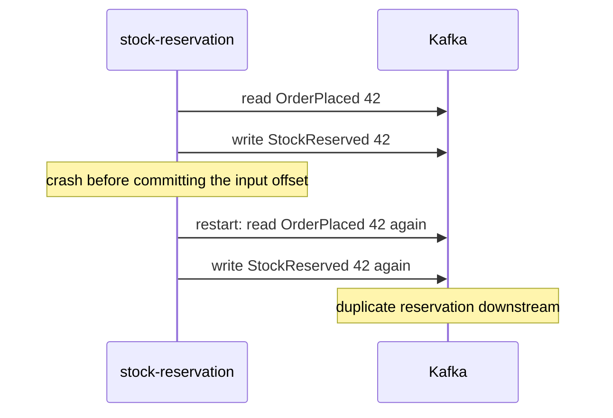
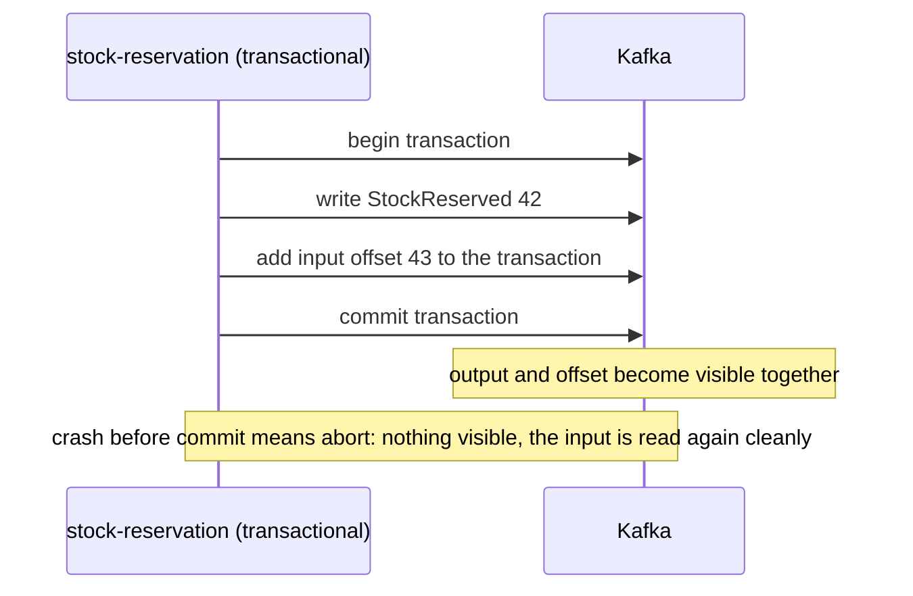

# Idempotent Producer and Transactions (Exactly-Once)

**Messaging · Kafka · Step 2.2.9 · Intermediate** · Last updated 2026-10-21

> [!TIP]
> **In one sentence:** Kafka's exactly-once combines an idempotent producer (no duplicates from retries) with transactions (outputs and consumed offsets saved together, all or nothing), and it only covers work that reads from Kafka and writes back to Kafka.
>
> **Memory hook:** a **bank transfer**. Taking money from one account and adding it to another must happen together or not at all. A Kafka transaction does the same with "write my output events" and "mark the input as done". And the bank cancels any old cheque book once a new one is issued (fencing old producers).

## Where it fits

Step 2.2.9 of the [Kafka series](01-kafka-overview.md). It builds on the idempotent setting from [producers](03-producers-keys-acks-batching.md) (2.2.3), [offset commits](05-offset-commits-delivery-guarantees.md) (2.2.5) and [idempotency](../../01-resilience/04-idempotency.md) in the resilience track. Next: [schemas and evolution](10-schemas-evolution.md) (2.2.10).

## 1. The story

ShopFlow's `stock-reservation` service reads `OrderPlaced` from Kafka and writes `StockReserved` back to Kafka. It sends the output, then commits the input offset. One day it crashes between the two: on restart it reads the order again and writes **a second `StockReserved`**. Another time, an instance freezes in a long garbage-collection pause; the group gives its partitions to a new instance, then the frozen one wakes up and **keeps writing** as a "zombie". Downstream, stock is reserved twice.



## 2. The idea

Make "write the outputs" and "commit the input offset" **one atomic step**: a Kafka **transaction**. Either both happen, or neither. If the service crashes in the middle, the transaction is aborted, and consumers reading with **`read_committed`** never see the half-done output.

Give each producer a stable **`transactional.id`**. When a new instance starts with that ID, Kafka bumps an **epoch** and **fences** the old one: a zombie that wakes up gets an error instead of writing duplicates.



## 3. Key terms

| Term | Plain meaning |
|---|---|
| **Exactly-once semantics (EOS)** | Each input's effect appears once in the output, even with failures |
| **Idempotent producer** | The broker drops duplicates caused by producer retries |
| **Transaction** | A group of writes (and offset commits) that become visible all together or not at all |
| **`transactional.id`** | A stable name for a transactional producer, kept across restarts |
| **Epoch / fencing** | A counter that lets Kafka reject an older ("zombie") producer with the same ID |
| **`read_committed`** | Consumer mode that only sees committed transactions |
| **Consume-process-produce** | Read from topics, transform, write to topics: the pattern transactions protect |

## 4. How it works, step by step

1. **`initTransactions()`**: registers the `transactional.id`, completes any unfinished transaction from a previous instance, and fences older producers with the same ID.
2. **`beginTransaction()`**.
3. **Consume** a batch and **process** it.
4. **Send** the output events.
5. **`sendOffsetsToTransaction(...)`**: add the consumed offsets to the same transaction (instead of a normal commit).
6. **`commitTransaction()`**: outputs and offsets become visible together. On error, **`abortTransaction()`**, and the input will be read again.
7. Downstream consumers use **`isolation.level=read_committed`**, so they skip aborted data and only see committed transactions.

**Kafka Streams** does all of this with one setting: `processing.guarantee=exactly_once_v2`.

> [!IMPORTANT]
> Exactly-once covers only the **read from Kafka, write to Kafka** loop. It does **not** cover a database write, an email or an HTTP call made in the middle. Those still need idempotency (or the transactional outbox).

## 5. Real-world examples

- **Financial aggregations:** a Kafka Streams app sums transactions per account into a balance topic with exactly-once, so a crash never double-counts a payment.
- **Currency conversion pipelines:** an app reads prices in one currency and writes converted prices to another topic; transactions stop duplicates when instances restart or rebalance.
- **Writing to a database:** a team needs results in PostgreSQL, so Kafka transactions don't help; instead they upsert by event ID and store the offset in the same database transaction.

## 6. Design choices and trade-offs

| Need | Use | Cost |
|---|---|---|
| Effects outside Kafka (database, email, APIs) | **At least once + idempotent consumer** (2.2.5) | A dedupe check per event |
| Topic-to-topic processing | **Kafka transactions** | Extra latency (output visible only at commit), more complexity |
| Stream-processing apps | **Kafka Streams `exactly_once_v2`** | Some throughput and latency cost |
| Database change and event together | **Transactional outbox** (microservices track) | An outbox table and a relay |

**Latency:** `read_committed` consumers see output only when the transaction commits, so longer transactions mean more delay. Keep transactions short.

## 7. Common mistakes

1. **Believing exactly-once covers the database or HTTP calls.** It doesn't.
2. **Downstream consumers left on `read_uncommitted`**, seeing data from aborted transactions.
3. **A random `transactional.id` on every start**, so zombies are never fenced.
4. **The same `transactional.id` on two live instances**, so they keep fencing each other.
5. **Long transactions**, adding latency and risking timeouts.
6. **Using transactions where an idempotent consumer is simpler.**

## 8. In code

> [!NOTE]
> Untested sketch to show the shape.

```java
producer.initTransactions();
while (running) {
    ConsumerRecords<String, OrderPlaced> batch = consumer.poll(Duration.ofMillis(500));
    producer.beginTransaction();
    try {
        for (var rec : batch) producer.send(new ProducerRecord<>("stock-reserved", rec.key(), reserve(rec.value())));
        producer.sendOffsetsToTransaction(nextOffsets(batch), consumer.groupMetadata());
        producer.commitTransaction();
    } catch (ProducerFencedException fenced) {
        producer.close();                 // a newer instance owns this ID: stop
        break;
    } catch (KafkaException e) {
        producer.abortTransaction();      // nothing becomes visible; the batch is read again
    }
}
```

```yaml
spring:
  kafka:
    producer:
      transaction-id-prefix: stock-reservation-
    consumer:
      isolation-level: read_committed
```

| Setting | What it controls |
|---|---|
| `enable.idempotence` | No duplicates from producer retries |
| `transactional.id` | Stable identity for transactions and fencing |
| `isolation.level` | Whether consumers see only committed data |
| `processing.guarantee` (Kafka Streams) | `exactly_once_v2` turns it all on |

## 9. Remember

- **Idempotent producer: no duplicates from retries. Transactions: outputs + offsets all or nothing.**
- **Fencing stops zombies**, via a stable `transactional.id` and epochs.
- **Consumers must use `read_committed`.**
- **Exactly-once stops at Kafka's edge**; databases and APIs need idempotency.
- **Kafka Streams: one setting, `exactly_once_v2`.**

## 10. Interview corner

**15-second answer:** "Kafka exactly-once is an idempotent producer plus transactions that commit output and input offsets atomically, with read_committed consumers and zombie fencing; it only covers Kafka-to-Kafka processing."

**60-second answer:**
> "Exactly-once in Kafka has two parts. The idempotent producer stops duplicates from retries. Transactions make the output writes and the consumed offsets one atomic unit: begin, send, add the offsets with sendOffsetsToTransaction, commit, or abort on error. Consumers use read_committed so they never see aborted data, and a stable transactional ID with an epoch fences zombie instances. Kafka Streams turns this on with exactly_once_v2. The key limit is that it covers only consume-process-produce within Kafka; for databases or external APIs I use at-least-once with idempotent consumers or the outbox pattern."

**Likely follow-up questions:**
- **Does exactly-once cover writing to a database?** No. Use idempotent writes, or store offsets in the same database transaction.
- **What is a zombie producer?** An instance that was replaced but is still running; fencing rejects its writes.
- **Why `read_committed`?** Otherwise consumers can read writes from transactions that are later aborted.
- **Exactly-once versus effectively-once?** Exactly-once is Kafka's internal guarantee; effectively-once is at least once plus idempotent handling, which works across systems.
- **What does it cost?** Latency (output visible at commit), throughput and complexity.

**Architect angle:** "I use Kafka transactions or Streams EOS for topic-to-topic pipelines, and at-least-once with idempotent consumers everywhere side effects leave Kafka, and I say which one applies when someone says 'exactly once'."

## 11. Industry check

> [!NOTE]
> Checked 2026-10-21 by web search (KIP-98, KIP-447 and KIP-732 pages, Conduktor, Confluent). Re-verify when you revisit the note.

- **Confirmed:** only one producer per `transactional.id` can be active; zombies are fenced by an epoch; `initTransactions` completes in-progress transactions; the read-process-write pattern adds consumed offsets with `sendOffsetsToTransaction`; `ProducerFencedException` signals another active producer with the same ID; brokers cap transaction timeouts (`max.transaction.timeout.ms`). Kafka Streams `exactly_once_v2` (from KIP-447, introduced as "beta" in 2.6 and renamed in 3.0) is the recommended mode, and the original mode was removed in 4.0. Exactly-once covers only the consume-process-produce cycle inside Kafka; external side effects need application-level idempotency.
- **To verify:** the default `isolation.level` for your client (commonly `read_uncommitted`); which parts of KIP-890 (transaction protocol hardening) shipped in your Kafka version; the default `transaction.timeout.ms`.
- **Decision rule:** Kafka transactions or Streams EOS for topic-to-topic work; idempotent consumers or the outbox for everything else.

## 12. Going further

- KIP-98 (exactly-once delivery and transactional messaging), KIP-447, KIP-732
- Apache Kafka documentation: transactions and Kafka Streams processing guarantees
- *Kafka: The Definitive Guide* (exactly-once semantics)

**Next:** [Schemas and evolution (Avro, Schema Registry)](10-schemas-evolution.md) (2.2.10).

Back to [the Kafka overview](01-kafka-overview.md) · [Messaging overview](../01-messaging-overview.md) · [Index](../../README.md) · [Roadmap](../../roadmap.md).
