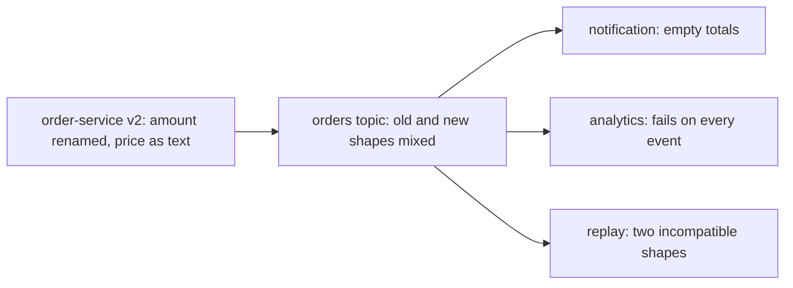
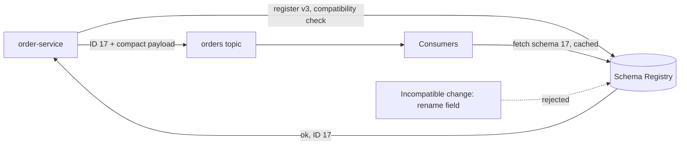

# Schemas and Evolution (Avro, Schema Registry)

**Messaging · Kafka · Step 2.2.10 · Intermediate** · Last updated 2026-10-21

> [!TIP]
> **In one sentence:** a schema is the agreed shape of an event, a schema registry stores every version and checks that changes stay compatible, so producers and consumers can evolve independently without breaking each other.
>
> **Memory hook:** a **standard plug socket**. Appliance makers and house builders never meet, but everything fits because both follow the standard. New appliances can add features, but they can't change the shape of the plug, or every house breaks.

## Where it fits

Step 2.2.10 of the [Kafka series](01-kafka-overview.md). Events are long-lived and read by many teams ([consumer groups](04-consumers-consumer-groups.md), 2.2.4), so their shape is a contract. Bad data that slips through ends up in [dead-letter topics](08-error-handling-retries-dlt.md) (2.2.8). Next: [ordering, partition planning and hot partitions](11-ordering-partition-planning-hot-partitions.md) (2.2.11).

## 1. The story

ShopFlow's `order-service` publishes `OrderPlaced` as plain JSON. One release renames `amount` to `totalAmount` and sends the price as text instead of a number. Nobody tells the consumers. `notification-service` starts sending emails with an empty total, `analytics-service` fails on every event, and when the data team **replays last month's events** after a fix, the old and new shapes are mixed in the same topic.



## 2. The idea

Treat the event shape as a **contract**. Describe it in a **schema** (Avro, Protobuf or JSON Schema) and store every version in a **schema registry**. Before a producer can use a new version, the registry **checks compatibility** with earlier versions; an incompatible change, like renaming a field, is rejected before it reaches production.

Each message carries only a small **schema ID**, not the whole schema. Consumers fetch the schema by ID (and cache it), so they can read any version that is in the topic.



## 3. Key terms

| Term | Plain meaning |
|---|---|
| **Schema** | The formal description of an event's fields and types |
| **Schema evolution** | Changing a schema over time without breaking readers or writers |
| **Schema Registry** | A service storing schema versions and checking compatibility |
| **Subject** | The name a group of schema versions is registered under |
| **Schema ID** | A number written into each message to say which schema it uses |
| **Compatibility mode** | The rule a new version must follow (BACKWARD, FORWARD, FULL, NONE) |
| **Data contract** | The schema plus its rules and owner: the promise a producer makes |
| **Avro / Protobuf** | Compact binary formats with schemas and evolution rules |

## 4. How it works, step by step

1. The producer's serializer takes the event and its schema.
2. It looks up (or registers) the schema in the registry; the registry **checks compatibility** against earlier versions.
3. The registry returns a **schema ID**.
4. The serializer writes a small header (a magic byte `0` and the 4-byte schema ID), then the compact payload.
5. The consumer's deserializer reads the ID, fetches that schema from the registry (once, then cached) and decodes the event.

**Compatibility modes**, and the upgrade order they allow:

| Mode | Guarantee | Upgrade first |
|---|---|---|
| **BACKWARD** (default) | Consumers on the new schema can read data written with the previous one | Consumers |
| **FORWARD** | Consumers on the old schema can read data written with the new one | Producers |
| **FULL** | Both | Either |
| ***_TRANSITIVE** | The same, against **all** earlier versions, not just the last one | As above |
| **NONE** | No checks | You are on your own |

**Safe evolution habits:** add new fields as **optional, with a default**; never rename a field or change its type; deprecate before removing; for a truly breaking change, publish a **new event type or topic** (for example `OrderPlacedV2`) and migrate consumers.

## 5. Real-world examples

- **Many teams, one event:** in a large retailer, dozens of services read `OrderPlaced`. A compatibility check in the producer's build pipeline stops a breaking change before it ships.
- **Data lakes:** years of events must stay readable for analytics and audits, so teams use transitive compatibility to keep every old version decodable.
- **Mobile and gRPC shops:** teams already using Protobuf for APIs use Protobuf schemas for Kafka too, so one schema language covers both.

## 6. Design choices and trade-offs

| Format | Strengths | Weaknesses |
|---|---|---|
| Plain JSON | Readable, no tooling | No contract; breaking changes slip through; larger messages |
| JSON Schema | Readable, with validation | Larger messages; evolution rules less natural |
| **Avro** | Compact, strong evolution rules, common with Kafka | Binary; needs tooling to read |
| **Protobuf** | Compact, widely used with gRPC | Binary; its own evolution rules |

**Choosing a mode:** keep **BACKWARD** (the default) unless you have a reason: it lets you rewind consumers to the start of a topic, and it means you roll out consumers first. Use transitive modes for long-retained or replayed topics.

**Ownership:** the producing team owns the schema; consumers are stakeholders. That is a *data contract*, and it belongs in design reviews.

## 7. Common mistakes

1. **Plain JSON with no contract** between teams.
2. **Setting compatibility to NONE** to "unblock" a release.
3. **Renaming fields or changing types** in place.
4. **Getting the rollout order wrong**: with BACKWARD, upgrade consumers before producers.
5. **Letting every producer auto-register schemas in production**, instead of registering through the build pipeline.
6. **Treating a registry outage as bad data**, sending good events to the DLT (see 2.2.8).

## 8. In code

> [!NOTE]
> Untested sketch to show the shape. Class names follow Confluent's serializers; check versions.

```json
{
  "type": "record", "name": "OrderPlaced", "namespace": "com.shopflow.orders",
  "fields": [
    { "name": "orderId", "type": "string" },
    { "name": "amount", "type": "double" },
    { "name": "currency", "type": "string", "default": "EUR" }
  ]
}
```

The `currency` field was added in a later version, **with a default**, so readers using the new schema can still read older events that don't have it.

```yaml
spring:
  kafka:
    producer:
      value-serializer: io.confluent.kafka.serializers.KafkaAvroSerializer
      properties:
        schema.registry.url: http://schema-registry:8081
        auto.register.schemas: false      # register through the build pipeline instead
```

| Setting | What it controls |
|---|---|
| Serializer / deserializer | Encodes events with the schema ID, decodes with the fetched schema |
| `schema.registry.url` | Where schemas are stored |
| Compatibility mode (per subject) | Which changes the registry accepts |
| Auto-registration | Whether clients may register new versions themselves |

## 9. Remember

- **The event shape is a contract**; the producer owns it.
- **The registry checks compatibility before the change ships.**
- **Messages carry a schema ID, not the schema.**
- **BACKWARD (default): upgrade consumers first.** Transitive for long-lived topics.
- **Add optional fields with defaults; never rename or retype; breaking change = new event.**

## 10. Interview corner

**15-second answer:** "I define events with Avro or Protobuf schemas in a schema registry that enforces compatibility, so producers and consumers can evolve independently without breaking each other."

**60-second answer:**
> "Kafka events are long-lived and read by many teams, so their shape is a contract. I define them with a schema format like Avro or Protobuf and store versions in a schema registry. Each message carries a small schema ID, and consumers fetch and cache the schema. The registry checks every new version against a compatibility mode; I keep the default BACKWARD, which lets consumers on the new schema read older data, so consumers roll out first and topics can be replayed. Safe changes are adding optional fields with defaults; renames, type changes and other breaking changes go into a new event type or topic. Schemas are registered through CI, not by producers at runtime."

**Likely follow-up questions:**
- **BACKWARD versus FORWARD?** BACKWARD: new readers handle old data (upgrade consumers first). FORWARD: old readers handle new data (upgrade producers first).
- **How do you make a breaking change?** A new event type or topic, run both, migrate consumers, then retire the old one.
- **Why not plain JSON?** No enforced contract, so breaking changes reach consumers at runtime; it's also bigger.
- **What's in the message itself?** A magic byte and the schema ID, then the binary payload.
- **What if the registry is down?** Clients cache schemas they've seen; new schemas can't be fetched or registered, so treat it as an outage, not bad data.

**Architect angle:** "I treat event schemas as public APIs: versioned, compatibility-checked in CI, owned by the producer, and reviewed when they change."

## 11. Industry check

> [!NOTE]
> Checked 2026-10-21 by web search (Confluent Schema Registry documentation, serializer docs, third-party wire-format write-ups). Re-verify when you revisit the note.

- **Confirmed:** Confluent Schema Registry's default compatibility is BACKWARD (consumers on schema X can read data written with X or X-1); other modes are BACKWARD_TRANSITIVE, FORWARD, FORWARD_TRANSITIVE, FULL, FULL_TRANSITIVE and NONE; Confluent recommends keeping BACKWARD because it allows rewinding consumers to the beginning of a topic; adding optional fields is allowed under BACKWARD. The wire format is a magic byte `0x00`, a 4-byte big-endian schema ID, then the payload (Protobuf adds message indexes). Confluent Platform offers broker-side schema ID validation.
- **To verify:** the default subject naming strategy (commonly `<topic>-value`); the full table of allowed changes per mode; alternatives such as Apicurio Registry and their wire formats.
- **Decision rule:** schema format + registry for shared events, BACKWARD (transitive for long retention), registration through CI, breaking changes as new event types.

## 12. Going further

- Confluent documentation: "Schema Evolution and Compatibility"
- Apache Avro specification: schema resolution
- Martin Kleppmann, *Designing Data-Intensive Applications* (encoding and evolution)

**Next:** [Ordering, partition planning and hot partitions](11-ordering-partition-planning-hot-partitions.md) (2.2.11).

Back to [the Kafka overview](01-kafka-overview.md) · [Messaging overview](../01-messaging-overview.md) · [Index](../../README.md) · [Roadmap](../../roadmap.md).
