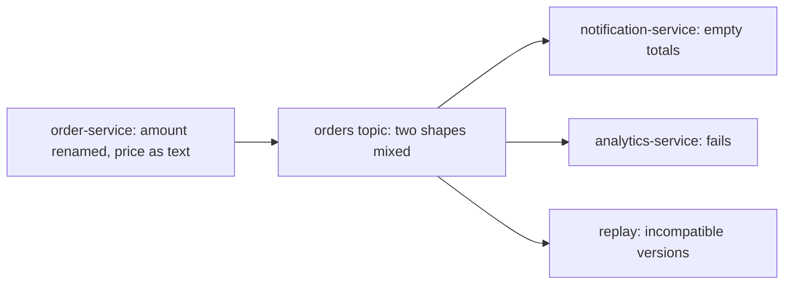
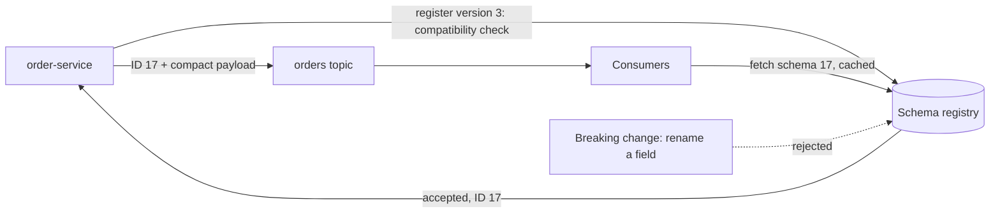

# Schemas and Evolution (Avro, Schema Registry)

**Messaging · Kafka · Step 2.2.10 · Intermediate** · Last updated 2026-10-21
**Prerequisites:** [Producers](03-producers-keys-acks-batching.md) (2.2.3)

## 1. What it is and why it matters

**What is it?** A **schema** is the agreed shape of an event. A **schema registry** stores every version of it and checks that changes stay **compatible**, so producers and consumers can change at different times without breaking each other.

**Why do we need it?** Events are read by many teams and kept for days or years. A careless change by one producer can break every consumer, including ones reading old events.

**When would I meet it?** Adding a field to an event, renaming one, replaying old data, or onboarding a new consumer team.

> [!TIP]
> **Memory hook:** a standard plug socket: add features to the appliance, never change the shape of the plug.

## 2. Mental model: a plug standard

| In the analogy | In Kafka |
|---|---|
| The plug standard | The **schema** |
| The standards body checking new designs | The **schema registry** with a **compatibility mode** |
| A new appliance with extra features | A new schema version with an optional field |
| A plug of a new shape | A breaking change (rename, type change) |

**Where the analogy breaks:** houses don't keep old appliances forever, but Kafka keeps old events; a consumer may have to read many schema versions in the same topic.

## 3. Industry terms

| Term | Simple meaning | Why it matters | Example | Related terms |
|---|---|---|---|---|
| **Schema** | Formal description of an event's fields and types | The contract between teams | Avro record `OrderPlaced` | Data contract |
| **Schema evolution** | Changing a schema without breaking readers or writers | Teams deploy independently | Adding `currency` with a default | Compatibility |
| **Schema registry** | Stores schema versions, checks compatibility | Catches breaking changes before production | Confluent Schema Registry | Subject |
| **Compatibility mode** | The rule a new version must follow | Decides upgrade order | BACKWARD, FORWARD, FULL | Transitive |
| **Schema ID** | A number in each message saying which schema it uses | Messages stay small | ID 17 | Wire format |
| **Data contract** | Schema plus rules and an owner | Treats events like public APIs | `order-service` owns `OrderPlaced` | Schema |

## 4. In a real system (ShopFlow)

**The business problem.** The Order Service team wants to evolve `OrderPlaced` freely, while the Notification and Analytics teams must keep working, including when they replay old events.

With plain JSON, one release renamed `amount` to `totalAmount` and sent the price as text. The Notification Service sent emails with empty totals, the Analytics Service failed on every event, and a replay mixed both shapes in one topic.



**How a registry helps.** The registry rejects the rename before it ships; safe changes (adding an optional field with a default) pass; each message carries a schema ID so consumers can read every version.

**What it costs.** A registry to run (and to keep available), binary formats that need tooling to read, and discipline in how changes are rolled out.

**Elsewhere:** in a large retailer, dozens of services read one event type, and a compatibility check in the producer's build pipeline stops breaking changes; data lakes that keep years of events use transitive compatibility so every old version stays readable; teams already using Protobuf for gRPC APIs use it for Kafka events too.

## 5. How it works



1. **What starts it:** the producer's serializer encodes an event with its schema.
2. It looks up or registers the schema; the registry **checks compatibility** against earlier versions.
3. The registry returns a **schema ID**; the message is written as a magic byte `0`, the 4-byte schema ID, then the payload.
4. The consumer reads the ID, fetches the schema once (then caches it) and decodes.

| Mode | Guarantee | Upgrade first |
|---|---|---|
| **BACKWARD** (default in Confluent Schema Registry) | Consumers on the new schema can read data written with the previous one | Consumers |
| **FORWARD** | Consumers on the old schema can read data written with the new one | Producers |
| **FULL** | Both | Either |
| `*_TRANSITIVE` | The same, against all earlier versions | As above |
| **NONE** | No checks | You are on your own |

> [!NOTE]
> Untested sketch to show the shape.

```json
{ "type": "record", "name": "OrderPlaced", "namespace": "com.shopflow.orders",
  "fields": [
    { "name": "orderId", "type": "string" },
    { "name": "amount", "type": "double" },
    { "name": "currency", "type": "string", "default": "EUR" }
  ] }
```

`currency` was added in a later version **with a default**, so readers on the new schema can still read older events without it.

## 6. Failure scenarios

### A breaking change reaches production

- **What happened?** The rename in the story.
- **Why?** No contract and no automated compatibility check.
- **What the business sees:** wrong emails, broken reports, failed replays.
- **Solutions:** a registry with a compatibility mode; register schemas in the build pipeline; breaking changes become a new event type or topic.
- **Trade-offs:** slower, deliberate changes.

### Wrong rollout order

- **What happened?** Under BACKWARD mode the team removed a field that consumers still read, and upgraded the producer before the consumers; old consumers then met events without that field.
- **Why it hurts:** BACKWARD guarantees new readers can read old data, not that old readers can read new data.
- **Solutions:** upgrade consumers first under BACKWARD (or choose FULL).
- **Trade-offs:** coordinated rollouts.

### The registry is unavailable

- **What happened?** Consumers met a schema ID they hadn't cached and couldn't fetch it.
- **What the business sees:** deserialization failures on every new-version event.
- **Solutions:** highly available registry; treat it as an outage (pause), not as poison messages ([2.2.8](08-error-handling-retries-dlt.md)).
- **Trade-offs:** the registry becomes critical infrastructure.

## 7. Architectural decisions

| Format | Strengths | Weaknesses |
|---|---|---|
| Plain JSON | Readable, no tooling | No enforced contract; larger |
| JSON Schema | Readable with validation | Larger messages |
| **Avro** | Compact, strong evolution rules, common with Kafka | Binary; needs tooling |
| **Protobuf** | Compact, common with gRPC | Binary; its own evolution rules |

Keep **BACKWARD** unless you have a reason: upgraded consumers can read the previous version. Plain BACKWARD checks only against the latest version, so for topics you replay from the start or keep for a long time use **BACKWARD_TRANSITIVE**, which checks against every earlier version. The producing team owns the schema.

**Common mistakes:** plain JSON with no contract; setting compatibility to NONE to unblock a release; renaming or retyping fields in place; the wrong rollout order; every producer auto-registering schemas in production instead of through the build pipeline; treating a registry outage as bad data.

## 8. Check your understanding

1. Under BACKWARD compatibility, which side do you upgrade first, and why?
2. Is adding a required field without a default a safe change for readers of old events? Why?
3. How would you rename a field that many consumers use?
4. Why does each message carry a schema ID instead of the schema?

Answers are at the end of this note.

## 9. Revision

**Remember**
- **The event shape is a contract**; the producer owns it.
- **The registry checks compatibility before a change ships.**
- **BACKWARD (default): upgrade consumers first**; transitive for long-lived topics.
- **Add optional fields with defaults; never rename or retype in place.**
- Messages carry a **schema ID**, not the schema.

**Explain in 15 seconds:** "I define events with Avro or Protobuf schemas in a schema registry that enforces compatibility, so producers and consumers can evolve independently."

**Explain in 60 seconds:**
> "Kafka events are long-lived and shared, so their shape is a contract. I define them with Avro or Protobuf and store versions in a schema registry; each message carries a small schema ID, and consumers fetch and cache the schema. The registry checks every new version against a compatibility mode. I keep BACKWARD, or BACKWARD_TRANSITIVE for topics we replay, so upgraded consumers can read older data, which means consumers are upgraded first. Safe changes are optional fields with defaults; renames and type changes become a new event type."

**Likely follow-up questions:**
- **BACKWARD versus FORWARD?** BACKWARD: new readers handle old data (upgrade consumers first). FORWARD: old readers handle new data (upgrade producers first).
- **How do you make a breaking change?** Publish a new event type or topic, run both, migrate consumers, then retire the old one.
- **Why not plain JSON?** No enforced contract, so breaking changes reach consumers at runtime; messages are also larger.

**Architect's takeaway:** treat event schemas as public APIs: versioned, checked in CI, owned by the producer, reviewed when they change.

**Next topic:** [Ordering, partition planning and hot partitions](11-ordering-partition-planning-hot-partitions.md) (2.2.11)

## 10. Verification and sources

> [!NOTE]
> Checked 2026-10-21 by web search. Re-verify when you revisit this note.

- **Confirmed:** Confluent Schema Registry's default compatibility is BACKWARD (consumers on schema X can read data written with X or X-1); modes include the transitive variants, FORWARD, FULL and NONE; Confluent recommends keeping BACKWARD because it allows rewinding consumers to the beginning of a topic (strictly, only the transitive variant checks against all earlier versions); adding optional fields is allowed under BACKWARD. The wire format is a magic byte `0x00`, a 4-byte big-endian schema ID, then the payload (Protobuf adds message indexes).
- **Assumptions and illustrations:** the ShopFlow story; the schema (not registered).
- **Also confirmed:** the default subject naming strategy is `TopicNameStrategy`: values are registered under `<topic>-value` and keys under `<topic>-key` (Confluent Schema Registry concepts).
- **To verify:** the full table of allowed changes per mode; other registries (for example Apicurio) and their wire formats.
- **Decision rule:** schema format and registry for shared events; BACKWARD (transitive for long retention); registration through CI; breaking changes as new event types.

**Sources:** Confluent documentation, "Schema Evolution and Compatibility"; Apache Avro specification; *Designing Data-Intensive Applications* (encoding and evolution).

## Answers

1. Consumers. BACKWARD guarantees that the new schema can read data written with the previous one, so upgraded consumers can handle both old and new events before producers start writing the new version.
2. No. A reader on the new schema looking at an old event finds no value and no default for the field, so it can't decode it.
3. Add the new field alongside the old one (optional, with a default), migrate consumers, then deprecate and later remove the old field; or publish a new event type and migrate consumers to it.
4. To keep messages small: the schema is stored once in the registry and cached by clients, and the ID says which version to use.

Back to [the Kafka overview](01-kafka-overview.md) · [Index](../../README.md) · [Roadmap](../../roadmap.md).
