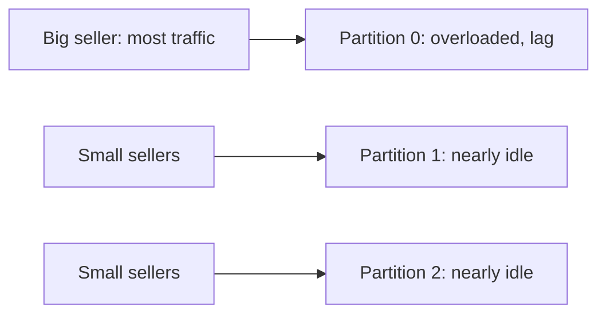
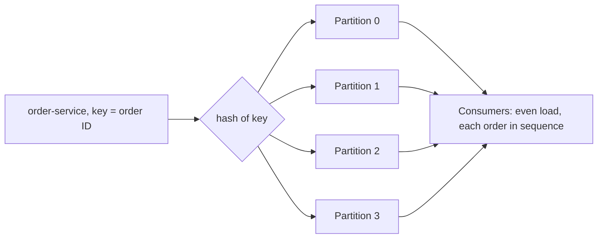

# Ordering, Partition Planning and Hot Partitions

**Messaging · Kafka · Step 2.2.11 · Intermediate** · Last updated 2026-10-21
**Prerequisites:** [The log](02-log-topics-partitions-offsets.md) (2.2.2), [Consumers](04-consumers-consumer-groups.md) (2.2.4), [Error handling](08-error-handling-retries-dlt.md) (2.2.8)

## 1. What it is and why it matters

**What is it?** Three linked decisions: which events must stay in order (the **ordering scope**), which **key** keeps them together, and how many **partitions** the topic needs.

**Why do we need it?** Kafka only orders events within a partition. A poor key breaks business order or overloads one partition; too few partitions cap throughput; changing the count later moves keys.

**When would I meet it?** Designing a new topic, investigating out-of-order processing, or seeing one consumer far behind while others are idle.

> [!TIP]
> **Memory hook:** airport check-in desks: families stay together at one desk, open enough desks for the busiest day, and one 300-person tour group jams a single desk.

## 2. Mental model: check-in desks

| In the analogy | In Kafka |
|---|---|
| A family checking in together | Events with the same **key** |
| A desk | A **partition** |
| Opening more desks later and reshuffling families | **Adding partitions** remaps keys |
| A 300-person tour group at one desk | A **hot key** / **hot partition** |

**Where the analogy breaks:** a family can be split across desks if needed; splitting a key across partitions means its events are **no longer ordered** relative to each other.

## 3. Industry terms

| Term | Simple meaning | Why it matters | Example | Related terms |
|---|---|---|---|---|
| **Ordering scope** | The set of events that must be processed in sequence | Determines the key | Per order | Key |
| **Key cardinality** | How many distinct key values exist | Few values cause skew | Country (low) versus order ID (high) | Skew |
| **Hot partition / hot key** | A partition or key with far more traffic | One consumer falls behind | A huge seller | Key sharding |
| **Key sharding (salting)** | Adding a suffix to a heavy key to spread it | Relieves hot keys | `seller-9#3` | Ordering scope |
| **Key affinity** | A key always mapping to the same partition | Lost when partitions are added | Order 42 → partition 1 | Repartitioning |
| **Sequence number** | A counter in each event | Lets consumers detect gaps or reordering | `sequence: 7` | Idempotency |

## 4. In a real system (ShopFlow)

**The business problem.** Each order's events must be processed in order, and load must spread evenly so stock reservations stay fast on sale days.

ShopFlow keyed `orders` by **seller ID** on 3 partitions. The biggest marketplace seller made one partition hot while the others idled. Then the team added partitions mid-sale; keys moved, and some `OrderCancelled` events overtook their `OrderPlaced`.



**How the decisions help.** The ordering requirement is per order, so the key is the **order ID**: many evenly used values, and each order's events stay together. Partitions are sized from measured throughput so they rarely need to change.

**What it costs.** Events of different orders have no order relative to each other (which is usually fine); a large up-front partition count adds some overhead.

**Elsewhere:** marketplaces that key by seller get hot partitions for the biggest sellers, while keying by order ID spreads load and keeps each order in order; IoT platforms shard a few chatty device keys or give them a dedicated topic; social networks handle accounts with millions of followers on a separate, scaled path.

## 5. How it works



**Keeping order end to end:**
1. **Producer:** same key for events that must stay in order; idempotence on, so retries don't reorder (with up to 5 in-flight requests).
2. **Partition:** the key's events are appended in the order they were sent.
3. **Consumer:** processes each partition in order; if it processes in parallel, it must parallelise **per key**, not per event.
4. **Errors:** retry topics let later events overtake ([2.2.8](08-error-handling-retries-dlt.md)); ordered flows retry in place or pause.
5. **Repartitioning:** for keyed topics, prefer a new, correctly sized topic and a planned migration over adding partitions in place.

**Sizing the partition count:**
1. Choose the target throughput **t**, one to two years ahead.
2. Measure one partition's producer throughput **p** and one consumer's processing throughput **c** (both depend on your settings and code).
3. Partitions ≥ **max(t / p, t / c)**, plus headroom; check the number of consumers you'll run.

> [!NOTE]
> Untested sketch to show the shape.

```java
kafkaTemplate.send("orders", order.id(), event);                 // key by the entity that needs ordering

String key = isHeavy(sellerId)                                      // shard only a genuinely heavy key
    ? sellerId + "#" + Math.floorMod(order.id().hashCode(), 4)      // order then holds only within each shard
    : sellerId;
```

## 6. Failure scenarios

### A hot key overloads one partition

- **What happened?** One seller produced most of the traffic.
- **Why?** All its events hashed to one partition.
- **What the business sees:** slow reservations for that seller's orders (and anyone sharing the partition).
- **Solutions:** key by a higher-cardinality field; shard the heavy key; or give it a dedicated topic.
- **Trade-offs:** sharding gives up ordering across shards of that key.

### Adding partitions breaks ordering

- **What happened?** Partitions were added mid-sale.
- **Why?** The partition is "hash modulo count", so many keys moved.
- **What the business sees:** occasional out-of-order processing for in-flight orders.
- **Solutions:** size ahead; migrate to a new topic deliberately; consumers tolerate reordering with sequence numbers.
- **Trade-offs:** planning effort or a migration.

### Parallel processing reorders events

- **What happened?** A consumer used a thread pool to process events from one partition concurrently.
- **Why?** Later events can finish before earlier ones.
- **Solutions:** process per key on dedicated threads (or a library that preserves per-key order).
- **Trade-offs:** more complex consumer code.

## 7. Architectural decisions

| Ordering needed | Approach | Cost |
|---|---|---|
| None | No key | No ordering |
| **Per entity** | **Entity ID as key** | Usually exactly right |
| Per heavy tenant | Sharded key or dedicated topic | Order only within each shard |
| Global | One partition | No scaling; rarely truly needed |

More partitions never fix a hot key; fix the key. Decide ordering scope, key and partition count in the design review and record them with the topic.

**Common mistakes:** keying by a low-cardinality field (country, seller, status); expecting more partitions to fix a hot key; adding partitions to a keyed topic in production; asking for global ordering when per-entity is enough; parallel processing per event inside a consumer; sizing partitions from a guess.

## 8. Check your understanding

1. How do you get strict ordering across an entire topic, and why is it rarely the right answer?
2. Why don't extra partitions help a hot key?
3. Your topic needs 120 MB/s; one partition handles about 20 MB/s from producers, and one consumer processes about 10 MB/s. How many partitions at minimum?
4. A consumer processes events from one partition in a thread pool. What breaks, and how do you fix it?

Answers are at the end of this note.

## 9. Revision

**Remember**
- **Decide the ordering scope first**, usually per entity.
- **Key = that entity's ID**, with many evenly used values.
- **Partitions ≥ max(t / p, t / c)**, measured, with growth headroom.
- **A hot key stays hot** whatever the partition count.
- **Adding partitions moves keys**; plan instead of patching.

**Explain in 15 seconds:** "I key by the entity whose events must stay in order, size partitions from measured throughput with headroom, and fix hot keys by sharding them or giving them their own topic."

**Explain in 60 seconds:**
> "Kafka orders events only within a partition, so I start from the ordering scope, almost always per entity like per order, and use that ID as the key, checking it has many evenly used values. I size partitions as at least the target throughput divided by measured per-partition producer and consumer throughput, planning a year or two ahead, because adding partitions later moves keys. A hot key isn't fixed by more partitions, so I shard it or route it to its own topic, accepting ordering only within each shard. And I make sure consumers and retries don't reorder what the key kept together."

**Likely follow-up questions:**
- **How do you detect a hot partition?** Uneven per-partition throughput, and lag concentrated on one consumer.
- **What breaks ordering on the consumer side?** Parallel processing per event, and retry topics that move events aside.
- **How do you increase partitions safely for a keyed topic?** Create a new, correctly sized topic and migrate deliberately, rather than adding partitions in place.

**Architect's takeaway:** ordering scope, key and partition count are expensive to change; decide them explicitly and record them.

**Next topic:** [Kafka with Spring Boot](12-kafka-with-spring-boot.md) (2.2.12)

## 10. Verification and sources

> [!NOTE]
> Checked 2026-10-21 by web search. Re-verify when you revisit this note.

- **Confirmed:** Confluent's guidance sizes partitions as at least max(t/p, t/c), with p and c measured, and suggests over-partitioning for growth because adding partitions later breaks key affinity. Hash partitioning only balances load if keys are balanced; common fixes for skew are sharding tags, dedicated topics and time-bucketed keys, at the cost of per-key ordering. Concurrent processing within a partition can complete later work before earlier work. The idempotent producer keeps order with up to 5 in-flight requests.
- **Assumptions and illustrations:** the ShopFlow story; the throughput figures in question 3 are an exercise, not measurements.
- **To verify:** parallel-consumer libraries and their ordering modes; per-partition throughput on your hardware.
- **Decision rule:** ordering scope → key → measured partition count with headroom → special handling for hot keys.

**Sources:** Confluent documentation, "Choose and Change the Partition Count"; Confluent blog, "How to choose the number of topics/partitions"; *Kafka: The Definitive Guide*.

## Answers

1. Use a single partition. It gives total order but no parallelism: one consumer per group and one partition's throughput. Most systems need order only per entity.
2. One key always hashes to one partition, however many partitions exist; the load of that key can't spread.
3. max(120/20, 120/10) = max(6, 12) = **12** partitions, before adding headroom.
4. Events of the same order can finish out of sequence. Process per key: route each key to the same single thread (or use a library that keeps per-key order), and commit offsets only up to the point every earlier event is done.

Back to [the Kafka overview](01-kafka-overview.md) · [Index](../../README.md) · [Roadmap](../../roadmap.md).
