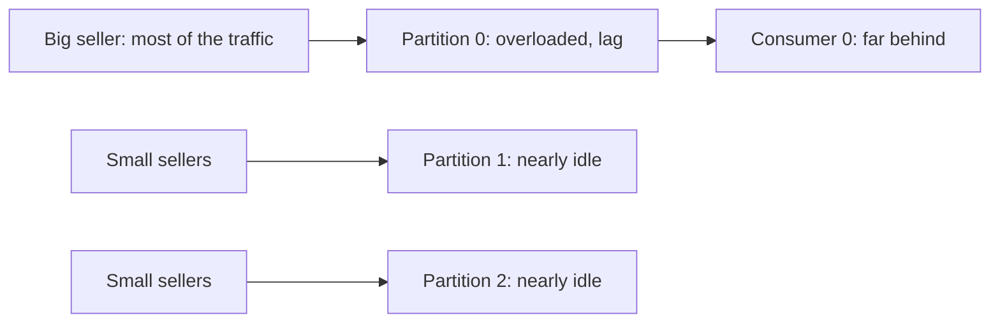
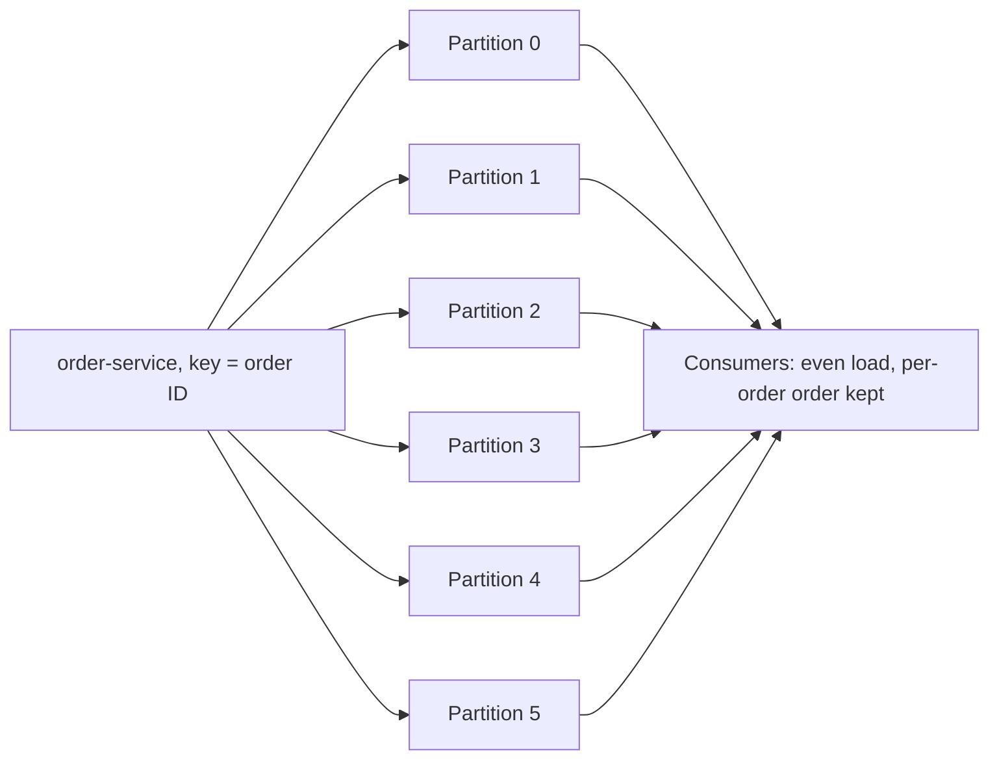

# Ordering, Partition Planning and Hot Partitions

**Messaging · Kafka · Step 2.2.11 · Intermediate** · Last updated 2026-10-21

> [!TIP]
> **In one sentence:** decide which events must stay in order, pick a key that keeps exactly those together, size partitions from measured throughput, and watch for keys so busy that one partition does all the work.
>
> **Memory hook:** **airport check-in desks**. Families (a key) stay together at one desk, so they're served in order. Open enough desks for the busiest day, because adding desks later reshuffles who goes where. And if one tour group of 300 people (a hot key) arrives at one desk, that desk jams while others sit empty.

## Where it fits

Step 2.2.11 of the [Kafka series](01-kafka-overview.md). It pulls together [the log and partitions](02-log-topics-partitions-offsets.md) (2.2.2), [producers](03-producers-keys-acks-batching.md) (2.2.3), [consumer groups](04-consumers-consumer-groups.md) (2.2.4) and the reordering risk of [retry topics](08-error-handling-retries-dlt.md) (2.2.8) into one design decision. Next: [Kafka with Spring Boot](12-kafka-with-spring-boot.md) (2.2.12).

## 1. The story

ShopFlow created `orders` with 3 partitions, keyed by **seller ID**. Two things went wrong. First, a big marketplace seller produces most of the traffic, so its partition is overloaded while the other two are almost idle: a **hot partition**, with lag on only one consumer. Second, to "add capacity" the team raised the partition count during the sale; keys moved to new partitions, and for orders in flight, `OrderCancelled` overtook `OrderPlaced`.



## 2. The idea

Make three decisions on purpose, before go-live:

1. **Ordering scope:** what really must stay in order? Almost always **per entity** (per order, per account), not per seller and never the whole topic.
2. **Key:** the key that matches that scope, with **many, evenly used values**. Here, the **order ID**, not the seller ID.
3. **Partition count:** from measured throughput, sized for growth, so you rarely need to add partitions.

For a key that is genuinely huge (one tenant much bigger than all others), **shard the key** (for example `sellerId#3`) or give it a **dedicated topic**, accepting that its events are only ordered within each shard.



## 3. Key terms

| Term | Plain meaning |
|---|---|
| **Ordering scope** | The set of events that must be processed in sequence (per order, per account) |
| **Key cardinality** | How many different key values there are |
| **Skew** | Uneven traffic across partitions |
| **Hot partition / hot key** | A partition (or key) receiving far more traffic than the rest |
| **Key sharding (salting)** | Adding a suffix to a heavy key to spread it over several partitions |
| **Key affinity** | A key always mapping to the same partition (lost when partitions are added) |
| **Sequence number** | A counter in each event so consumers can detect gaps or reordering |

## 4. How it works, step by step

**Keeping order end to end:**
1. **Producer:** same key for events that must stay in order; idempotence on, so retries don't reorder.
2. **Partition:** the key's events land in one partition, in the order sent.
3. **Consumer:** process each partition's events in order. If you process in parallel inside a consumer, parallelise **per key**, not per event.
4. **Errors:** retry topics can let later events overtake earlier ones (2.2.8); when order matters, retry in place or pause.
5. **Repartitioning:** adding partitions moves keys; for keyed topics, prefer a **new topic** with the right size and a planned migration.

**Sizing the partition count:**
1. Decide the target throughput **t** (plan one to two years ahead).
2. Measure what **one partition** can take on the producer side (**p**) and what one consumer can process from one partition (**c**). Both depend on your settings and code, so measure.
3. Partitions needed is at least **max(t / p, t / c)**.
4. Add headroom; check consumer parallelism (members can't exceed partitions).

## 5. Real-world examples

- **Marketplaces:** keying by seller creates hot partitions for the biggest sellers; keying by order ID spreads load and still keeps each order's events in order.
- **IoT platforms:** a few very chatty devices dominate traffic; teams shard those device keys or route them to a dedicated topic.
- **Social media:** an account with millions of followers creates a hot key when its posts are fanned out; its events are handled by a separate, scaled path.

## 6. Design choices and trade-offs

| Ordering needed | Approach | Cost |
|---|---|---|
| None | No key: spread evenly | No ordering at all |
| **Per entity** (order, account) | **Entity ID as key** | Ordering only per entity (usually exactly right) |
| Per heavy tenant | Sharded key (`tenant#N`) or dedicated topic | Order only within each shard; more complexity |
| Global (everything in one sequence) | One partition | No scaling; rarely truly needed |

**More partitions don't fix a hot key:** one key always goes to one partition, however many there are. Fix the key instead.

**Over-partitioning versus later repartitioning:** a little extra now is cheap; adding partitions later breaks key affinity for keyed topics.

## 7. Common mistakes

1. **Keying by a low-cardinality field** (country, seller, status), creating hot partitions.
2. **Assuming more partitions fix a hot key.**
3. **Adding partitions to a keyed topic in production** without planning for keys moving.
4. **Asking for global ordering** when per-entity ordering is enough.
5. **Parallel processing inside a consumer per event**, silently breaking order.
6. **Sizing partitions from a guess** instead of measured throughput.

## 8. In code

> [!NOTE]
> Untested sketch to show the shape.

```java
// Key by the entity whose events must stay in order
kafkaTemplate.send("orders", order.id(), event);

// Heavy tenant: shard its key; ordering then holds only within each shard
String key = isHeavy(sellerId) ? sellerId + "#" + Math.floorMod(order.id().hashCode(), 4) : sellerId;
```

```java
// Event with a per-entity sequence number, so consumers can detect gaps or reordering
public record OrderEvent(String orderId, long sequence, String type, Instant at) { }
```

| Setting or choice | What it controls |
|---|---|
| Key | Ordering scope and load spread |
| Partition count | Parallelism; hard to change for keyed topics |
| `enable.idempotence` | Order kept across producer retries |
| Consumer concurrency | Must not exceed partitions; parallelise per key, not per event |

## 9. Remember

- **Decide the ordering scope first**: usually per entity.
- **Key = that entity's ID, with many evenly used values.**
- **Partitions ≥ max(t / p, t / c)**, measured, sized for growth.
- **A hot key stays hot whatever the partition count**: shard it or give it its own topic.
- **Adding partitions moves keys**: plan instead of patching.

## 10. Interview corner

**15-second answer:** "I key by the entity whose events must stay in order, size partitions from measured throughput with growth headroom, and fix hot keys by sharding them or giving them their own topic."

**60-second answer:**
> "Kafka orders events only within a partition, so I start from the ordering scope, which is almost always per entity, like per order or per account, and use that ID as the key, making sure it has many evenly used values. I size partitions as at least the target throughput divided by the measured per-partition producer and consumer throughput, planning a year or two ahead, because adding partitions later moves keys and can break ordering. If one key is much hotter than the rest, more partitions won't help, so I shard that key or route it to its own topic, accepting ordering only within each shard. And I make sure consumers and retries don't reorder what the key kept together."

**Likely follow-up questions:**
- **How do you get global ordering?** One partition, which doesn't scale; usually per-entity ordering is what's really needed.
- **Why don't more partitions fix a hot key?** One key always maps to one partition.
- **How do you increase partitions safely for a keyed topic?** Create a new, correctly sized topic and migrate, rather than adding partitions in place.
- **What breaks ordering on the consumer side?** Parallel processing per event, and retry topics that move events aside.
- **How do you detect a hot partition?** Uneven per-partition throughput and lag concentrated on one consumer.

**Architect angle:** "Ordering scope, key and partition count are expensive to change, so I decide them explicitly in the design review and record them with the topic."

## 11. Industry check

> [!NOTE]
> Checked 2026-10-21 by web search (Confluent documentation and blog, Conduktor, partitioning guides). Re-verify when you revisit the note.

- **Confirmed:** Confluent's guidance sizes partitions as at least max(t/p, t/c), with p and c measured per partition (producer throughput depends on batch size, compression, acks and replication factor; consumer throughput depends on your processing code), and suggests over-partitioning for throughput one to two years out because adding partitions later breaks key affinity. Hash partitioning only balances load if keys are balanced; common fixes for skew are sharding tags (`customerId#N`), dedicated topics for heavy tenants and time-bucketed keys, at the cost of per-key ordering. Concurrent processing within a partition can complete later work before earlier work.
- **To verify:** the ordering modes of parallel-consumer libraries (for example Confluent's Parallel Consumer) before relying on one; per-partition throughput figures on your own hardware.
- **Decision rule:** ordering scope → key → measured partition count with headroom → special handling for hot keys.

## 12. Going further

- Confluent documentation, "Choose and Change the Partition Count in Kafka"
- Confluent blog, "How to choose the number of topics/partitions in a Kafka cluster"
- *Kafka: The Definitive Guide* (partitions and ordering)

**Next:** [Kafka with Spring Boot](12-kafka-with-spring-boot.md) (2.2.12).

Back to [the Kafka overview](01-kafka-overview.md) · [Messaging overview](../01-messaging-overview.md) · [Index](../../README.md) · [Roadmap](../../roadmap.md).
