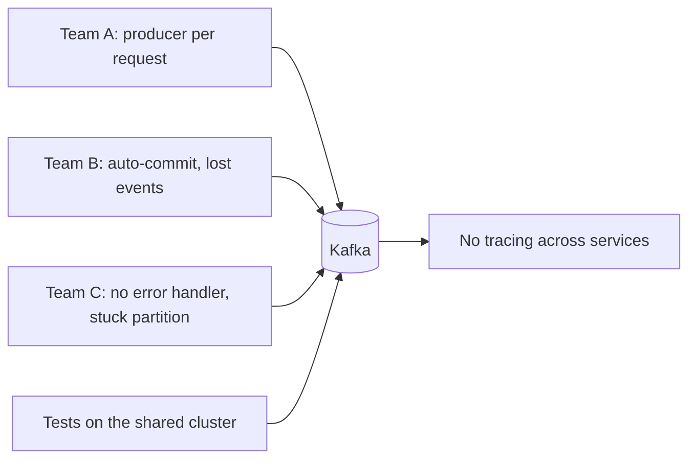
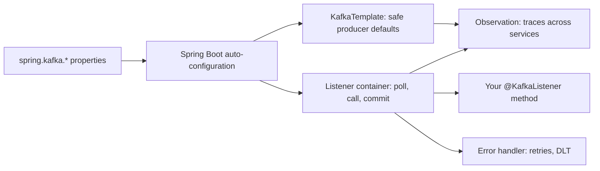

# Kafka with Spring Boot

**Messaging · Kafka · Step 2.2.12 · Intermediate** · Last updated 2026-10-21

> [!TIP]
> **In one sentence:** Spring Boot auto-configures Kafka from `spring.kafka.*` properties, gives you a `KafkaTemplate` to send and `@KafkaListener` to receive, and lets you plug in the error handling, commit mode, tracing and tests from the earlier notes as configuration instead of hand-written plumbing.
>
> **Memory hook:** a **fully equipped rental kitchen**. The stove, fridge and knives are already installed (auto-configuration); you bring the recipe (your listener code) and adjust the settings (properties). You don't build a stove every time you cook.

## Where it fits

Step 2.2.12, the last intermediate note of the [Kafka series](01-kafka-overview.md). It puts the earlier decisions into one Spring setup: [producer safety](03-producers-keys-acks-batching.md), [consumer groups](04-consumers-consumer-groups.md), [commit mode](05-offset-commits-delivery-guarantees.md), [error handling and DLTs](08-error-handling-retries-dlt.md), [transactions](09-idempotent-producer-transactions.md) and [schemas](10-schemas-evolution.md). Next: [retention, log compaction and tiered storage](13-retention-compaction-tiered-storage.md) (2.2.13), the start of the advanced level.

## 1. The story

At ShopFlow, every team wired Kafka differently. One service created a new producer for every request. Another left auto-commit on and lost events on crashes. A third had no error handler, so one bad message blocked a partition. Tests ran against the shared development cluster and broke each other. And when a customer asked "where is my order?", nobody could follow the order across services, because nothing linked a message to the request that sent it.



## 2. The idea

Use one standard Spring Boot setup, with company defaults decided once:

- **Auto-configuration** builds the producer, consumer and listener infrastructure from `spring.kafka.*` properties.
- **`KafkaTemplate`** sends events (one shared, thread-safe producer underneath).
- **`@KafkaListener`** methods receive events; a **listener container** runs the poll loop, calls your method, commits offsets and calls the **error handler**.
- **Observation** links each message to the trace of the request that sent it.
- **Tests** run against an embedded or containerised broker, not a shared cluster.



## 3. Key terms

| Term | Plain meaning |
|---|---|
| **`spring.kafka.*`** | Spring Boot properties that configure Kafka clients |
| **`KafkaTemplate`** | Spring's helper for sending events |
| **`@KafkaListener`** | Marks a method that receives events |
| **Listener container** | Runs the consumer's poll loop and calls your listener |
| **Container factory** | Builds listener containers with shared settings (concurrency, error handler, ack mode) |
| **Concurrency** | Number of consumers a container runs in this instance |
| **Observation** | Micrometer instrumentation for metrics and traces |
| **`@EmbeddedKafka`** | An in-process test broker from `spring-kafka-test` |

## 4. How it works, step by step

1. Add `spring-kafka` and set `spring.kafka.bootstrap-servers` plus producer and consumer properties.
2. Spring Boot auto-configures a `KafkaTemplate`, consumer and producer factories, and a listener container factory.
3. Declared `NewTopic` beans are created at startup (an existing topic is left alone).
4. Each `@KafkaListener` gets a container: it polls, calls your method per record (or per batch), commits according to the **ack mode**, and passes failures to the **error handler**.
5. `concurrency = N` runs N consumers in this instance; each is a group member, so N across all instances should not exceed the partitions.
6. With observation enabled on the template and the containers, sends and receives become spans in a trace.
7. Integration tests start an embedded or containerised broker and test the real flow.

Properties that Spring Boot doesn't expose by name go through the `spring.kafka.properties.*` map, which passes them straight to the Kafka client.

## 5. Real-world examples

- **Platform starters:** a company publishes an internal Spring Boot starter with its Kafka defaults (safe producer profile, manual ack, error handler with DLT, tracing on), so every team gets them by adding one dependency.
- **Order tracing:** with observation on, an order's trace runs from the HTTP request through `OrderPlaced` to the payment and email consumers, so support can see where an order stopped.
- **CI pipelines:** each build starts a throwaway Kafka for integration tests, so tests never touch shared environments.

## 6. Design choices and trade-offs

| Choice | Option A | Option B |
|---|---|---|
| Test broker | `@EmbeddedKafka`: fast, in-process | Testcontainers: a real broker image, closer to production, slower to start |
| Listener style | Record listener: simple, per-record errors, observation supported | Batch listener: higher throughput; observation not supported, errors per batch |
| Scaling | More `concurrency` per instance | More instances (pods) |
| Abstraction | Spring Kafka: full Kafka features | Higher-level abstractions (for example Spring Cloud Stream): portable, but hide Kafka specifics |

**Company defaults worth fixing once:** safe producer settings, auto-commit off with a deliberate ack mode, an error handler with a DLT, schema serializers, observation on, and consumer concurrency planned against partitions.

## 7. Common mistakes

1. **Creating producers by hand** instead of using the shared `KafkaTemplate`.
2. **Ignoring the result of `send`.**
3. **Leaving auto-commit on** for business events.
4. **No error handler configuration**, so failures behave in surprising default ways.
5. **Blocking calls without timeouts inside listeners.**
6. **Concurrency × instances greater than partitions.**
7. **Integration tests against shared clusters.**

## 8. In code

> [!NOTE]
> Untested sketch to show the shape. Property names differ slightly between Spring Boot versions.

```yaml
spring:
  kafka:
    bootstrap-servers: kafka:9092
    producer:
      acks: all
      properties:
        enable.idempotence: true
    consumer:
      group-id: notification-service
      enable-auto-commit: false
      auto-offset-reset: earliest
    listener:
      ack-mode: record
      concurrency: 3
```

```java
@Service
class OrderEvents {
    private final KafkaTemplate<String, OrderPlaced> template;
    OrderEvents(KafkaTemplate<String, OrderPlaced> template) { this.template = template; }

    void publish(OrderPlaced e) {
        template.send("orders", e.orderId(), e)
                .whenComplete((r, ex) -> { if (ex != null) log.error("send failed", ex); });
    }
}

@KafkaListener(topics = "orders", groupId = "notification-service")
void onOrder(OrderPlaced e) { email.sendConfirmation(e); }      // errors go to the configured error handler
```

```java
@SpringBootTest
@EmbeddedKafka(partitions = 3, topics = "orders")
class OrderFlowTest { /* send an OrderPlaced, assert the email was sent */ }
```

| Setting | What it controls |
|---|---|
| `spring.kafka.bootstrap-servers` | Where the cluster is |
| `spring.kafka.producer.*` / `consumer.*` | Client settings from the earlier notes |
| `spring.kafka.listener.ack-mode` | When offsets are committed |
| `spring.kafka.listener.concurrency` | Consumers per instance |
| `spring.kafka.properties.*` | Any other Kafka client setting |

## 9. Remember

- **Properties in, beans out:** Boot builds the Kafka plumbing.
- **One shared `KafkaTemplate`**; always handle send results.
- **Listener container = poll loop + commits + error handler.**
- **Concurrency × instances ≤ partitions.**
- **Observation on, real broker in tests.**

## 10. Interview corner

**15-second answer:** "Spring Boot auto-configures Kafka from spring.kafka properties; I send with KafkaTemplate, receive with @KafkaListener, and set commit mode, error handling, tracing and tests as standard configuration."

**60-second answer:**
> "With Spring Boot, Kafka is configured through spring.kafka properties, and Boot auto-configures the KafkaTemplate and listener container factory. I send with the shared KafkaTemplate and handle the send result, and receive with @KafkaListener methods that run in a listener container: it polls, calls my method, commits per the ack mode, and passes failures to the error handler, which I configure with retries and a dead-letter topic. Concurrency per instance times instances stays within the partition count. I enable observation so messages are part of distributed traces, and test with an embedded broker or Testcontainers. On a platform level I'd package these defaults in an internal starter."

**Likely follow-up questions:**
- **What does the listener container do?** Runs the poll loop, invokes the listener, commits offsets and handles errors.
- **How do you scale a Spring Kafka consumer?** Concurrency per instance and more instances, up to the partition count.
- **How do you test Kafka code?** `@EmbeddedKafka` for speed, or a containerised broker for realism.
- **How do you trace a message across services?** Enable observation on the template and listener containers so trace context travels with the message.
- **How do you set a property Spring Boot doesn't expose?** The `spring.kafka.properties.*` map.

**Architect angle:** "I standardise Kafka usage in a shared starter with safe defaults, so every team gets the same durability, error handling and tracing without re-deciding them."

## 11. Industry check

> [!NOTE]
> Checked 2026-10-21 by web search (Spring Boot reference, Spring for Apache Kafka reference). Re-verify when you revisit the note.

- **Confirmed:** Spring Boot configures Kafka through `spring.kafka.*`, auto-configures `KafkaTemplate`, creates `NewTopic` beans at startup (existing topics are left alone), supports all high-importance Kafka properties (others through the `spring.kafka.properties` map), and documents `@EmbeddedKafka` from `spring-kafka-test` for tests. In Spring Kafka, observation is enabled by setting `observationEnabled` on the `KafkaTemplate` and the container properties (which replaces the plain Micrometer timers), and Micrometer observation does not support batch listeners. The Spring Boot reference pages listed 4.1.x as the latest stable line at the time of checking.
- **To verify:** the Spring Boot property names for enabling observation; using Testcontainers' Kafka container with Spring Boot's service connections; the current state of higher-level abstractions such as Spring Cloud Stream.
- **Decision rule:** one shared starter with safe defaults, record listeners unless throughput demands batches, observation on, real brokers in tests.

## 12. Going further

- Spring Boot reference: "Apache Kafka Support"
- Spring for Apache Kafka reference: listener containers, error handling, observation
- Testcontainers documentation: Kafka module

**Next:** [Retention, log compaction and tiered storage](13-retention-compaction-tiered-storage.md) (2.2.13), the start of the advanced level.

Back to [the Kafka overview](01-kafka-overview.md) · [Messaging overview](../01-messaging-overview.md) · [Index](../../README.md) · [Roadmap](../../roadmap.md).
